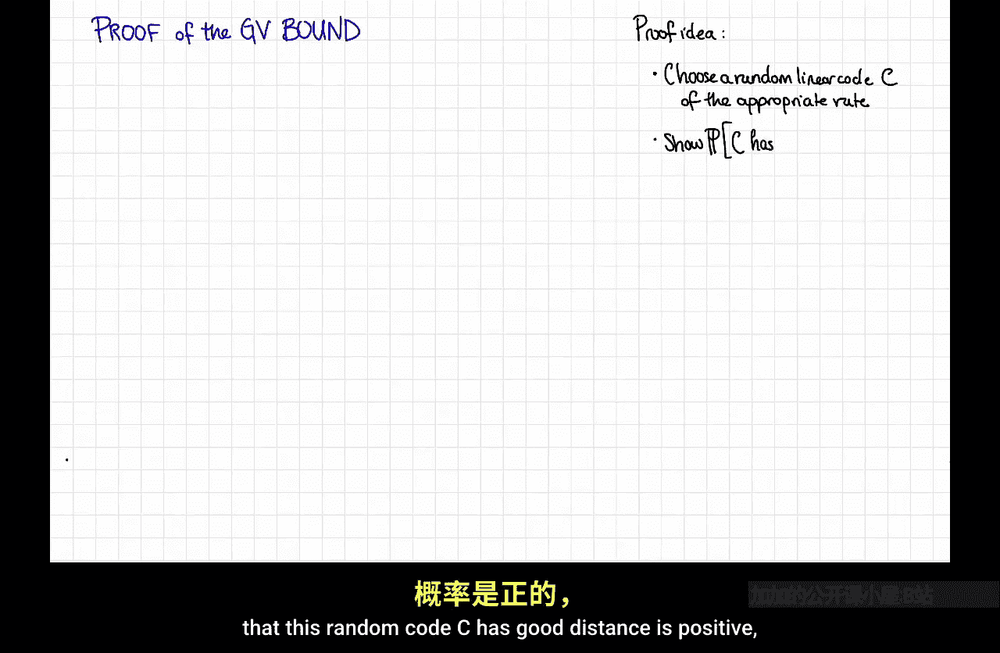
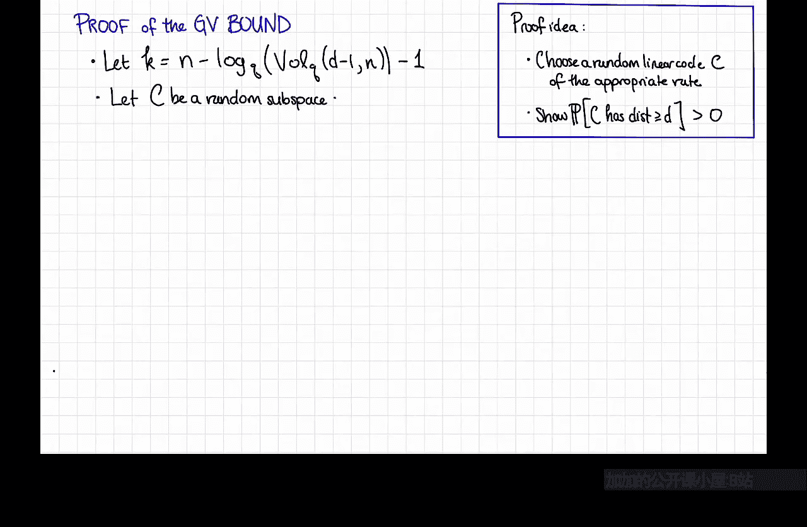

# 斯坦福大学【中英⚡代数编码导论｜Introduction to Algebraic Coding Theory】 p08 p7 3, Video 1： GV Bound -BV16sRYYTEwg_p8-

In this video， we will see one nice result that follows from the linear algebraic view we developed last time called the Gilbert Vsashov or G V Bo。

😊，The G V bound establishes the existence of codes with a good trade off between rate and distance。

Here's the statement of the Gilbert Farshanov Bo。It says that for any prime power Q and for any N and D。

 so that D is less than or equal to n。There exists a linear code C。That has length， N。

 alphabet size Q and distance D。And rate R remember that's k divided by n。

 which is at least this expression 1 the log base Q of the curary volume of the heming ball of radius D-1 in n dimensional space。

-1 all divided by n。This is the version of the theorem that will prove with prime power and linear here。

 but in fact， the statement is also true without those things。

Let's compare this to the heming bound that we saw before。The haming bound says that for any code C。

With length， N and distance D and alphabet size Q， the rate R of that code is at most。

Something that looks a lot like this。 It was1 minus。

The log base Q of the Qary volume of the hamming ball of radius D-1 over 2。

 the floor of that in n dimensional space。All divided by n。

So there are a few differences between the Gilbert Varsheov Bo and the Hamming bound。

The most important difference is that these inequalities are going the opposite way。That is。

 the heming bound is an impossibility result。 It says that we cannot come up with a code with rate that is too large。

On the other hand， the Gilbert Varsheov found is a possibility result。

 It says that there exists codes with decent rate。The second difference between these two bounds is。

This here， the difference between D -1 and D -1 over 2。If we ignore this little -1 here。

 which doesn't really matter because it's getting divided by n and we think of n as kind of large。

 that's the main quantitative difference between these two expressions。

Both of these expressions might be pretty inscrutable。

 Like what is the log base cu of the Q R volume of a handming ball of a particular radius。

But we're going to return to them later。For now， just pause the video and convince yourself that this thing。

Is smaller than this thing。That is good because if it were the other way around。

 then math would be broken。 This would be a contradiction。For the rest of this video。

 let's prove the Gilbert Vrsshlooff found。Here's the proof idea。

We're going to choose a random linear code C of the appropriate rate。

And then we're going to show that the probability that this random code C has good distance。

Is positive strictly greater than  zero。That will imply that there exists a code that has that good distance。

 because if we draw a random one with some positive probability， we'll get it。

This approach is called the probabilistic method。 It shows up a lot， in coding theory。Okay。

 so let's get started。First， let K be equal to n minus the log base Q of the Q area volume。

Of a heming ball of radius D minus1 in Fq to the n。-1。Notice that if we choose K like this。

 then K divided by n is exactly that rate expression that was in the statement of the G B bound。

Now we're going to choose a random linear code C。Of dimension K。

That is， C is going to be a uniformly random subspace of F Q to the N。

Notice that there are only finitely many subspaces of F Q to the N because everything in sight is finite。

 So just pick a uniformly random one of them。 That's what I mean by a uniformly random subspace。Now。

 let G an F Q to the n by K be a random generator matrix for C。That is， as we discussed before。

 a code might have multiple generator matrices。 Just pick one of them at random。 Essentially。

 this is taking a random basis for the subspace C。And using that for the columns of G。Okay。

 now we have this random subspace and our goal is to show that it has distance at least D with nonze probability。

To do this， let's record a useful fact。The useful fact is that for any fixed。X， that's non0。

The vector G times x for this random matrix G。Is uniformly distributed。In F Q to the n， except for0。

That is， if I fix some x， any non0 x， and I multiply it by my random matrix。

 I'm going to get some random vector， and this useful fact is saying that that random vector is equally likely to be any non zero thing in Fq to the n。

For an informal proof of this useful fact， Well， there's so much symmetry going on。 Like。

 how could it be anything other than uniformly distributed。

But it's a good exercise to prove this useful fact formally。

 and I encourage you to stop the video now and give it a try。Okay。

 hopefully you now believe the useful fact。 So let's carry on with our proof。 Remember。

 we want to show that the distance of this random code C is at least D with nonze probability。

So let's compute the distance of this code C。So the distance of our code C because it's a linear code。

Is the minimum weight of any nonze code word？And another way of writing that is that this is the minimum。

Over all， X。In F Q to the K， except 0。Of the weight of g times x。Now we can use our fact。

For any fixed x， that's non0。The probability。That the weight of G times x is less than D。Well。

 this is the probability that G times X lands in the handming ball。Of radius D-1 about the center 0。

Actually， I think my notation may be headed the other way around。Okay， either way。

 you know what I mean， the hamming ball centered at 0 of radius d -1。So why is this true？Well。

 this is just the set of all vectors of weight less than D。 And that's exactly what this says。Okay。

 well， what is this probability。By the useful fact， this vector is uniformly distributed。

 So that means the probability that it lands in this ball。

Is basically just the volume of that heming ball divided by the volume of the whole space。

So this is the Qary volume。At the heming ball of radius D-1。In n dimensional space。

 I guess -1 because we're not including 0 divided by the number of points it could possibly be。

 which is Q to the n-1。And just to make things a little bit easier， I'm going to ignore those ones。

 So I'll just say that this is less than or equal。To the Qary volume。

Of the hemingball of radius D-1 in F Q to the n， divided by  Q to the n。Actually， to save space。

 I'm just going to do that in line。So erase those ones and change that equal to a less than or equal to。

Okay， so now we want to know the probability that there is any x so that the weight of G times x is less than D。

 Well， let's do the union bound， so。By the union bound。

The probability that there exists some x in F Q to the K， other than 0。

Such that the weight of G times X is less than D。 Well。

 this is less than their equal to the number of such X times the probability。

That this event occurs for that ex。How many x are there， Well， there's at most Q to the K of them。

 Actually， there's  Q to the K - one of them。And then I'm just going to copy down this probability。

At this point， what we want to show is that this probability here。Is strictly less than one。Indeed。

 if we could show this。Then that would mean that the probability that our code does not have good distance is strictly less than one。

 And so therefore， the probability that our code has good distance is strictly greater than 0。

And that will imply that there exists a code with good distance and will be done。

 So let's see if this is true。So let's take the log base Q of both sides。

 and we see that we need K minus n。Plus， the log base Q。Of the Qary volume。

Of the ball of radius D-1 in n dimensional space。Should be strictly less than。0。

Or moving things around。We want to know， is K strictly less than n minus the log base Q of the  QR volume of the hemingwell of radius D -1。

And in fact， it is because conveniently， we chose K to be precisely that -1。So， therefore。

 this is true。Yes。So this one's true， too。Yes。😊，And therefore。

 the probability that this random linear code， this random K dimensional subspace。

 has distance at least D is strictly greater than 0。 Therefore， such a code exists。

So that proves that Gilbert Varheov bound。So returning to the statement here。

 we can put a check there。Now， we know that there exist， at least decent linear codes。

This formula is still pretty hard to parse， though。

We'll return to it in a later video to try to make sense of it。

