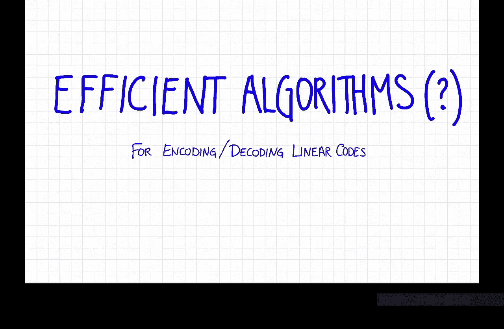
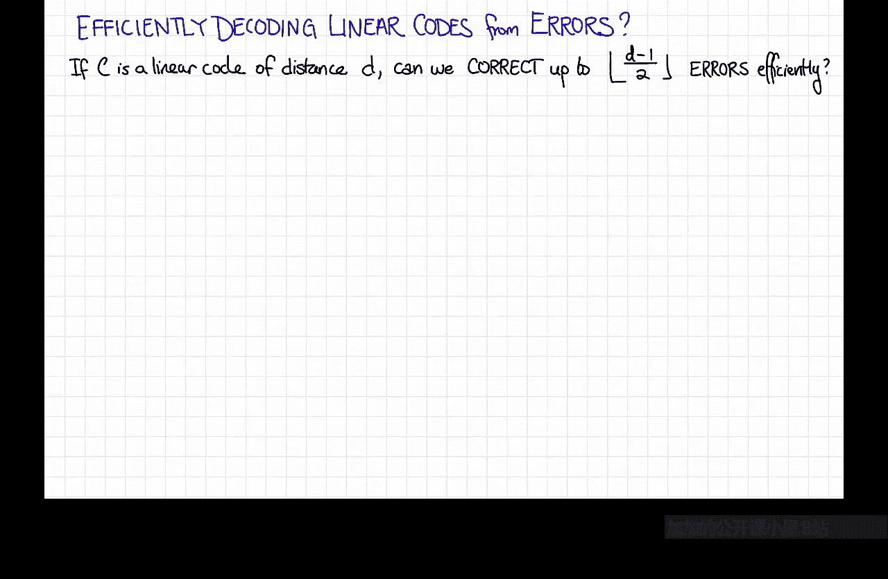
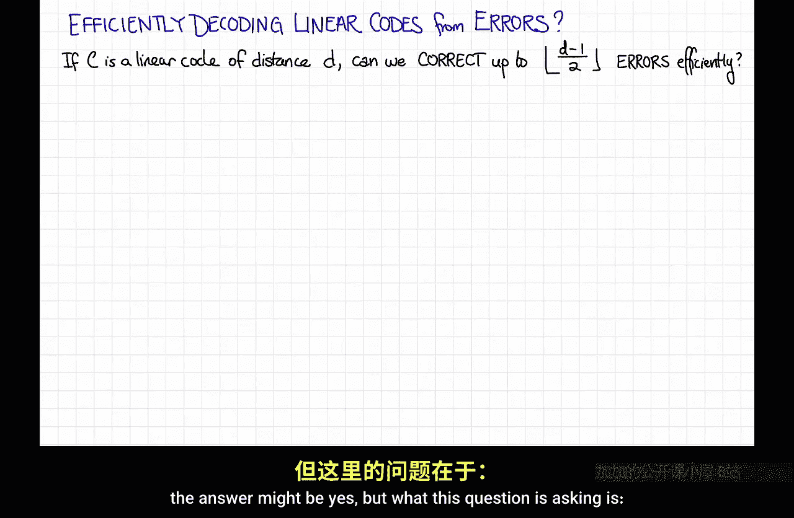
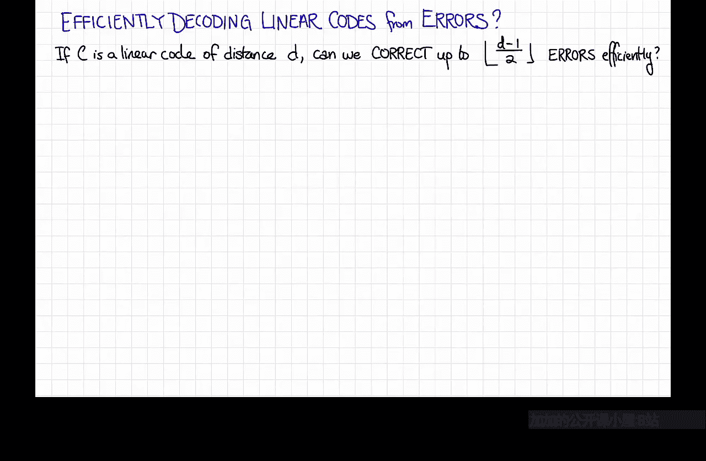
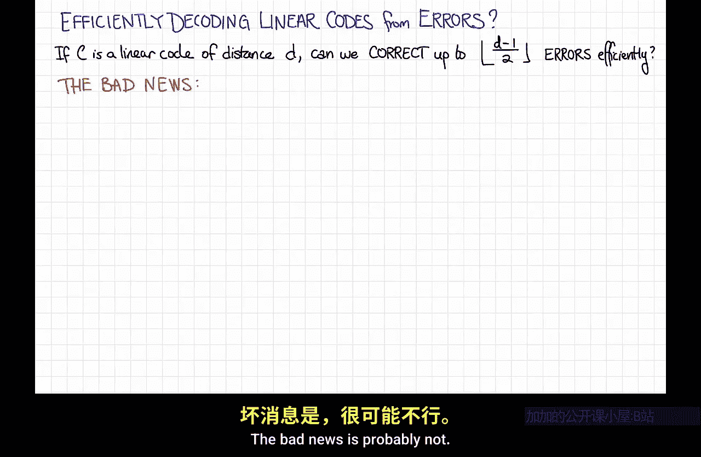

# 斯坦福大学【中英⚡代数编码导论｜Introduction to Algebraic Coding Theory】 p09 p8 3, Video 2： Efficient algorithms for linear codes -BV16sRYYTEwg_p9-

In this video， we'll briefly discuss the extent to which arbitrary linear codes admit efficient algorithms。

If C is a linear code， then it admits some efficient algorithms。Here， by an efficient algorithm。

 I mean， an algorithm that runs in time polynomial and n， the block length of the code。

In more detail， suppose that C。Subset of F Q to the N is a linear code of distance D。

Then the following three things are true。First， there is an efficient encoding map， ink。

Which maps a message from F， Q to the K to a code word in F Q to the N in C。

Why don't you pause the video now and try to figure out what this encoding map is。Great。

 so hopefully you've realized that this encoding map is just multiplication by a generator matrix G。

So， ink。Maps X。Some message X to the code word G times x。

And matrix multiplication we can do in polynomial time。 So that's an efficient algorithm。

The second thing we can do efficiently for linear code is detect up to D-1 errors。That is。

 if we see a corrupted code word， see twiddle。Which is corrupted with fewer than D-1 errors。

There is an efficient algorithm that will say， hey， something is up。Once again。

 pause the video for a second and try to come up with this algorithm。

One way to do this is with the parity check matrix。So given C twiddle。

 and we want to know if C twiddle is a legit code word or if its suffered up to D-1 errors。

We can just check。If H times C twiddle is equal to 0， If it is。

 then we'll say that C twiddle is a legit code word。 Nothing went wrong。 And if it's not。

 we'll say that something went wrong。Once again， this is an efficient algorithm because all we have to do is a matrix multiplication。

Third， there is an efficient algorithm to correct up to D -1 erasures。Once again。

 pause the video now and try to come up with the algorithm。One way is to use the generator matrix。

Suppose that we see a code word with some erasures that was originally equal to G times x for some vector x。

So the picture looks like this， and some of the coordinates of C have gotten erased。 Let's say。

 I don't know。 this one here。 and that one。And that one。And here what I'm coloring these in。

 I just mean that they they're getting colored over something， so they're getting erased。

If we think about what this does to the linear system， effectively。

 this is just sort of erasing those rows of G。 So erase that row。And that row。In that row。

And if we gather together all the information that we know。We can form some new linear system。

Where now we have a matrix G twiddle that we got just by removing these rows from G。

The key is that we now know everything in this target vector。

So a solution X to this system corresponds to a code word that is consistent with these at most D -1 eras。

We already know that there is at most one such X， because this code has distance D。

 And so it can handle up to D -1 erasures at least non efficiently。

 So we know that there's a unique solution X to this linear system。Okay。

 so our algorithm is just solve the linear system。 Find the unique solution。Notice that， for example。

 Gaussian elimination or whatever your favorite linear algebra algorithms are。

 work just fine over finite fields， so we can still solve this system of equations efficiently。

So that gives us an efficient algorithm to correct up to D minus-1 erasures in a linear code。

So all of this is good news。 You give me a linear code。 Any linear code。

 I can do these three things efficiently。 I can encode a message。 I can detect errors。

 and I can correct erasureers。😊，This is leaving out one important thing I might like to do。

 which is correcting errors。So here's the question。

 if I have an arbitrary linear code C of distance D。

Is there an algorithm to correct up to the floor of D-1 over two errors efficiently。

Notice that for some particular codes， like， for example， the Hamming code， the answer might be yes。

 but what this question is asking is， can I do this in general for any linear code C？

Okay， so here's the bad news。The bad news is probably not， the answer is probably no。

In more detail， consider the following problem。Given some C twiddle in F Q to the end。

And a generator matrix G。An F Q to the n times k。Find x in Fq to the K。

Then minimizes the hamming distance between C， twiddle and G times X。That is。

 the problem is give and C twiddle， find the code word in C that is closest to C twiddle。

This problem is called the maximum likelihood decoding problem。Notice that solving this problem。

Is pretty similar to being able to correct up to D-1 over 2 errors efficiently。In particular。

 if we could solve this problem， we would be able to correct this many errors。Unfortunately。

 this problem is N P hard。If you don't know what NP hard means， that's okay。 Inally。

 what it means is that it's really unlikely that we're going to find a polynomial time algorithm that solves this problem for a worst case code C。

If you're curious， in fact， the problem is N hard， even if the code is known in advance and with arbitrary pre processing time。

 Moreover， it's also N hard to approximate。In fact， even computing the distance of linear code。

 given the generator matrix is NP hard。So this problem and a lot of problems surrounding it are hard。

 So the takeaway。Is that we are not likely。To find a polynomial time algorithm for this task。Here。

 when I say not likely and probably not。I'm referring to the fact that we don't actually know whether or not P is equal to NPp。

 if you know what that means。 So it could be the case that someday someone finds a polynomial time algorithm。

 but that would imply some really weird things in complexity theory。Okay， so that's the bad news。

 We're probably not going to be able to solve this problem efficiently for a arbitrary linear code C。

However， the good news。Is that we don't care about an arbitrary linear code C。

We care about a linear code that we get to design。Going forward。

 we're going to focus a lot of our time on trying to design specific， special。

 structured linear codes that do admit fast algorithms。But wait， there's more good news。

The more good news is that actually， sometimes it's kind of convenient。😊。

That this problem is thought to be hard。In the next video， we'll see an application to cryptography。

 which relies on this fact。