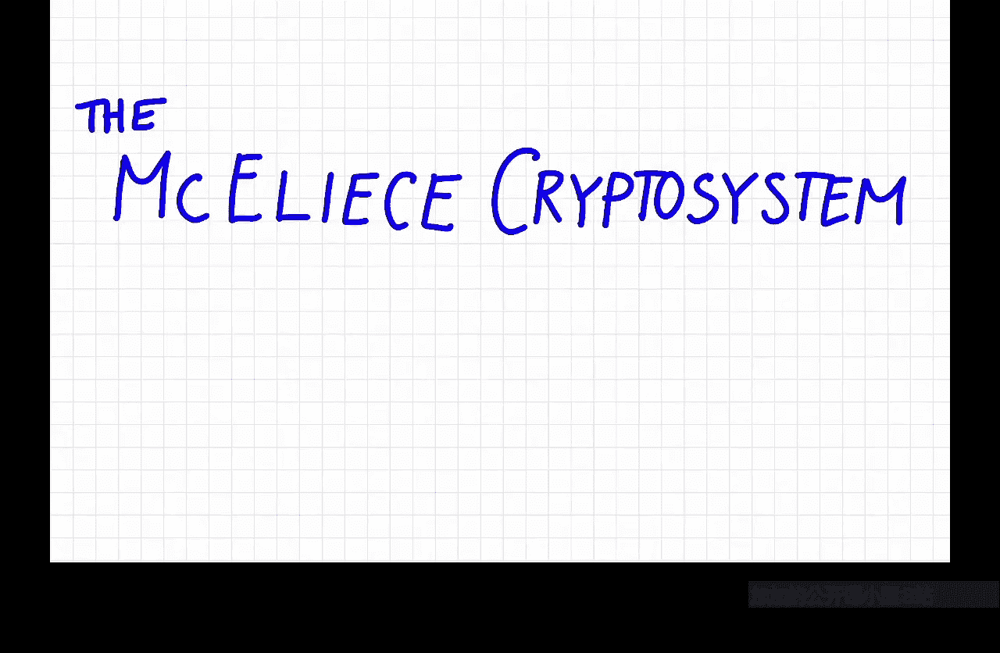
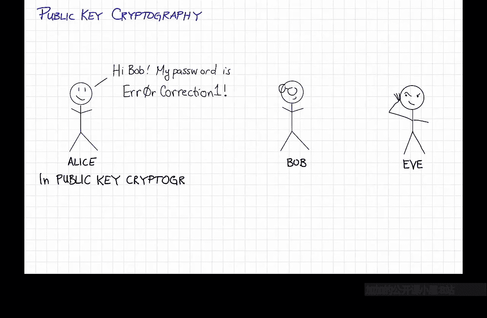
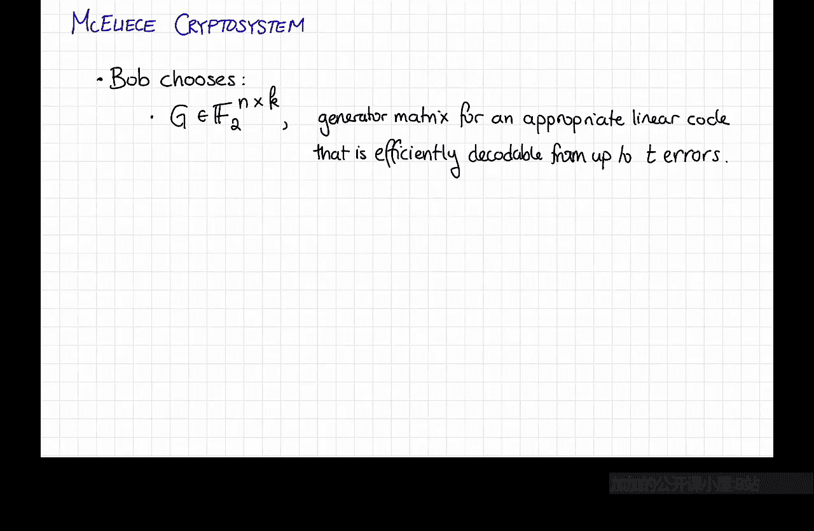
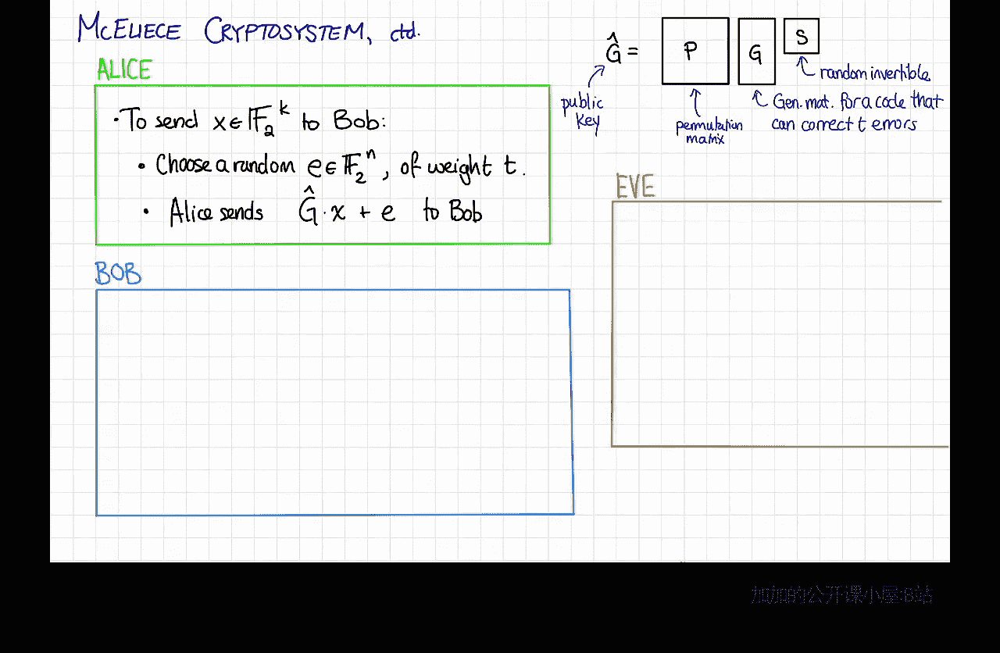

# 斯坦福大学【中英⚡代数编码导论｜Introduction to Algebraic Coding Theory】 p10 p9 3, Video 3： The McEliece Cryptosystem -BV16sRYYTEwg_p10-

In this video， we'll take a short detour to see an application of linear codes in cryptography。

 This is called the Mielese cryppt system。

So in just one slide， here's the idea of public key cryptography。As usual， we have a sender Alice。

 who wants to talk to a receiver Bob。 But now the situation is a little bit different。 Now。

 there is no noise between Alice and Bob。 They have a completely clear channel。

 But the issue is that there is some Eavesdper Eve。 There she is listening to what they say。So。

 for example， suppose Alice wants to send Bob some sensitive information。

Maybe she wants to send him a password or something。

Alice would like to get this sensitive information to Bob， but she doesn't want Eve to overhear it。

The setup in public key cryptography is the following。

First， everyone has a public key and a secret key。And not surprisingly。

 the public key is public and the secret key is secret。So for example， maybe Bob has a secret key。S。

 K。 subb Bob， which only he knows。And then he also has a public key。P， K， subbob。

Which he publishes and announces to the world。Now， when Alice wants to send a message to Bob。

 like she does here。She's going to encrypt her message using Bob's public key。

So she'll put it in a box and lock it with Bob's public key somehow。This looks like a tiny suitcase。

 but it is supposed to be a padlock。 Just bear with me。Right so， Alice。

Enccrypts her message to Bob using his public key。However。

 only Bob's secret key can decode the message。So when Bob gets this encrypted package message thing。

He'll be able to use his secret key to decode it and learn the information that Alice wanted him to have。

On the other hand， when Eve Eavesrops， she sees the same thing that Bob does。

 but she doesn't have Bob's secret key。And we hope that without that secret key。

 she's not able to unlock this message， and she's not able to， in this example。

 learn Alice's password。So that's the basic setup。So how can we come up with these public keys and secret keys and how can we use them to lock and unlock a message？

Here's one way to do that， using linear codes。So this is called the Mielese crypto system。

So here's one way for Bob to generate his public key and his secret key。First。

 Bob is going to choose the following things。First。

 he's going to choose a matrix G in F 2 to the n by K。

And G is supposed to be a generator matrix for an appropriate linear code。

That is efficiently decodable from up to T errors for some parameter t。

So notice that not just any generator matrix will do first。

 it needs to have an efficient decoding algorithm， so far we don't know any of those。

 although we will see some of those in later videos。But more than that。

 it has to have some special structure which will help the security of this scheme。

We're not going to go into detail about this。 if you want some buzzwords。

 Bob should choose G to be the generator matrix for a binary GA code。But again。

 the details won't be important for this discussion。Okay， so Bob chooses his generator matrix G。

 He's also going to choose。

A random， invertible matrix。S。That lives in F2 to the K by K。Finally。

 Bob is going to choose a random permutation matrix。P。In F 2 to the n by N。That is。

 P is an n by n matrix with entries， zeros and ones。So that when you multiply P by a vector。

 what it does is it permutes the coordinates of that vector。

Another way of saying it is that P has exactly one one in every row in every column。Okay。

 so Bob is going to choose all of these things。 And from these。

 he's going to assemble his secret key and his public key。Subabb's secret key。

It's just going to be these three ingredients。S， G， and P。Bob's public key。

The thing that he's going to publish。Is going to be the product of these three ingredients。

 So it'll be a matrix G hat。Which is equal to the permutation matrix P。Times the generator matrix G。

For this efficiently decodable linear code。Times this invertible matrix， S。

So G hatAT is a tall and skinny matrix， the same dimensions that G has and by K。

And Bob is also going to throw the parameter T into his public key。Okay。

 so this tells us how Bob is going to generate his secret key and his public key。Nextex。

 let's see how this scheme actually works for Alice to send a message to Bob。

So here's what all the parties are going to do。For Alice to send a message X to Bob。

Alice is going to first choose a random vector。Yi。In F2 to the N。That has weight， tea。

Then Alice is going to send。Gihat。Times x。Plus， E to Bob。Here， G hatt is Bob's public key。

Which I've drawn up here so you can remember what it is。Okay， so that's what Alice does。

 How does Bob decrypt this message。

So first， Bob is going to compute。P inverse times the message he receives。

Since G hat is equal to P times G times S。This is equal。To G times S times x plus P inverse。Times E。

And another way of writing that is G times in parentheses， S times x。Plus， E prime。

 where E prime is some vector of weight T。That's because we got E prime。

By just permuting the coordinates of E and E had weight T to begin with。At this point。

 Bob can use the fact that G is the generator matrix for a code that is efficiently able to correct up to T errors。

Becauseuse when we look at this， we see that this is actually just a corrupted code word。

 The message is S times X。 we've corrupted it with these T errors from E prime。

Sabab can decode his code。To obtain S times x。And now Bob has asked it's part of his private key。

So he can invert it。And recover X。And now Bob has X， ho right。Okay。

 so what is Eve C through all of this？So， Eve sees。The message that Alice sent。

 that's G hatt X plus E。And she also sees G hat。Because that's Bob's public key。

 It's publicly available to anybody， including Eve。And our hope is that， given this information。

Eve cannot recover X。So why might we hope that。First。😡，We might hope that G hat。

Looks like a completely random matrix to E。Of course， it's not completely random。

 We started out with this extremely structured matrix， G。

The one that admitted this efficient decoding algorithm。 But then we scrambled it up。

So he permuted the rows。 That's what P is doing。 And then we scrambled up the column space by multiplying by a random invertable matrix S。

And the hope is that this scrambling。Along with an appropriate choice of the original matrix G。

Is going to make it difficult for Eve to tell the difference， at least computationally efficiently。

 between G hatt and a completely random generator matrix。Okay， given that hope。

 the second hope we have。Is that decoding a random linear code is hard。Computationally hard。

We saw in a previous video that decoding a worst case linear code is hard， it's NP hard。

So maybe it's not too much of a stretch to think that decoding a random one is also hard。

 But we could hope that。If both of these hopes hold true。

 then it would be very computationally difficult for Eve to figure out X， given this information。

If we assume that Eve is limited to polynomial time algorithms。That is。

 Eve doesn't want to wait around for the heat depth of the universe in order to solve this problem。

Then this scheme is secure。 Eva is not going to learn Alice's message。Okay。

 you might have noticed that the security of this scheme depends on some hopes。

Are these hopes reasonable。Many people think they are。And so for the security of this scheme。

 we make the assumption that these hopes are true。That is that this problem recovering X。

 given that information is hard。We do have to make this assumption。 We cannot prove that it is true。

 at least not yet。This is a pretty common situation in cryptography。Typically， in cryptography。

 one has to assume that certain problems like factoring or something like that。

 are computationally difficult。For this particular scheme， this is the assumption that we're making。

This assumption is called the Mielese assumption， at least when this matrix G here is the generator matrix for a binary Ga code。

At the time of this recording， NISist， the National Institute of Standards and Technology。

 is actually running a competition to determine the next standard for post quantum cryptography。

That is cryptography that can resist attacks from a quantum computer。There are currently。

 as of January 2021， four finalists for public key encryption in round three of the competition。

One of those finalists is based on this Mielese crypto system。

 So this is a pretty timely example of applications of linear codes。

