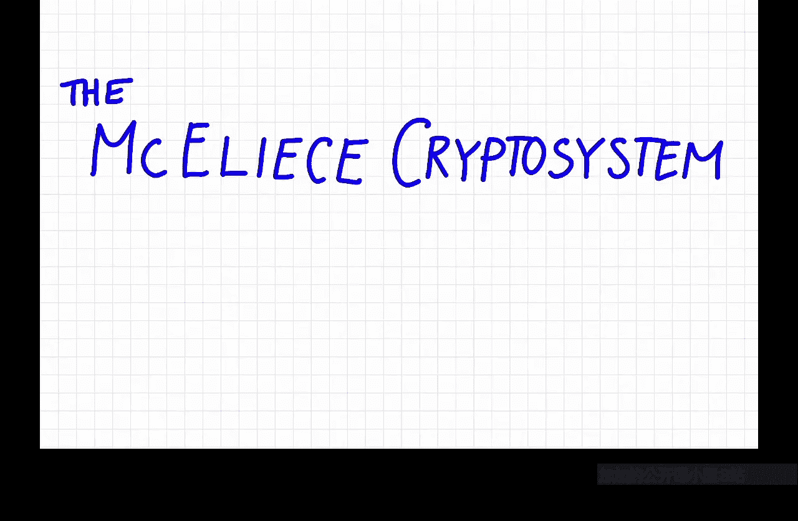
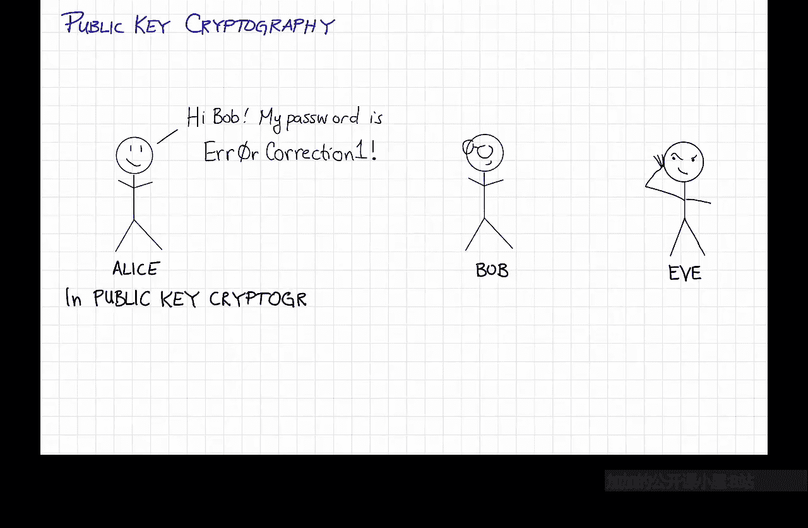
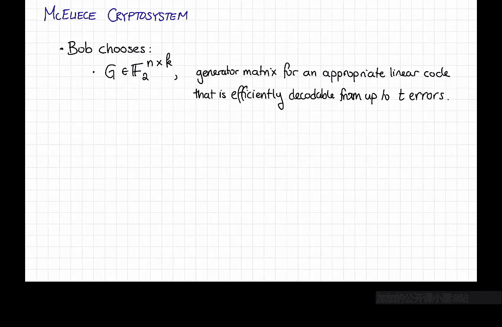
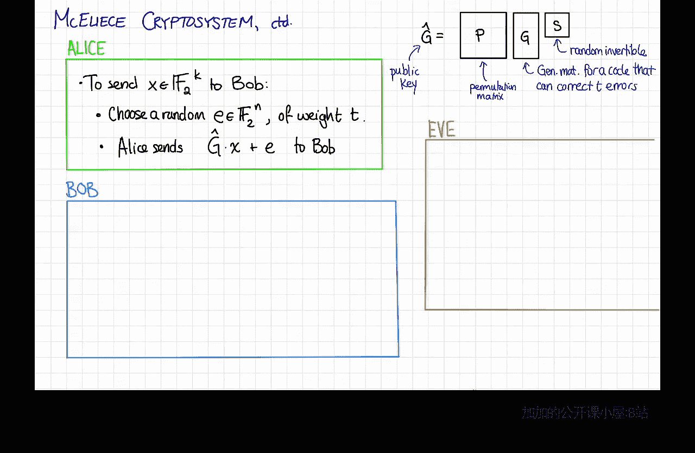

# 代数编码导论：3：McEliece密码系统 🔐

在本节课中，我们将学习线性码在密码学中的一个应用：McEliece密码系统。这是一种公钥密码系统，其安全性基于某些计算问题的困难性。

## 公钥密码学基础

上一节我们介绍了线性码的基本概念，本节中我们来看看如何利用它来构建一个密码系统。首先，我们需要理解公钥密码学的基本框架。

在公钥密码学中，通信双方（例如发送者Alice和接收者Bob）拥有一个完全清晰的通信信道。但问题是，存在一个窃听者Eve，她试图窃听他们的通信。

以下是公钥密码学的基本设置：

*   首先，每个参与者都拥有一对密钥：一个**公钥**和一个**私钥**。
*   公钥是公开的，任何人都可以获取。私钥则是秘密的，只有拥有者自己知道。
*   当Alice想给Bob发送加密消息时，她使用Bob的公钥对消息进行加密。
*   当Bob收到加密消息后，他使用自己的私钥进行解密。
*   窃听者Eve虽然能看到加密后的消息，但由于她没有Bob的私钥，因此（我们希望）她无法解密出原始消息。

## McEliece密码系统的构建

了解了基本框架后，我们来看Bob如何生成他的公钥和私钥。以下是Bob生成密钥的步骤：

1.  Bob选择一个在有限域 **F₂** 上的 **n × k** 生成矩阵 **G**。这个矩阵对应一个能高效解码（纠正最多 **t** 个错误）的线性码。在实际应用中，**G** 通常选择为二进制Goppa码的生成矩阵。
2.  Bob选择一个随机的 **k × k** 可逆矩阵 **S**。
3.  Bob选择一个随机的 **n × n** 置换矩阵 **P**。这个矩阵的作用是打乱向量坐标的顺序。

Bob的**私钥**就是这三个组成部分：**(S, G, P)**。

Bob的**公钥**则是这三个矩阵的乘积：**Ĝ = P × G × S**。Bob同时会将纠错能力参数 **t** 也放入公钥中公布。

## 加密与解密过程

现在，我们来看看Alice如何利用Bob的公钥发送消息，以及Bob如何用私钥解密。

### 加密过程
当Alice想发送消息 **x**（一个 **k** 比特的向量）给Bob时，她执行以下操作：

1.  Alice随机选择一个重量为 **t** 的 **n** 比特错误向量 **e**。
2.  Alice计算密文 **c = Ĝ × x + e**，并将其发送给Bob。

### 解密过程
Bob收到密文 **c** 后，利用他的私钥进行解密：

1.  Bob计算 **P⁻¹ × c**。由于 **Ĝ = P × G × S**，这等于 **G × S × x + P⁻¹ × e**。
2.  令 **e‘ = P⁻¹ × e**，由于 **P** 是置换矩阵，**e‘** 的重量仍为 **t**。因此上式可写为 **G × (S × x) + e‘**。
3.  此时，**G × (S × x)** 是一个码字，但被最多 **t** 个错误 **e‘** 污染。因为 **G** 对应的码能高效纠正最多 **t** 个错误，Bob可以对其进行解码，恢复出 **S × x**。
4.  最后，Bob用他私钥中的可逆矩阵 **S** 的逆，计算 **S⁻¹ × (S × x) = x**，从而获得原始消息。

## 系统安全性分析

那么，窃听者Eve面临什么情况呢？Eve可以看到Bob的公钥 **Ĝ** 和Alice发送的密文 **c = Ĝ × x + e**。我们希望她无法从中恢复出消息 **x**。

系统的安全性基于以下两个希望：

1.  **公钥看起来是随机的**：虽然生成矩阵 **G** 本身具有特殊的代数结构以支持高效解码，但经过随机可逆矩阵 **S** 和置换矩阵 **P** 的“扰乱”后，得到的公钥 **Ĝ** 在计算上应与一个随机的生成矩阵难以区分。
2.  **解码随机线性码是困难的**：我们在之前的课程中看到，解码一个最坏情况下的线性码是NP难问题。因此，我们有理由希望解码一个“看起来随机”的线性码在计算上也是困难的。

如果以上两点成立，那么对于只拥有多项式时间计算能力的Eve来说，从 **Ĝ** 和 **c** 中恢复 **x** 将是极其困难的。

需要指出的是，这些是**安全假设**，我们目前尚无法证明其绝对成立。在密码学中，基于某些计算问题的困难性来构建系统是常见做法（例如RSA算法基于大数分解的困难性）。对于McEliece系统，当 **G** 是二进制Goppa码的生成矩阵时，这个假设被称为 **McEliece假设**。

## 现实意义与总结

本节课中我们一起学习了McEliece密码系统。这是一个利用具有高效解码算法的特殊线性码来构建公钥加密方案的经典例子。

其现实意义在于，McEliece密码系统被认为是能够抵抗未来量子计算机攻击的候选算法之一。例如，截至2021年，美国国家标准与技术研究院（NIST）推动的后量子密码学标准化进程中，就有一类决赛方案是基于McEliece密码系统的变体。

总结来说，McEliece系统展示了编码理论不仅可用于可靠通信（纠错），还能应用于信息安全（加密），是连接这两个重要领域的一个优美范例。