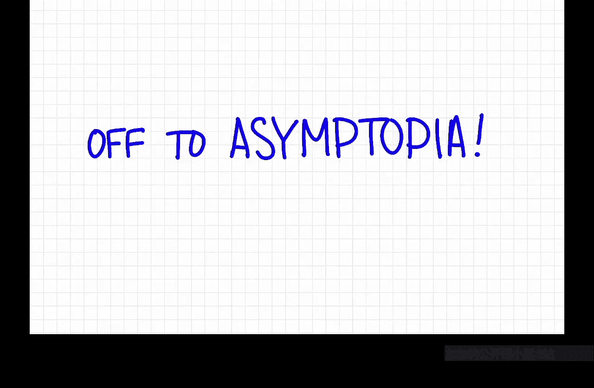
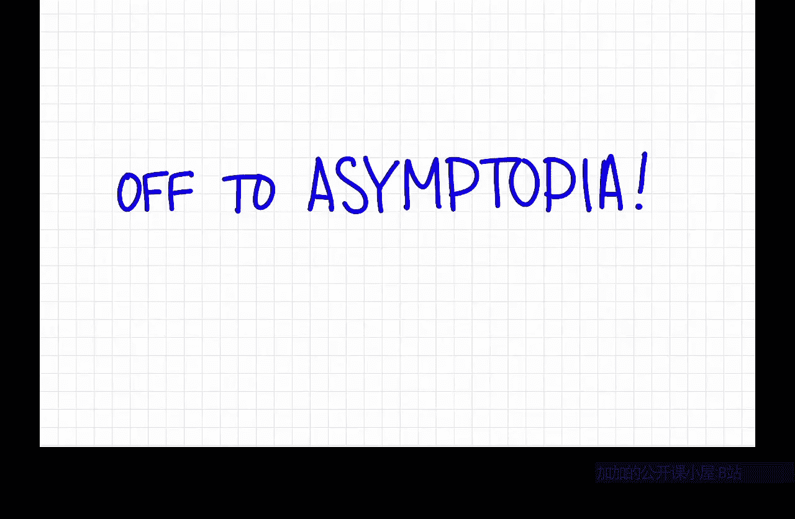

# 斯坦福大学【中英⚡代数编码导论｜Introduction to Algebraic Coding Theory】 p11 p10 3, Video 4： Asymptotics -BV16sRYYTEwg_p11-

In this video， we'll see what happens when N gets large。

To motivate the asymptotics that we'll study， let's recap a couple of the things that we've seen so far。

First， we've seen a couple of bounds。 We saw the G V bound and the heming bound。

These bounds said that the optimal rate K over N for a code with distance D and alphabet size Q is bounded above by some ugly formula and bounded below by some other ugly formula。

 A natural question that we had after seeing these bounds。🤢，Is， are these bounds good or bad。That is。

 what do these big nasty formulas behave like， Are they big or small or or what。

A second thing that we have seen is some discussion about， quote unquote， efficiency。

So we saw that there are some efficient algorithms for linear codes。Like encoding。

 decoding from erasureers。Or detecting errors。And we also saw that there are unlikely to be efficient algorithms for all linear codes or for random linear codes。

That is， we saw that maximum likelihood decoding。Is N hard。And we also saw the Melese crypto system。

Which assumed that decoding a random linear code was computationally difficult。

A question that you might have been thinking when we talked about this。

Is what do we mean by efficient here。We said that efficiency meant polynomial in N when we were talking about it。

 But if you are familiar with asymptotic notation， you might remember that something needs to be going to infinity for those sorts of things to make sense In our previous discussion。

 everything was just fixed。 So what do we mean by efficient in some constant。

 So something needs to be getting large。 What is it to answer these questions。

 We're going to formalize some asymptotics， What parameters should we think of as big。

 what parameters are small and how do the parameters relate to each other。

Here's the parameter regime that we're going to study for most of this class。

We're going to assume that the parameters N and K And D。 So that's the block length。

 the message length and the distance are all tending to infinity。

And we're going to usually assume that they are doing so so that the ratio K over N。

 That's the rate of the code is tending towards some constant R。And the ratio D over n。

 that's the relative distance of the code。 is tending towards some constant delta。

There are several reasons why we're going to assume this。First， as we said on the previous slide。

 this is going to make it easier to understand what's possible and what's not。

 We can just focus on R versus Delta， for example， and ignore N， K and D。

 as long as they' are all sufficiently large。Second。

 it allow us to talk meaningfully about computational complexity。And， of course， third。

 this parameter regime is reasonably relevant for a lot of different applications。With that in mind。

 here's a definition。A family of codes is a collection C of codes， C1， C 2， C 3， dott dot。

 where each C， I is an N， I comma K， I comma D， I sub Q， I code。

Remember that means it has block length， N I， message length， KI， distance， DI， and alphabet size QI。

Given such a family， we defined the rate of the family to be R of C。

 which is equal to the limit as I goes to infinity of the rate of the Ithe code。

 So K I divided by N I， assuming that limit exists。Similarly。

 we're going to define the relative distance of the family C as the limit of the relative distances of the code C I。

Just some notes about this definition。So first。I'm going to frequently refer to C the family of codes as just a code。

And I'll drop the subscript I。That is， I'm going to abuse notation and just think about a single code C。

But somehow， its parameters and in K And D are all tending to infinity。

This is not technically correct， but it will save us a lot on the subscripts。

 and hopefully it won't confuse things too much。A second note is that the alphabet of C， the family。

Might not be constant。 It might depend on which code in the family we're looking at。In that case。

 when I'm abusing notation like this， I might say that。This code C has the alphabet。

 which is a function of the block length n or something like that。

Here's a familiar example of a family of codes。 So let n sub I B2 to the I-1。

 Then the heming code C sub I of length N sub I is the code with this parity check matrix。

This is an I by 2 to the I -1 matrix， and the columns of this matrix are all of the non0 elements of F 2 to the I。

Notice that there are  two to the I minus one of them， so we just stack them up as columns here。

We've already seen the hamming code with n sub I equals 7 before in these videos。

 And you may have explored this family more generally on your homework。It is a fun exercise， again。

 what you may have done on your homework。To show that the Ithe hemming code C sub I。

Is a2 to the I -1a 2 to the I  I -1 comma 3 sub 2 code。That is。

 it has block length to the I -1 dimension to the I  I -1 and distance 3。This means that C。

 the collection of all of these sea eyes。Is a family of codes， according to the previous definition。

The rate of this family。Is the limit as I goes to infinity of the rate of the Ih code That's 2 to the I minus I-1 divided by 2 to the I。

And his eye goes to infinity， that approaches one。It's pretty cool。1，1 is a pretty good rate。

On the other hand， the relative distance。Delta of C。

Is the limit as I goes to infinity of the relative distance of the Ih code。

 That's 3 divided by 2 to the I。And that goes to zero real fast。So， that's not so good。

You might recall that earlier， we asked the question。

 what is the best trade off between rate and distance。

Before the question was somewhat complicated because we also had these parameters， N。

 K And D floating around。But now we can just ask for any family of codes。

What is the best trade off between the rate and distance of that family of codes。

 That's just two numbers。As we can see in this example here。Basically。

 the the only family of codes that we know。Does not get such a good trade off between rate and distance。

 Rather， it has a phenomenal rate， but really bad distance。So's a first question that we might ask。

 E question。We might just ask for any family of codes that has rate and distance strictly greater than0。

A quick definition。Such a family of codes is called asymptotically good。That is。

 we say that a family of codes is asymptotically good。

 If the rate and relative distance of that family are both strictly greater than 0。

So are there asymptotically good coats。We will address this in the next video。

