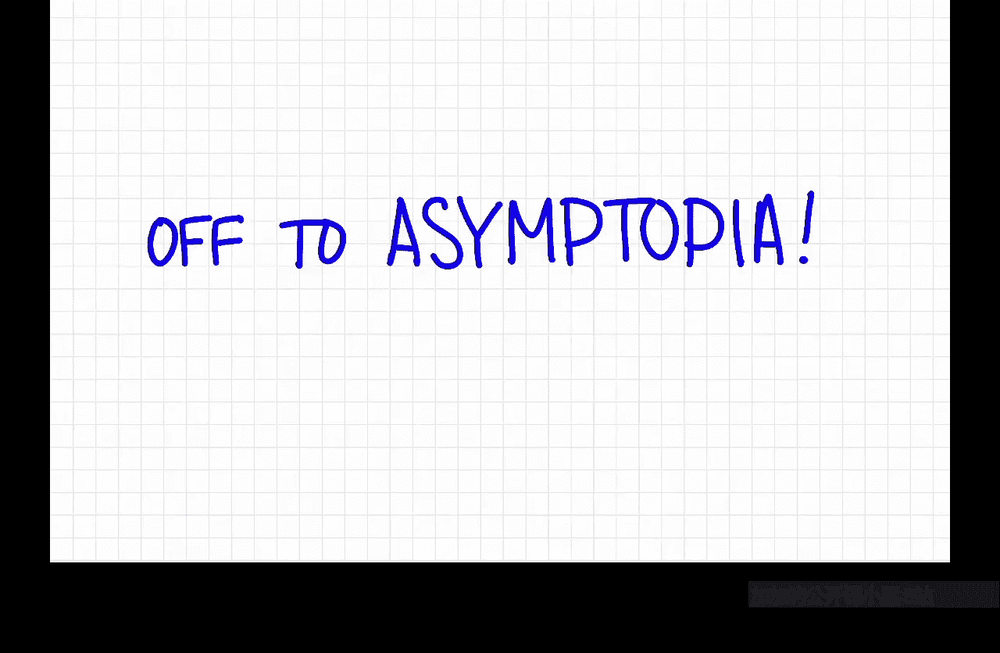
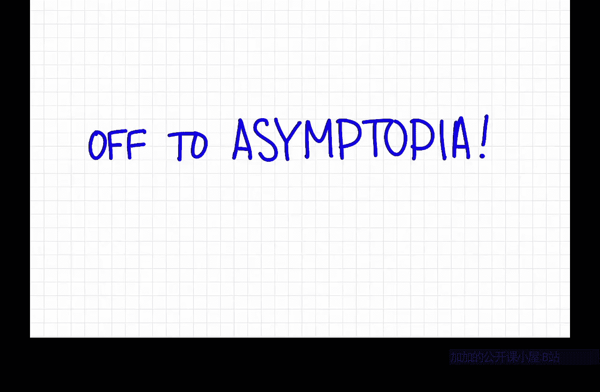

# 代数编码导论：4：渐近分析






在本视频中，我们将探讨当码长 `N` 变得非常大时会发生什么。

## 概述

在本节中，我们将学习如何分析编码参数在趋于无穷大时的行为，即渐近分析。我们将定义码族的概念，并引入渐近好码的定义，为后续理解码的极限性能打下基础。

## 动机与回顾


为了引出我们将要研究的渐近分析，让我们先回顾一下目前已经了解的几个概念。

首先，我们已经见过几个界。我们见过吉尔伯特-瓦尔沙莫夫界和汉明界。这些界表明，对于一个具有距离 `D` 和字母表大小 `Q` 的码，其最优码率 `K/N` 被一些复杂的公式所界定。

在了解了这些界之后，一个很自然的问题是：这些界是好是坏？也就是说，这些复杂的公式表现如何？它们是很大、很小，还是别的什么？

其次，我们讨论过所谓的“效率”。我们看到，对于线性码存在一些高效的算法，例如编码、从擦除中译码或检错。同时，我们也看到对于所有线性码或随机线性码，不太可能存在高效的算法。也就是说，我们看到最大似然译码是 `NP` 难的。我们还介绍了梅勒斯密码系统，它假设译码随机线性码在计算上是困难的。

在讨论这些时，你可能思考过一个问题：我们这里说的“高效”是什么意思？我们说过，高效意味着关于 `N` 是多项式时间的。但如果你熟悉渐近记法，你可能会记得，要让这类说法有意义，必须有某个量趋于无穷大。在我们之前的讨论中，所有参数都是固定的。那么，对于一个常数，我们说的“高效”是什么意思呢？因此，必须有某个量变得非常大。这个量是什么？

为了回答这些问题，我们将形式化一些渐近分析。我们应该把哪些参数看作大的？哪些参数是小的？参数之间如何关联？

## 渐近参数体系

在本课程的大部分时间里，我们将研究以下参数体系。

我们将假设参数 `N`、`K` 和 `D`（即码长、消息长度和距离）都趋于无穷大。我们通常进一步假设，它们以这样的方式趋于无穷大：比值 `K/N`（即码率）趋于某个常数 `R`，而比值 `D/N`（即码的相对距离）趋于某个常数 `δ`。

我们采用这个假设有几个原因。首先，正如上一张幻灯片所说，这将使我们更容易理解什么是可能的，什么是不可能的。例如，我们可以只关注 `R` 与 `δ` 的关系，而忽略 `N`、`K` 和 `D`，只要它们都足够大。其次，它使我们能够有意义地讨论计算复杂度。当然，第三，这个参数体系与许多实际应用是相关的。

## 码族的定义

基于以上考虑，我们给出一个定义。

一个**码族** `C` 是一个码的集合 `{C₁, C₂, C₃, ...}`，其中每个 `Cᵢ` 是一个 `(Nᵢ, Kᵢ, Dᵢ)` 子 `Qᵢ` 码。记住，这意味着它的码长为 `Nᵢ`，维数为 `Kᵢ`，距离为 `Dᵢ`，字母表大小为 `Qᵢ`。

给定这样一个族，我们定义该码族的**码率** `R(C)` 为第 `i` 个码的码率的极限（假设该极限存在）：
```
R(C) = lim_{i→∞} (Kᵢ / Nᵢ)
```

类似地，我们定义码族 `C` 的**相对距离** `δ(C)` 为各个码的相对距离的极限：
```
δ(C) = lim_{i→∞} (Dᵢ / Nᵢ)
```

关于这个定义有几点说明。

首先，我经常会简称码族 `C` 为一个“码”。我会省略下标 `i`。也就是说，我将滥用符号，只考虑一个单一的码 `C`，但它的参数 `N`、`K` 和 `D` 都以某种方式趋于无穷大。这在技术上并不完全正确，但可以为我们省去很多下标，希望不会造成太多混淆。

第二点说明是，码族 `C` 的字母表大小可能不是常数。它可能取决于我们看的是族中的哪个码。在这种情况下，当我像这样滥用符号时，我可能会说这个码 `C` 的字母表大小是码长 `N` 的函数，或类似的说法。

## 一个熟悉的例子：汉明码族

这是一个熟悉的码族例子。

令 `Nᵢ = 2ⁱ - 1`。那么长度为 `Nᵢ` 的汉明码 `Cᵢ` 是以下奇偶校验矩阵定义的码：
```
Hᵢ = [所有 F₂ⁱ 中的非零元素作为列向量]
```
这是一个 `i × (2ⁱ - 1)` 的矩阵，其列是 `F₂ⁱ` 中所有非零元素。注意，这样的元素有 `2ⁱ - 1` 个，所以我们把它们作为列堆叠在这里。

我们之前在这些视频中已经见过 `Nᵢ = 7` 的汉明码。你可能在作业中更一般地探索过这个族。再次说明，这是一个有趣的练习（你可能在作业中已经做过），可以证明第 `i` 个汉明码 `Cᵢ` 是一个 `(2ⁱ - 1, 2ⁱ - i - 1, 3)` 子 `2` 码。也就是说，它的码长为 `2ⁱ - 1`，维数为 `2ⁱ - i - 1`，距离为 `3`。

这意味着 `C`（所有这些 `Cᵢ` 的集合）根据之前的定义，是一个码族。

这个码族的码率是第 `i` 个码的码率的极限：
```
R(C) = lim_{i→∞} ( (2ⁱ - i - 1) / (2ⁱ - 1) )
```
当 `i` 趋于无穷大时，它趋近于 `1`。这非常棒，`1` 是非常高的码率。

另一方面，该码族的相对距离 `δ(C)` 是第 `i` 个码的相对距离的极限：
```
δ(C) = lim_{i→∞} ( 3 / (2ⁱ - 1) )
```
这个值非常快地趋近于 `0`。所以，这就不太好了。

## 核心问题：码率与距离的权衡

你可能还记得，之前我们问过一个问题：码率和距离之间最好的权衡是什么？之前这个问题有些复杂，因为我们还有参数 `N`、`K` 和 `D` 需要考虑。但现在，对于任何一个码族，我们可以直接问：这个码族的码率和距离之间最好的权衡是什么？这仅仅是两个数字。

正如我们在这个例子中看到的，基本上，我们目前已知的唯一码族（汉明码族）在码率和距离之间并没有取得很好的权衡。更确切地说，它有非凡的码率，但距离非常差。

因此，我们可能提出的第一个问题是：是否存在码率和相对距离都严格大于 `0` 的码族？

## 渐近好码的定义

这里有一个快速的定义。

如果一个码族的码率和相对距离都严格大于 `0`，则称该码族为**渐近好码**。

也就是说，我们称一个码族是渐近好码，当且仅当：
```
R(C) > 0 且 δ(C) > 0
```

那么，是否存在渐近好码呢？我们将在下一个视频中解答这个问题。

## 总结

在本节中，我们一起学习了渐近分析的基本框架。我们定义了码族的概念，并引入了码率和相对距离的渐近定义。通过汉明码族的例子，我们看到了高码率与低相对距离的权衡。最后，我们提出了是否存在码率和距离都非零的“渐近好码”这一核心问题，为后续内容做好了铺垫。