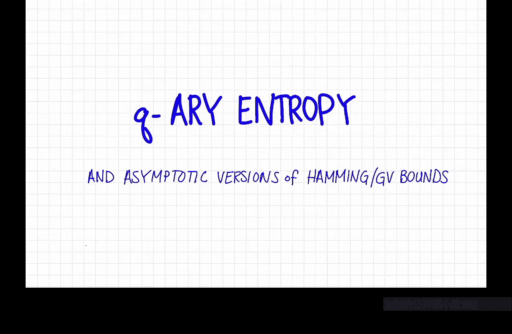
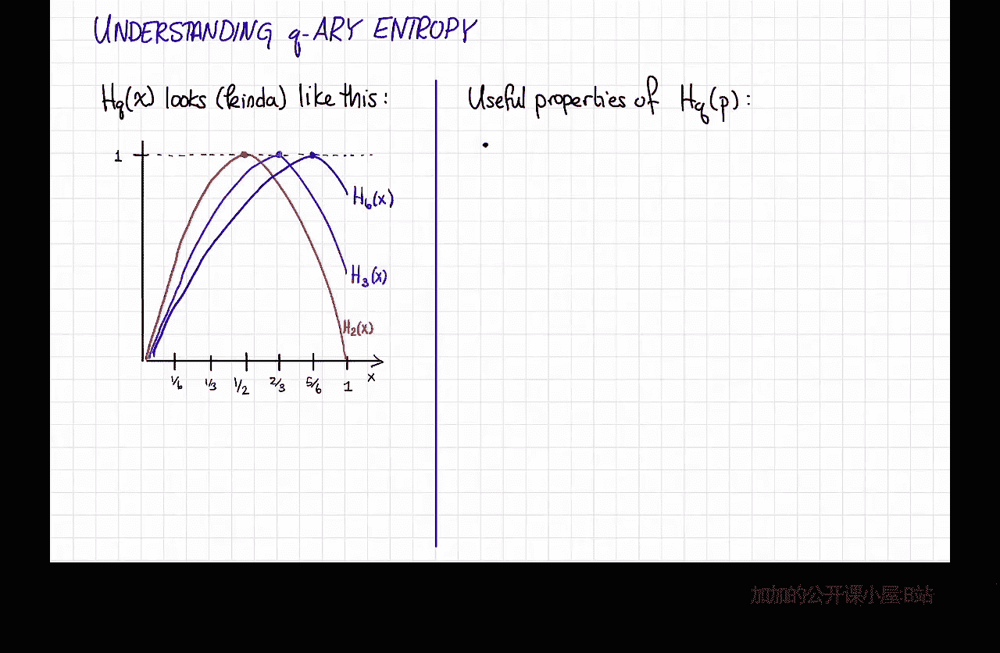

# 斯坦福大学【中英⚡代数编码导论｜Introduction to Algebraic Coding Theory】 p12 p11 3, Video 5： q-ary Entropy -BV16sRYYTEwg_p12-

Now that we have our asymptotic parameter regime， we can simplify the expressions for the hammming and G V bounds。

We'll also introduce the Qary entropy， which is going help us do that。

If you're familiar with the binary entropy function。

 the Qary entropy function is a generalization of that。

If you're not familiar with the binary entropy function， that's okay。

 I'm about to define the Q R entropy function。So， here's the definition。The Qary interview function。

 H subq。It maps the unit interval to the unit interval， and is defined by this formula here。

So H Q of x， where x is a number between 0 and1。Is equal to x times the log base Q of Q -1。

Minus x times the log base Q of x minus1 minus x times the log base Q of 1 minus x。

That's a pretty strange expression。 If you haven't seen it before。

 Why do we care about this function。The reason we care is because the Qie entropy will allow us to simplify those nasty expressions involving the volumes of haming balls。

More specifically， we have the following proposition。Proposition。Let Q greater than equal to 2。

 be an integer。And let P be a number between 0 and 1 minus1 over  Q。

Then the following two things are true。First。The volume of the Qri hamming ball。Of radius P。

 N in F Q to the N。Is bounded above by Q to the n times the  Qary entropy of P。Second。

The volume of that hamming ball is bounded below。By that same expression。

 except with a little o of n term in the exponent。Here we see that a function F。Is little O of N。

If the ratio， f of n divided by n goes to0 as n goes to infinity。

So we should think of this term here as negligible compared to this term。Thus， essentially。

 what this proposition is saying。 I it the volume of this hamming ball。

Is more or less equal to Q to the n times the  Qary entropy of P。

This will be useful because it will allow us to replace all of those pesky volumes of handing balls and those formulas that we had with somewhat cleaner expressions。

Okay， but if the goal is to understand volumes of handing balls and the strategy is to replace them with Qary entropy。

 we better understand the QR entropy function。So let's get a basic idea of how this function behaves。

Here's a picture of what the  QR entropy function looks like for  Q equals 2 and 3 and 6。Disclaimer。

 this is just a hand drawn picture， not not an actual graph。But up to that disclaimer。

 here's basically what it looks like。 So the binary entropy， which you might be familiar with。

 looks like this curve here。So it's zero。At x equals 0 and also at x equals 1。

 and it has a maximum at x equals1 half， where it takes on the value of  one。

The three area entropy look similar， except it's kind of shoved over to the right。

So it's still equal to 0 at 0。But now its maximum happens at two third and still takes the value of one。

The six area entropy。Is shoved over to the right even further。 Its maximum occurs at 5。

6 and still has the value of one。More generally， the Q area entropy function has a maximum at 1-1 over Q with value 1。

 And as Q gets larger， It just gets shoved more and more and more over to the right。

To get some quantitative understanding of how this behaves。

 let's look at the QR entropy in a couple of different parameter regimes。First。

 let's consider the parameter regime where Q is really large。

So'll say that Q is tending to infinity。And p is just some constant in 0，1。

 So it's bounded away from 0 and 1， And it's staying constant while Q is growing。

 Then the  Q area entropy of P。 So the first term is P times the log base Q of Q -1。

And you can check that the next two terms。Are big O of log based Q of some stuff that doesn't have a Q in it。

 This is not a technical derivation， but hopefully， you get got the idea。 Now。

 these log based Q of stuff terms as Q gets really large， these get really small。

So this is approximately 0 or more precisely， it tends to 0 as Q tends to infinity。

 On the other hand， when Q is really big， this term here。

 the log base Q of Q -1 is approximately1 in the sense that it tends to1 is Q tenses to infinity。

 Thus， in this parameter regime， H Q of P is approximately P。In pictures。That means that。

 for really large cu。The Qary entropy looks something like this。That is。

 it mostly looks like the line H subq of P is equal to P。

 And then there's this little dohiickey at the end。Okay。

 so that's pretty easy to understand when Q is really big， this function， basically a straight line。

Great。Next parameter， regime， If Q is not so big， say Q is a constant。And P is really small。

Thenhan H sub Q of P， the cur entropy of P。Is equal to this， I just copied out the definition again。

And once again， let's look at each of these terms and think about how they behave as P gets small。

Oops， this a typo here。Should be a Q -1。Okay， so this first term here， now that I fix the typo。

Is big O of P as P gets small。That is， this thing here is just a constant， and there's P。

This last term also turns out to be big O of P。You can see this， for example。

 by taking a tailor expansion of the log of 1 over 1 minus P。That leaves this term in the middle。

 which is big O of P log 1 over P。 That's much bigger than O of P。 So this middle term dominates。

Thus， in this parameter regime， the Qary entropy of P is approximately equal to the middle term P log base Q of one over P in pictures。

That says that if we have Q that's not too big and we focus in right near the origin here。

Then this kind of behaves like P log base Q is one over P。

So those are a few parameter regimes we might be interested in。

There are many other parameter regimes you might care about。 And for a lot of them。

 you can get some good sort of back of the envelope understanding of how things behave。

 either by doing an analysis like this。 So writing out the terms and observing that one will dominate or by taking a tailor expansion and seeing what happens。

Now that we understand the Qary entropy， at least a little bit。

 let's use it to simplify our expressions for the G V and the heming bounds。

Let's recall that the G V and the heming bounds look like this。That is。

 they bound the optimal rate K over N that's possible for a code of distance D and alphabet size cube。

 And notably， both of them involve the volume of a Qary heming ball。So， our strategy。Is to note。

That we have the Qary volume。At the hamming ball of radius， Delta N and F Q to the N。

Is approximately equal。To Q。To the Qary entropy of Delta times n。At least his end gets large。

Taking logs of both sides。We see that the log base Q of that volume。Is approximately equal。

To H Q of delta times n。As then gets large。That's nice because this expression is a lot shorter than that expression。

 And now this is a function that we somewhat understand。

So let's plug this in to these bounds and see what we get。It turns out that this is what we get。

So here's what the handing bound looks like。It says that for any family， C of Qary codes。

 the rate of C。Is bounded above by one minus the cur entropy of the relative distance of C divided by 2。

I'm not going to go through the details of how we get this。But basically。

 it follows just by plugging in that approximation into the non asymptotic form of the hand ground that we had before。

To good idea to pause the video now and check that this is indeed legit。

We can do the same thing for the Gilbert Vshovov Bo。 And one thing we could get is the following。

So let Q be greater than equal to 2。Then for any delta between 0 and 1-1 over  Q。

And any epsilon between 0 and 1 minus the  Qary entropy of Delta。

There exists a cuary family of codes， C。With relative distance， at least Delta。In rate。

 at least one minus the  Q R entropy of Delta minus epsilon。Here。

 this epsilon is kind of a fudge factor。It's going to come out in the length of the code。

 That is the smaller epsilon is the larger the block length of the code needs to be。

Before this starts being true。Of course， these are only statements about the limit as N goes to infinity of this family of codes。

 And that's why it's true for any epsilon， strictly greater than 0。Once again。

 I'm not going to go through the details here， but it's a good exercise to go back to our non asymptotic form of the Gilbert Varslov Bo and plug in our approximation for the volume of a heming ball from Qary entropy and see how you could get this theorem。

Okay， great。 Now we have somewhat simpler expressions for the trade off between rate and distance。

What do these look like？The great thing about looking at these asymptotics is that now we only have two parameters to look at the rate and the relative distance。

 We don't care about N or K or D or any of those things。Since we only have two parameters。

 we can plot them。So here on the X axis， I'm plotting Dlta the relative distance。

And here on the y axis， I'm plotting R， the rate。And we can plot these two trade offs。

So this red curve here， this is approximately the trade off that the Hamming down gives us。

I say approximately because， again， this is a hand drawn cartoon， not an actual graph。

 but dude look something like this。If I were to look out here at this particular combination of Delta and R。

 the Heming bound says there is no code or no family of codes that have that rate and that distance。

On the other hand， the Gilbert Varashov Bo is this blue curve here。So what the G V bound says。

 is that if I were to look at a point Delta comma R down here， let's say。

Then there does exist a code with parameters， at least that good。So， down here。

These are all of the things that are possible。Up here。

 these are all the things that we know to be impossible。And here， at least for now。

 is a big region of uncertainty。This picture might leave us with some questions。First。

 we might wonder， are there families of codes that beat the asymptotic G V bound。That is。

 is there a family of codes with rate and distance that lives here。

 sort of above the blue curve or here or here or here。Well， the answer is yes and no。

 So on the positive side。For alphabet size Q that is greater than equal to 49。The answer is yes。

It is known that particular families of codes called algebraic geometry codes。Do beat the D bound。

On the other hand， for Q equals 2。That's what this picture is for。 Sorry if I didn't say that before。

It turns out that this is still an open question。That is the Gilbert Vshmoath bound。Which， as we saw。

 was not so hard to prove， is actually the best known possibility result we have for binary codes。

 And we don't know whether or not we can do better。I find that kind of exciting。

The next question we might ask is， O， even if I don't want to do better than the G V bound。

 can you at least give me a code or a family of codes that meets it or comes close to meeting it。

Recall that our proof of the G V bound was non constructive。 We used the probabilistic method。

 So we took a random linear code and observed that with decent probability， it had good parameters。

So that tells you that there exist good codes。 But what are they， What do they look like。

Can you give me an explicit construction of such a thing here。

 explicit means either ideally a nice description of that thing or at least an efficient algorithm to construct one。

Once again， the answer is yes and no。So， on the yes side。For large queue。The answer is， yes。

And we'll see such a construction pretty soon in an upcoming video。On the other hand。

 for Q equals 2 for binary codes。Once again， this is still mostly an open question。

I say mostly because there's been some really cool recent work by Tajma。

 which constructs explicit families of codes real close to the Gilbert Vsashov Bo。😊。

Sort of down in this parameter regime here。But， for example。

 in parameter regime up here as of the time of this recording， this question is still wide open。Also。

 pretty exciting。One more question we might ask that we have asked before is。

Are their families of asymptotically good codes。So recall from a previous video that an asymptotically good code is just a code with rate and distance both bounded away from 0。

We asked this question at the end of the last video。Fortunately， for this question。

 we now have closure。The answer is， yes。And in fact。

 the Gilbert Vashmov Bo tells us that the answer is， yes。 for example。

 these are asymptotically good coats or even these ones。

So even if we don't know the answers to these really exciting open questions。

 at least we've made some progress over our previous state of knowledge。Okay。

 that wraps it up for this video。In the next few videos。

 we'll see some more bounds and some more constructions。

 which will help us narrow down this yellow region of uncertainty here。

