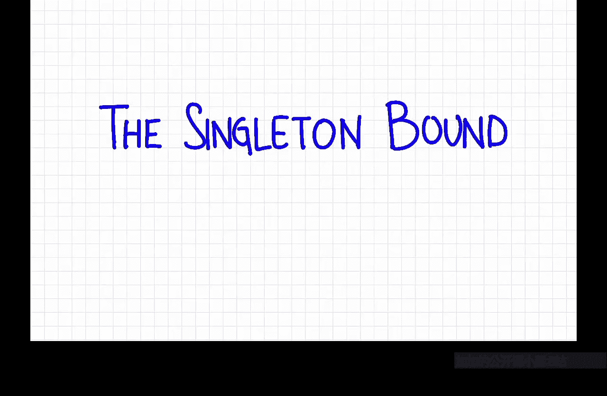
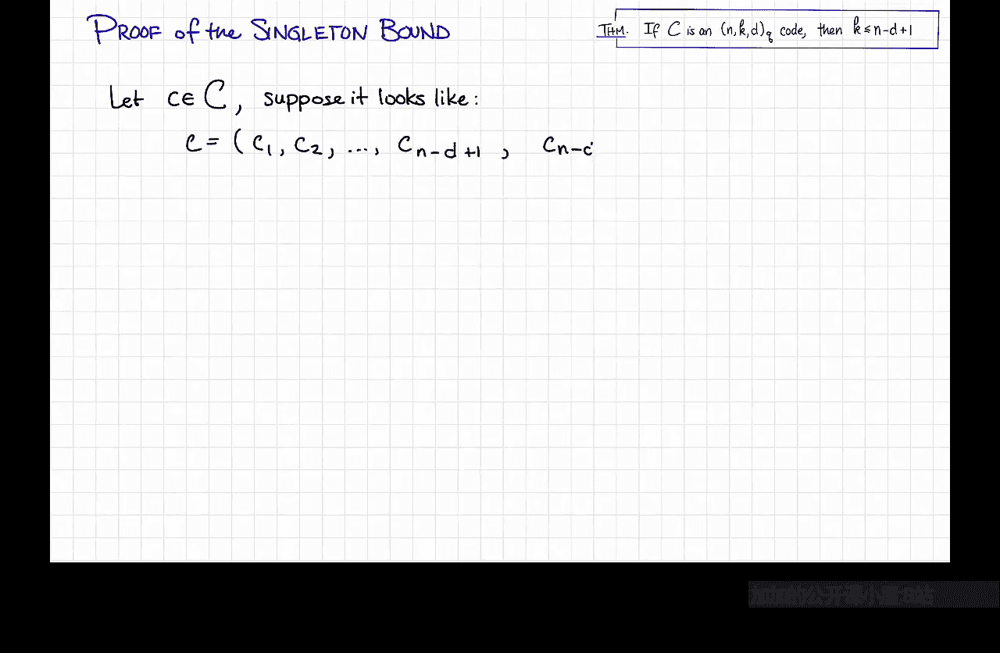

# 斯坦福大学【中英⚡代数编码导论｜Introduction to Algebraic Coding Theory】 p13 p12 4, Video 1： The Singleton Bound -BV16sRYYTEwg_p13-

In this video， we'll prove another impossibility result on the achievable trade off between rate and distance called the Singleton Bo。

The Singleton bound says the following。If C is an N， K D sub Q code， that is， it has block length， N。

 message length K distance D over an alphabettic size Q。Then K is at most n minus D plus 1。

Before we prove this bound， let's get a sense of what it looks like。When  Q equals 2。

 the picture looks kind of like this。 Remember， here that this plot is plotting Delta。

 the relative distance on the X axis and R the rate on the y axis。

 And we're wondering what pairs of deelta and R are achievable。

 meaning that there exists a family of codes that achieve them。In an earlier video。

 we saw the Hamming bound。Which says that any trade offs out here are not achievable。

So what does the Singleton bound say， if we plot it， it looks like this。

So it says that anything out here is not achievable。But we already knew that from the hamming bound。

 So for Q equals，2， the singleingleton bound is not telling us anything we didn't already know。

 It is strictly weaker than the hamming bound， although it is a little bit simpler。 So that's nice。

However， the singleingleton bound can become better than the hamming bound as Q gets bigger。

In general， the picture looks more like this。As cu gets large。

 the handing bound starts to look something like this。

While the singleingleton bound stays exactly the same。In particular， in this region here。

Before the start of this video， we might have thought that it was possible to obtain a trade off in this region。

 However， now we know that that's not the case。 The Singleton bound rules that out。So for larger Q。

 the singleingleton bound does tell us something on top of the heming bound。

Let's prove the singleton bound。 I copied it over here so you can look at it。First。

 let's consider a code word C in our NKDQ code。And suppose it looks like this。

That is C is a vector of length n， and I've just written out the coordinates。

Now what we're going to do is throw out the last D minus1 coordinates。

And let's call the rest Phi of C。So these d -1 coordinates， let's throw these out。

And this front part， let's call this fee of C。Now， consider the code C twiddle that we get。

Just by keeping the first parts of each code word of C。That is C twittle is fee of sea。

For all C in my original code， big C。Thus， see twiddle。Lives in Sigma to the n minus d plus 1。

Where Sigma is the original alphabet of C。Now， I'm going to make two claims。 the first claim。

Is that the size of sea。Is equal to the size of sea twittle。Why is this the case？Well， if not。

Then there must have been some collision when we created C twiddle。

 There must be some C And C prime so that phi of C is equal to phi of C prime。But then。

 I claim that the distance。Between CNC prime。Is going to be at most d minus1。

That's because if phi of C is equal to Phi of C prime。

 That means that this first chunk is the same for both C And C prime。

 So the only coordinates they could differ on are this last chunk。

 And there's at most D one of those。But the original code had distance D。

 So this would be a contradiction。So that establishes claim one。The second claim。

Is it the size of sea twittle。Is it most Q to the n minus d plus 1？

This is true just because C twiddle is a subset of sigma to the n minus D plus1。And in particular。

 the size of C twiddle can't be bigger than the size of that set。

Which is Q to the n minus D plus  one。Altogether， the two claims implied that the size of C is equal to the size of C twiddle。

Which is at most Q to the n minus d plus 1。And if we take the log based queue of both sides。

We see that the message length K， which remember， by definition。

 is equal to the log base Q of the size of C。Is it most n minus D plus1。

 and that's what we are trying to prove。So this establishes the singles and bound。

