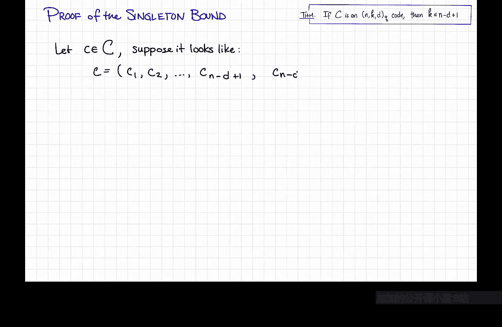

# 代数编码导论：13：Singleton界

在本节课中，我们将学习并证明一个关于码率与距离之间可实现性权衡的另一个不可能性结果，称为Singleton界。

## 概述 📋

Singleton界阐述了以下内容：如果一个码 **C** 是一个参数为 **(N, K, D)** 的 **q** 元码，即其码长为 **N**，消息长度为 **K**，最小距离为 **D**，字母表大小为 **q**，那么 **K** 至多为 **N - D + 1**。

在证明这个界之前，我们先直观感受一下它的含义。

## Singleton界的直观理解 📈

当 **q = 2**（二元码）时，图像大致如下。请注意，这张图的 **X** 轴是相对距离 **Δ**，**Y** 轴是码率 **R**。我们关心的是哪些 **(Δ, R)** 对是可实现的，即存在一系列码能达到这些参数。

在之前的课程中，我们学习了汉明界。汉明界指出，此区域之外的任何权衡都是不可实现的。

那么Singleton界说了什么呢？如果我们画出它，它看起来是这样的。它指出，此区域之外的任何权衡也是不可实现的。但我们从汉明界已经知道了这一点。因此，对于 **q = 2**，Singleton界并没有告诉我们任何新信息。它严格弱于汉明界，尽管它更简洁一些。

然而，当字母表大小 **q** 增大时，Singleton界可能变得比汉明界更强。

一般来说，图像更接近这样。随着 **q** 变大，汉明界开始呈现这样的形状，而Singleton界则保持不变。具体来说，在这个区域里，在本视频开始之前，我们可能认为获得此区域内的权衡是可能的。但现在我们知道事实并非如此。Singleton界排除了这种可能性。因此，对于较大的 **q**，Singleton界确实在汉明界之外告诉了我们一些新信息。

## Singleton界的证明 🔍

让我们来证明Singleton界。为了方便查看，我把它复制到这里。

**定理（Singleton界）**：若 **C** 是一个 **(N, K, D)** 的 **q** 元码，则 **K ≤ N - D + 1**。

首先，考虑我们 **(N, K, D)** 码中的一个码字 **c**。假设它看起来像这样：

即 **c** 是一个长度为 **N** 的向量，我刚刚写出了它的各个坐标。

接下来，我们将丢弃最后 **D - 1** 个坐标。让我们把剩余的部分称为 **φ(c)**。也就是说，我们丢弃这 **D - 1** 个坐标，而把前面的部分称为 **φ(c)**。

现在，考虑我们通过保留原码 **C** 中每个码字的前面部分而得到的新码 **C̃**。即 **C̃ = { φ(c) | c ∈ C }**。因此，**C̃** 存在于集合 **Σ^(N - D + 1)** 中，其中 **Σ** 是原码 **C** 的字母表。

我将提出两个主张。

以下是第一个主张：

**主张 1**：**|C| = |C̃|**。

为什么是这样？如果不是这样，那么在我们创建 **C̃** 时必定发生了碰撞。必定存在两个不同的码字 **c** 和 **c‘**，使得 **φ(c) = φ(c‘)**。但这样一来，我断言 **c** 和 **c‘** 之间的距离至多为 **D - 1**。这是因为如果 **φ(c) = φ(c‘)**，意味着它们的前面部分相同，所以它们只能在最后这部分坐标上不同，而这里最多只有 **D - 1** 个坐标。但原码的最小距离是 **D**，这将导致矛盾。因此，主张 1 成立。

以下是第二个主张：

**主张 2**：**|C̃| ≤ q^(N - D + 1)**。

这是成立的，因为 **C̃** 是 **Σ^(N - D + 1)** 的一个子集。特别地，**C̃** 的大小不可能大于该集合的大小，即 **q^(N - D + 1)**。

综合起来，这两个主张意味着 **|C| = |C̃| ≤ q^(N - D + 1)**。如果我们对两边取以 **q** 为底的对数，可以看到消息长度 **K**（根据定义，**K = log_q(|C|)**）至多为 **N - D + 1**。这正是我们要证明的。因此，Singleton界得证。

## 总结 ✨

本节课中，我们一起学习了Singleton界。我们了解到，对于任何 **(N, K, D)** 的 **q** 元码，其消息长度 **K** 受到 **K ≤ N - D + 1** 的限制。我们通过构造一个“截断”码并分析其大小的方式证明了这一点。对于小字母表（如二元码），这个界弱于汉明界；但对于大字母表，它能提供更强的限制，帮助我们排除一些理论上不可行的码率与距离组合。