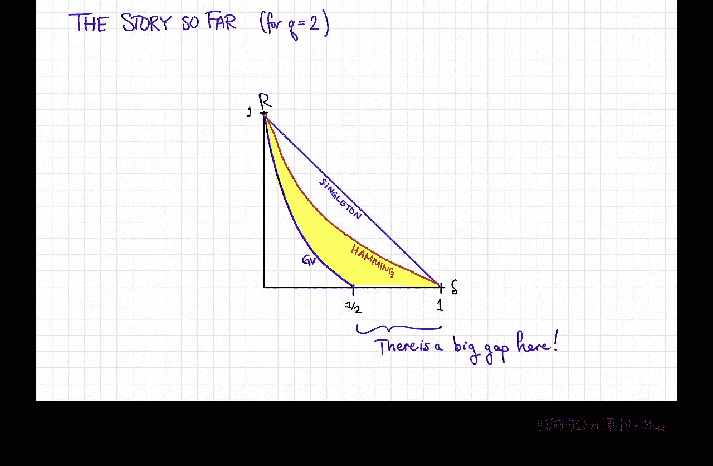
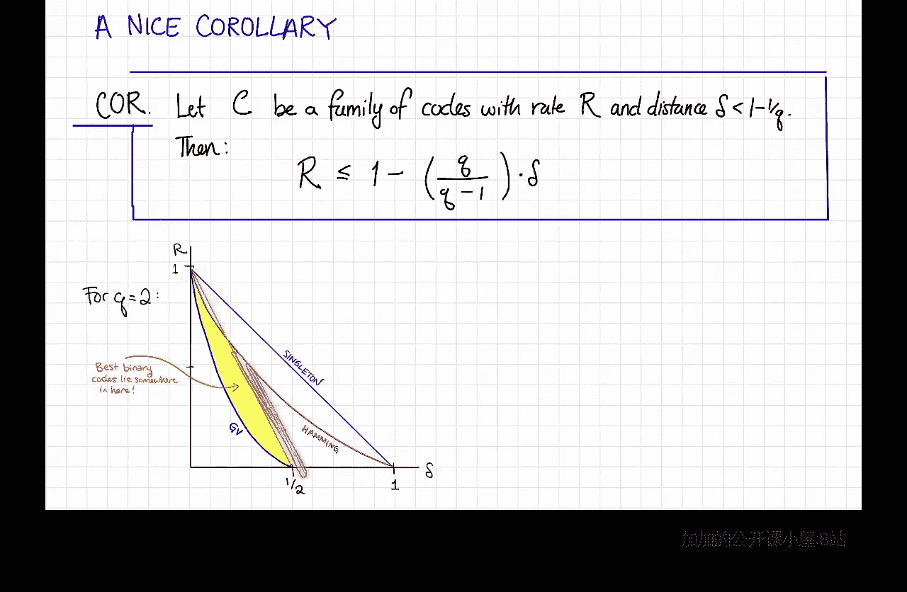
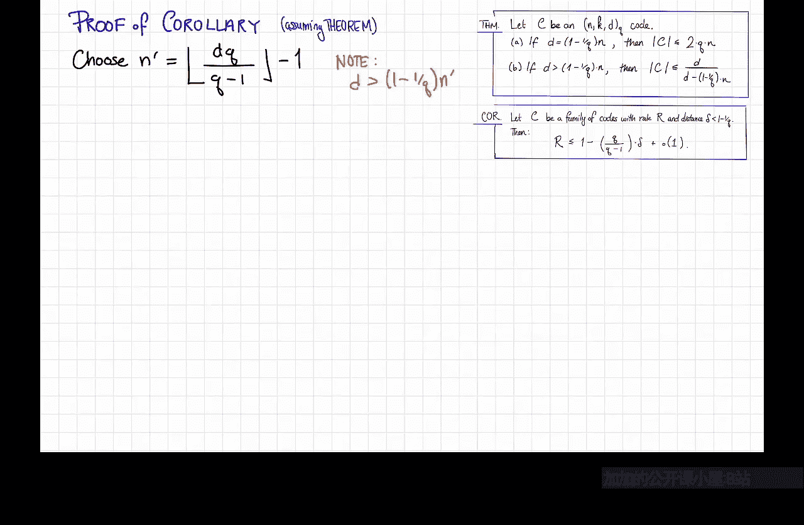
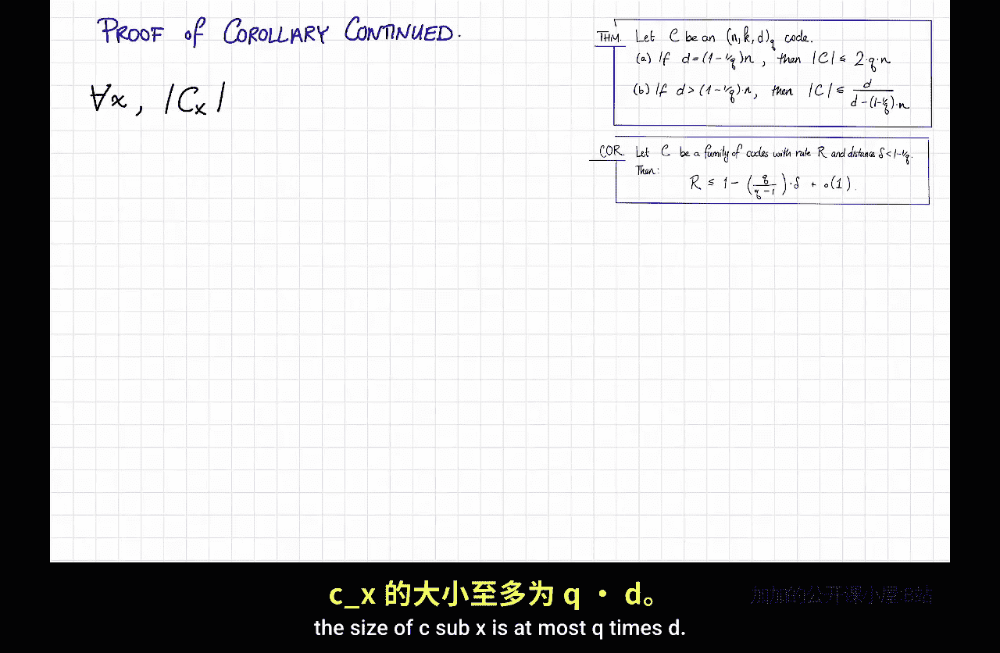
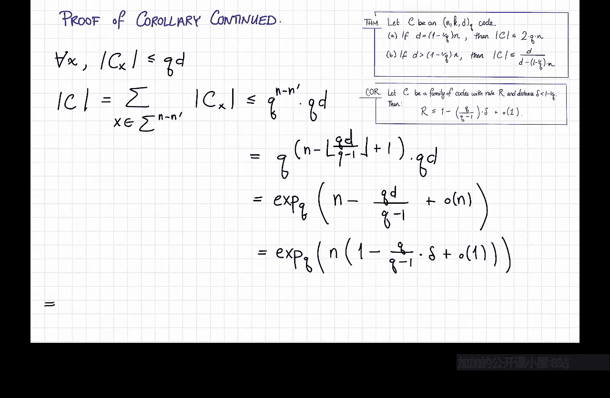
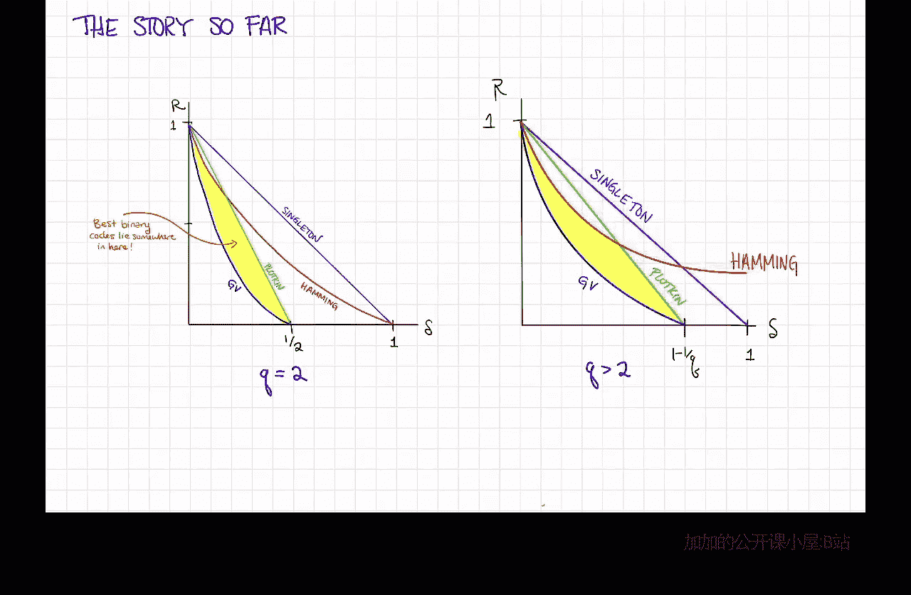
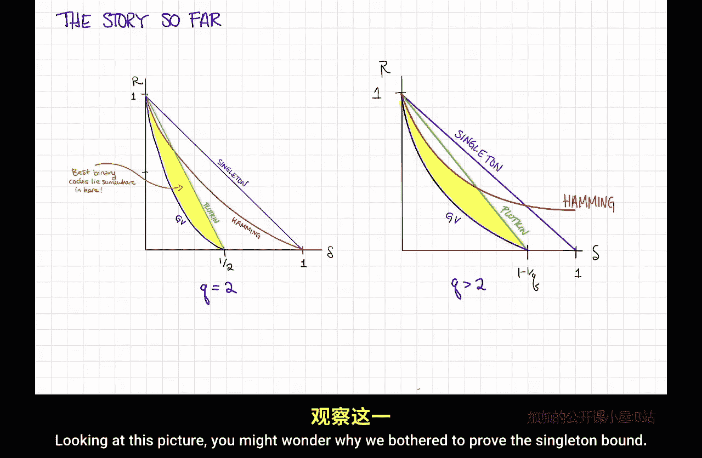
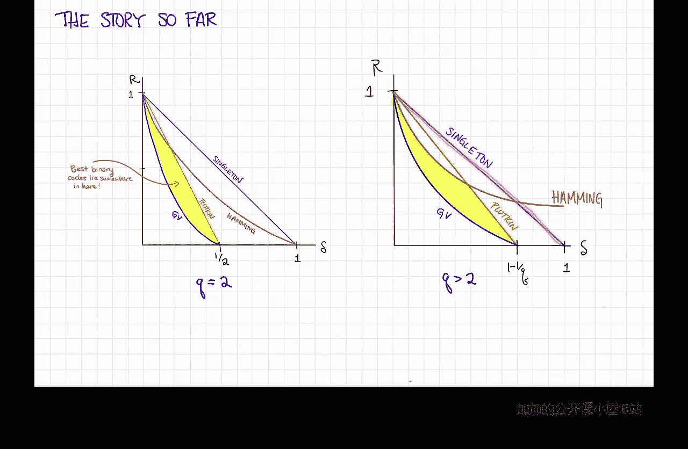
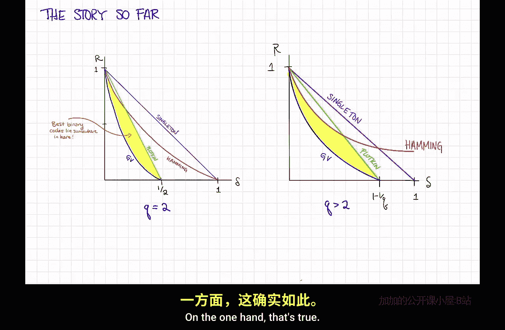
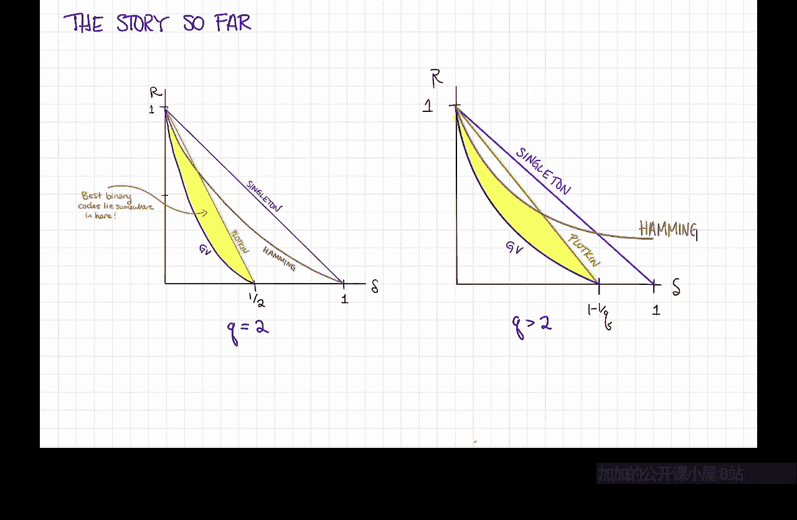

# 斯坦福大学【中英⚡代数编码导论｜Introduction to Algebraic Coding Theory】 p14 p13 4, Video 2： The Plotkin Bound -BV16sRYYTEwg_p14-

In this video， we'll see one more impossibility result known as the plotkin bound。

So here's the story so far， at least for Q equals 2。

 at least for the trade off between rate and distance。

So we saw the hamming bound and the singleingleton bounds。 These are impossibility results。

 They say that these trade offs between rate and distance appear， are not achievable。

We also saw the Gilbert Vrssashov Bo。 That's a possibility result。

 And it says that these trade offs down here。Are achievable。And we were left with the question。

Are trade offs in here， this yellow region achievable or not。Let's focus in on this big gap here。

This gap might make you wonder whether or not it's possible to get trade offs， say here。That is。

 for a binary code， is it possible to have distance greater than a half and rate greater than 0。

It turns out that the answer is no。 and this is what the plot con bound tells us。

So here's what the plot con bound says。Let see be an N， K， DQ code。

Then the following two things are true。First， if the distance D of C is equal to 1-1 over  Q times n。

 So if  Q is equal to 2， that says the distance is right here at one half。

Then the size of the code is at most two times Q times n。Further。

 if the distance is bigger than that， appear somewhere。Then the size of the code is smaller， still。

 smaller than d divided by d minus1 minus1 over  Q times n。The punchline here。

Is that the answer to our previous question is no。 That is， this implies。

That if the relative distance delta is greater than equal to 1-1 over  Q。

That is in the picture we're sort of in this region over here。Then the rate of the code are。

Which remember， is equal by definition to the log base Q of the size of C divided by N。Must go to 0。

As N goes to infinity。That's because the log base Q of either of these things divided by n tends to 0 as n goes to infinity。

So that means that out here。The rate better be0。We're going to om the proof of the plot can in these videos。

 but you can check out the lecture notes for pointers to approve。However。

 we will state and prove the following useful corollary。

 which extends the plot and bound to delta that is less than1 minus1 over  Q。

So here's what the corollary says。Let's see be a family of codes with rate R and distance Delta。

 which is less than 1 minus1 over  Q。So in the picture， now we're over in this region。

Then this corollary says the rate R is bounded above by 1 minus。

Q divided by  Q -1 times delta plus some little o of one term。That is。

 this is a term that goes to0 as n goes to infinity。Actually。

 I guess since this is a statement about a family of codes with asymptotic rate R。

 we're taking n to infinity anyway。 So I'm just going to erase that。There we go。

 here's a nice corollary。So， for Q equals 2。The picture looks like this。

We've got our singleleton bound and our hamming bound and our G V bound as before。

 and the plot can bound， comes down like this。So it's a little bit worse than the heming bound over here。

But it's better than the pluming bound as Delta is larger over here。

So this is the picture for Q equals 2。 What about for Q greater than 2。

Pause the video now and think about what the picture is going to look like as Q gets larger。Okay。

 so hopefully you've figured out that the picture looks something like this for larger Q。 Again。

 this is just a stylized picture that's drawn by hand， not an actual plot。

So we have the singleleton bound， and the plot can bound。 These are just straight lines。

 The singleleton bound doesn't depend on the alphabet size。 It's always just this straight line。

 and the plot can bound。Is going to be a straight line ending at this point，1-1 over Q。Notably。

 that is also where the GV bound ends up。Okay， so like I said。

 we're not going to prove the plotkin bound that's this theorem here。

But we are going to prove this corollary。Assuming the theorem。 So let's do that now。First。

Let's choose。A parameter n prime。To be equal to the floor of D times Q。Divided by  Q -1。-1。

Just a note。This implies that D is strictly greater than 1-1 over Q times n prime。

So this looks like a funny expression， but we only chose it basically to make this true。Now。

 for all X。In sigma to the n minus n prime。Let's define a new code。C sub x。

Which is equal to the set of vectors， C N minus n prime plus 1。C， n minus n prime plus 2。

Data dot up to C。Such that C。Is a code word in our original code。So that the first part of C。

 that is C 1 up to C n minus n prime。Is equal to x。That is。

 C sub x is the set of ends of code words in C so that the beginnings are equal to x。

So these are the last and prime symbols。And these are the first n minus n prime symbols。Now。

 I claim that C sub X has distance at least D。To see why， let's draw a picture。

So let's consider two code words in C， C and C prime that both have the same beginning， X。

That means that this thing here is a code word in Cx， and this thing here is also a code word in Cx。

And I claim that these two things must have distance from each other， at least D。

But that's true because the original two code words C And C prime had to have distance from each other。

 at least D， Cause C has distance D。But if these original two things must have distance D and they agree here。

 then all the distance must be coming from this end part。

And so the corresponding code words in CX also have distance at least D from each other。

So that shows that CX has distance at least B。Also， let's observe that C sub x。Has length and prime。

Which as noted before is at most d divided by 1 minus1 over  Q。Now， let's apply our theorem。

 which I copied up here to Ca Becks。The theorem implies。That the size of C sub x。

Is at most D divided by D-1-1 over Q times n prime。That's part B of the theorem。

Multiplying the top and the bottom by Q， we see that this is equal to Q times D。

Divided by Q times D minus Q minus-1 times n prime。And this is at most， Q times D。

The reason this is at most Q times D is that this denominator。Is greater than 0， and it's an integer。

 so it better be greater than or equal to one。Okay， so the size of each C sub x is at most Q times d。

Let's go on to a new slide and recall that we just showed that for all x。

 the size of C sub x is it most Q times D。

Now， I claim that we have。The size of C。Is equal to the sum over all x and sigma to the n minus n prime。

Times the size of C x。That's because the size of C to x is just the number of code words in C that start with X。

 and every code word in C has to start with something， so just add them all up。Now。

 applying what we just learned。We see that。 This is at most。Q to the n minus n prime。Times Q D。

Using the fact that this sum has cud the n minus n prime things in it。

And plugging in the definition of N prime。This is Q to the n minus the floor of Q D divided by  Q minus1 plus 1 times  Qd。

I'm going to write this as X sub Q。 That just means Q to the stuff。 So Q to the n minus。

QD divided by Q minus-1。Plus， a little o of nern。Here。

 this little o of n term is capturing the floor on that and the plus one and stuff like that。

Pulling out an end。This is equal to x sub Q。 Again， that just means  Q to the stuff。

Of n times1 Q over Q -1 times delta， the relative distance。

 Remember that Delta is just D divided by n。 That's why it shows up here。Plus。

 a little o of one term。

Altogether， this implies that the rate R。Which remember， by definition。

 is equal to the log base Q of C divided by N。Is at most。This thing。

1 minus Q divided by  Q -1 times delta。Plus， little o of one。And that's what we wanted to show。

So this proves this nice corollary to the plot can。So to summarize。

 here is what we know so far about the best possible trade offs between rate and distance。

We have seen impossibility results。 The singleleton bound， the heming bound。

 and now the plot can bound。

Which limit what trade offs between rate and distance are possible。And we've also seen the GV Bo。

 a possibility result。Looking at this picture， you might wonder why we bothered to prove the singleleton bound。

 It seems like the plotkin bound always strictly dominates it。

On the one hand， that's true。

On the other hand， in a future video， we are going to see a family of codes that achieves the Singleton bound。

Before we get there， you should think about how that might be possible。

 given the plot and that we've just proved。

