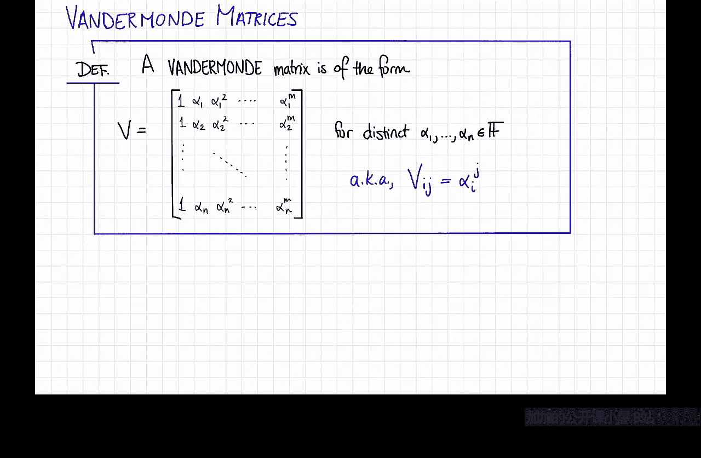
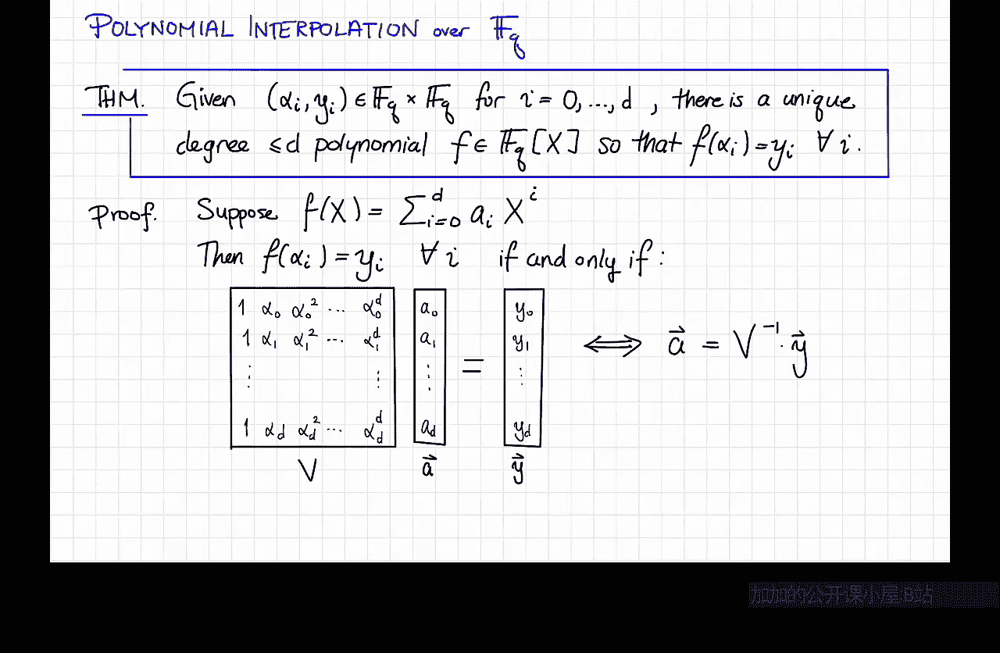
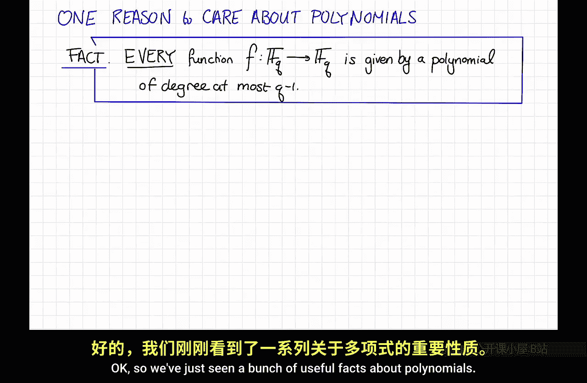
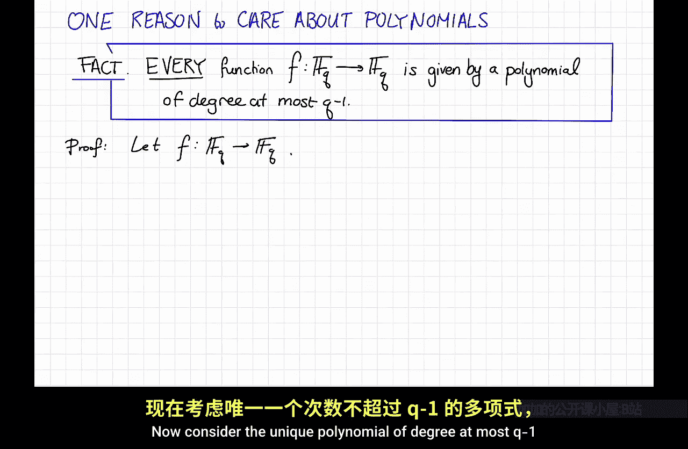
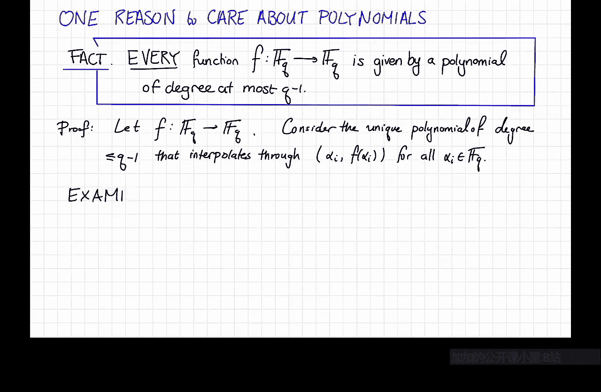

# 斯坦福大学【中英⚡代数编码导论｜Introduction to Algebraic Coding Theory】 p15 p14 4, Video 3： Polynomials over finite fields -BV16sRYYTEwg_p15-

Soon， we are going to define Re Solomon codes， a family of codes that meets the singleleton bound and admits fast algorithms and is just generally really cool and useful。

But before we get there， we need to talk about polynomials over finite fields。

We can define a polynomial over a finite field the same way as we do over the reels。That is。

 we say that a univariate polynomial in the variable capital X over the field F Q of degree D。

Is of the form。F of x equals a n plus a1 times x plus a2 times x squared plus dota dot plus A D times x to the D。

Where all of the coefficients AI come from this field。And the top coefficient AD is non zero。

The collection of all Uniivevariate polynomials in the variable capital X over F Q is denoted like this as F Q square brackets。

 capital X。Just a note， depending on your background。

 using a capital x as a variable in a polynomial is either totally normal or totally weird。

If it's totally weird， sorry， we're going to do it。

A useful fact about polynomials over the reels or over finite fields is that low degree polynomials do not have too many roots。

More precisely， a non zero polynomial F of degree at most D has at most D roots。Here。

 a root of a polynomial is just a value x and Fq， so that f of x is equal to 0。

 So this is saying the number of xs so that f of x is equal to 0 is at most D for a degree D polynomial。

This fact is just stupidly useful。 We are going to use this again and again and again throughout these videos。

😡，In fact， this fact is so useful that we are going to introduce a new character。 Polly。

 the polynomial interpolation parrot， just to emphasize this fact。All right。

 load of polyormials don't have too many roots。Thanks， Polly。Okay， so why is this fact true？

If you believe that sort of polynomial arithmetic over FQ works roughly the way it ought。

 here's a quick proof。So， proof。If f of alpha is equal to 0 for some particular alpha in Fq。

Thenhan the polynomial x minus alpha。 So this is a degree1 polynomial。 This divides F of x。

But that means that if F of X had， let's say， D plus one roots。Say alpha1 up through alpha d plus 1。

Then， the product。Of all of those polynomials， X minus alpha I is going to divide F of x。

But this is a degree D plus1 polynomial。 So that means that F better have degree at least D plus1。

Okay， so this is not a full proof because we're sort of assuming that polynomial division and roots and stuff like that works kind of the way you expect it to。

 but if you believe that， then hopefully this convinces you that a polynomial degree at mostD has at mostD roots。

If you want a foolproof from first principles， go check out an algebra textbook。

Just to make sure we understand this extremely useful fact that low degree polynomials don't have too many roots。

 let's look at some quick examples over F3。To check your understanding。

 pause the video now and figure out how many routes each one of these polynomials has over F3。Okay。

 so here's the answers。F of x equals x squared minus-1 has two roots over x3。

Those two roots are one and two。And we can see that just by checking that F of2 is equal to f of 1 is equal to zero。

And we can see that there's not a third root because F of 0 is equal to -1 or 2 mod 3。

 which is decidedly not 0。Similarly。X squared plus 2 x plus 1。Has one root over F3。

It's because F of 2。Is equal to9， which is equal to0 mod 3。And once again。

 you can check that neither zero nor one are roots of this polynomial。

And f of x equals x squared plus 1 has zero roots。To see that， we can just check。

That f of 0 is equal to1。F of1 is equal to 2。And if of two is equal25， which is equal to 2 mod3。

In particular， these examples show that while degree2 polynomials in this case have at most two roots。

They might have fewer than two roots。Notice also that this last polynomial x squared plus 1。

This does have a root in F 2。Because1 plus 1 is equal to0 mod 2， so f of 1 is equal to0 mod 2。

So this shows that the choice of field matters for the number of roots of a polynomial。

A useful concept when talking about polynomials over finite fields and polynomial evaluation and polynomial interpolation is vanderband matrices。

So here's a definition。 A vandermond matrix is a matrix of this form。That is。

 we're going to pick n distinct values Al 1 up through alpha n in some field F。

And then we're going to let V be the matrix so that the I Jth entry of V is alpha I to the J。

 so it looks like this。So the first column is just a column of ones。

 That's all of the alpha I' is to the0。 The next column is just all of the alpha I's。

 The next column is all of the alpha I' squared and so on up to all of the alpha I's to the M for some integer M。

A useful fact about vandermond matrices is that square vandermond matrices are invertible。

Here's a quick proof。Let V be a square Vderon matrix。We want to show that V is invertible。

 which is equivalent to showing that the kernel of V is just 0。That is， we'd like to show。

That if v times a is equal to 0 for some vector A， then a itself must be 0。Allright， well。

 let's check this。Suppose that a is the vector with coordinates， a 0， a 1， A2， dot dot dot。

 then V times a。Is equal to a vector。Where the first entry is the sum over I of A I。

 Alpha 1 to the I。The second entry is the sum over I， A I， Alpha2 to the I， and so on。

All the way up to AI alpha n to the I。Here， this is just the definition of matrix vector multiplication when the matrix in question looks like this。

But now， this is equal。To the vector with entries。F of alpha 1。F of alpha 2， dot， dot， dot。

 F of alpha N。Where F of x。Is the polynomial。Some over I， AI X to the I。

Notice that the degree of this F is less than or equal to n -1。Since this sum here。

 sorry that I didn't write the indices goes from0 to n minus1。This implies one of two things happen。

Either。F is the zero polynomial。Which implies that a itself is equal to 0。

Or F is a non zero low degree polynomial。All right， load of polynomials don't have too many roots。

Thanks， Polly。So since low degree polynomials don't have too many roots。

 that would imply that F of X。Has strictly less than n roots。And that implies that v times a。

Is not the zero vector。Because v times a consists of n polynomial evaluations。

 and strictly less than n of them can be0。Thus， either a is equal to0 or v times a is not equal to zero。

 and that's what we wanted to show。Okay， so square vanderon matrices are invertible。

Let me erase this proof that we can have space to write a corollary。So the corollary。

Is that any square sub matrix of a Vderbon matrix is also invertible。Here's a proof。

Any such submatri looks like this。That is， it's an R by R matrix so that the Jaith powers。

Some of the alphas live here。The J plus first powers are there and so on。

But this matrix is equal to d times v。Where D is a diagonal matrix。With diagonal and trees。

Alpha i to the J。Alpha I plus1 to the J。Up through alpha I plus R to the J。

And V is a vander bond matrix。So by the fact， V is invertible。

 and D is a diagonal matrix with non zeros on the diagonal。 So it's also invertible。

 So their product is invertible。 So that proves the corollary。

Those facts about vander bondd matrices imply the very useful fact that polynomial interpolation。

 quote unquote，  works over FQ。So what do I mean by that？Here's a theorem。

Suppose we are given D plus 1 pairs， alpha I Y I for I equals 0 up to D。

And think of these as pairs of evaluation points and values。

Then there is a unique polynomial of degree at most D。Called F。

So that F of alpha I is equal to Y I for all I equals 0 up to D。Here's a proof。

Let's write a polynomial F。As the sum from I equals 0 to D of AI times x to the I。

 where the AI are going to be coefficients in Fq。So for such a polynomial F。S， of alpha I。

Is equal to Y I for all I。If and only if the following linear system is satisfied。So here。

We have a square vandermon matrix， V。Where the evaluation points are alpha not up through alpha D。

Here。We have a vector A whose entries are the coefficients of the polynomial。

And just like we saw on an earlier slide， when we multiply V by a。

This is basically the same as just evaluating the polynomial F and all of these evaluation points。

 alpha not for alpha D。And so what it means for F of alpha I to be equal to Y I is that this matrix vector product。

Is equal to the vector Y， whose components are just y not up through Y D。

But because square vandermond matrices are invertible， like we just saw。

This linear equation holds if and only if the vector a。Is equal to v inverse times y。

So that means that the unique polynomial F that interpolates these points。

Has coefficients given by v inverse times y。

And that proves the theorem。Just a note。This proof actually shows that not only is there a unique such polynomial F。

 but actually， we can find it very efficiently。All we have to do is solve a linear system。Actually。

 we can find it even more efficiently than that。 It turns out there's sort of a fast Fourier transform type algorithm that you can use to multiply by a vandermon matrix or its inverse。

So actually we can find these coefficients A in time something like D log D。Okay。

 so we've just seen a bunch of useful facts about polynomials。

Why do we care so much about polynomials over finite fields。

One reason is this other fact about polynomials， which is that every function F from a finite field Fq to the finite field Fq is given by some polynomial。

 some polynomial degree at most  Q -1。Here's a proof。Suppose that F is some function from F Q to Fq。

Now， consider the unique polynomial of degree at most  Q -1。

That interpolates through all the points in FQ。Such a polynomial exists by the theorem that we saw in the previous slide。

But now this polynomial is exactly the polynomial we're looking for。

 it agrees with F on every single point in the field， and it has degree at most Q minus-1。

One quick example of this。

Consider the polynomial F of x equals x to the Q。By the fact above。

 this must have some representation as a polynomial degree at most Q -1。What is it？

If you're familiar with finite fields， you might guess correctly that its F of x is just equal to x。

The reason for this is another useful fact。Which is that。For all alpha in Fq。

Of the Q is just equal to itself。So that implies that this polynomial。

Has exactly the same evaluations as this polynomial。As for why this fact is true。

That's a fun exercise to try to prove it yourself。 Or you can check out an algebra textbook。😊，Okay。

 now we know all of the facts about polynomials that we need to know to define read Solomon codes。

 we'll do that in the next video。