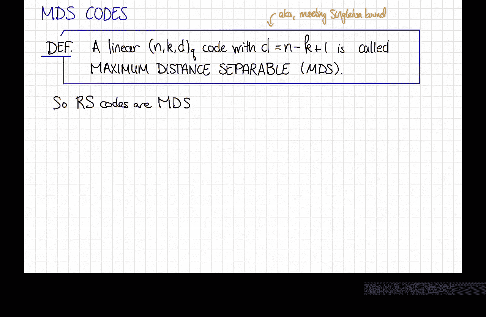
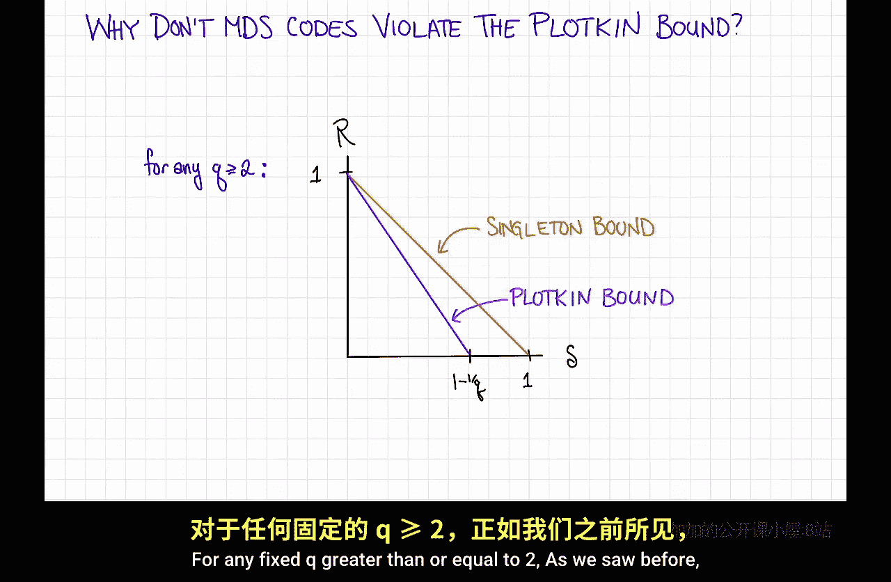
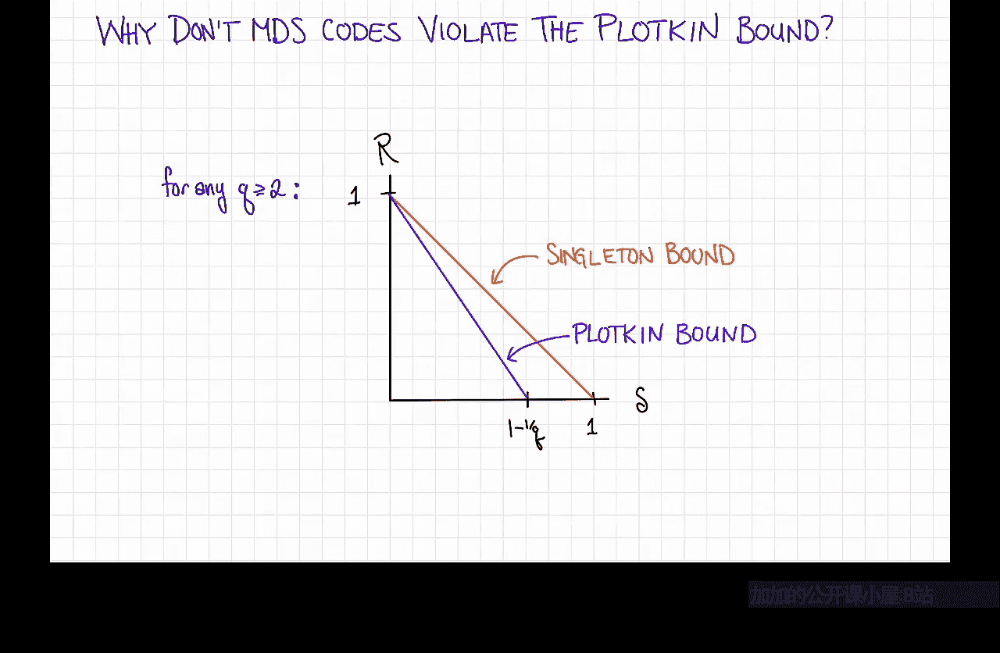
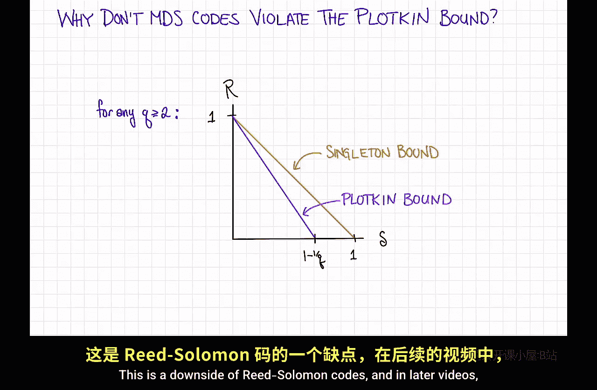
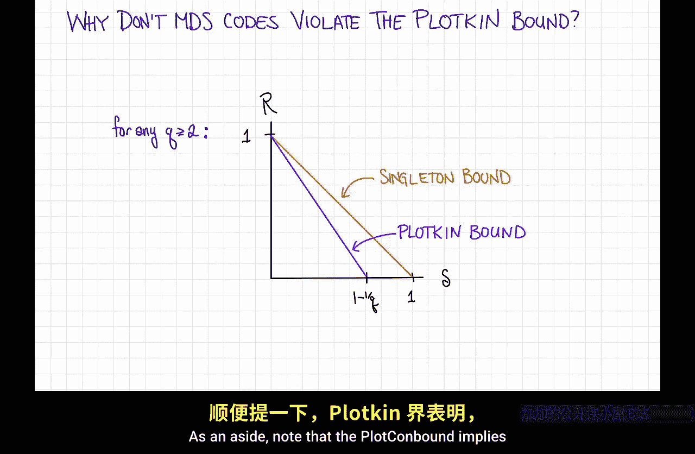
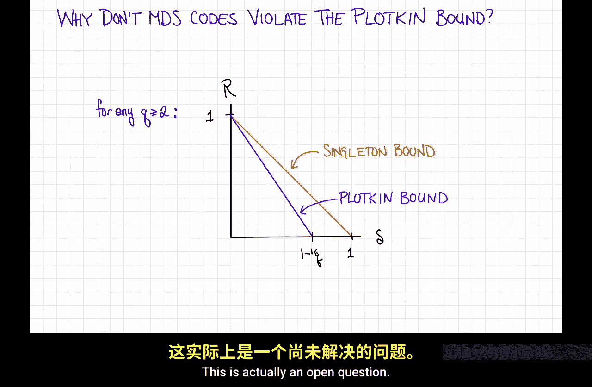

# 斯坦福大学【中英⚡代数编码导论｜Introduction to Algebraic Coding Theory】 p16 p15 4, Video 4： Reed-Solomon Codes! -BV16sRYYTEwg_p16-

In this video， we'll introduce Reed Solomon Cos。As you can tell from the decoration on the title screen here。

 I get pretty excited about these。I might even add a sound effect if I can figure out how。🎼Yeah。

 there we go。So read Solomon codes are a family of NKQD codes。That first。

 achieve the singleton bound。 That is n is exactly equal to D plus K -1。

They admit efficient encoding and decoding algorithms。And because of these things。

 they are used all over the place in practice。The basic idea。Behind read Solomon codes。

Which we've seen before。 All right， Mo polynomials don't have too many roots。Thanks， Polly。 Yeah。

 so the basic idea is， as Polly， the polynomial parrot says。

Low degree polynomials do not have too many roots。In particular， as we'll define on the next slide。

 the code words of read Solomon code are going to consist of evaluations of low degree polynomials。

So low degree polynomials， not having too many roots means that these code wordss don't have too many zeros。

 AK， the distance of the code is good。More precisely， here's a definition of read sallomon codes。

Let Q be greater than equal to n be greater than equal to K。And let's choose n distinct points。

 Al 1 through alpha n in F Q。Then the read Solomon code of dimension K over F Q with those evaluation points。

 Al Alpha went through alpha N。Is the following。So I'm going to denote it Rs subq of alpha N K。

And when alpha is clear from context and Q is clear from context， I might just write RS N K。

And this is defined as the following set。 So it's the set of all vectors of the form F of alpha 1。

 F of alpha 2， dot dot dot up to F of alpha N。Where F is a polynomial over Fq of degree at most k -1。

So the read Solomon code of dimension K with evaluation points alpha is the set of all such vectors。

Just a note， this definition implies a natural encoding map。That is。

 the map is the one that takes a message。A not a1 dotta dot up to a K -1。

And maps it into the code word。F sub a of alpha 1。F sub a of alpha 2。Dottat， dot F sub A of alpha N。

Where F sub a of x is the polynomial。That is the sum from I equals 0 to k -1。Of AI X to the I。

There are other natural and reasonable encoding maps for read Solomon codes。

 but this is the one that we're going to think about foremost most of this course。

Here are some useful properties of REsal codes。First。

 read Solomon codes are linear codes with Vderbond matrices as generator matrices。More precisely。

 consider the code with evaluation points， alpha and dimension K。

Then the generator matrix for this code is this vandermond matrix。 It has evaluation points。

 also alpha。So it has N rows， and then it has K columns。

We've essentially seen why this is the generator matrix in a previous video。

 If you multiply this matrix by some vector a。You're essentially evaluating the polynomial whose coefficients are a at these points。

 alpha1 through alpha n。The next nice property of read Solomon codes is that the distance of a read Solomon code with block length N and dimension K is exactly D equals n minus K plus 1。

So here's a proof。First， since Re Solomon codes are linear， as we just saw。

It suffices to show that the minimum weight is not too small。

More precisely that the minimum weight is n minus k plus 1 of any non zeroro code word。

But that's the same as asking with a maximum number of zeroes in any code word。Is K -1。

That is n minus this。And that's the same as saying that the number of roots。Of any。Degree at most。

 K -1 polynomial。Is k -1。And this is true。 All right， Mo polyormials don't have too many roots。

 Thanks， Polly。Notice that for these if and only if arrows to strictly make sense。

We should argue not only that low degree polynomials don't have too many roots。

 but also that there is a polynomial of degree at most K -1， which has K -1 roots。

This is also true if it's not clear， immediately， pause the video and figure out why。

A corollary of this proposition。Is that Re settlementloman codes exactly meet the singleingleton bound。

Remember from a previous video that the Singleton bound said that the distance D was always at most n minus K plus  one for any code。

And now we see that read Solomon codes exactly achieve that。 Pretty cool。

A code that exactly meets the singleingleton bound is called a maximum distance separable code。

So what we've just seen is that read Solomon codes are maximum distance separable or MDS。

1 observation about MS codes。Is that a code is MDS？If and only if。

Every K by K sub matrix of its generator matrix。Is full rank。That is。

 if the generator matrix looks like this。And I choose any K rows。Say those ones。

Then the submatri formed by just those K rows。Is going to be full rank。

Here this generator matrix is meant to be K by n。To see why this is true。Notice that distance。

N minus K plus 1。Means that a code can correct n minus K erasureers。And in our picture over here。

 that looks like this。We have our message X that we multiply by our generator matrix G。

To get some code word C。 And now we have n minus K erasureers。Let's say those symbols got erased。

Leaving us with K remaining linear equations。But being able to recover X from those K linear equations is exactly saying that this sub matrix formed by those K rows is full rank。

So that's a nice， useful property of MDS codes。Notice that read Solomon codes have Vdermon matrices as generators。

 and we already saw that this property was true for vandermond matrices。 so that checks out。

Another observation。Is that。If C is an MDS code。With parameters， N， K D in Q。

Than any K positions of the code word C。Determine the entire code word。

This is just another way of saying that the code can correct n minus K erasureers。

 but sometimes it's nice to think about it in this way instead。

Let's try to put MDS codes in the context of the bounds on rate distance trade offs that we've shown before。

So remember that we had this picture。 This is a picture of two of the bounds that we've seen before。

 We've seen the singleleton bound， and the plotkin bound。Both of these are impossibility results。

 and they say that trade offs on this side of the line are impossible。For any fixed Q。

 greater than or equal to 2。

As we saw before， the plot can bound is strictly better than the singleleton bound。That is。

 it says that the singleingleton bound is never achievable。

But we just said that an M D S code is defined as a code that achieves the singleingleton bound。

 And we gave an example of such a code to read Solomon code。 How can this be。

The secret is that this picture holds for any fixed cue。But for read Solomon codes。

 the alphabet size Q is not fixed。 It's actually growing with the block length N。

This is a downside of read Solomon codes， and in later videos we'll see some ways to try to make the alphabet size smaller。

As an aside， note that the plot can implies that any family of MDS codes must have alphabet size growing with the block length。

How fast does it have to grow？This is actually an open question。

 There's a conjecture called the MDS conjecture， which states that read Solomon codes have basically the optimal alphabet size。

 but it's still open。

