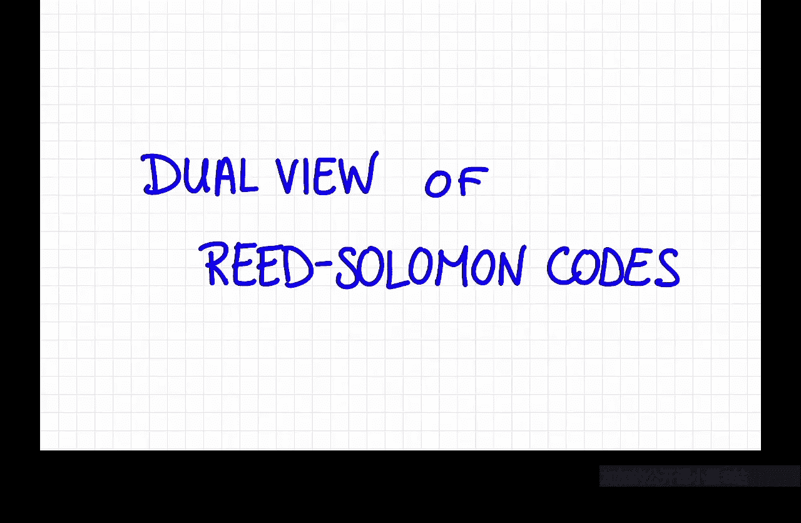
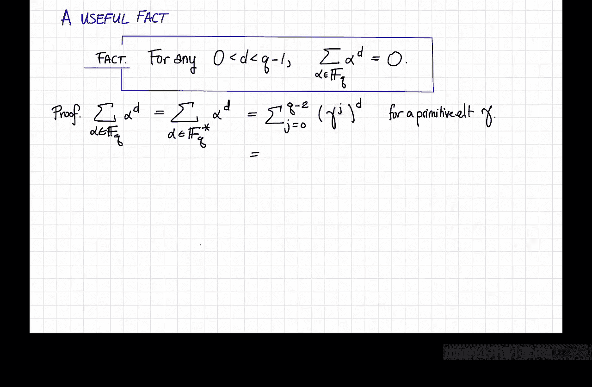
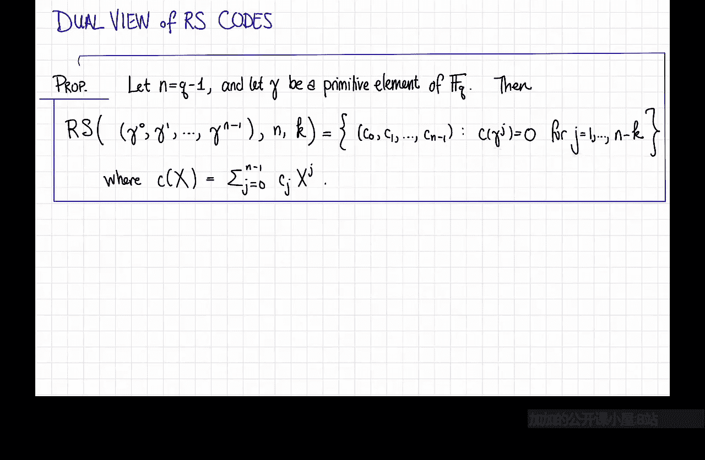
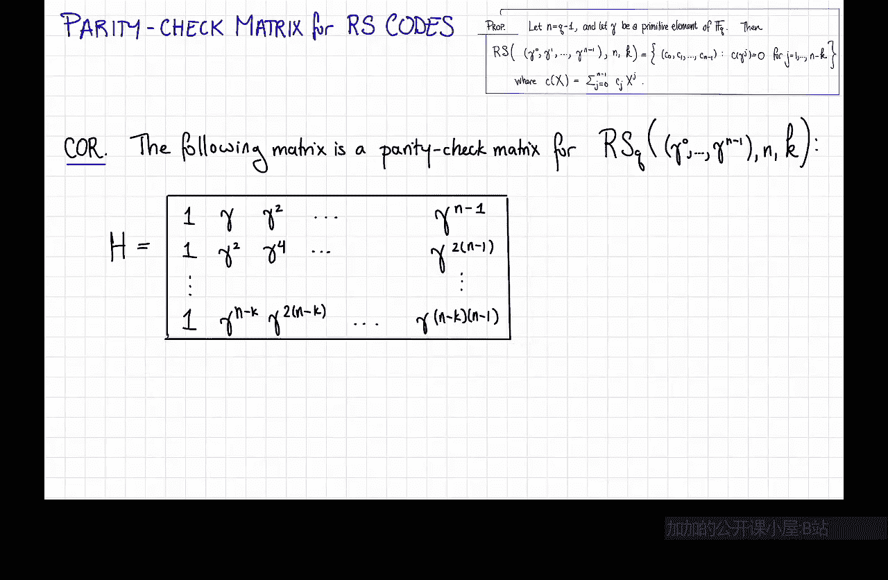
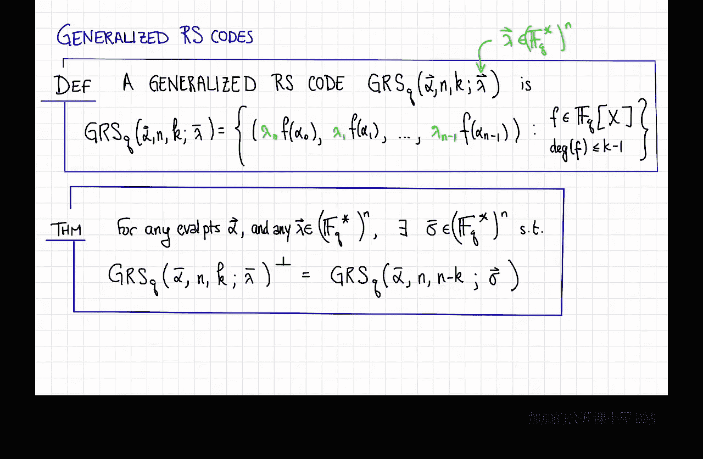

# 斯坦福大学【中英⚡代数编码导论｜Introduction to Algebraic Coding Theory】 p17 p16 4, Video 5： The dual view of RS codes -BV16sRYYTEwg_p17-

In this video， we'll work out parity check matrices for read Solomon codes。Before we start。

 we need a few more algebra definitions。Our first definition is of FQ star。F。

 Q star is what will define to be the multiplicative group of non0 elements in F Q。That is。

 is just the set of all the non zero elements in FQ。In this context。

 multiplicative group means that it's a group under multiplication。

 That just means that it's closed under multiplication and undertaking multiplicative inverses。

Here's an example。Consider the field F 5。Which， as we've seen， is equal to the number 0，1，2，3，4。

With addition and multiplication， mod 5。Then， F 5 star。Is just all the nonzero elements of F5。

 so that's 1，2，3，4。With multiplication mod 5。Notice that I no longer want to define addition on this set。

 because， for example，2 plus 3 is 0， which is not in the set。 So let's just stick to multiplication。

Here's a fact about FQ star。It forms a cyclic group。

What that means is that there is some element gamma in F Q star。

So that FQ star is generated by gamma。That means that F Q star is equal to the set gamma。

 gamma squared， gamma cubed， dot dot up to gamma to the Q -1。

Such a gamma is called a primitive element of FQ。Sorry， this star shouldn't be there。

Returning to our example。2。Is a primitive element of F 5。

Because if we take two and start powering it up， we get 2， and then two squared is equal to 4。

2 cubed is equal to 8， which is 3 mod 5。2 to the fourth is equal to 16， which is1 mod 5。

And this set is equal to F5 star。We've got one， two， three， four。On the other hand。

4 is not primitive。Because if we take four and start powering it up。We get 4 squared equals 1。

For cubed。Is back to 4 modd 5。4 to the fourth is equal to1 mod 5。And so on。

So we're only ever going to get one，4， one，4， one，4， one， four， we'll never get three or two。

Here's a useful fact about finite fields。For any D greater than 0 unless than  Q -1。

The sum over all alpha in a finite field Fq of alpha to the D is equal to 0。

Here's a proof of this fact。So the sum over all alpha and F Q。Of alpha to the D。

This is also the sum over all alpha in F Q star。Of alpha to the D， because we're just leaving out 0。

 and that would only contribute 0 to the sum。And this is the sum。From J equals 0 to Q minus2。

Of gamma to the C， to the D。Where gamma is a primitive element。

That's because as we iterate over all of these powers of gamma。

 we're going to iterate over all of the elements of FQ star by definition。

Just to note that here I'm having the powers of gamma go from 0 to q -2 instead of from 1 to  Q -1。

 like I did on the previous slide。 It turns out these are the same。 Do you see why。If not。

 we'll see why I in just a minute。Okay， so now I can switch the order of these two exponents。

This is equal to the sum from j equals 0 to Q minus2。

Of gamma to the D to the J。And this is equal to 1 minus。Gamma to the D to the Q -1。

Divided by1 minus gamma to the D。Why is this true？Well。

 you might remember a formula like this that works over the real numbers or something like that。

 It works just fine over finite fields， too。For concreteness， let's prove this real quick。

So for all x not equal to1。1 minus x。Times the sum from j equals 0 to let's say t minus1 for some t。

Of x to the J。Is equal to 1 minus x to the T。You can see that just by multiplying it out。

 you basically get this telescoping somewhere everything cancels except the first one and the last term。

And so dividing both sides by 1 minus x， which we can do since x is not equal to1。We see that。

 this sum。Is equal to 1 minus x to the t divided by 1 minus x。

So now we're just going to apply this with X gets gamma to the D。And we get that。

But now I claim that this thing is equal to one。That is gamma to the D to the Q -1 is equal to1。

 And this is because gamma to the D to the Q -1 times gamma to the D is equal to gamma to the D to the Q。

And if you recall， we saw a fact in a previous video that said that this is just equal to gamma to the D。

 Anything in F Q， when you raise it to the Q is just equal to itself。

So dividing both sides by gamma to the D。This implies that。Gammma to the D to the Q -1。

Is equal to one。Just to note， this explains earlier why it was okay to shift the indices from 1 toq 1 to 0 toq 2。

Gammma to the0 is equal to gamma to the Q minus-1。 they're both equal to1。Okay。

 but now we can use this logic here。To see that this is equal to 1 minus1 divided by 1 minus gamma to the D。

And that's equal to zero。Here， were using the fact that gamma to the D is not equal to one。

And that follows since D is not equal to 0 or  Q -1。 And as we just saw。

 gamma to the 0 or gamma to the  Q -1 are equal to 1。 But for any D in between。

 we have to get all of the other elements becauseuse gamma is a primitive element。

 So we're not going to get one that way。So this is zero， divided by something non zero。

 and that's zero。So， that proves this fact。Using that fact。

 we can now prove this proposition about Read Solomon codes。

 which gives us another way of looking at them。So the proposition says， let n be equal to Q -1。

And let gamma be a primitive element of FQ。Then consider the read Solomon code with evaluation points。

Gammma to the 0。 gamma to the  one1 dotta dot gamma to the n -1。With block length N and dimension K。

The proposition says that this is equal to the set of all vectors。 C n C1， dot dot dot up to C n -1。

So that C of gamma to the J is equal to 0 for all J between1 and n minus K。 And here。

 C is the polynomial C of x。Which is given by the sum from J equals 0 to n -1 of c sub J x to the J。

Notice that this is kind of flipping things around。In our original definition of Read Solomon codes。

 our message was the coefficients of some polynomial。

And our code word was the evaluations of that polynomial。In this view。

 the code word is the coefficient of some polynomial。

And we have these constraints that that polynomial is equal to zero when evaluated on certain points。

Let's prove this proposition。So， let's let F。Be some polynomial of degree K -1。Her degree at most。

 came -1。So that means that a read Solomon code word looks like evaluations of F。Now。

 consider the corresponding polynomial C。From this proposition。

 And let's see what happens when we evaluate it on gamma to the J。We get C of gamma to the J。

Is equal to the sum from L equals 0。To n -1。Of C sub L。Gammma to the J times L。

And remember that C L here is equal to F of gamma to the L。So writing out what that means。

This is equal to the sum over L。Of F of gamma to the L， which is the sum from I equals 0 to k -1。

Of F sub I times gamma to the L times I。All times gamma to the J times L。

Cause that was sitting right there。Now switching the order of summations。

This is equal to the sum from I equals 0 to k -1。Of F sub I。Times。The sum from L equals 0 to n -1。

Of gamma to the I plus J times L。Notice that0 is less than or equal to I is less than or equal to k -1。

 by definition。And1 is less than or equal to J is less than or equal to n minus k by definition。

So that means that I plus J。Is at least one and at most， and -1。So coming back over here。

 let's rewrite this term a little bit。 So instead of gamma to the I plus J times L。

 I'm going to write it as gamma to the L to the I plus J。And as we saw over here。

 I plus J is at least one and at most， and -1。Which， in particular， is strictly less than  Q-1。

Since n is Q -1 itself。Which means that this thing here is equal to 0 by the useful fact that we saw in the previous slide。

That means that this whole thing is 0。Okay， so this shows one direction of this proposition。

In particular， it shows containment in this direction that this read Solomon code here is a subset of this set here。

I claim that containment is also true in the other direction。 And to see that。

 you can count the dimensions of these two sets。That is， this set has dimension K。

 It's a read Solomon code of dimension K。 And I claim that this set also has dimension K。

And that means that this containment is enough to show this equality。

To see that this set has dimension K。Let's table that for just one slide。

 because it'll be easier to see once we write down the parity check matrix view of this statement。

So here's the parity check matrix view of the statement that we just saw。

 which I've written here as a corollary。It says that this matrix is a parity check matrix for the read Solomon code that we are looking at in the previous proposition。

So this is the matrix where the first row is one gamma， gamma squared dot dot dot。

 all the way up to gamma to the n， -1。 The second row is1 gamma squared gamma to the fourth dott dot up to gamma to the  two n -1 and so on。

So there are n columns here。And n minus K rose。

To see why this proposition。Says that H here is a parity check matrix for that read Solomon code。

 Let's consider what happens when we multiply H by a vector。

And let's suppose that the elements of this vector are C n， C1， dot tat dot down to C and -1。

What we get is another vector。And the jath entry of this vector。Is the sum from I equals 0 to n -1。

Of C I times gamma to the J I。That's just how matrix vectoror multiplication works。

But this is equal to C of gamma to the J。Where C is the polynomial as we defined it in the corollary。

Thus， that implies that the set of vectors C 0 up to c n -1。Such that。

See if gamma to the j is equal to0 for all J between 1 and n minus k。Is， in fact。

 equal to the kernel of H。Because this statement is exactly the same as the statement that H times this vector is equal to 0。

Thus， the proposition says that read Solomon codes are actually this set， so therefore。

 they are also actually the kernel of H。 So H is a parity check matrix for the corresponding read Solomon code。

Notice that this view also shows why this set has dimension K， which I claimed on the previous slide。

In particular。This parity check matrix H here is a vantterbon matrix。Therefore， it has full rank。

 rank and minus K。But then the dimension of the kernel of H is going to be n minus its rank。

 which is equal to K。Cool， so now we know the parity check matrix of a read Solomon code。

 or at least this particular read Solomon code， the one whose evaluation points are gamma to the 0 gamma to the1 dot ta dot up to gamma to the n -1 for a primitive element。

 gamma。While we're on the topic of parity check matrices， notice that this parity check matrix H is。

 as we just noted， a vandermond matrix。In particular。

 its transpose looks an awful lot like the generator matrix for read Solomon code。

It's not quite the same because the column of ones is going to be at the top of the transpose instead of along the side。

 but it's pretty close。This kind of suggests that the duel of a Read Solomon code is basically a read Solomon code。

And turns out， that's true。To make that a bit more precise。

 we can define something called a generalized read Solomon code。So a generalized read Solomon code。

 which I'm going to denote G RRS subq。With parameters， alpha， those are the evaluation points， N。

 the block length， K， the dimension and a vector lambda。Where lambmbda is a vector in F。

Q star to the N。Is the following set。So it's exactly the same as a read Solomon code。

Except I'm going to stick these multiples of the lambda eyes in front of each coordinate。

 So the zeroth coordinate is always going to be multiplied by lambmbda 0。

 The first coordinate is always going to be multiplied by lambmbda 1， and so on。

It turns out that with just this small change， the observation that we made before about the transpose of the parity check matrix looking more or less like a generator matrix for readsalmon code is actually true。

That is， when you look at the parity check matrix of a generalized read Solomon code and you take the transpose of that。

 you're going to get the generator matrix of another generalized read Solomon code。In other words。

 we have the following theorem。Oh whoops， there's little typo in my theorem， give me just a sec。Okay。

 now we have the following theorem。For any sequence of evaluation points， alpha。

 distinct evaluation points。Add any vector Lambda in F Q star to the end。

There is some vector sigma in F Q star to the end， So the following holds。

If you look at the generalized read Solomon code with evaluation points。

 Al and these multiples lamb up。 and you look at the duel of that。That thing is， again。

 going to be a generalized read Somon code with the same evaluation points。

 but with multiples given by sigma。 And the dimension， if it started out as K。

 is going to be n minus K in the duall。

I'm not going to do this proof here。But I encourage you to give it a try。In particular。

 can you figure out what exactly these multiple sigma should be in terms of lambda。Okay。

 so that's it for this video。 So now we know both the generator matrices and parity check matrices for read Solomon codes。

 and we know that read Solomon codes meet the singleingleton bound。

And all of this was just due to one extremely useful fact。 All right。

 More polyormials don't have too many roots。Thanks， Polly。

