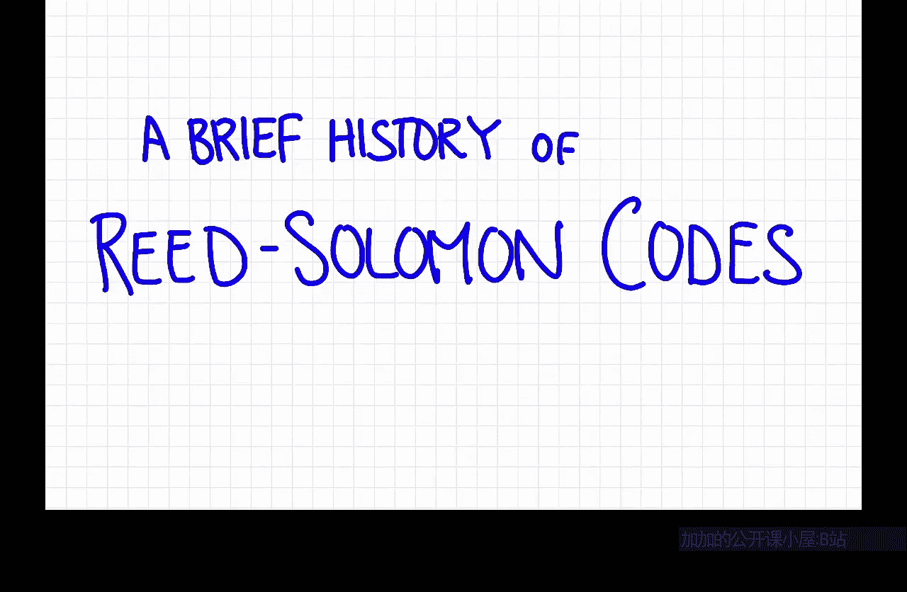
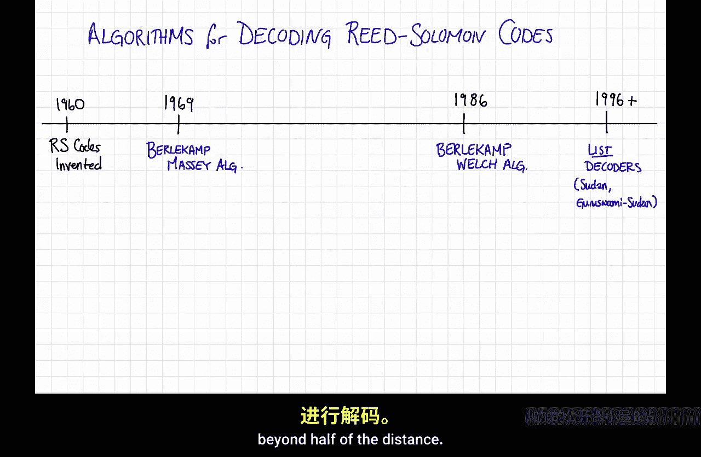

# 斯坦福大学【中英⚡代数编码导论｜Introduction to Algebraic Coding Theory】 p18 p17 5, Video 1： History of RS Codes -BV16sRYYTEwg_p18-

In this video， we'll go over a really brief history of Read Solomon codes and mention a few of their many applications。

Recall the definition of read Solomon coats。We have n distinct evaluation points。

 alpha 1 through alpha n。And parameters， Q and N and K。

Then the read Solomon code of dimension K over F Q with those evaluation points。Is defined like this。

So it's the set of all vectors。Which are evaluations on those evaluation points of low degree polynomials。

We saw in a previous video that read Solomon code's Meet the Singleton Bo， really cool。

This idea of evaluating low degree polynomials and calling it a code is such a nice idea。

 Where did it come from and where is it used。Readed Solomon codes were invented by Irving Reed and Gustav Solomon。

 In 1960， Reed and Solomon were at Lincoln Lab at M T at the time。In their original paper。

 here it is。 They introduced read Solomon codes and showed， as we've already observed。

 that they have this really great trade off between rate and distance。

One thing you might have been wondering after the previous video where we observed this is。Okay。

 so they have a great trade off between rate and distance。

 But how can we efficiently decode them from errors。It turns out we can。

 And this is not at all obvious。In fact， Reed and Solomon didn't actually know how to do that when they first proposed the code。

So if you go take a look at this paper， the original decoding algorithm is not at all optimal。

So here is Readedin Solomon's original decoding algorithm， Freeed Solomon codes。

 Let's say I have a code word。 So it looks like this。 evaluations of some low degree polynomial F。

And then some of those evaluations get messed up。Let's say this one was supposed to be F of alpha and-2。

 And someone went and changed it to 7 or something like that。 So we have a few of these mess ups。

Okay， so we have this corrupted code word now with some errors。What's the algorithm， Well。

 let's just choose K symbols at random。 Let's say these symbols。

Let's interpolate a degree k minus1 polynomial through them。

And let's hope that we avoided all of the bad symbols。 If we did avoid all the bad symbols。

 we'll get it right。 If we hit a bad symbol， maybe we'll get it wrong。

Repeat this a few times to take majority vote。This algorithm works okay if there are very few errors。

But you can check that it's not going to get us all the way up to the distance minus1 over two。

 which is what we would hope for from a decoding algorithm。

So here's a brief timeline of decoding algorithms to read Solomon codes。As we discussed earlier。

 they were invented in 1960。 And around the same time， people were developing decoders for B C。

 H codes。 We're going to talk about B， C， H codes in a future video。

 They're related to read Solomon codes。 And these B， C， H codes decoders worked for some。

 but not all read Solomon codes。Then， later in 1969。There was an improvement to this B， C。

 H decoder known as the Burleamp masssey algorithm。

 This actually remains one of the standard decoders for read Solomon codes today day。

 It uses the dual view of read Solomon codes that we saw in a previous video。

That is where we view the code words as coefficients of some polynomial that vanishes on certain points。

Then， some time passed。And then in 1986， Burleamp and Welch developed a new algorithm of a very different flavor than the Burlaamp Masey algorithm。

 In particular， it uses the original view where the message is the coefficients of the polynomial。

Then later on in the '90s， people started thinking about how to decode read Solomon codes beyond half of the distance。

How is that possible， you might ask， Well， it's called list decoding。

 and we're going to return to it in a later video， and we will see some of these decoders when we get there。

How about applications of read Solomon codes。Well， because there weren't very many good algorithms to begin with when read settlementmon codes were invented。

 they didn't have a lot of applications off the bat。However， later on， starting in the 70s。

 they found many high profile applications， for example。

 in the Voyager space program and in compact disks。Nowadays， they're used all over the place。

 They aren't so popular for communication anymore。 There are other codes with faster algorithms。

 but they are used a lot for storage， for example， in hard drives and distributed storage systems。

And they're also used in things like QR codes。So this QR code here。

 this is a polynomial that's been turned into binary in some way。

We'll talk more about how you would turn a read Solomon code into a binary code later in the course。

There are also a lot of applications beyond communication and storage。

 and we'll see some of those also in later videos。In the next video， though。

 we're going to focus in on one of these algorithms for decoding Read Solomon codes from errors。

 the Burlac Welch algorithm。