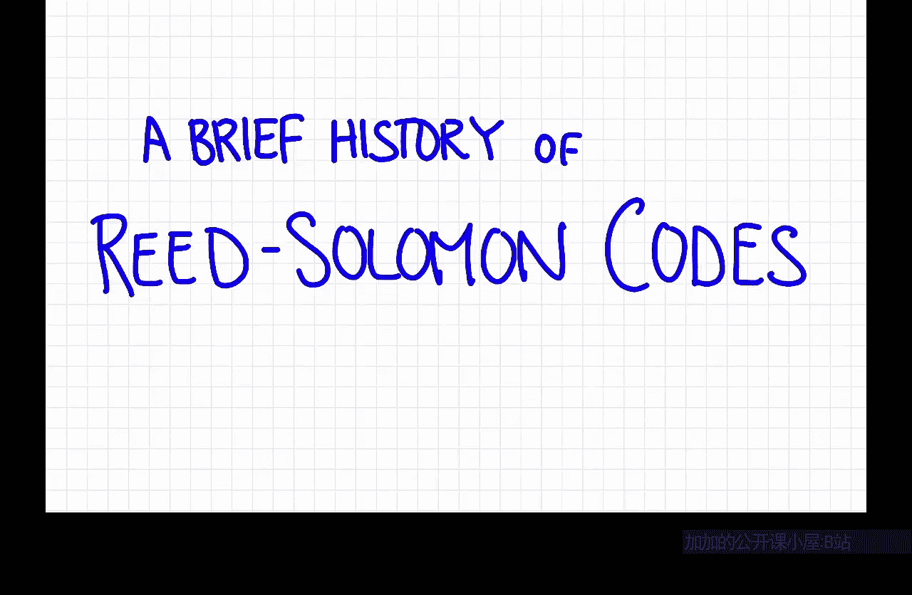
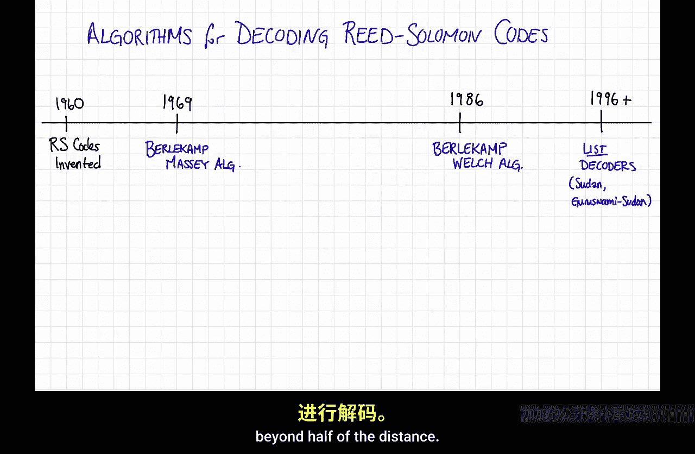

# 代数编码导论：1.5：里德-所罗门码简史 📜

在本节中，我们将简要回顾里德-所罗门码的发展历史，并介绍其众多应用中的几个例子。

## 里德-所罗门码的定义回顾

首先，我们回顾一下里德-所罗门码的定义。我们有一组 **n** 个互不相同的评估点：**α₁, α₂, ..., αₙ**。给定参数 **q**（有限域的大小）、**n**（码长）和 **k**（维数），那么基于这些评估点的、定义在有限域 **F_q** 上的里德-所罗门码定义如下：

**RS(n, k) = { (f(α₁), f(α₂), ..., f(αₙ)) | f ∈ F_q[x], deg(f) < k }**

换句话说，它是所有次数低于 **k** 的多项式在这些评估点上的取值所构成的向量集合。我们在之前的视频中已经看到，里德-所罗门码达到了**辛格尔顿界**，这是一个非常出色的特性。

## 起源与发明者

这种通过评估低次多项式来构造编码的想法非常巧妙。那么它从何而来，又用在哪里呢？

里德-所罗门码由**欧文·里德**和**古斯塔夫·所罗门**于**1960年**发明。当时，里德和所罗门都在麻省理工学院的林肯实验室工作。在他们发表的原始论文中，他们引入了里德-所罗门码，并展示了其**在码率与距离之间取得了极佳的权衡**，这一点我们之前已经观察到。

## 早期解码算法的挑战

在上一节我们观察到其优异性能后，你可能产生了一个疑问：既然它们在码率与距离上有这么好的权衡，那么我们如何能**高效地对它们进行纠错解码**呢？

事实证明我们可以做到，但这绝非显而易见。实际上，里德和所罗门在最初提出这种码时，并不知道如何高效解码。如果你去查阅原始论文，会发现其中给出的解码算法远非最优。

以下是里德和所罗门最初提出的解码算法思路：
假设我们有一个码字，它是某个低次多项式 **f** 的评估值。在传输后，其中一些评估值被破坏了（产生了错误）。原始的算法是：**随机选择 k 个符号**，通过这些点插值出一个次数为 **k-1** 的多项式，并希望这 k 个点中没有包含错误符号。如果运气好避开了所有错误，就能正确恢复；如果不幸包含了错误，结果就会出错。这个算法可以重复多次，通过**多数表决**来提高正确率。

该算法在错误非常少时可行，但可以验证，它**无法达到我们期望的最佳纠错能力**，即纠正最多 **(d-1)/2** 个错误（其中 d 是最小距离）。

## 解码算法发展时间线

接下来，我们简要回顾一下里德-所罗门码解码算法的发展历程。

*   **1960年**：里德-所罗门码被发明。
*   **同期**：人们开始为**BCH码**（我们将在后续视频中讨论，它与里德-所罗门码相关）开发解码器。这些早期的BCH解码器对部分里德-所罗门码有效，但并非全部。
*   **1969年**：出现了对BCH解码器的改进，即**伯利坎普-梅西算法**。该算法利用了我们在之前视频中看到的里德-所罗门码的**对偶视角**（将码字视为在某些点上取零值的多项式的系数）。时至今日，这仍然是里德-所罗门码的标准解码器之一。
*   **1986年**：伯利坎普和韦尔奇提出了一种风格迥异的新算法——**伯利坎普-韦尔奇算法**。该算法使用的是**原始视角**，即消息是多项式的系数。
*   **1990年代**：研究人员开始探索如何突破“半距离”限制进行解码，即纠正超过 **(d-1)/2** 个错误。

你可能会问，这怎么可能？这被称为**列表解码**。我们将在后续的视频中回到这个话题，并在那时了解一些相关的解码器。

## 主要应用领域

那么，里德-所罗门码有哪些应用呢？由于其发明之初缺乏高效解码算法，它并未立即得到广泛应用。

然而，从**20世纪70年代**开始，它找到了许多高规格的应用场景，例如：
*   **旅行者号太空计划**
*   **光盘（CD）技术**

如今，里德-所罗门码已无处不在。虽然在通信领域，它因存在更快速算法的其他编码而不再那么流行，但它在**存储领域**应用非常广泛，例如：
*   硬盘驱动器
*   分布式存储系统

此外，它也用于像**QR码**这样的应用中。你看到的这个QR码，其本质就是通过某种方式将多项式转换成了二进制形式。我们将在课程后续部分详细讨论如何将里德-所罗门码转换为二进制码。

除了通信和存储，里德-所罗门码还有许多其他应用，我们也会在后面的视频中看到一些例子。

## 本节总结

在本节课中，我们一起学习了里德-所罗门码的简要历史。我们回顾了其定义，了解了它由里德和所罗门在1960年发明，并经历了从简单随机插值到伯利坎普-梅西算法、伯利坎普-韦尔奇算法，乃至列表解码的算法发展历程。最后，我们看到了它从早期的太空探测、光盘到现代存储系统和QR码的广泛应用。

在下一个视频中，我们将聚焦于其中一个具体的解码算法——**伯利坎普-韦尔奇算法**，来深入学习如何对里德-所罗门码进行纠错解码。