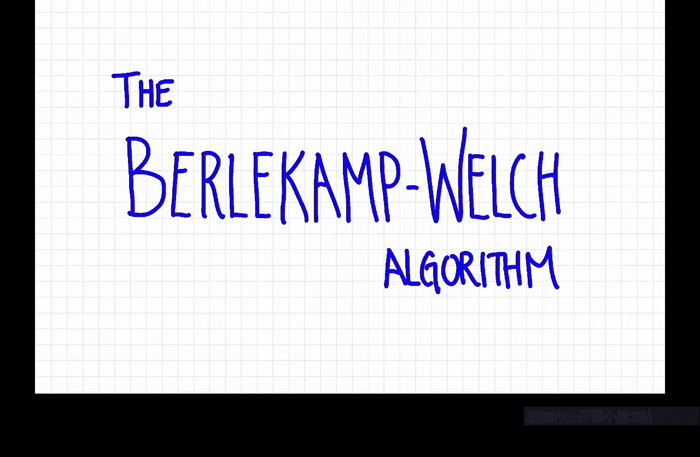
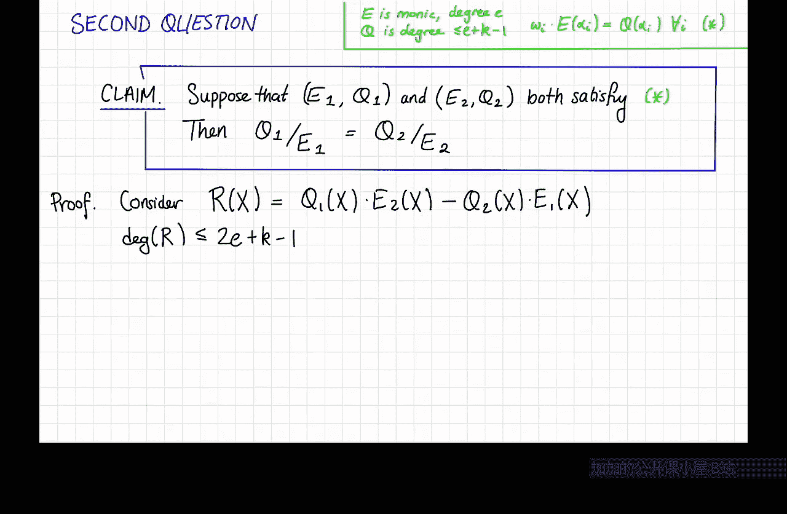
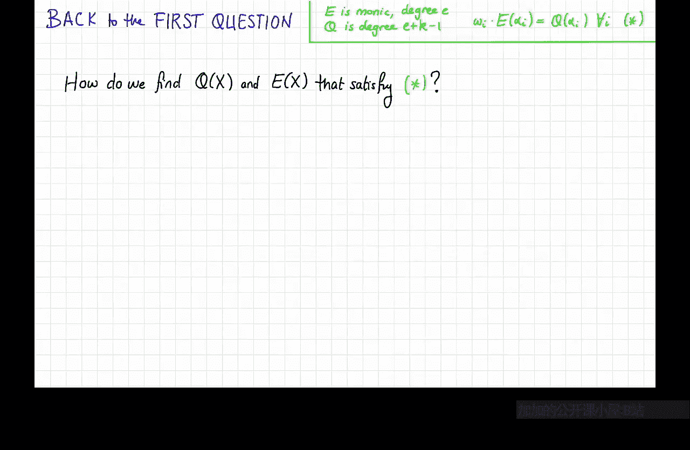
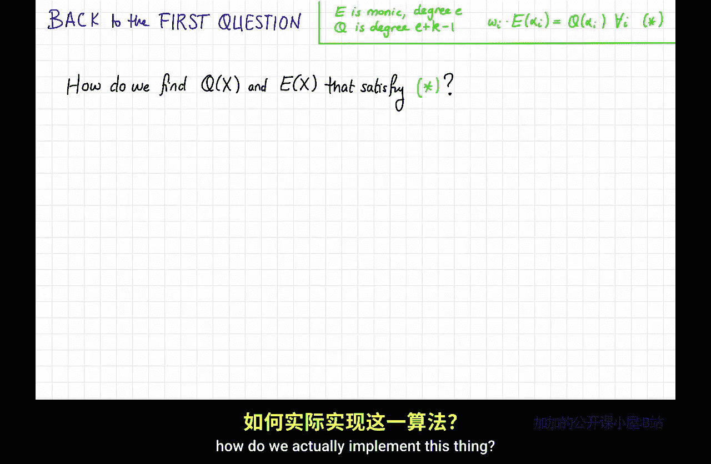
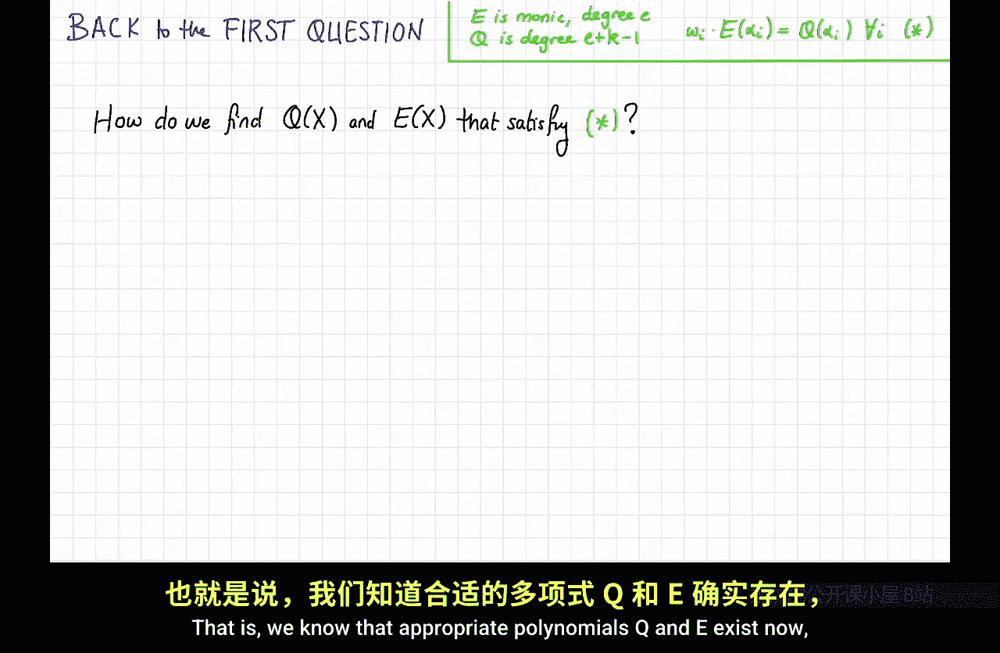
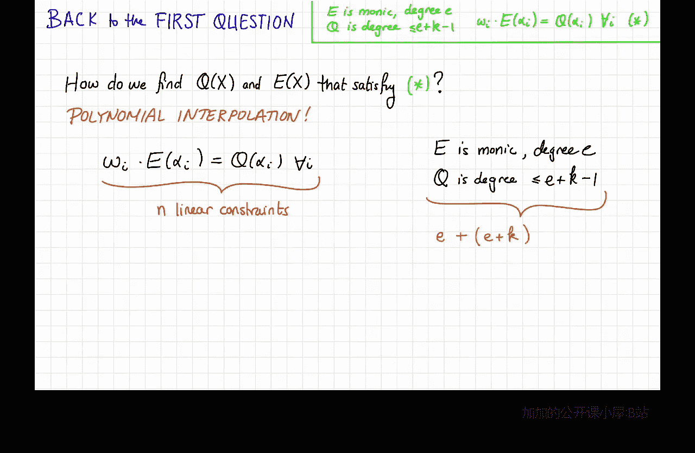
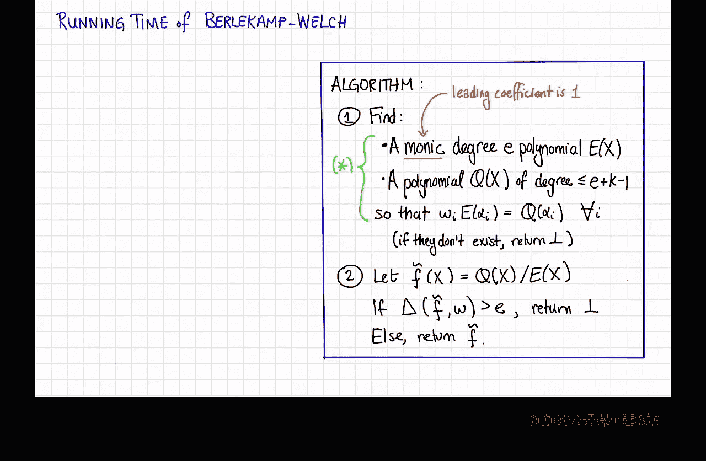

# 斯坦福大学【中英⚡代数编码导论｜Introduction to Algebraic Coding Theory】 p19 p18 5, Video 2： Berlekamp Welch Algorithm -BV16sRYYTEwg_p19-

In this video， we'll take a look at one algorithm for decoding Read Solomon codes known as the Burle Camp Welch algorithm。

First， what is the problem we are trying to solve？The problem is decoding read solomon codes from errors。

More formally， it's this。Suppose we are given some received word W。 So W1。

 W2 dot dot dot up to W N in F Q to the N。Our job is to find a read Solomon code word that is close to this W。

 That is we want to find some polynomial F。Over Fq。That has degree strictly less than K。

 and that doesn't disagree with W too much quantitatively。

The number of positions I on which F of alpha I is not equal to W I should be at most E。

 which is some number less than or equal to the floor of n minus k divided by 2。And otherwise。

 if no such polynomial exists， we should return this little bot symbol。

Why do we have an n minus K over 2 here？Remember that because read Solomon codes meet the singleleton bound。

 n minus k divided by 2， the floor of that is the floor of the distance minus1 divided by 2。

And that's basically the best we could hope for。 So here， what we're actually asking for is。

 can we decode read Solomon codes efficiently from errors up to as many errors as we could possibly hope to correct。

The Burlet Camp Welsh algorithm solves this problem efficiently。The basic idea is the following。

Let's consider the polynomial。E of X。Which I'm going to define to be the product。Over all。

 indices I so that the received symbol in the ice coordinate is not equal to the code word symbol。

F of alpha I， where F is supposed to be the right answer here。And in this product。

 I'm just going to have F minus alpha I。Notice that from the perspective of solving this problem。

 we do not know what this polynomial is because we don't know which eyes these are。

 but it still exists， you know， often in Ma land。 So let's consider it。

We're going to call this the error locator polynomial。Notice that if we plug in alpha I。

 such that W I is not equal to F of alpha I。Then this thing vanishes。 So it vanishes on the errors。

 So we call it the error locator polynomial。Now that we've defined this polynomial。

 here's an observation。For all， I。W I times E of alpha I。Is equal to F of alpha I times E of alpha I。

Why is that true。Well， if W I is equal to F of alpha I， then these two sides are the same。

On the other hand， if W I is not equal to F of alpha I， then E of alpha I is equal to 0。

 and this equation reads 0 equals 0。 Also true。 So this is always true。 Let's call this thing here。

 Q of alpha I。So I'm going to define a polynomial Q， which is F times E。

The idea of the Burlec Welch algorithm is to find a polynomial Q and find a polynomial E so that this thing is satisfied。

And then we're just going to divide Q by E and hope we end up with F。More precisely。

 here's the algorithm。Step1。Find the following things。

So we're going to find first amonic degree E polynomial E of x。 here。

 mononic just means that the leading coefficient is one。

And we're also going to find a polynomial Q of X of degree at most E plus K -1。

So that this thing is satisfied for all I。 That is W。 I times E of alpha I is equal to Q of alpha I。

Let's call all these things， star。So step one is to find those things。

 and if we can't find them if such polynomials don't exist， we're just going to return bought。Here。

 recall it this parameter E。This is the parameter from the statement of our problem。

 which I copied down here。E should be less than or equal to the floor of n minus k divided by 2。Okay。

 so this is step 1。 We're going to find such things。 somehow。 I haven't said how yet。

Then step 2 is to hope somehow that this Q in this E arose by doing this and try to recover F by dividing Q by E。

 So we're going to let F twiddle of x。Be equal to Q of x divided by E of x。

And then we'll check and see if F Twiddle is a good answer。 So if。

The hamming distance between F Twiddle and W。Here， I'm abusing a notation a little bit when I say F twiddle here in the argument of hamming distance。

 I mean， the vector that you get when you evaluate F twiddle on all of the evaluation points。

 So if the hamming distance between that vector and W。Is greater than E。

That means that F Twitter isn't the right answer， after all。Returned bot。

 We didn't find a good answer。 Otherwise， we did find a good answer， So just return it。So else。

 return after it。So this is the Burla Camp Welch algorithm。At this point。

 you might have a few questions。Our first question is。How do we do step 1。

 How do we find these polynomials if they exist。The second question is， why is this a good idea。

That is， why is it correct to return Q divided by E？If we got lucky and we happened to pick Q and E。

As per our intuition， then this is a good idea。 But what if we picked some other Q and E。

 Why should that Q divided by that E give us the right answer。These are both good questions。

Let's answer the second one， first。So to answer the second question。

 I'm going to make the following claim。The claim is that if there is some degree at most K -1 polynomial F。

That is within distance E of W。Then there exists polynomials E and Q。

 satisfying star from the previous slide。I've copied star up here so you can see what it is。

 So we want E to be mononic degree E Q to be degree E plus K -1， and this to hold。For all I。Right。

 so the claim is that。There exists E in Q that satisfy that。 And furthermore。

 so that F of x is equal to the ratio of Q and E。Let's prove this claim。

 We basically already proved it when we talked about the idea。But let's do it a little more formally。

So let E of x be this error locator polynomial。Except I'm going to multiply it by x to the E minus the haming distance between F and W。

That goes outside the product。The reason that I'm multiplying by this factor is to make sure that this whole thing has degree exactly E。

Now， I'm going to define Q。To be E of x。Times F of x。

Now we can check that star holds for this choice of E and Q。Because of this little extra term here。

 E does indeed have degree， exactly E。And you can observe that。 It's mononic。Q has degree at most。

 E plus K -1。Because E has degree E， and F has degree at most K -1。So that's satisfied。

And this thing， here is satisfied。By the same argument that we saw in the previous slide。

If WI is equal to F of alpha I。Then it's satisfied。 And if WI is not equal to alpha I。

 then both of these things are 0 and it's still satisfied。So that proves this claim。

We still haven't answered the second question yet。 though。 we need another claim。

Here's the other claim。Suppose that E1， Q1 and E2， Q2 both satisfy star up here。

Then I claim that Q1 divided by E1 is the same as Q2 divided by E2。Let's prove this claim。Proof。

Let's consider the polynomial R of X。Which I'm going to define as Q1 of x times E2 of x。

Minus Q2 of x。Times E1 of x。We're going to show that this polynomial is identically zero。

If we can do that， that means that Q1 times E2 is equal to Q2 times E1。

And that will imply this thing that we want to show。Alright。

 So how are we going to show that R of x is identically 0。

 We're going to show that it has low degree and too many roots。More precisely。

 let's observe that the degree。Of R。Is it most？2 E plus K-1。

That's because Q has degree at most e plus k minus1。

And E2 has degree at most E and the same for this term。So adding those two things together。

 that's 2 E plus k -1。

Moreover。For all I， between one and n。I claim that R of alpha I is equal to 0。To see this。

 let's just write out what R of alpha I is。This is Q1 of alpha I。Times E2 of alpha I。

Minus Q2 of alpha I。Times E1 of alpha I。And now using the fact that both this pair and this pair obey star。

I can replace。Q1 of alpha I with W I times E1 of alpha I， And similarly。

 Q2 of alpha I with W I E2 of alpha I。So let's do that。And this is equal to 0。

 because this term is exactly the same as that term。So now I have a polynomial。Of degree at most。

2 E plus K -1 with N roots。But since E is strictly less。Then n minus K plus1 over 2。

 Becauseuse remember， we chose E to be less than or equal to the floor of n minus K over 2。

This implies that2 E。Plus， K -1 is strictly less than n。

So now I have a polynomial of degrees strictly less than N。With n different roots。

 Al I for all I from one to N。All right， lot of great polyorials， don't have too many roots。Thanks。

 Polly。Yes， so since low W B polynomials don't have too many roots， in particular。

 non0 degree less than n polynomials don't have N roots。 That implies that R must be the0 polynomial。

Here， when I write this funny equal sign with three equals， I mean that r is identically equal to0。

 meaning that all of its coefficients are equal to0。

But if R is identically equal to 0 and R is defined like this。

That implies that Q1 of x times E2 of x。Is equal to Q2 of x times E1 of x。

And that implies the thing we wanted to show。That Q1 divided by E1。

Is equal to Q2 divided by E2 as functions。So that proves the second claim。Now。

 let's return to this second question we were trying to answer。

Why is it the correct idea to return Q of x divided by U x。

Well I now claim Me claim that these two claims that we just made explain why this is correct。

So remember， the first claim says that if there is some polynomial F of degree at most K -1。

 which is close to W， then there's going to be some E And Q to find that have the right ratio。

The second claim says that any E and Q that we find are going to have the same ratio。

So since at least one of them has the right ratio， that means they all must have the right ratio。

 So no matter what E and Q we find。And we will find at least one of them， by this first claim。

We will get the right answer。So this explains why the Weldblacamp algorithm is correct。

However， we now need to return to our first question， which is。

 how do we actually implement this thing？

That is， we know that appropriate polynomials Q and E exist now。 But how do we actually find them。

The answer？Polynomial interpolation。A K， solving a linear system。More precisely。

 let's think about this task that we have。We want to find E and Q。Of appropriate degrees。

 so that this stuff holds。We can think of this as a linear system in the coefficients of E and Q。

So these equations， W， I times E of alpha I。Equals Q of alpha I for all I。

This gives us n linear constraints。That are linear in the coefficients of E and Q。

We're looking for polynomials， E。Mononic of degree E。And Q。Of degree at most。E plus K -1。

And so the variables for our linear system are going to be the coefficients of these polynomials。

 There's E coefficients for E。And then we have E plus K coefficients for the polynomial cube。

So that gives us two E plus K variables for our linear system。So now I have a linear system。

 I've got a bunch of variables。 I've got a bunch of linear constraints。

We actually already know that a solution exists。 our first claim from before showed that。

And our second claim from before shows that any solution will do。

So just solve this linear system and find any solution。

That will give you the coefficients of E and Q， and then you just do polynomial division to recover F。

Finally， let's look at the running time of this algorithm。

So I've copied the algorithm over here。So how long does this take。To do step 1。

We need to set up some linear system and solve it。 That takes time Big O of N cubed to do Gausian elimination。

 for example。To do step 2， we just need to divide one polynomial by another。

 You can also do that in time， Biggo event cubed。So the total running time of this。

Is big of and cubed。Where n is the block length of the read Solomon code。This is great。

 In particular， it's much， much faster than the naive algorithm of try all of the code words and see which one is closest。

😊，However， there are faster algorithms out there。For example， in an earlier video。

 we mentioned the Burlec Massey algorithm。This can run a bit faster， actually， in time。

 Big O of n squared or even faster， depending on how you implement it。

We're not going to talk about the Burlac May algorithm in these videos。

 but I encourage you to read about it if you're curious。

