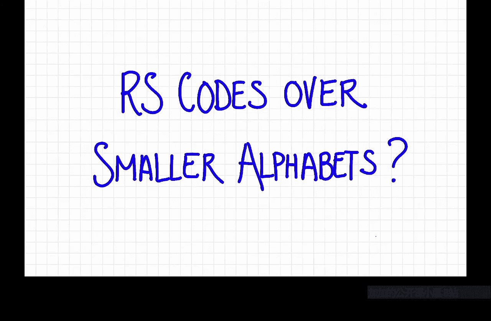
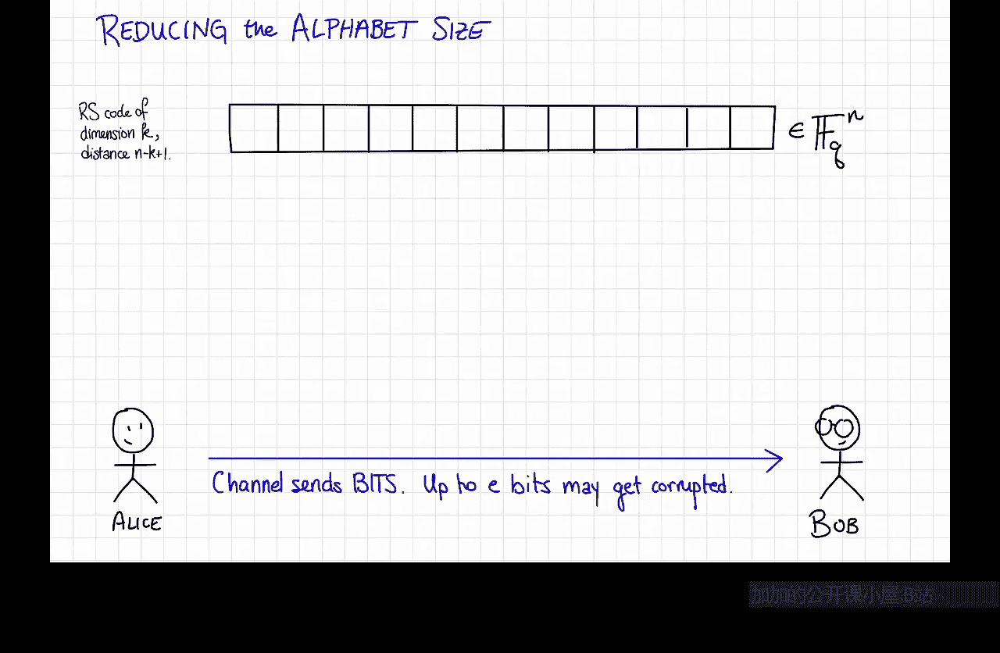
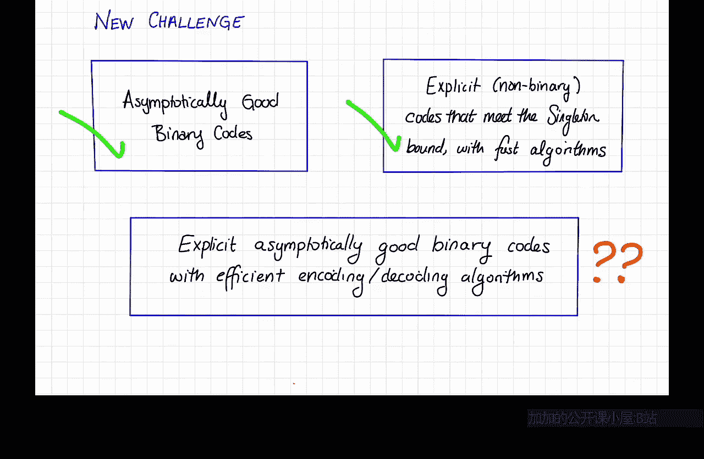

# 斯坦福大学【中英⚡代数编码导论｜Introduction to Algebraic Coding Theory】 p20 p19 6, Video 1： Smaller Alphabets for RS codes？ -BV16sRYYTEwg_p20-

In this video， we'll talk about the challenge of the large alphabet size associated with read Solomon codes。

So here's the story so far。We saw read Solomon codes。

 which are based on this really nice idea about lowy polynomials。 All right。

 Luie polynomials don't have too many roots。 Yes， thank you， Polly。😊。

And we also saw that read Solomon codes have the optimal trade off between rate and distance。

 They meet the singleingleton bound。Moreover， we saw that they have efficient encoding and decoding algorithms。

 For example， we saw the Welch Burlac algorithm in an earlier video。This is a pretty nice story。

 Maybe we should just call ourselves done。However， there is one major downside to read Solomon codes。

 which is the large alphabet size。To see why this is an issue。

 let's go back to our All and Bob scenario。So suppose that Alice wants to send a message to Bob。

 and they'd like to use a read Solomon coat。So let's say that they're going to use some read Solomon code of dimension K and distance n minus k plus1。

Over an alphabet size Q， where  Q is at least n。Unfortunately。

 the channel between All and Bob sends bits。That is， the channel doesn't know about F Q。

 It just knows about zeros and ones。 And the rule is that up to E bits might get corrupted when Alice tries to send Bob a bit string of a particular length。

Here's one very natural way that Alice and Bob could try to use their read Solomon code with this channel。

The basic idea is that each one of these symbols。 This is a symbol in F Q， a set of size  Q。

 So I can represent it as log base2 of Q bits。 So I'm just going to replace each one of these symbols with log Q bits。

So this gives us a bit string。Of length N log Q。In general， in these videos。

 whenever I don't write the base of the log， I mean log base too。Okay。

 so this seems like a reasonable thing to do。 But how well does this do。

 If we treat this as a binary code， what are its parameters。Okay， so the message length， K prime。

Well， by definition， this is the log base alphabet size。

 The alphabet size of the new code is  two of the size of the code。

 The size of the new code is the same as the size of the old code。

And the size of the old code is Q to the K。 So this is the log。Base 2 of Q to the K。

Also known as K log Q。The block length of the new code and prime。It's just N log Q。

And what's the distance？Why don't you pause the video right now and think about the best bound you can get on the distance of this thing as a binary code。

Okay， so our priori， the best bound we can get on the distance D prime is that D prime is at least D。

Or n minus k plus 1。Which was the distance of the original code。

The reason that we get D here and not D log Q， which you might expect based on what happens with these other things。

Is that intuitively， if we corrupt a single bit here。That can corrupt a whole symbol here。

So it's possible that by corrupting D bits。If they each occur in different symbols。

 correspond to corrupting D whole symbols in the original code word。

So we don't get to multiply this by log Q or anything like that。Now。

 let's calculate the rate and the relative distance of this new binary code。The new rate are prime。

Is equal to k prime divided by n prime。That's K log Q divided by n log Q， the log Q's cancel。

 and this is just K over n。Which was the rate of the original code。So the rate stays the same。

The relative distance， however， is going to change。

So the relative distance is D prime divided by n prime。Which is going to be D divided by n log Q。

Or at least D divided by N log Q is the best bound that we can get on it。

 It might be that the real distance D prime is actually bigger than D， but we don't know that。

 So let's assume the worst and assume it's this。But then this is smaller or equal to。Delta。

 the relative distance of the original read Solomon code。Divided by log n。

Because N is always at least Q for a read Solomon code。

This is somewhat troubling because not only is Delta prime the distance of our new binary code worse than Delta。

 the distance of our original code， but it's worse by something that's getting bigger as and gets bigger。

In particular， this term is little O of 1。 It goes to 0 as n goes to infinity。

So if we take this approach， we do get a binary code。

 but we don't even get an asymptotically good code。

 The distance is going to 0 as n is getting larger。In light of this scenario。

 let's set up a new goal for ourselves。Let's recall some of the goals we've already achieved。

One goal we had previously was to come up with asymptotically good binary codes。

 or at least decide whether or not they exist。We achieve this goal。

 The Gilbert Vrshov Bo tells us that such codes exist。 A random linear code does well。

We also achieved the goal of coming up with explicit codes。

 maybe not binary codes that meet the singleton bound。 That is。

 have the optimal trade off between rate and distance and have fast algorithms。

 These are read Solomon codes。Here， remember that explicit means that there is an efficient way to describe them。

 Our proof using the Gilbert Vashov Bo was non constructive。 It says that there exist good codes。

 but it doesn't tell us what they are。 It's much more useful if we have a description。

 So we want explicit codes。 We actually want to know what they are。

And in the case that we don't ask for binary codes， we now know how to solve this goal as well。

 Hoay Re Solomon codes。What we're going to ask for next is the best of both worlds。

We'd like explicit codes。 So we actually want to know what they are。 We want them to be binary。

And we want them to have efficient encoding and decoding algorithms。

We also want them to have a good trade off between rate and distance。Ideally。

 we'd want them to have the optimal trade off that's achievable by binary codes。

As discussed in a previous video， we don't actually know what that optimal trade off is。 So for now。

 let's just settle for asymptotically good。Remember that that means that both the rate and the distance are bounded away from 0。

So this is going to be our new goal for the next couple of videos。

Our strategy will be to try to make read Solomon codes into binary codes。

But we'll do it in a better way than the straightforward strategy that we saw earlier。

