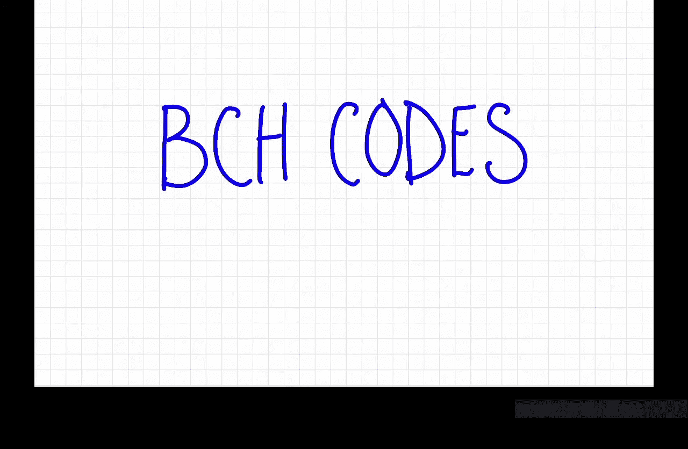
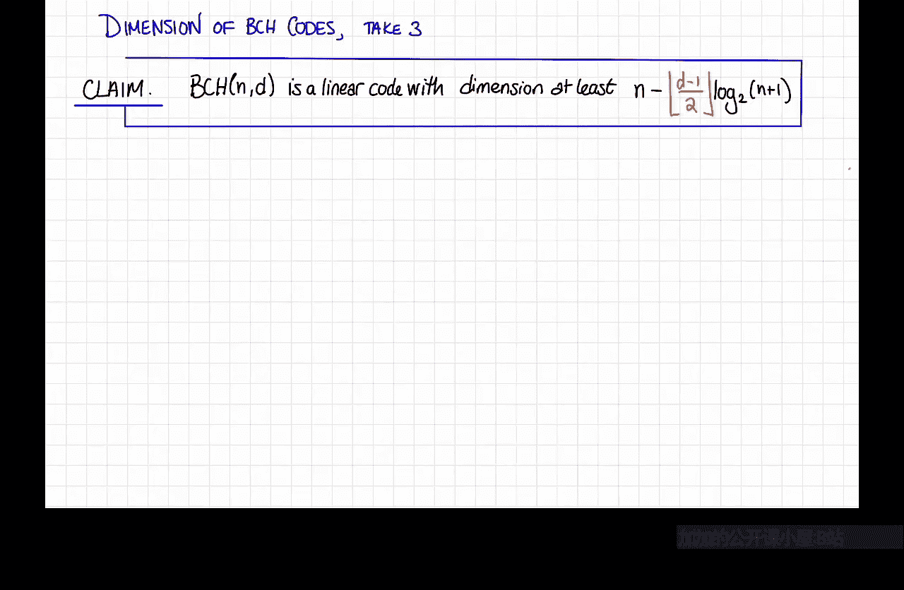
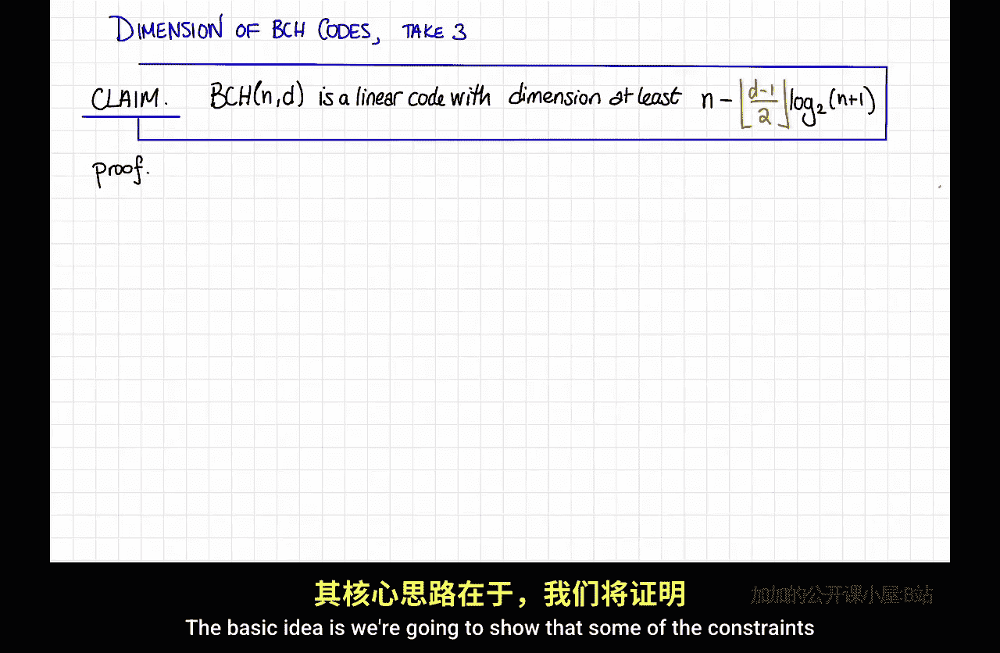
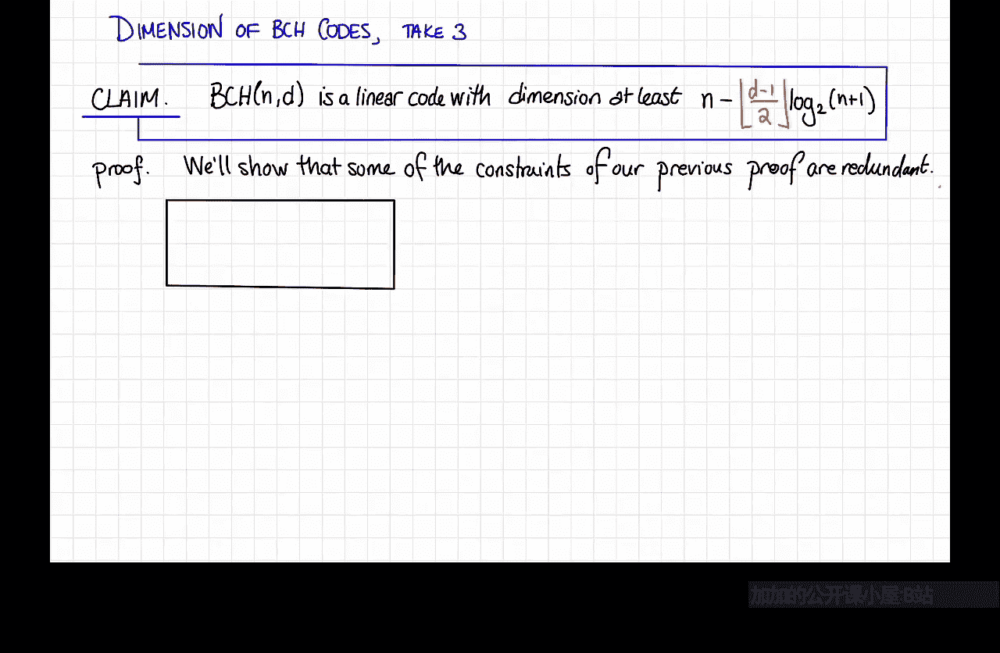
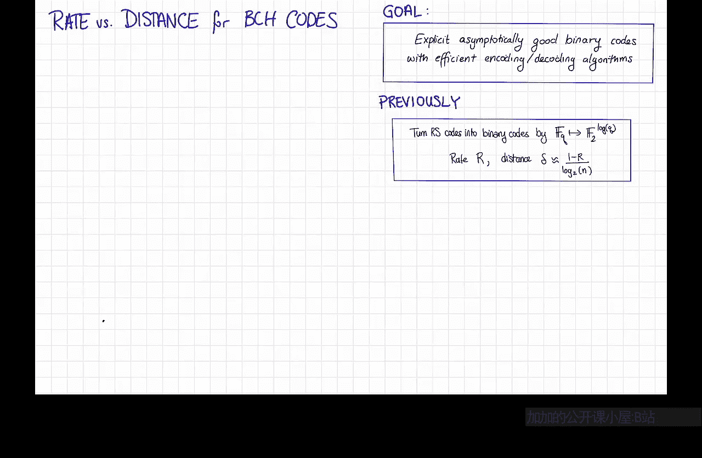
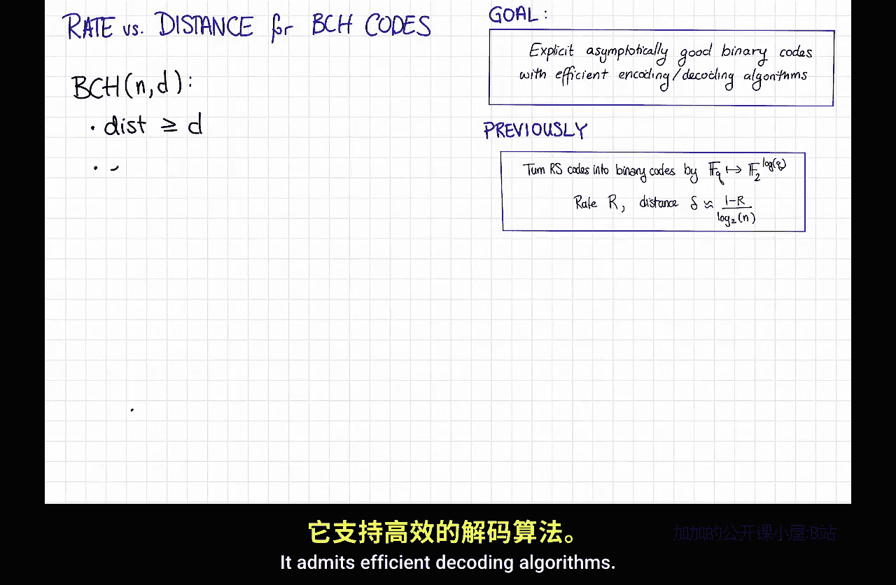
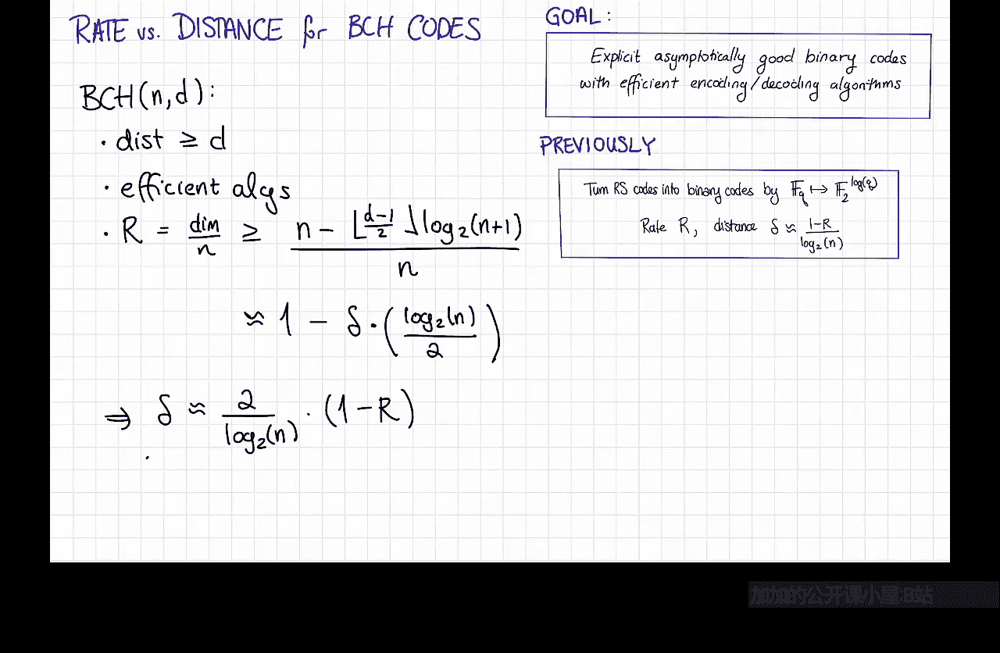

# 斯坦福大学【中英⚡代数编码导论｜Introduction to Algebraic Coding Theory】 p21 p20 6, Video 2： BCH Codes -BV16sRYYTEwg_p21-

In a previous video， we asked how we can make read Solomon codes into binary codes。

Here's one way of doing it called B C H codes。

Just a heads up， this is not actually going to achieve our goal of explicit asymptotically good binary codes。

 but we'll be able to do a little bit better than we did with our straightforward scheme from the previous video。

The name B C， H codes come from the initials of their inventors。Who discovered B C。

 H codes in 1959 and 1960， respectively。Here's the definition of a B， C， H coat。

Let n be 2 to the M-1 for some integer M。And let gamma be a primitive element of F2 to the M。

Now for some parameter， D less than equal to n。Define the B， C， H code with parameters， N and D。

To be the set of all vectors， C n of through C N -1 and F2 to the n。

 So all binary vectors of length N。 so that C of gamma to the J is equal to 0 for all J between 1 and D -1。

 And here， C of x is the polynomial whose coefficients。R C n through C N -1。

 So it's the sum from I equals 0 to n -1 of C I times x to the I。 Hopefully。

 this definition looks pretty familiar。In fact， if we change this2 to a Q。

This is exactly the same as the dual view of read Solomon codes that we saw before。

Another way of saying this is that a B C， H code is just the set of all of the read Solomon code words that happen to be binary。

Or in other words， it's the intersection of the corresponding read Solomon code。

With the set F2 to the N。Based on this observation， we can make the following two observations。First。

 the distance of this B， C， H code。Is at least D， because D is the distance of this corresponding read Solomon code。

And we got from this read Solomon code to this B， C。

 H code by just throwing out all the non binary code words。

 So that's not going to make the distance any smaller。

A related observation is that BCH codes have efficient decoding algorithms。In particular。

 we can use some of the algorithms that we already saw for read Solomon codes and use them for BCH codes。

Actually， the intellectual history goes the other way。 Some of these decoding algorithms。

 like the Burla Camp Masey algorithm， was actually developed first for BH codes and then extended to read Solomon codes。

Okay， so this is pretty great。 We now have a binary code with good distance and efficient algorithms。

 The main question left is， what is the dimension of a B H code。😊，If we define a B， C。

 H code as all of the corresponding read Solomon code words that happen to be binary。

 we might wonder if a B， C， H code has anything in it at all。

 Why should there be any read Solomon code words that happen to be binary。 right。

 That's like saying I'm going to take some low degree polynomial over a big field。

 I'm going to evaluate it at all the points in the big field。

 And I'm just going to hope that I'm always going to get either 0 or one。

 Why should there be any polynomials like that。 With that intuition。

 We might think that the dimension of a B C， H code is 0。 There are no code words in it。

 other than the all0 code word。 But in fact， it is greater than 0。 Let's see why。 So here's a claim。

 I claim that the B， C， H code is a linear code over the field F 2。

And that not only does it have dimension not0， but it has pretty big dimension。

 It has dimension at least n minus D plus 1。Okay， just a heads up， this claim is totally false。

However， the proof that I'm going to give for it is going to be instructive。

 So let's try to prove it anyway。 As we go through， keep an eye out for the error。

 I'm going to make some mistake。Okay， so here's a proof。

I'll put it in quotation marks because it will not be correct。 First。

 notice that the condition C of gamma to the J is equal to 0 From the definition down here。

 I've just copied the definition of a B H code down there。

 This condition is a linear constraint in the coefficients C n through C N -1。That is。

 the linear constraint looks like this。 The sum from I equals 0 to n -1 of gamma to the J I times C I is equal to 0。

And here are my variables。 And these are just some constants。

 And I'm saying that these linear equations had better be satisfied for all J between 1 and D -1。

 So there are D -1， such constraints。Therefore， by linear algebra， the dimension。Of the B， C。

 H code with parameters， N and D should be at least the number of variables minus the number of constraints。

And there are n variables and D -1 constraints。 So this is n D plus1。

 And that's exactly what we claimed， Q， E， D。Okay， so as mentioned above， this proof is wrong。

 and the statement is false to see why the statement is false。 Let's do a quick sanity check。

So here I'm going to plot the singleton bound and the plot can bound on these rate versus relative distance axes that we keep drawing。

 This is forq equals 2。So the singleingleton bound looks like this。While the plot can bound。

 looks like this。In particular， for Q equals 2。The plotkin bound says that all of the points out here are not achievable。

In particular， the singleingleton bound is not achievable。 However， this claim here says that B， C。

 H codes meet or possibly exceed the singleingleton bound。Cause they have block length， N distance。

 at least D and dimension， at least n minus D plus one。 But this is impossible by the plot combat。

 So he knows that something's wrong。So what's wrong If you didn't already see it when I was doing the proof。

 pause the video now and try to find the error。Okay。

 so the problem is that this linear constraint is not linear over F2。

That is a constraint that's linear over F2 looks something like this。That is。

 it says that some linear combination of the Cs should be 0。

 where the coefficients of the linear combinations need to live in F 2。Here。

 these coefficients live in F Q， the big field。So this is not actually a linear constraint in the vector space F2 to the N。

 Therefore， this linear algebra claim is not legit。So that's the problem。However。

 we can fix this proof。 So here's a new claim。 I claim that the BH code with parameters N and D。

Is a linear code with dimension， at least this。 So n  D -1 times the log base two event。

 And this claim turns out to be true。 Let's see a proof。So the basic idea is the same。

 We're still going to count constraints， but we'll do it correctly this time。

 What we'll actually do is show that each constraint。

 C of gamma to the J equals 0 is actually M different linear constraints over F 2。

In order to show this， we're going to use the following fact about the field F 2 to the M。

So the fact is that the finite field F of size 2 to the M。Is， in fact， a vector space over F2。

And it has the same additive structure as the vector space F2 to the M。

Notice that these objects are not the same。 This one is a field。

 It makes sense to multiply two of these things together。This thing is a vector space。

 It doesn't make sense to multiply two vectors together。 But if you ignore the multiplication here。

 this is saying that you're basically going to get that structure a little more formally。

 This is saying that there exists a map fee。That maps the finite field of size 2 to the M to the vector space F2 to the M。

 such that first phi is of ejection。And second， that phi plays nice with addition。

 That is phi of alpha plus beta。For two elements， alpha and beta in F2 to the M is equal to phi of alpha plus phi of beta。

We're not going to prove this fact here， we're just going to take it as a given。But given this fact。

 let's carry on with the proof。So our goal， again， is to show that each of these constraints is actually M different F2 linear constraints。

So let's write down what each one of those constraints means。Formerly。

 it means that the sum from I equals 0 to n -1。Of C times gamma to the Ij。Is equal to 0。

Let's consider what happens if we view this equation in vector space land。 So formally。

 let's take phi of both sides of this equation where phi is this map here that turns my field into my vector space。

 Then this is the same as saying。That the sum from I equals 0 to n -1 of C I times phi of gamma to the I J。

Is equal to0。As vectors。The reason that's true is that this map Phi here is F2 linear。

 so it can go inside the sum。 And since C I is either a0 or a1。Well， if it's a one。

 then fee breaks up around the sum。 and it's， if it's 0， we just get 0。

 So this left hand side is just equal to this。And the right hand side is equal to0。

I guess I should have said up here that we also have phi of zero equal to zero。

So now we can just think about this as doing linear algebra over F2。

 and we can forget all of this fancy F2 to the M stuff。That is， I can write this equation like this。

That is， this says that the sum over I of this bit C I sub 0 or 1 times sum little vector of length M with entries in 0 or 1 is equal to 0。

Another way of writing this equation concisely in matrix notation is the following。That is。

 I have my code word C not of through cn minus1 here。And I multiply it by this matrix。

 which is M by n， where each of these columns is just each of those things stacked up next to each other。

And when I do this matrix vector multiplication， I better get 0。So this original thing。

 without the fees。Is exactly the same as this matrix equation over F2。

So this is what I mean when I say that each constraint of this form is actually M linear constraints over F2。

I have M different constraints， which are given by the rows of this matrix。

Let me clean up this slide a little bit。 so I have a bit more room。Okay。

 so I just moved this picture over here。And we've now established that each one of these is MF2 linear constraints。

 so let's put a check there。And now let's do the same proof as before。

 let's just count the number of variables in the number of constraints。

So the number of variables is equal to N。 C n through C， N -1。The number of constraints。Okay。

 so I have M constraints， M， F 2 linear constraints for each one of these。

 And I have D - one of these，1 for each J。 So this is M times D -1。

And this is equal to D-1 times the log base 2 of n plus 1。And that's because。

N was equal to 2 to the M-1。 And I just solve for M。Therefore。

 the dimension is at least the number of variables， minus the number of constraints。

Which is at least n minus。D-1 times the log base 2 of n plus 1。

And that's exactly what we claimed up here。So that proves the claim。Quick note。

 I realized halfway through the slide that I had a typo in the original statement。

 I had an end here instead of an n plus one， which I changed。 So now it's exactly what we proved。

 If you were taking notes at the beginning of the slide， that that wasn't quite right。

 But now it's right。Sorry about that。Okay， so this proves the claim。

Another way to see the proof of this claim is via a parity check matrix。 So once again。

 let me clean up this slide a little bit to say what I mean by that。So we can view this picture here。

As a bunch of constraints on our code word， and it's already in sort of parity matrix notation。

And so what this argument is doing is basically saying we can come up with a parity check matrix for the B。

 C， H code just by stacking the D-1 different such matrices on top of each other。

So it looks something like this。This layer here stands for the constraint that C of gamma is equal to 0。

So again， my columns are just the vectors phi of gamma to the eye。

The next layer is for c of gamma squared equals 0。 So here's phi of gamma to the two I and so on。

At the end of the day， I have this。Matrix。Which has M times d-1 rows because they are D-1 layers of M rows each。

And I know that my code lies in the kernel of this matrix。

The dimension of the colonel with this matrix can be no more than。Number of columns。

 minus number of rows。 That's n minus D -1 times M。

 And that's exactly the argument that we said here。So again， this is exactly the same argument。

 just a matrix way of looking at it。Okay， great。 So now we've proved this claim。But actually。

 we can do even better。In particular， we can do better by a factor of 2。 That is。

 I can replace this D-1 with a D-1 divided by 2。Here's a proof。

The basic idea is we're going to show that some of the constraints from our previous proof are redundant。

In pictures， we have this parodity check matrix。

Let's call it H。And we're going to show this matrix H that we came up with in the previous proof。

Has the same row space as some smaller parity check matrix。

Which has half the number of layers as our original one。

 and which we are just going to get by throwing away half the layers of this guy。

So we're going to show that we can throw away half of these layers and still keep the same row space。

Since these two matrices have the same row space， they are parity check matrices for the same code。

So that means we can do the same argument that we did before。

 Di of the code is at least N number of variables， minus number of constraints and number of constraints is now going to be D-1 over 2 times M。

And that's going to give us this answer。So let's see why it's legit to throw away half the layers。

To do that， let's state a subclaim。The subclaim is。For any polynomial C。Over F 2 with variable x。

And for all alpha。In F2 to the M， the big field。If C of alpha is equal to 0。

That's the same as C of alpha squared being equal to0。To see why we can just do some algebra。

So proof。Suppose that c of alpha is equal to 0。Then squaring both sides that shows that C of alpha squared is equal to 0。

And opening up the definition of C of alpha that says the sum from I equals 0 to n -1 of C I times alpha to the I。

 all that squared。Is equal to 0。And now I claim that I can actually move this squared inside the sum。

So I claim that this is the same as saying that the sum from I equals 0 to n -1 of C I squared alpha to the2 I is equal to 0。

If you haven't seen this before， this might look a little bit funny。In particular。

 this is not normally how arithmetic works。 You normally cannot bring squares inside of summations。

 but it turns out that over fields of size 2 to the M for some M， you can。In more detail。

 in this field。F 2 to the M， we always have1 plus1 is equal to 0。

You already know that this is true in F2， but it turns out also to be true in F4 and F8 and F16 and so on。

When a field has size 2 to the M， we say that it has characteristic 2。

 And so the statement is that in any field of characteristic 2，1 plus 1 is equal to 0。

If you believe that， then， for example， a plus B squared。Well。

 this is equal to a squared plus A B plus B， A plus B squared。And this， A B plus B， A。

 if we use the fact that multiplication is commutative and the various other arithmetic laws that hold in fields。

 this is equal to A B times 1 plus 1， and  one plus 1 is equal to 0。 So this is equal to 0。

So this whole thing is equal to a squared plus b squared。

This basic observation generalizes to sums with more than two things。 and in general。

 in fields of characteristic， too， we have that the sum of a bunch of things squared。

Is just equal to the sum of the squares of those bunch of things。

This fact is sometimes called the freshman's dream， Ca freshmen often try to do this over the reels。

 where it is not O， but it is O over fields of characteristic， too。Okay。

 so since we're working over a field of characteristic2。

 that is a field whose size is a power of two。This is a legit step。

Our next step is to say that C I squared is the same as C I。That's because C I is either 0 or 1。

 It lives in F 2，0 squared is equal to 0，1 squared is equal to 1。 So therefore。

 C I squared is equal to C I。So this implies that the sum from I equals 0 to n -1 of C I。Alfred。

 to the two eye。Is equal to 0。And using the definition of C again。

We see that this expression is exactly C of alpha squared。

So we started out with C of alpha being equal to 0。

 and we showed that this was equivalent to C of alpha squared being equal to 0。

So that proves the subclaim。Okay， now I'm going to erase the proof so that we can use the subclaim。

I claim that this subclaim allows us to enact this intuition。

 It shows us that we can throw out half of the roads。In particular。

 this means we can throw out all of the layers corresponding to C of gamma to the J equals 0 for even J。

And the reason is that。See if game of the J equals 0。

Is equivalent to C of gam to the J over 2 being equal to 0， as long as J is even。

 And so if we just keep all the odd ones。That means that we're going to cover all of them。

So that lets us throw out half of the layers。 All the layers corresponding to even Jays were left with only the odd layers。

 And because of this subclaim， we've only thrown out repeated rows。Therefore。

 H prime has the same row speech as H， and it has the claimed number of layers。

 So the claimed number of rows。 and using exactly the same argument as before number of variables。

 minus number of constraints。 This proves the new claim with this improved bound。Horay。

Now that we understand the dimension of B， C， H codes。

 let's return to our original goal that we stated in a previous video。

So recall that our goal was to come up with explicit。

 asymptotically good binary codes with efficient encoding and decoding algorithms。

Previously we saw a strategy which got this， where we basically just turned read Solomon codes into binary codes by replacing every Qary symbol with a little bit string of length log Q。

That didn't do so great。 It had rate R。And relative distance delta equals 1 minus r divided by log base2 of n。

So how do BCH codes do on this goal and how do they compare to what we got previously？

So the BH code with parameters N and D。We already saw that it has distance， at least D。

It admits efficient decoding algorithms。

And we just got to bound on the dimension。 So that's going to allow us to get a bound on the rate。

So the rate。Which is equal to the dimension divided by n。Is at least。N minus。D-1 over 2。

Times the log base 2 of n plus 1。All divided by n。And this is approximately equal to 1 minus delta。

That's the relative distance D divided by n。Times。The log base，2 of N。Divided by2。

Here I have a squiggle squiggle here because I dropped the floor。 I don't feel like dealing with it。

 And I also dropped this n plus one inside of the log。 I just turned it into an n。

These are changes that are not going to affect the asymptotic rate as N goes to infinity。Okay。

 so now solving for Delta in this expression。This implies that deelta is approximately equal to2 divided by log n。

Times 1 minus the rate。So， comparing this。To this， what we got before。

 we see that we actually do do better。 We're going to do better by a factor of 2， this factor of 2。

However， we're still not going to get asymptotically good codes as n goes to infinity。

If we have constant rate。Then the distance is going to go to 0 as n gets large。That said。

Because of these efficient algorithms and this better than naive trade off between rate and distance。

 B， C H codes are actually used all over the place in practice。

 especially for situations where N isn't so big。So to summarize， B。

 H codes are a pretty cool way ofquote making Read Solomon codes binary。

 You just take the subset of the Read Solomon code that happens to be binary。

 And it turns out that there's actually something still there。😊，B， C。

 H codes don't yet achieve our goal， but they're still pretty cool and useful to know about anyway。

In the next video， we'll see a different way to try to make Read Solomon codes binary。

