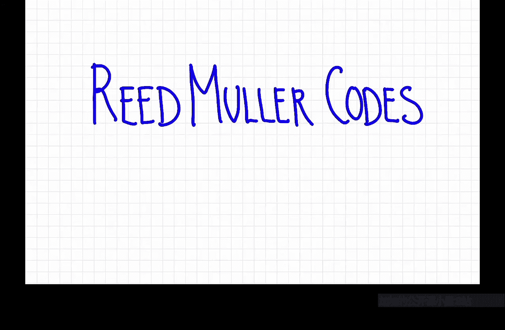
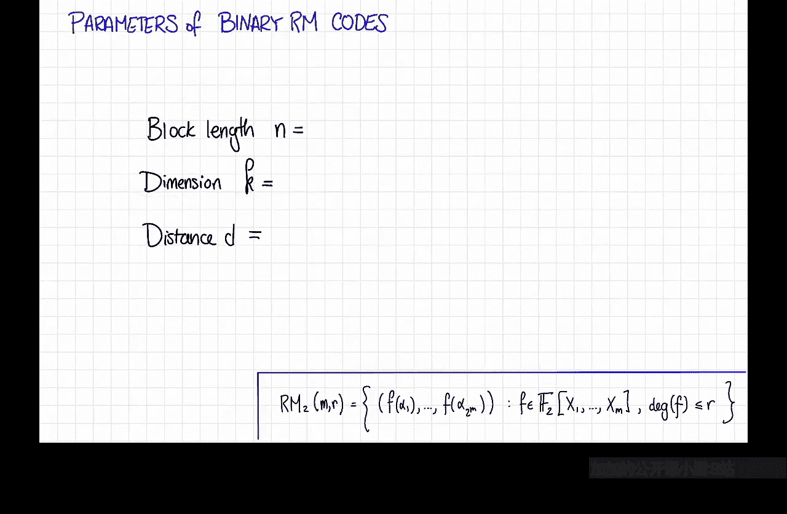
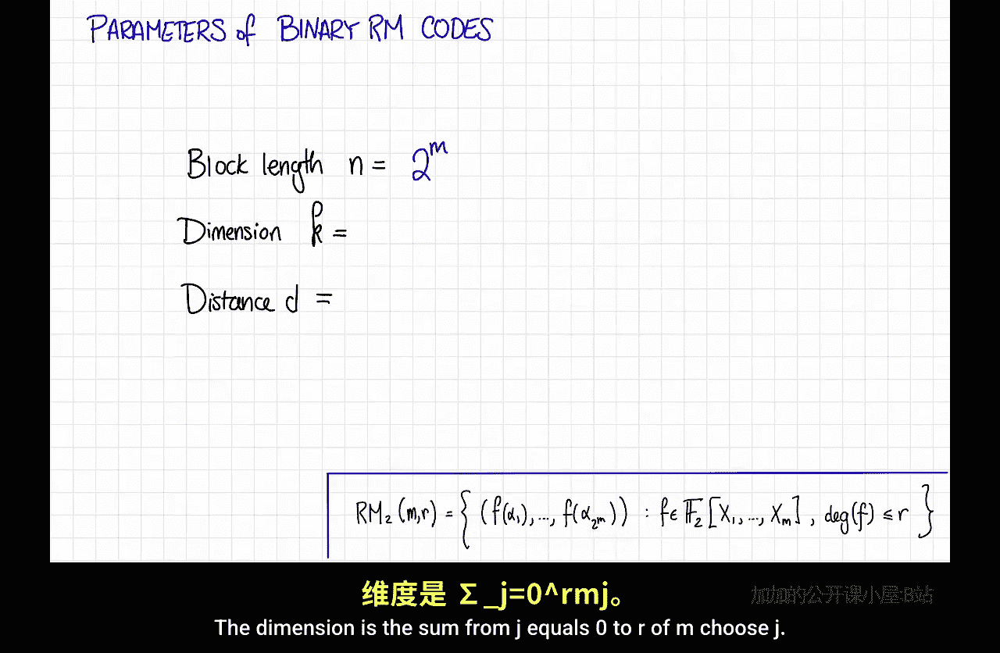
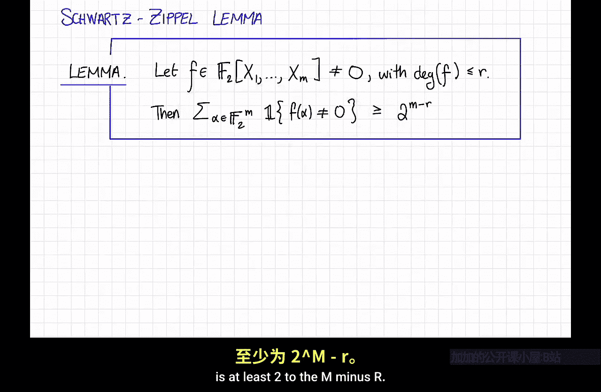
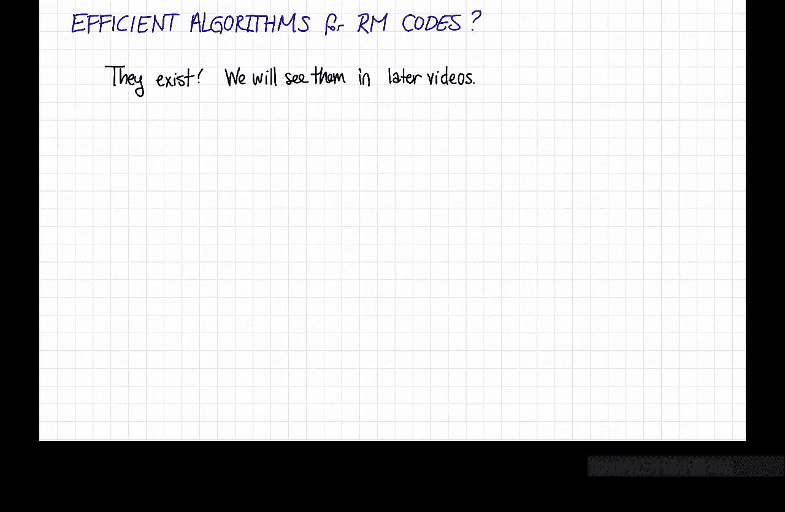
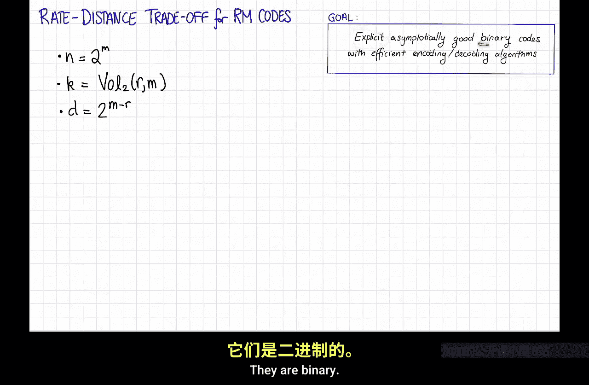
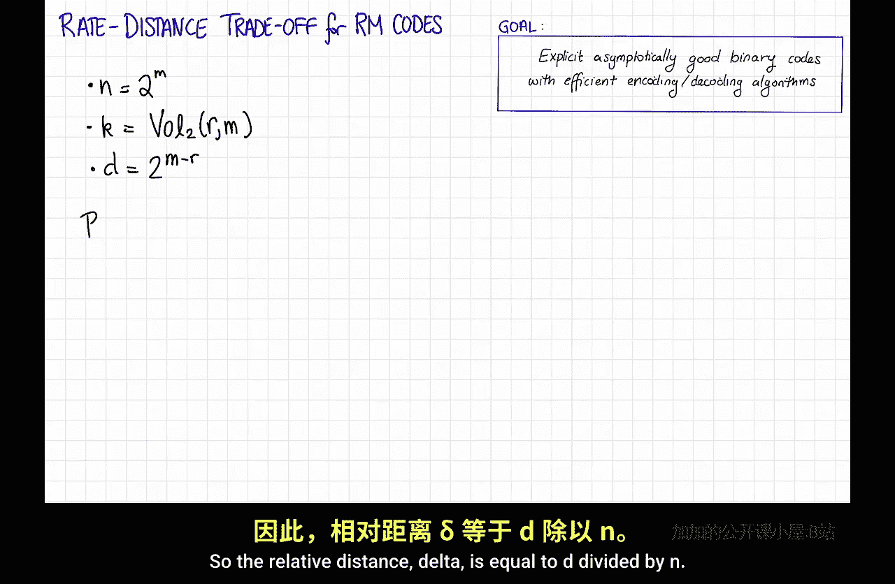
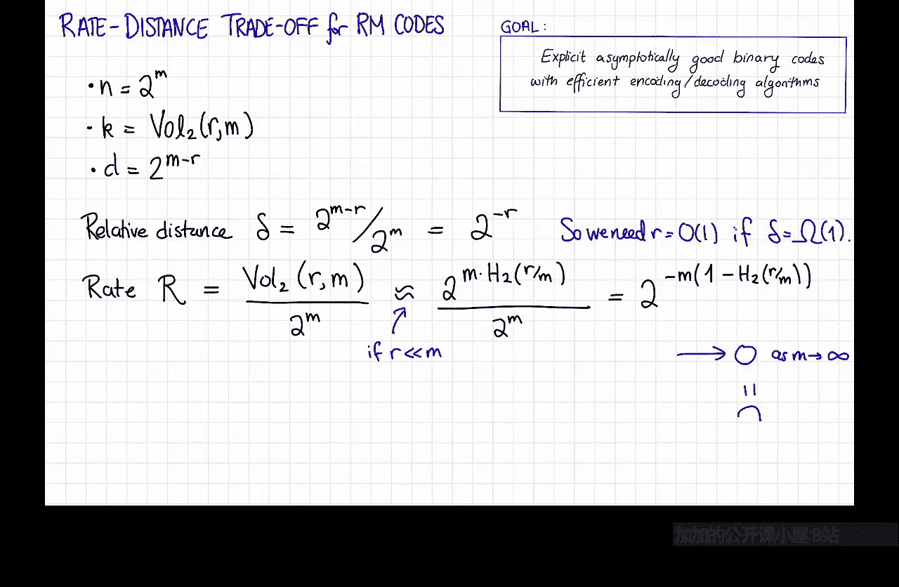

# 斯坦福大学【中英⚡代数编码导论｜Introduction to Algebraic Coding Theory】 p22 p21 6, Video 3： Binary Reed-Muller Codes -BV16sRYYTEwg_p22-

In previous videos， we've been seeing different binary takes on read Solomon codes。In this video。

 we'll see another such take called a binary read Mueller code。

So here's the definition of a binary read Mueller code。As a historical aside， read Mueller codes。

 actually predate read Solomon codes， even though we're going to introduce them the other way around。

Read Mueller codes were invented by Mueller and provided with an efficient decoding algorithm by Reid in 1954。

The binary Mvari read Mueller code of degree R is defined as follows。

So we're going to use the notation RM， sub2， mR。And it's defined in a way similar to read Solomon codes。

So it's the set of all vectors， which are the evaluations。Of some F on evaluation points。

 alpha 1 through alpha 2 to the M， where F is an M variant polynomial over F2。Of degree， at most。

 are。Here， the evaluation points， alpha 1 up through alpha 2 to the M。

This is just going to be the set of all possible evaluation points in F2 to the M。

So each of these alpha I's is a binary vector of length M。F。

Is them going to be an M variant polynomial。 For example。

 F of x1 comma X 2 is a bivari polynomial that has two variables。

 And then I'm allowed to have mononomials， which are any mixtures of these different variables。

The degree of a polynomial F is just the largest degree of any monomial that appears in it。

And the degree of a monoial with K terms in it is just K。

So this looks an awful lot like a read Solomon code。

 except that we're looking at multivariate polynomials。Just as a note。

Which will hopefully help define multivariate polynomials of degree at most D if that wasn't clear from these little scribbles down here。

Any such polynomial。That is any Mvariate polynomial over F2 in the variables x1 through X M。

Of degree at most D。Looks like the following。It looks like F of x1 dotta dot up to X M。

Is equal to the sum。Over， sets S。Subset of the integers 1 through M。

 When I use this bracket notation， this is this set 1，2，3，4， dotta， dot up to M。

So the size of S is at most D。Of A sub S。Times the monoial。The product over I and S of X， I。

Where the a sub S are some coefficients coming from F2。

So this is just a generic form of such a polynomial。 You pick some coefficients。

 This is what a polynomial with those coefficients looks like。

Notice that because we're working over F2。All of these monomials have all variables of degree at most one。

 That's because for any x and F2， x squared is equal to x。 So there's no point in having。

 say x1 squared or x2 to the fifth or anything like that。But if we were working over a larger field。

 then these monoials might look a little more complicated。Okay。

 so that's the definition of binary read mueller codes。 What sort of parameters do these codes have。

I've copied the definition of the ReadMeller code down here。

Why don't you pause the video for a second and try to at least fill in these two。

What is the block length and the dimension of this code。Okay， so the block length is2 to the M。

That is， this vector has length2 to the M。The dimension is the sum。

From J equals 0 to R。Of M Cho J。Which we actually had some notation for。

 This was the volume over an alphabet of size 2。Of the hamming ball of radius R in M dimensional space。

The reason for this formula is that this is the number of coefficients in an arbitrary polynomial that we get to choose。

That is， just like a read Solomon code。 One way to think about the encoding map of a read Mueller code is to choose the coefficients a sub S and then make this polynomial out of them。

 and then evaluate this polynomial at all of the different evaluation points。

So the message length or the dimension is just the number of possible coefficients we get to choose and how many are those。

 That's the same as the number of subsets。Of the integers  one through M that have size at most D。

 And that's what this sum is counting。Okay， so now we know the block length and the dimension of a binary read Mueller code。

How about the distance。In order to understand the distance of a binary read Miller code。

 we're going to use something called the shorttz zippolemma。 So here's what the lemma says。

Let F be an Mvariate polynomial over F2 that is not identically 0。That is。

 not all of its coefficients are 0。And suppose that the degree of F is at most R。Then。

 the number of points。In F 2 to the M so that F of alpha is not equal to 0。

Is at least 2 to the M minus R。

The flavor of this lemma might look familiar。 All right。

 Mo ray polynomials don't have too many roots， Thanks， Polly。Yeah。

 so this is basically saying that low degree multivariate polynomials don't have too many roots。

For the proof。Well， we're going to skip the proof， but it's a fun exercise。As a hint。

 show that you can write F like this。For some M-1 variant polynomials， F n。And F1。

And then news induction on M。Okay， but assuming this lelemma。

Let's also observe that this lemma is tight。That is。

 there are some degree R polynomials so that this inequality is an equality。

To see that this is tight， consider the polynomial F of x1 dot dot up to X M。

Which is just equal to the product of the first R of these variables， x1， x2， dott dot up to X R。

Observe that this polynomial is non 0。 If and only if x1 up through X R are all equal to1。

 and then the remaining M minus R variables can be whatever they want。

So that's 2 to the M minus R possibilities so that this thing is non zero。

A corollary of both dilemma and the observation。Is that the distance of the read Muer code with parameters。

 M and R。Is exactly2 to the M minus R。Indeed， this lemma is exactly saying that any non0 read Mueller code word has at least 2 to the M minus R non zeros。

 since it's a linear code。 that means that the distance is at least2 to the M minus R。

In this example， from our observation。Shows that the distance is at most2 the a minus R。

 so therefore it's equal to that。So let's go back to our parameters slide here and write that the distance is equal to 2 to the M minus R。

Great， so now that we understand the parameters of binary readmeller codes。

How about efficient algorithms。Okay， so readMeller codes do have efficient decoding algorithms。

We'll see them maybe in later videos， but we're going to skip them for now。Fun exercise。

 Try to come up with one for yourself。

So let's return to our goal that's been driving these past couple of videos。We want explicit。

 asymptotically good binary codes with efficient encoding and decoding algorithms。Okay。

 so binary read Weller codes Def explicit。 I can tell you exactly what they are。 They are binary。

And if you believe me， they do have efficient encoding and decoding algorithms。

But are they asymptotically good。We already computed their parameters， N， K And D。

 So now let's compute the relative distance in the rate and see how that trade off looks。

So the relative distance。

Delta。Is equal to D divided by n。 That's2 to the M minus R divided by 2 to the M。

Also known as2 to the minus R。In particular， if we want this to be bounded away from  zero。

 R needs to be a constant。The rate R of a binary read Mueller code with parameters， R and M。

Is equal to K divided by n。 So that's the volume。Of the handing ball of radius R in 01 to the M。

Divided by the block length N， which is 2 to the M。Okay， this looks a little bit gross。

 But fortunately， we've already understood somewhat what that looks like。So at least if R is know。

 not super close to M。This is something like 2 to the M times the binary entropy。Of R divided by M。

Divided by 2 to the m。Which is equal to 2 to the minus M times 1 minus。

The binary entropy of R of Ram。Unfortunately， if R is constant。This is going to zero real fast。

So this is going to one。 So this is going to0 real， real fast as M grows。In particular。

 unfortunately， binary read Mueller codes are also not going to achieve our goal because theyre not asymptotically good。

If we want constant relative distance， the rate needs to be going to 0。However。

 just as with BCCH codes， read Mueller codes are actually really useful to know about and are used in practice a lot。

😡，In particular， even though they don't have good distance in this worst case sense。

 they actually do perform pretty well on random errors。

 which is also a reasonable model for lots of applications。As a side notes。

 it's actually still an open question to completely understand the performance of binary read mueller codes on random errors。

 It's been figured out for some parameter regimes by some recent exciting work。

 but the general question still wide open。

Okay， so the major takeaway from this video is that binary read Mueller codes are one way of coming up with a read Solomon like code that is evaluations of low degree polynomials that happen to be binary。

They are still super cool and super useful， but unfortunately， they don't quite achieve this goal。

In the next video， we will see yet another way to try to make Read Solomon codes binary。

 and this one will actually achieve the goal。