# 斯坦福大学【中英⚡代数编码导论｜Introduction to Algebraic Coding Theory】 p23 p22 6, Video 4： Concatenated Codes (Take 1) -BV16sRYYTEwg_p23-

In this video， we'll see yet another way to turn codes over a big alphabet into binary codes。

And this one actually will achieve the goal of explicit constructions of asymptotically good。

 binary coats。

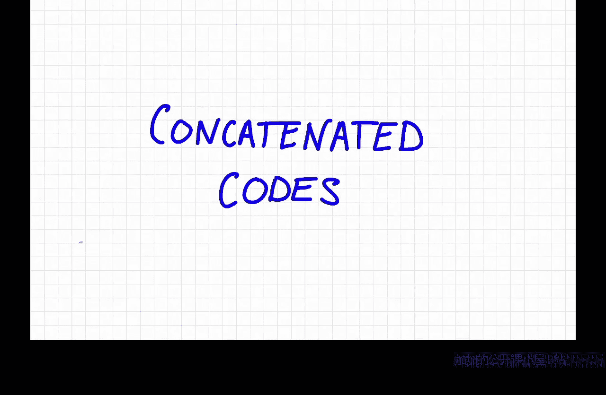

The construction we're going to look at is called concatenated coats。To motivate concateated codes。

 let's start out with this simple construction we had in a previous video。So we had some code word。

 why？In our original code over some big alphabet sigma。If the original alphabet sigma had size Q。

 so each of these was some element of sigma。We saw that we could write each one of these symbols as a bit vector of length log cube。

So the idea was， well， okay， just write all those V vectors and stack them next to each other and hope for the best。

The problem with this is that the distance got worse。 That is。

 the distance of this binary code was worse than the distance of the original Qary code。Intuitively。

 the reason for this is that one mess up down here。

 a single bit was enough to mess up this entire block。So， the problem was。

We had these binary vectors。And we were worried that some error might mess them up and make them hard to interpret。

Pasuse the video now for a second and think about how you might deal with that。

 That is you want some way to protect binary strings from errors。

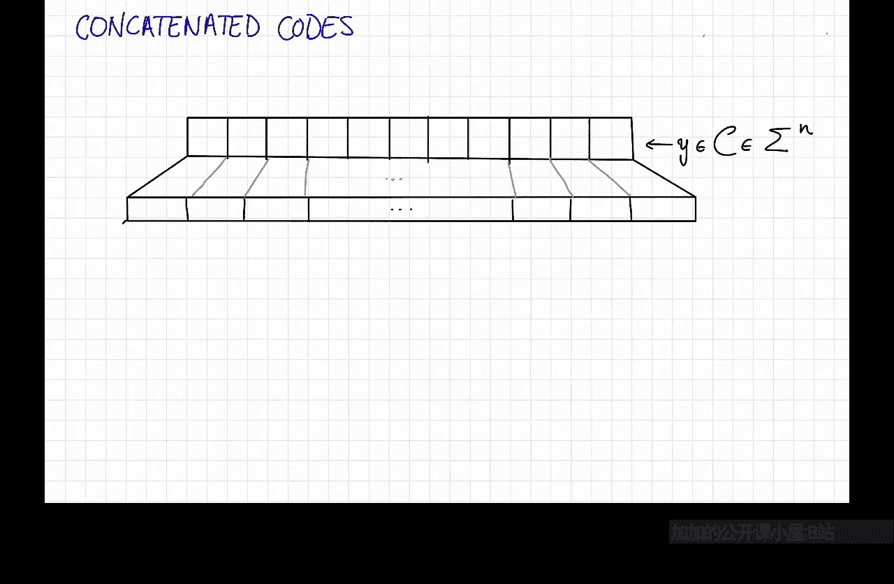

Okay， so you might realize that we've in fact， spent several， several。

 several videos talking about how to solve that exact problem。

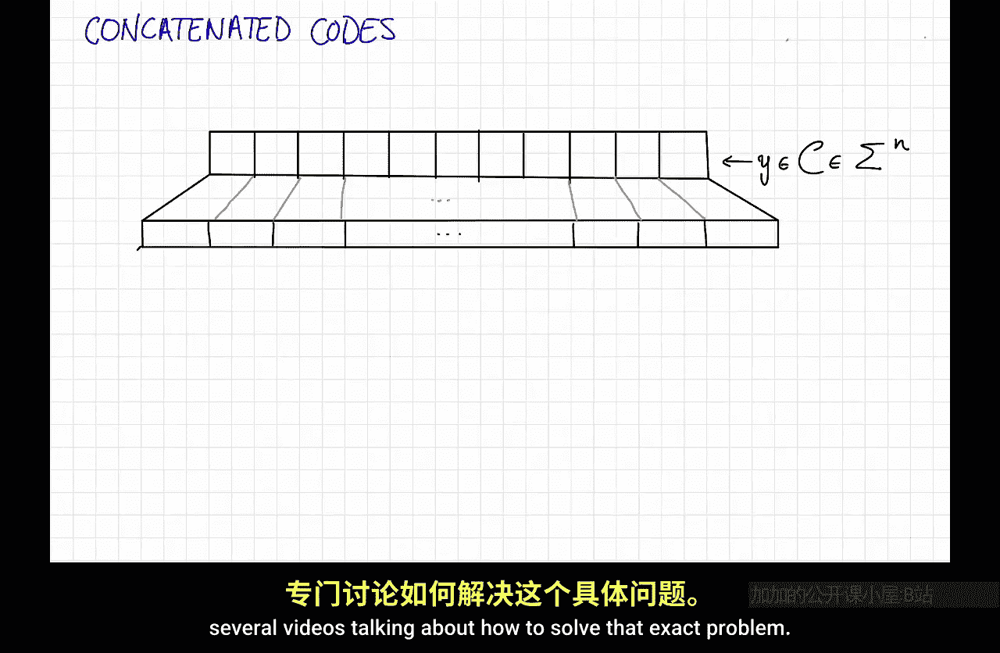

This leads us to the idea of concatenated codes。 Why don't we take each one of these little binary strings here and treat it as a message and encode it with yet another code。

 This time， a binary code。

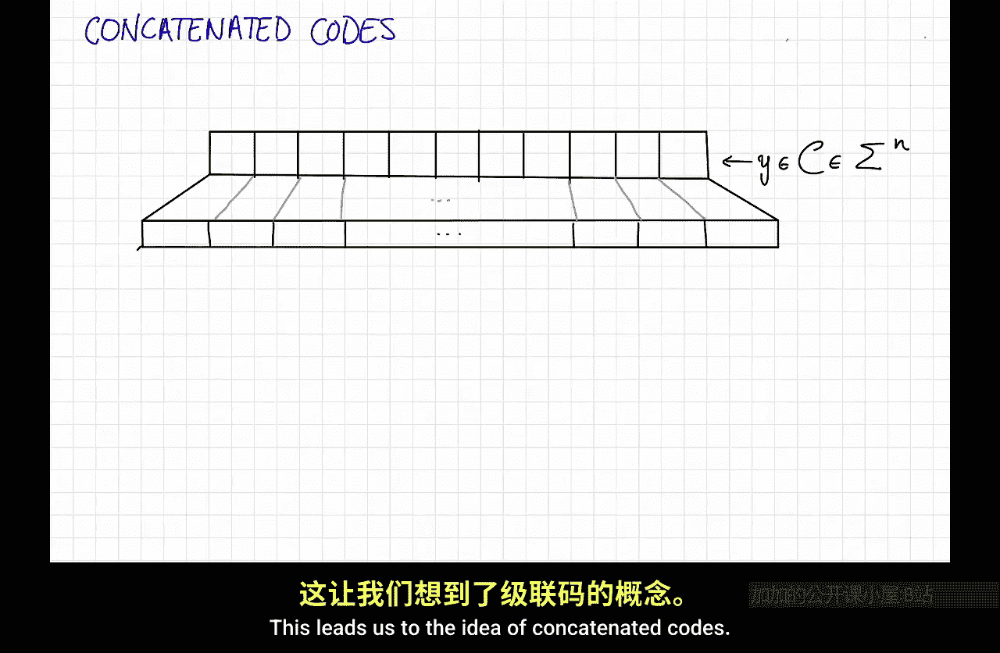

So the picture looks like this。

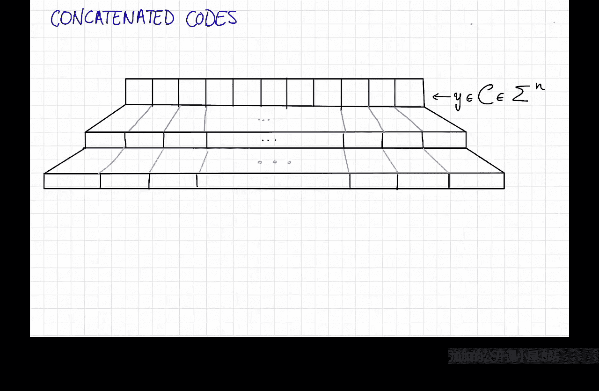

That is for each one of these little vectors here。 binaryinary vectors。

 We're going to encode it with some other error correcting code to create a slightly longer binary vector。

 We're going to do that for all of these chunks and then stack the results together。

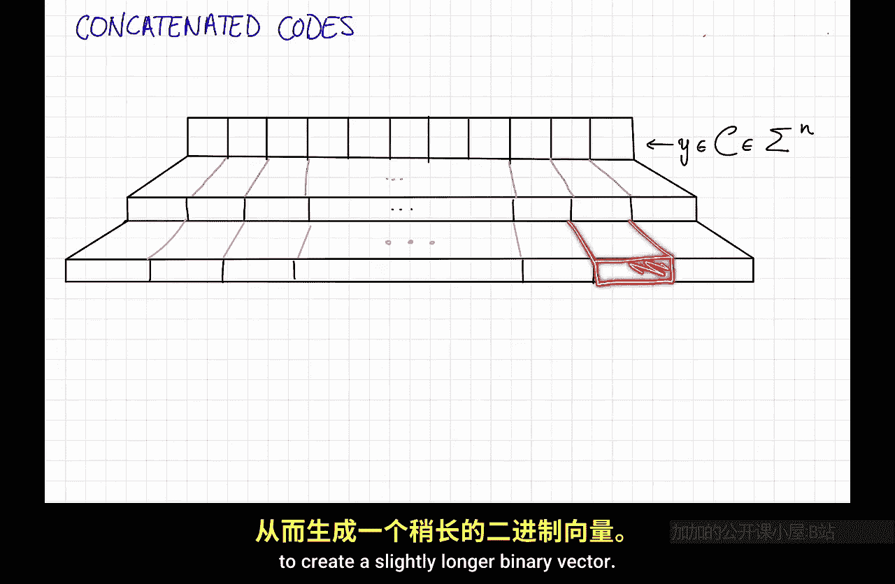

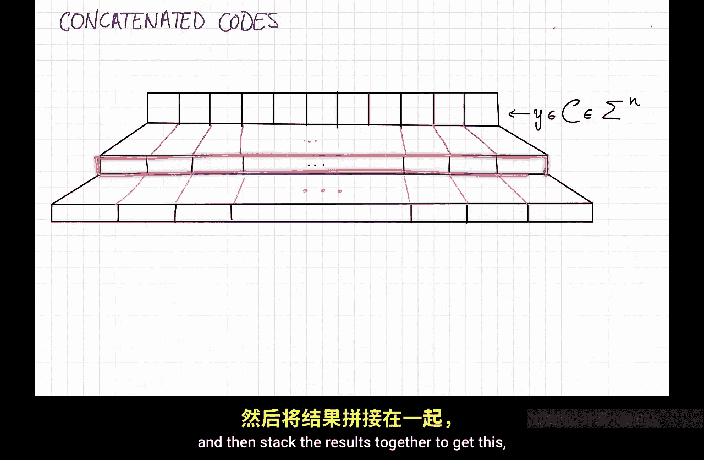

To get this， which will be a code word in our final binary code。A little bit more formally。

 Here's a definition。Let's let C out。 This is going to be our outer code。

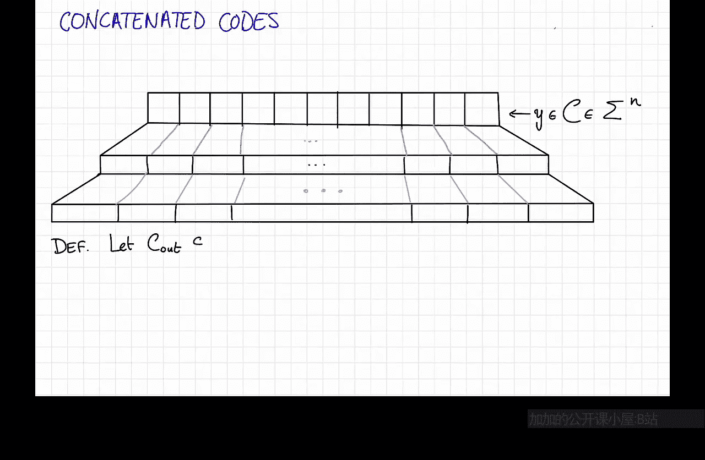

Be a code over。The alphabet Sigma out of length n out。

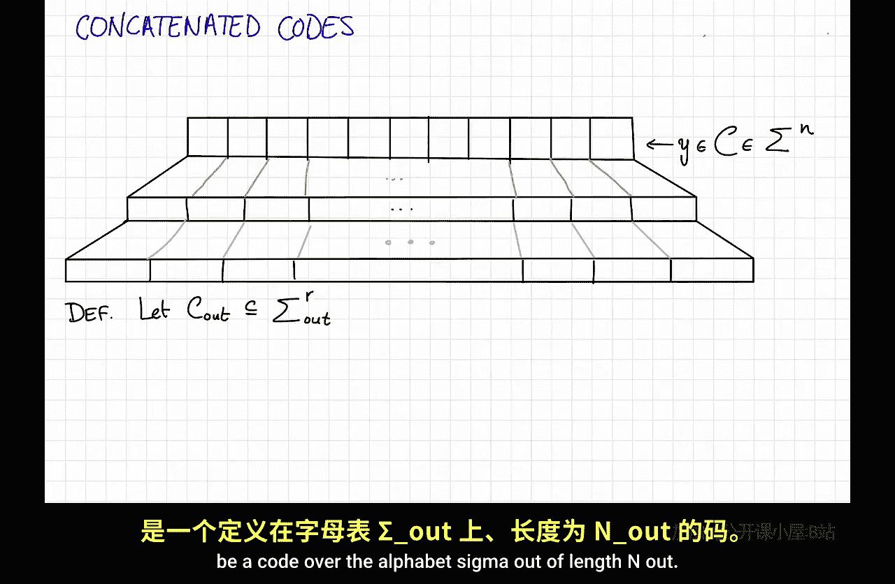

So in this picture here， this was actually C out。Sigma out and Anna out。

So this is our original code over the big alphabet。

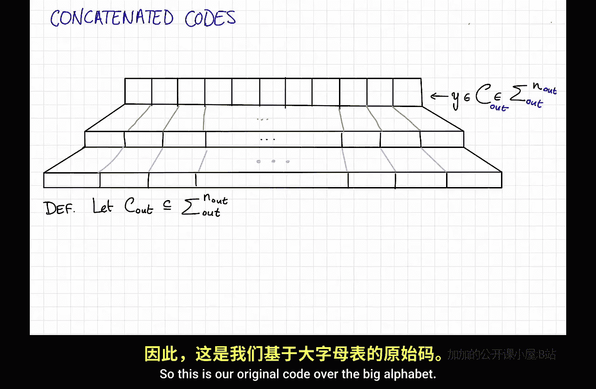

And let's say it's a Q out airy code。

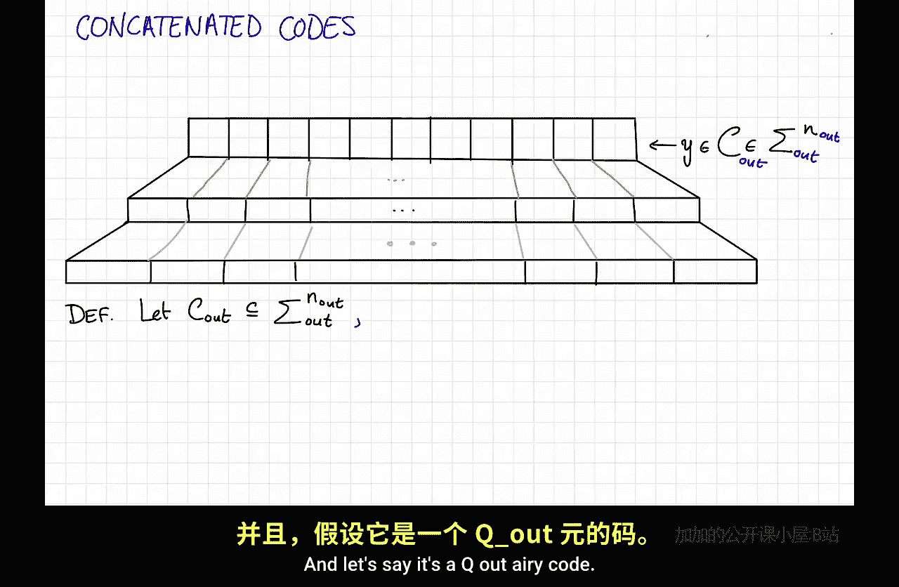

That is the size of sigma out is Q out。And let's say it has dimension K out and distance D out。

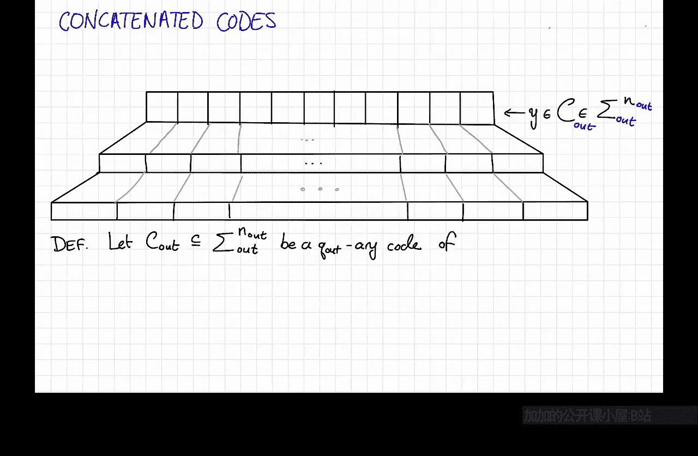

And then we're going to define an inner code， that's going to be the one that does the encoding of each of these little blocks。

And not surprisingly， let's call it C in。And we're going to define it to have all the same things。

 except with the subscripts in。Notice when we were motivating this。

 we said that this would be a binary code， but it works more generally for any smaller alphabet size。

 So let's just say it has an alphabet sigma in， which has size Q subin and think of Q subin as being equal to 2。

 If you want the final thing to be binary。We are going to assume that Q out is equal to Q in to the K in。

That means that the inner code has the right message length in order to encode one of these little blocks。

Then we're going to define the concatenated code。See in， concateninated with sea out。

I'm going to use this little circle to denote the concatenation operation。

So this is a code that is a subset of Sigma in the smaller alphabet。To the n out times and in。

And it's defined as the image of the following encoding map。

So the map is going to take some message X。In the message space， that sigma in。

To the K in times K out。So let's draw our message up here。

And what we're going to do is we're going to treat this space Sigma into the K in times K out as。

Sigma into the K in to the K out。So that is， I'll put parentheses around it like that。

And then I'm imagining that I'm sort of chunking up this message into little blocks。

And each one of these blocks is a vector in sigma into the k in， and there are K out such blocks。

Since Q into the k in is equal to Q out， theres some bijection between sigma into the k in and sigma out。

 So what I'm going to do is treat this alphabet here as just sigma out。

And instead of treating this as a vector of k out things， each of which are in sigma into the canan。

 I'll treat it as a vector of K out things， each of which are in sigma out。

So that's the first step of this encoding map。 I'm going to take my message。

And I'm going to treat it。As some x。In sigma out。To the K out。I'm not really doing anything here。

 I'm just changing how I'm looking at this information。Now， I have this message。

And it's in exactly the right form to be encoded by my outer code， C out。

So the next thing I'm going to do is I'm going to encode it， using the outer code。

To get this code word， why。So down here， I'm going to write that Y is the encoding under the outer code of this message X。

Then what I'm going to do exactly as we did before， is treat this。As a bunch of binary chunks。So。

 for example， if this symbol。Is why I in sigma out。

Then I'm going to treat it as a vector over sigma in。Let's call that。Vectctor， Y I。

In Sigma into the K in。And again， that's just by taking this thing and writing it in this alphabet via some arbitrary biject。

Once I do that， I'm going to take this symbol and encode it using my inner code。Xiin。

So the next step of the encoding map， is I'm going to map why here to the encoding。

Under the inner code of y1。Concatenated with the encoding。Under the inner code of Y 2。

Datta dot up to the encoding。Under the inner code of Y N out。I'm out of room here。

 so I'm going to shove this over a little bit。There we go， just barely fits。And here。

This just means stick all of these things next to each other， just like we did in this picture。

So here we're going to use the inner code C in。To arrive at this encoding。Ink in of。Vectctor Y I。

I guess I should have put little vectors down here on these guys， too。Okay， so that's the definition。

Notice that in addition to defining a code， this also defines a natural encoding map using the encoding maps of C in and C out。

Okay， so what are the parameters of concatenated codes in terms of the parameters of the original codes C in and C out？

So why don't you pause the video now and figure out what is the alphabet。

 the message length and the codeward length of the concatenated code C in concatenated with C out in terms of the parameters of those codes。

Okay， so the alphabet is sigma in。The message length。Is K in times K out。

And the codeward length is N in。Times and out。In particular。

 this message length and code word length imply that the rate of this code。Is okay。

 so it's K in times K out。Divided by n in times n out。

Which is just equal to the product of the rates of the original codes。 So that's R in times R out。

Okay so if I have two codes， C in and C out and I concatenate them。

 the rate that I get from the resulting concatenated code is just the products of the rates of my original two codes。

That's convenient。How about the distance？Here's a proposition。

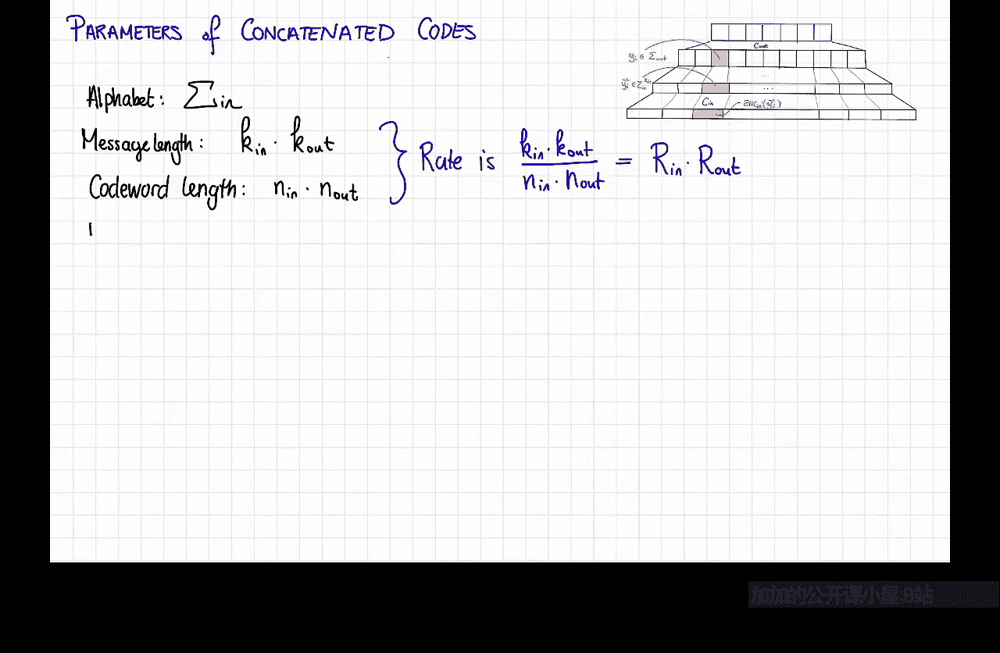

The distance。Of sea in， concatenated with sea out。Is at least D， in。Times D out。In particular。

 this implies that the relative distance of the concatenated code is， again， the product。

 or at least the product of the relative distances of the two component codes。Okay， so altogether。

 that's quite convenient。 You want to get the rate， Just multiply the rates。

 You want to get at least a bound on the distance， Just multiply the relative distances。

Let's prove this proposition。So， proof。Consider two distinct code words in this concatenated code。So。

 let's see。Be not equal to C prime。Be two code words in big C。

 which is the concatenation C in concateninated with C out。And let's draw them like this。

 Sa here's C。And here's C prime。And these divisions that I'm drawing here are the same as the divisions in this picture。

So this is some code word in the inner code C in， and so is this， and so is this。

 and I've just stacked a bunch of them together。Okay。

 so I have these two code words in my concatenated code。 And I want to know。

In how many places must they differ。So first， since they are encoding different messages。

At least D out of these blocks must be the encodings of different symbols。

That's using the distance of the outer code。So suppose that these D out blocks are in the picture。

This one and maybe this one。So what that means is that maybe this code word of C is the same as this code word of C。

 but this code word of C better be different from this code word of C。

But then using the distance of C within each of those D out blocks。

 at least D in symbols have to differ。So， for example。Maybe in these two blocks here。

This chunk of D in symbols differs from this chunk of D in symbols。

And maybe in these two blocks here。These D in symbols differ from these corresponding D in symbols。

Altogether， the total number of places that much differ is at least D out times D in。

So this proves the proposition that the distance of this concatenated code is at least D out times D in。

Just a note， this is just a bound。It doesn't mean that the distance is exactly D out times D。

 and perhaps it could be better。Because we're often going to want to refer to this。

We'll give it a special name。 We'll call it the designed distance。Okay。

 so let's return to this goal that we've had for several videos now。Of constructing explicit。

 asymptotically good binary codes with efficient encoding and decoding algorithms。

So I claim that this idea of concatenated codes is going to help us make progress to this goal。

So the idea is as follows。Let's take a read Solomon code， as our outer code。

And then we'll just choose any asymptotically good binary inner code as an inner code。And the result。

 I claim， is going to be an asymptotically good， binary code。To see why。

If we start with our read Solomon code， this has rate R out。Let's say that's bigger than zero。

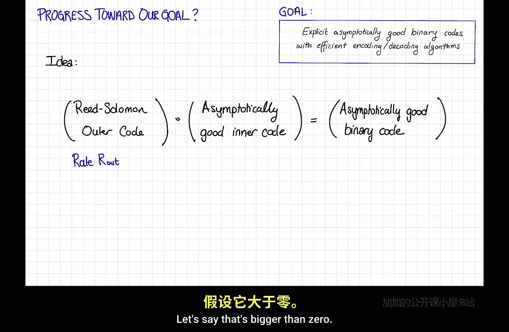

And it has relative distance。Delta out。Which is equal to 1 minus R out。

Which provided that we have chosen R out to be strictly between 0 and 1。

 This is also strictly bigger than 0。Now let's take our asymptically good inner code。

Let's say that this has rate R in。Strictly bigger than 0。

And distance deelta n also strictly greater than0。Then the computations that we just did so that the concatenated code here is going to have rate。

Are in times R out。Still strictly greater than0。And distance Delta in Time Dlta out。

Also strictly greater than 0。So if we start with two codes like this。

 we're going to get an asymptotically good binary code。Further。

 our read Solomon codes are super explicit。I can tell you exactly what they are。

 and evaluations of low degree polynomials。So as long as we can come up with an inner code that's explicit。

Then we'll be able to get a concatenated code that is also explicit。And that will achieve， well。

 at least this first part of this goal will come back to the encoding and decoding algorithms later。

So this is great。All we need in order to get at least this part of the goal。

 explicit asymptotically good binary codes is this piece。An explicit， asymptically good binary code。

Hm。So this seems a little bit like a chicken and egg problem。But wait。It turns out to be okay。

The key is that this code can be a lot shorter than this code in terms of block length。In fact。

 we can make it short enough that we can actually just find a code by brute force。

 just exhaust over all of them。 We know by the Gilbert Bartenov bound that one exists。

 And if it's short enough， we can find it efficiently in polynomial time。

We're going to stop here for this video。But， next time。

We'll work out the parameters for how this works。 And we'll see that this chicken and egg problem can actually be resolved。

That's going to give us explicit， asymptotically good binary codes， getting half to the school。

And then in a later video， we'll actually see the efficient decoding algorithms to go along with it for concatenated codes。

