# 代数编码导论：4：级联码（第一部分） 🧩

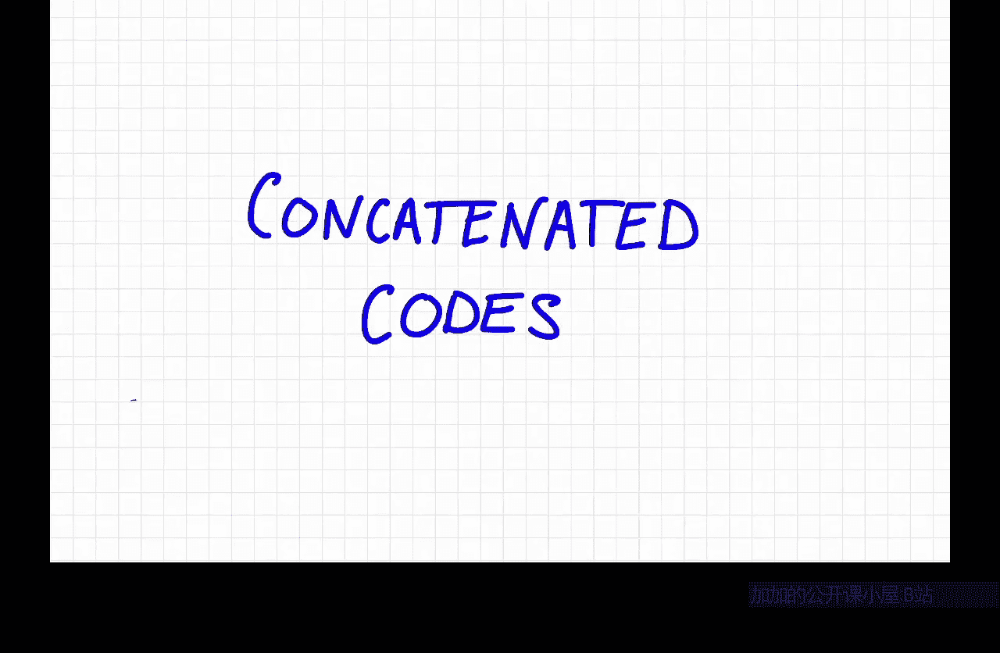

在本节课中，我们将学习一种将大字母表上的码转换为二进制码的新方法。这种方法被称为“级联码”，它能帮助我们实现一个明确的目标：显式地构造出渐近好的二进制码。

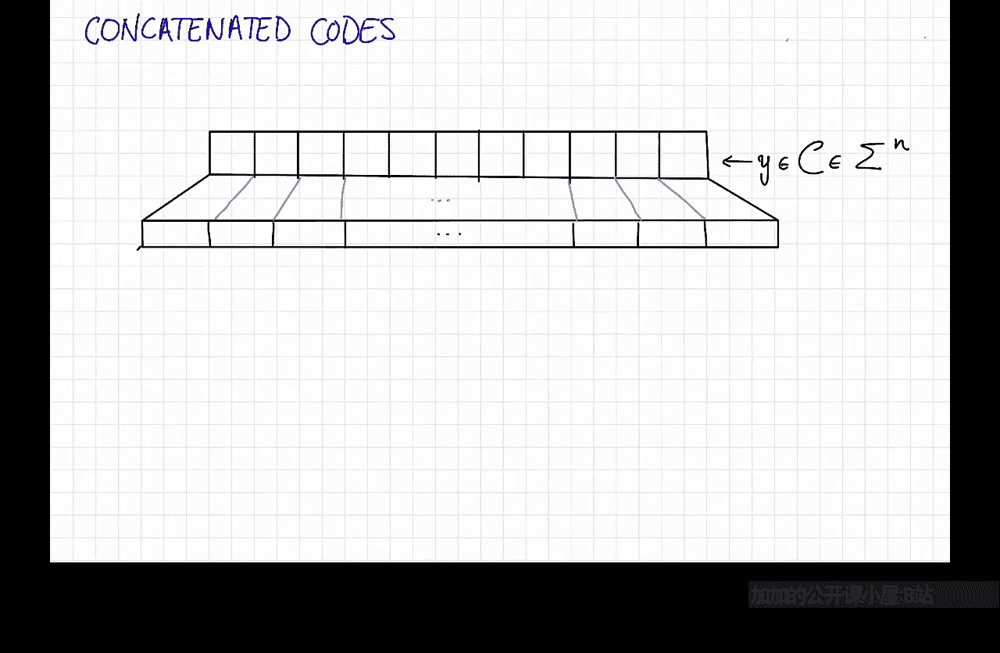

---

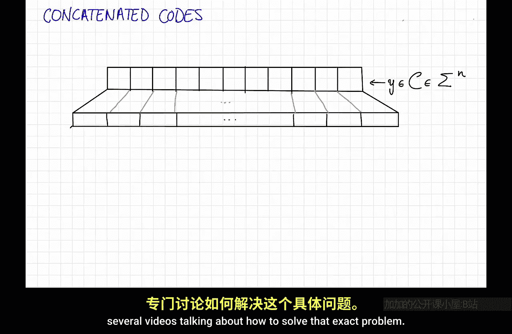

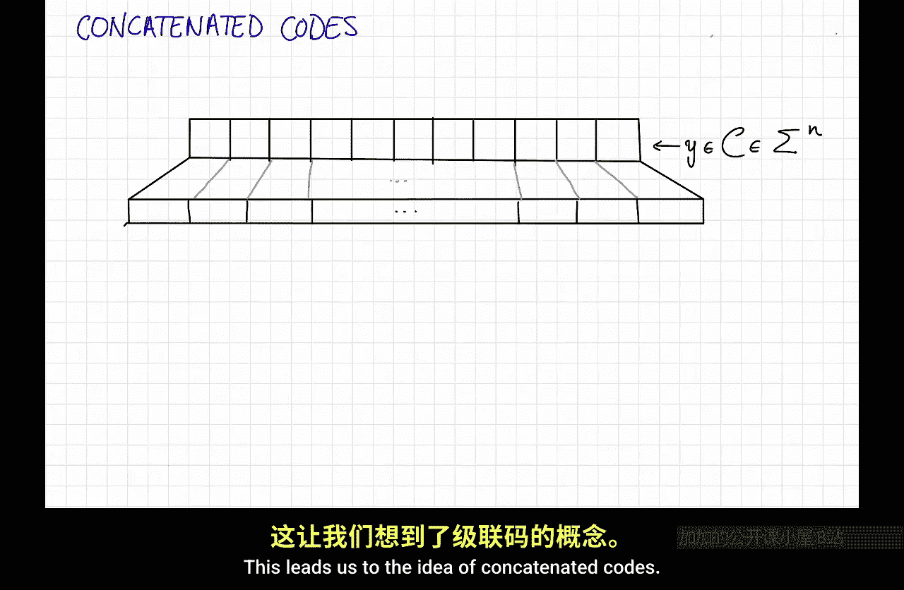

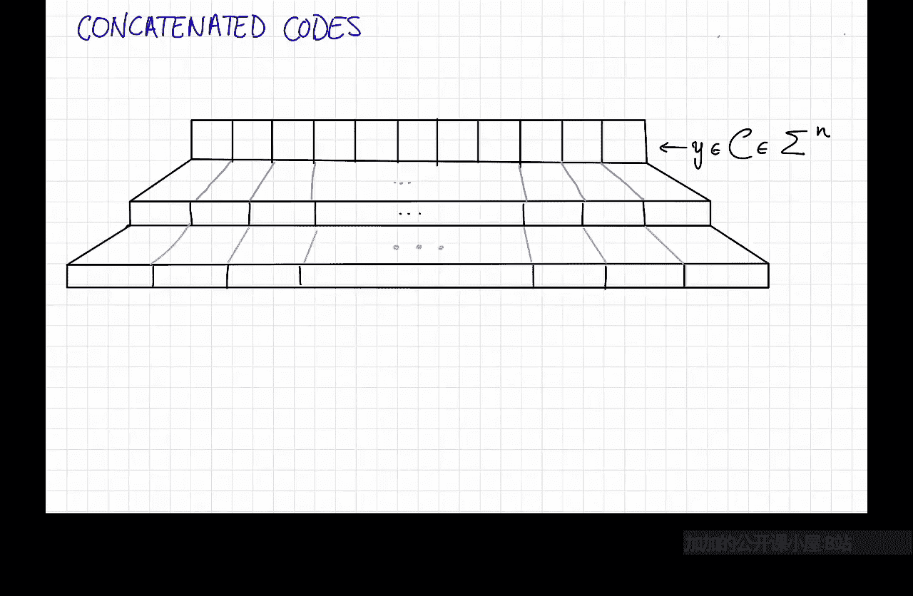

## 动机与问题

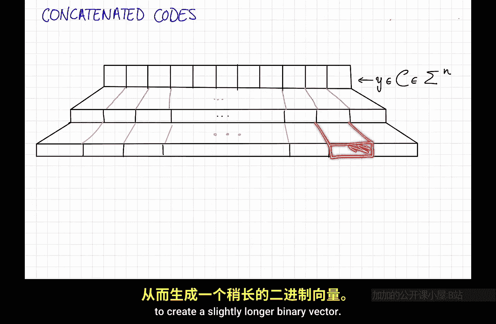

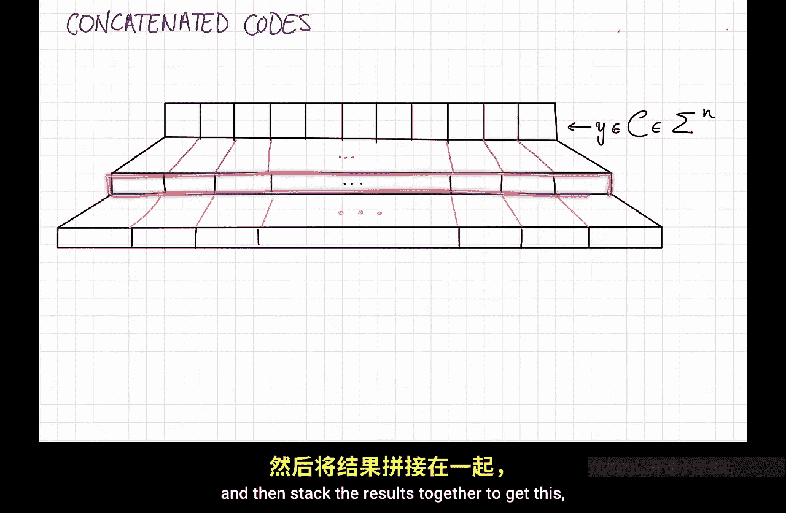

上一节我们介绍了一种简单的转换方法：将大字母表上的码字直接写成二进制向量并拼接起来。然而，这种方法存在一个问题：转换后二进制码的距离会变差。

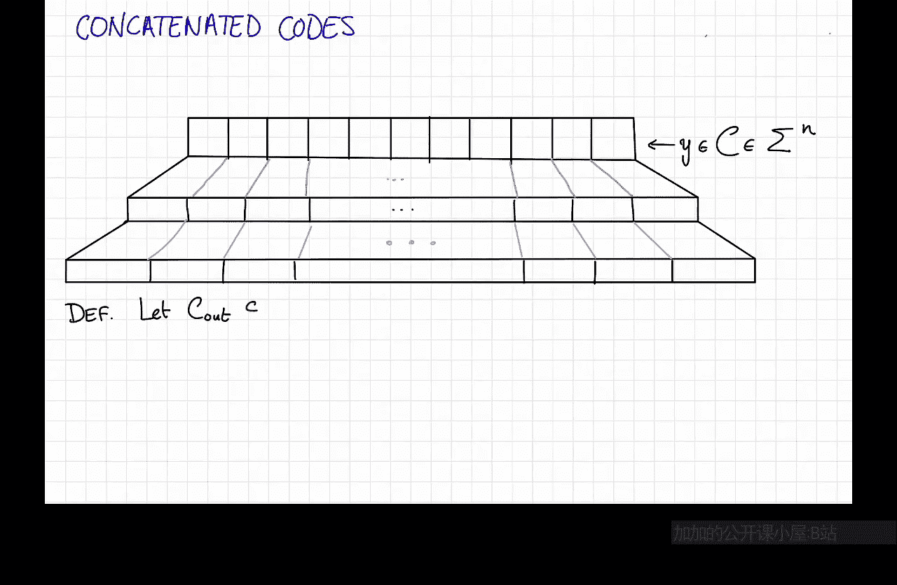

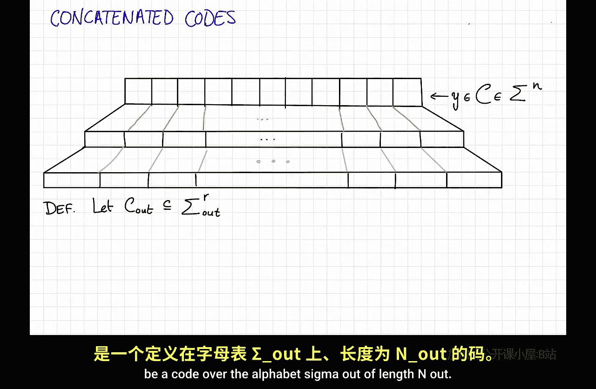

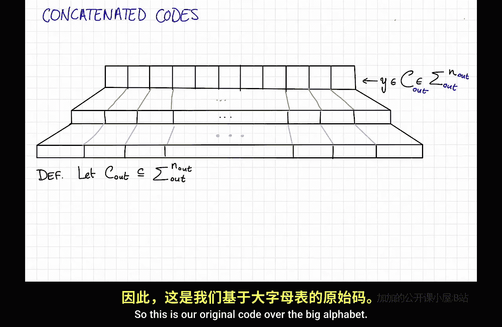

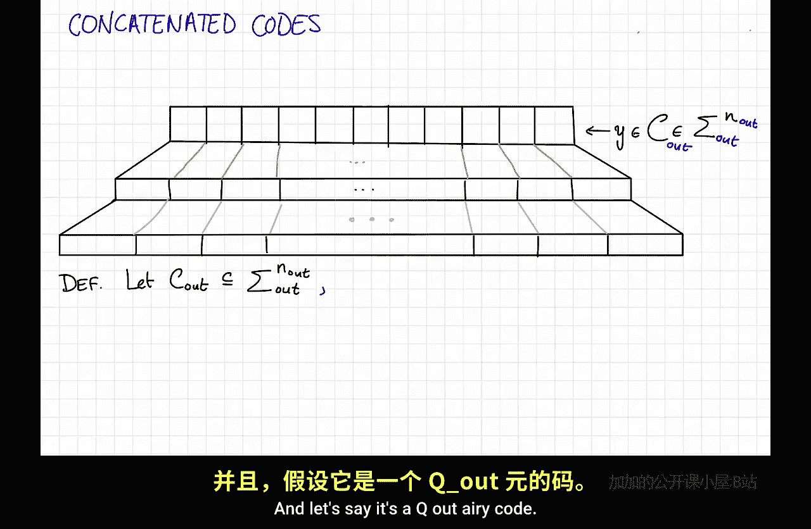

直观原因是，一个二进制块中哪怕只有一位出错，也可能导致整个符号块被错误解读。这引出了核心问题：我们如何保护这些二进制字符串免受错误影响？

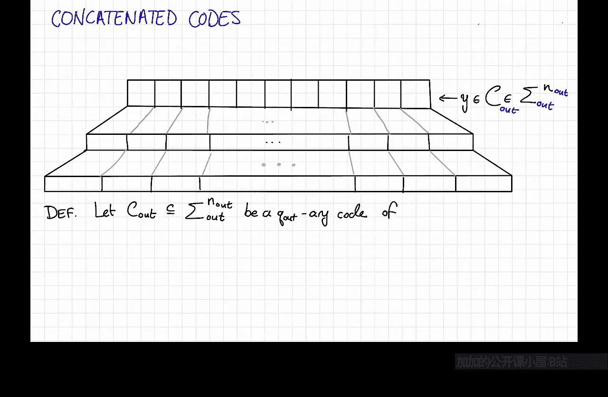

## 级联码的核心思想

为了解决上述问题，我们引入了级联码的概念。其核心思想是：**对每个二进制小块，再用一个纠错码（内码）进行二次编码**。

以下是构建级联码的步骤：
1.  将原始大字母表码（外码）的码字拆分成符号。
2.  将每个符号视为一个二进制消息。
3.  使用一个二进制码（内码）对每个二进制消息进行编码。
4.  将所有内码编码后的结果拼接起来，形成最终的二进制码字。

## 正式定义与参数

现在，让我们正式定义级联码及其参数。

### 定义组件码

*   **外码 (C_out)**：定义在大字母表 Σ_out 上，参数为 `[n_out, k_out, d_out]`，字母表大小为 `Q_out`。
*   **内码 (C_in)**：定义在小字母表 Σ_in 上，参数为 `[n_in, k_in, d_in]`，字母表大小为 `Q_in`。我们要求 `Q_out = Q_in^{k_in}`，以确保内码能编码外码的一个符号。

### 定义级联码

级联码 `C = C_in ∘ C_out` 的编码过程如下：
1.  将长度为 `k_in * k_out` 的消息 `x` 视为 `k_out` 个块，每块是 `Σ_in^{k_in}` 中的一个向量。
2.  通过双射，将每个块映射为外码字母表 `Σ_out` 中的一个符号，得到消息 `x' ∈ Σ_out^{k_out}`。
3.  使用外码 `C_out` 对 `x'` 进行编码，得到码字 `y ∈ Σ_out^{n_out}`。
4.  将 `y` 的每个符号 `y_i` 通过双射还原为 `Σ_in^{k_in}` 中的向量。
5.  使用内码 `C_in` 对每个这样的向量进行编码，得到 `n_out` 个内码码字。
6.  将这些内码码字拼接起来，得到最终的级联码字 `c ∈ Σ_in^{n_in * n_out}`。

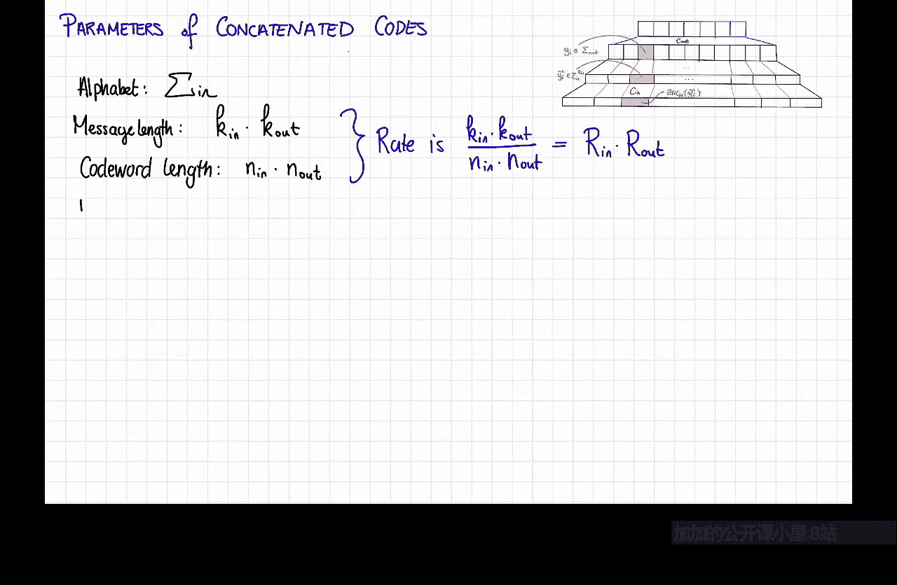

### 参数计算

以下是级联码的关键参数：
*   **字母表**：`Σ_in`（例如，二进制时为 `{0, 1}`）。
*   **消息长度**：`k_in * k_out`。
*   **码字长度**：`n_in * n_out`。
*   **码率 (R)**：`R = (k_in * k_out) / (n_in * n_out) = R_in * R_out`。
*   **距离 (d)**：`d ≥ d_in * d_out`。
*   **相对距离 (δ)**：`δ ≥ δ_in * δ_out`。

## 实现渐近好码

我们回到最初的目标：构造显式的、渐近好的二进制码。

思路如下：
1.  选择一个**里德-所罗门码**作为外码 `C_out`。它具有正的码率 `R_out > 0` 和相对距离 `δ_out = 1 - R_out > 0`。
2.  选择一个**渐近好的二进制码**作为内码 `C_in`。它具有正的码率 `R_in > 0` 和相对距离 `δ_in > 0`。
3.  将它们级联。根据上述计算，得到的二进制级联码的码率 `R = R_in * R_out > 0`，相对距离 `δ ≥ δ_in * δ_out > 0`，因此它是一个渐近好码。

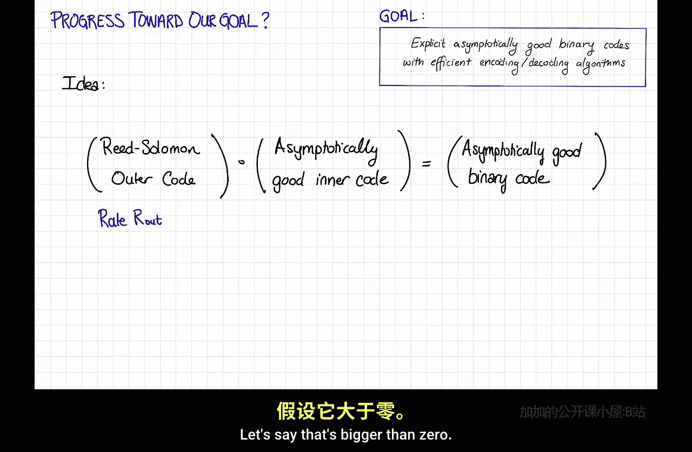

里德-所罗门码是显式的。那么，如何获得一个显式的、渐近好的二进制内码呢？这似乎成了一个“先有鸡还是先有蛋”的问题。

关键在于，内码的码长可以比外码短得多。根据吉尔伯特-瓦尔沙莫夫界，这样的好码是存在的。如果码长足够短，我们甚至可以通过穷举搜索在多项式时间内找到一个。这解决了“显式性”的问题。

---

## 总结

本节课我们一起学习了级联码的构造方法。我们首先分析了简单转换方法导致距离变差的问题，进而引入了对内码块进行二次编码的级联思想。我们正式定义了级联码，并推导了其码率是内外码码率的乘积，其距离至少是内外码距离的乘积。最后，我们展示了如何通过选择里德-所罗门码作为外码和一个短且渐近好的二进制码作为内码，来构造显式的渐近好二进制码，为解决“先有鸡还是先有蛋”的显式构造问题铺平了道路。在后续课程中，我们将探讨级联码的高效解码算法。