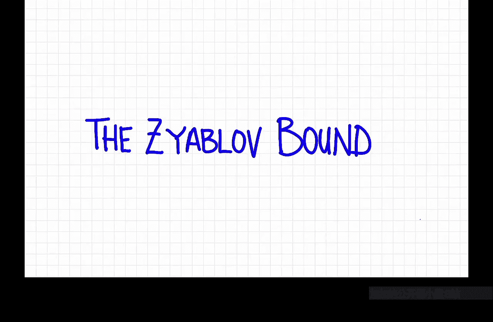
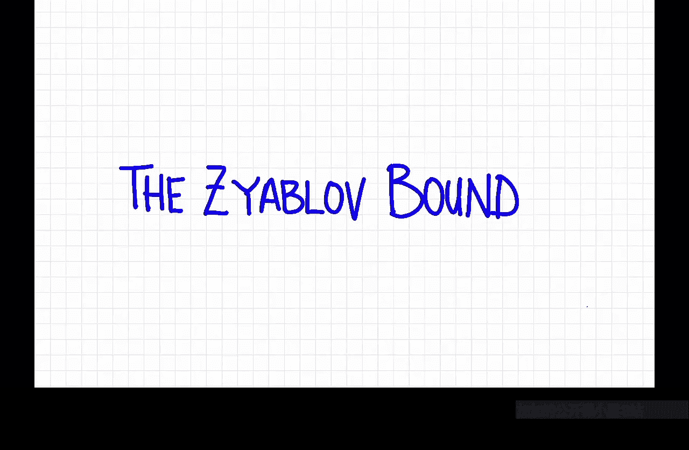

# 斯坦福大学【中英⚡代数编码导论｜Introduction to Algebraic Coding Theory】 p24 p23 7, Video 1： The Zyablov Bound -BV16sRYYTEwg_p24-

In this video， we will at least partially achieve our goal of explicit。

 asymptotically good binary codes with efficient algorithms and also introduce something called the Zoblov Bo。

😊。

So here's the statement of the Zobloth Bo。It says that for any epsilon greater than 0。

 there is a family of explicit binary linear codes of rate R and distance Dlta that satisfy this particular nasty trade off。

Here， explicit means that there is a polynomial time algorithm。

 polynomial and N to find a description of the code。So this is not just an existential result。

 There exists a code such that blah， blah， blah。 It means that if you give me an n。

 I can pretty efficiently give you the code of that length or give you a description of the code of that length that satisfies this trade off。

Okay， but so what is this trade off， This looks pretty gross。

This says that the rate of the code is at least the supreum over all R between 0 and 1 minus the binary entropy of Delta minus epsilon。

Of the quantity， R times 1。Delta divided by the inverse of the binary entropy of1 minus or minus epsilon。

We will see where this big， nasty expression comes from when we prove the Zablooff bound。 But first。

 let's take a look at what it looks like on a graph。

So here's our favorite graph where we have the rate on the y axis and the relative distance on the X axis。

 This is the graph for binary alphabets。 And here's all the bounds we know， plus the Z oflo bound。

In particular， here is the Gilbert Varsheov Bo。So remember that the Gilbert Varsheov Bo is sort of the best bound where we know the existence of codes with these trade offs。

 So I know that there exists a code here with this particular trade off between Delta and R。

 But I don't really know what it is。 The Gilbert Vrsashov Bo was non constructive。

Zoblooff Bo is down here。 It's below the Gilbert Vacheov bound。

And what the theorem here says is that on this curve。

Not only do there exist codes with this trade off， but actually。

 there are explicit constructions of them。In the context of this goal that we had stated in a previous video were now like halfway there。

 So the goal was to find explicit， asymptotically good binary codes with efficient encoding and decoding algorithms。

What thezeobloth bound gives us is this first half。In particular， codes here are explicit。

 asymptotically good binary codes。 It turns out that they also have efficient decoding algorithms。

 We'll see that in a later video。But for now， let's prove the Zlooff bound。

We're going to prove the Yobluff bound using concatenated codes。

 So let's quickly recall what those look like。We have some inner code。

 C in and some outer code C out。And we can create the concatenated code C in concateninated with C out。

 as follows。We take some message X， which lives in sigma in to the K in times K out。

And then we treat that as a message in sigma out to the K out。

 which we can then encode with our code C out。 So then we get this code word here， Y。

 which is a code word in C out。And now what we're going to do is we're going to use the inner code to reencode each symbol of this code word。

 So for this symbol here， for example。It lives in the big alphabet's sigma out。

 And we're going to treat that as a vector over the small alphabet Sigma in。

And then we're going to encode that little vector with the inner code C in to create some slightly longer vector still over the alphabet sigma in。

 We're going to do that for all the symbols and stack them next to each other。

And that's going to give us our final code word C， which lives in the concatenated code。

For the Zaploff bound， we're going to take our inner code and our outer code as follows。

Our outer code is going to be a read Solomon code with rate R out distance Delta out。

 which is equal to 1 minus R out， because read Solomon codes achieve the singleleton bound。

 And that's what this says。Our inner code is going to be a binary linear code that lives on the Gilbert Vrsacheovv bound。

 That is， it has rate little R， which is greater than equal to 1 minus the binary entropy of deelta n times epsilon。

 and it has distance Delta in。We still need to say how we're going to get this。

 We'll come back to that in a moment。So now let's take a look at what this theorem that we're trying to prove says。

 I've just copied the Zolo bound down here。So there's a bunch of deda that we need to establish。

The first is the rate distance trade off。That is this nasty expression。

The second is that we want binary codes that are also linear。 and finally。

 we want them to be explicit。So let's check all of these one at a time。First。

 the rate distance trade off。Okay， so our code C。Which is the concatenation of C in and C out。

Has the following parameters。So the relative distance。Is Delta。

 which is equal to the product Delta in times Delta out。 We showed this in a previous video。

In our case， this is1 minus R out。That's Delta out。Times Delta n。

Which is H2 inverse of1 minus R minus epsilon。 So this is what you get when you solve this expression for Delta in。

The rate of the concatenated code。This is just the product of the rates of the inner and outver codes。

 We showed this in a previous video。 So this is R equals little R times R out。

Since the little R is the rate of the inner code and R out is the rate of the outer code。

But this is equal to little R times 1 minus deelta divided by。

The binary entropy inverse of1 minus R minus epsilon。

And that's just what you get when you solve this equation here。For R out。

So now we see where this nasty expression comes from in this theorem。So far。

 the rate little R could have been anything。So let's just pick the right little R to maximize this to get the best possible trade off between rate and distance。

And that gives us the supreme in the theorem。Okay， so that establishes the rate distance trade off from the theorem。

 so let's put a check there。How about these other things。

So this code is certainly binary by construction。 So let's put a check。 Is it linear。

It turns out that it is， at least when the read Solomon code is over a field of size that is a power of two。

I'm going leave that as a fun exercise for the viewer。

All that's left now is this thing about explicitness。

The reason why this isn't obvious is because while C out is completely explicit。

 it's very easy to describe or read Solomon code。 C in does not seem very explicit。 right。

 The G V bound is non constructive。 How are we going to come up with this thing。

So I'm going to erase this stuff here， and then we're going to talk about explicitness。Okay。

 so for our purposes right now， what we mean by explicit is we just want an efficient algorithm that will give us a description of the code。

So for that， it suffices to come up with an efficient algorithm， efficient。

 meaning polynomial and N that will give us a description of this thing。 C in。

 Because once we have a description of C in。The rest of the sort of concatenated code set up is all pretty explicit。

So let's say that the evaluation points of C out or read Solomon code are all of FQ star。

And let's also say that  Q is equal to 2 to the K in。Where K in is the dimension of this inner coat。

Notice that this implies that Kn is equal to log Q。And also that n out is equal to  Q -1。Okay。

 so with these parameter settings， let's write down an algorithm to produce C in。

 or at least to produce a description of C in。Okay， so here's the algorithm。

We're just going to do brute force search。That is， let's search over all possible linear codes。

With this rate over F2。And when I say search over all linear codes。

 I mean search over all of the generator matrices。How many are there of these things to search over？

Will there are2 to the K in times n in such generator matrices？And since N in is， by definition。

 K N divided by little R， Since the inner code has rate R。This is equal to 2 to the K in squared。

 divided by little R。And since we said that K in was equal to log Q。

This is equal to 2 to the log square Q divided by R。

So we need to search over roughly this many generator matrices。

And then we need to check to see if they have big enough distance。

Notice that we know by the Gilbert Varsashov Bo that such a generator matrix does exist。

So we will find it if we go over all of them。Okay， so is this number big or small in terms of N。

Let's do a computation to find out。So， Q。Is equal to n out plus1？Because we said so。

And this is equal to n divided by n in。Plus one。Where n here is going to be the length of our final concatenated code。

 So remember， n is just equal to n in times n out。 So that's why I can replace n out with this quotient here。

And this is equal to R N divided by K in。Plus 1， again。

 using the fact that the inner code has rate little R。And this here means。That N is approximately。

Q log Q divided by R。Solving for N here and using the fact that K N is log Q。That means。

That log squared Q。Is about log squared n。If we assume that R is a constant。

I'm being a little bit fast and loosed with the squiggly squigglies because it doesn't really matter so much for reasons we'll see in a moment。

Okay， so log squared  Q is about log squared n。So let's record that up here。

So that tells us that the number of things we need to exhaust over is。

About2 to the big O of log squared n。This implies that the total time for this algorithm。

In terms of n， the final block length of the concatenated code。Is roughly this。

 which can also be written as。En to the big O login。H well， that's not quite what we wanted。That is。

 it's not quite polynomial time。 We really wanted running time N to the constant。 Instead。

 we have N to the big O of log n。A running time like this is called quasii polynomial。

 which while being extremely fun to say， is not quite what we wanted。But it's pretty close。

It turns out you can do a little bit better than this pretty naive algorithm of search over all of the codes。

Perhaps it's not surprising that you can do better。 And， in fact。

 we can make this almost polynomial run time。 We can get that down to polynomial。

I'm going to skip that in the video， but check out the lecture notes for pointers to see how to get it。

For now， though， let's put kind of a like an approximate check here。So we didn't really show it。

 but we showed at least a quasi polynomial time algorithm。 And if you trust me。

 there really is a polynomial time1， which you can get by doing a slightly smarter search than this thing。

Okay， so up to this kind of sququiiggle， sququiiggle and the fact that I left this for you to check。

 we've now accomplished the first part of our goal。 We've proved this theorem。

Which establishes the existence of explicit， asymptotically good binary codes， awesome。😊，As an aside。

 you might be a bit concerned about this definition of quote unquote， explicit。

Even if there's a polynomial time algorithm to tell me what a code is。

 this is way less explicit than say read Solomon codes。

I need to run an algorithm to find out what the definition is instead of just being able to like。

 write the definition on a slide or something。It turns out that one can get much more explicit constructions of asymptotically good binary codes by picking the inner codes in this concatenated code construction carefully。

Once again， you can check out the lecture notes for more on that if you're curious。However， for now。

 we're going to move on。In the next video， we'll talk about an algorithm for efficiently decoding concatenated codes。

And that will lead us to the complete fulfillment of our goal。

