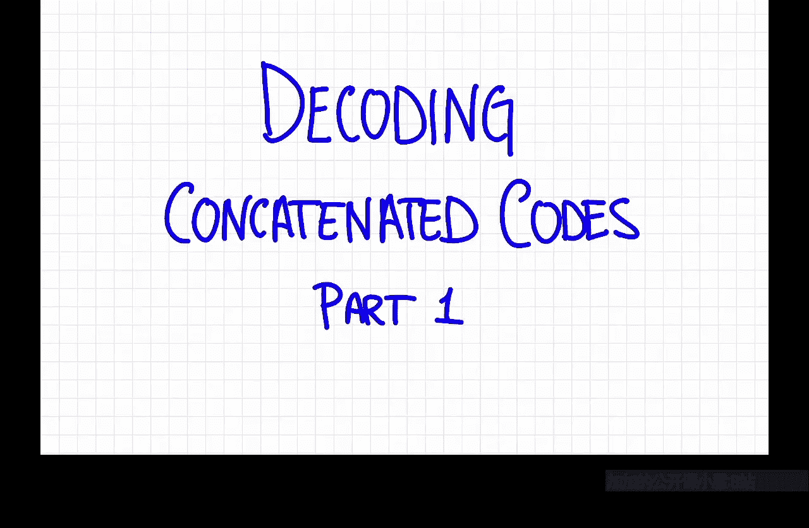
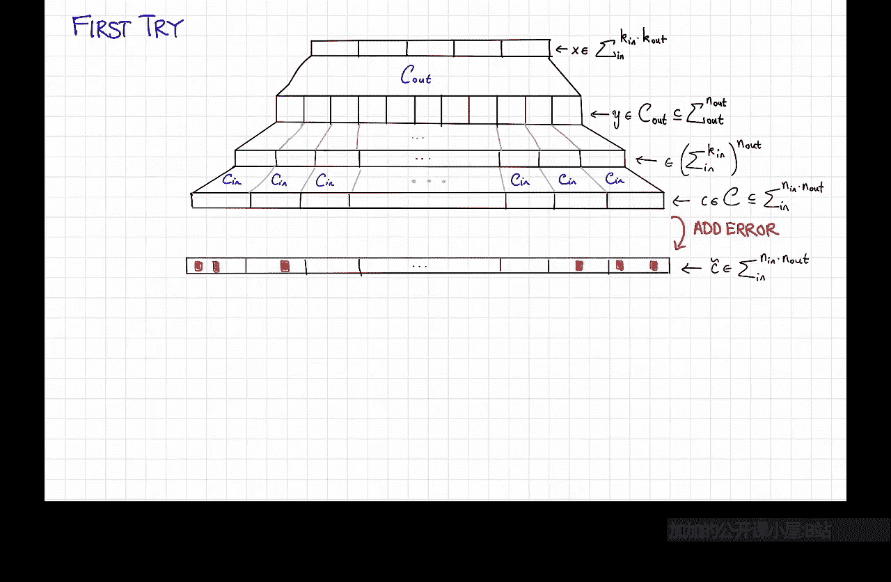

# 斯坦福大学【中英⚡代数编码导论｜Introduction to Algebraic Coding Theory】 p25 p24 7, Video 2： Decoding Concatenated Codes Part 1 -BV16sRYYTEwg_p25-

Now that we've seen concateninated codes give asymptotically good codes。

 let's see how we can efficiently decode them。Let's start by recalling our goal。

 Our goal for a couple of videos now has been explicit， asymptotically good。

 binary codes with efficient encoding and decoding algorithms。So far， we got this part。

And in this video， and the next one， we're going to figure out this part。

Remember that the code that we were using for this first part was a concatenated code。

 So the concatenated code C in concatenated， C out。

Where C out was a read Solomon code with distance D out and C in had distance D in。

In the previous video， we chose it to be on the Gilbert Barsoff Bo。

 but that's not going to matter for this video。 So for this video。

 all we really care about is that C out has a read Solomon code with distance D out and that C has distance D in。

And we're trying to figure out how can we efficiently decode this code。Let's start with a first try。

So remember， here's the structure of concatenated codes。

So we have our concatenated code code word down here。

And then what's going to happen is some errors going to get added。So particular symbols in Sigma in。

Are going to get messed up。 I've colored these red here。

Let's say that E of them are going to get flipped， but we don't know which ones。

There's a very natural decoding algorithm。Actually。

 why don't you pause the video now and think about how you would try to decode such a code？Okay。

 so perhaps you came up with something like this。Step 1。Is to decode each one of these blocks。

Using the inner code C in。That is， we want to find some C prime in C N。

 that is the closest as possible to this block。So let's say we do that for each of these blocks。So。

 for example， maybe this block。Gets decoded to some C prime。Which we hope。

Is equal to this thing here。Then we can work backwards from C prime to figure out what this message was and then what this corresponding symbol was。

That is， we're going to convert this decoding that we get into some element alpha and sigma out。

So maybe that's this guy right here。And we're going to do that for all of these possible symbols。

 So we will end up with all of these symbols， or at least a guess for all of those symbols。

Some of them might be wrong， but the hope is that then this code C out will be able to take care of that。

 So the final step is to decode C out from what we've gotten here to try to recover the original message。

Okay， so that's a very natural algorithm。We have two questions。 Is it efficient。And is it correct？

That is， does it work to actually correct errors？First， I claim that it is efficient。

So this step here， it might not seem efficient because what is C in at some arbitrary linear code。

But remember that because C in is so short， we can actually decode it efficiently using brute force。

So actually， this step turns out to be efficient。This one's efficient。

 It's just converting one type of data into another type。And then this third step。

 this is efficient because it's a read Solomon code。That is。

 we can just use the Welspoerc decoder or something like that to decode C out。Okay。

 so this is efficient。Is it correct？I claim that， yes， it is correct， at least up to a point。

More precisely， I claim that this algorithm works。Provided with the number of errors E is at most d in times d out divided by 4。

Here， D in is the distance of the inner code and D out is the distance of the outer code。

One thing to note is that this product， D in times D out。

 That is the designed distance of the concatenated code。 That is。

 we know that the concateated code has distance at least D in times D out。Therefore。

 in a perfect world， we might hope to decode the concatenated code up to half of its distance that is up to Dn times d out divided by2。

So this is off from that by a factor of two。We'll come back to this thought later。But for now。

 let's prove this claim。Proof， first， let's call a block。Like this one here。

Let's call that bad if it has too many errors for the inner code to decode。

That is this block is bad if there's greater than the floor of Dn -1 over two errors。

If there are E errors total。Than there at most E divided by this many bad blocks。

That's because in the most extreme case， there are exactly this many errors per bad block and all of the other blocks have zero errors。

That is， if I were a bad guy trying to maximize the number of bad blocks。

 I would make each block just just a little bit bad， just as bad as it needs to be to be called bad。

 and I wouldn't waste any more errors on it。And if I did that。

 this would be the number of bad blocks。Now， if a block is not bad。

 then the inner code C ins can successfully decode it。That's because the distance of C in is D in。

 And we saw many， many videos ago that a code with distance D in can correct up to this many errors。

Therefore， if a block like this one is not bad。Then if I work backwards through this algorithm。

This decodes to the correct code word， here。And this decodes to the correct symbol here。

So that means that if this block is not bad， I get the correct symbol up there。Now。

 let's consider what sea outs decoder is going to do。

See Al Dakoder is successful as long as the number of incorrect symbols up here。

Is less than or equal to the floor of d out minus1 over 2。

Which is the same as saying that the number of bad blocks is less than that。But now。

 using the fact that the number of bad blocks。Is less than or equal to E divided by the floor of D and -1 over 2。

We see that seaouts decoder is successful。If E， the total number of errors。

Is less than or equal to this product。 The floor of D in -1 over 2 times the floor of D out -1 over 2。

I just got that by plugging this in for bad blocks and then solving for E。

And that gives us the claim。Because notice that if E satisfies this， it also satisfies this。Okay。

 great。 So this algorithm works as long as theres not too many errors。So this does achieve this goal。

That we've been after for a couple of videos now。So let's put a check there。That is。

 we now know how to get explicit， asymptotically good binary codes with efficient encoding and decoding algorithms。

The idea is that we take a concateninated code with the read Solomon code as the outer code。

And a non explicitpl code on the G V bound as the inner code。

The reason that this is explicit and eventually has efficient algorithms is because that inner code is so short that we can do sort of brute force algorithms on it efficiently。

Okay， so let's stop for a moment and celebrate the achievement of our goal。Okay。

 that's enough celebration because now we get to move on to a new goal。

As we saw in that earlier slide， we could have hoped to do a little bit better than that claim was。

That is， the claim showed that we could decode up to the design distance over 4。But really。

 we should be able to do up to the design distance over 2。 So that's going to be our new goal。

We're going to want explicit binary codes near the Zablov bound。So not just asymptotically good。

 but with the best trade off we know how to get so far for explicit codes。

With efficient decoding algorithms。Up to D minus-1 over two errors where D is the design distance of the code。

So now we're not going to settle anymore for just asymptotically good。

 We actually want good trade offs， or at least the best that we sort of know how to get so far。

In order to get some intuition for how we're going to achieve this new goal。

Let's take a quick look at what we were leaving on the table in that simple algorithm that we just analyzed。

So I claimed that we were leaving a factor of two on the table。

And I claim also that we can find that factor of 2 via the following observation。

So the observation is that when we decode our corrupted code word block into a block of the inner code。

We don't just learn what this corrected inner code word is。

 We also know how many errors we fixed when we were doing this correction。

To see why this observation matters， let's consider two extreme examples of what the adversary might do to foil the decoding algorithm that we saw before。

In the first example， the adversary is going to introduce either zero errors or Dn over two errors into each block。

That is basically the adversary is going to try to use its budget to make as many bad blocks as possible by just barely corrupting each block that it chooses to corrupt enough to make it bad。

So in this case， the picture looks like this。We have our code word， C。

And then the bad guy is going to apply some errors。And they do so in the following pattern。

For each block， either， if they're not going to do anything to that block。 It remains untouched。

 It's fine。Or they're going to apply just enough errors to make this a bad block。

And that just enough errors is Dn over  two。Okay， so now what happens to our algorithm if they do that。

 Well， we try to decode and all of these bad blocks。 maybe we get the wrong answer for。

 So now we end up with all of these bad blocks down here where we have the wrong answer。

 and they're going to be messed up in the outer codes decoder。If we work it out。

 we're going to end up with E divided by Dn over2 incorrect blocks。

This is exactly the computation that we did in the proof a couple of slides ago。However。

 one observation is that if the bad guy actually decided to do this。

 tried to sort of be as bad as possible for the number of bad blocks。

We can actually do a little bit better if we knew the bad guy were using this strategy。

 then we can actually tell which blocks are going to be incorrect。

That's because when we took this corrupted block。Let's color it pink so that it matches with this picture up here。

And we corrected it to this orange block down there。

We're going to change at least Dn over two symbols when we do that。

And the reason is that because the inner code has distance D in。

If the bad guy messes up D in over two symbols here。

They can't have pushed it all the way to some other corrupted code word。

 They they must still be D and over two distance away from any other corrupted code word。

So even if we correct to the wrong code word here， we're going to be changing at least D in over two symbols。

On the other hand， here。We're not going to do anything at all。

So if the bad guy were actually pursuing this strategy。

 the correct thing for us to do would be to say， well， okay。

 I know that I had to change some symbols here。 So let's just call that whole block an erasure。

 Like God just give up on it。So in that case， we can tell which blocks are incorrect。

Which means that we can basically treat any errors as actually erasureers。

 And if you remember from the very beginning of this course。

 we saw that a code with distance D can handle D -1 erasureers。

 even though it can only handle D -1 over two errors。A K， A。

 we can handle twice as many erasureers as we can。 errors。 There's our factor of 2。Okay。

 so that's a reason to be hopeful。But， of course， there's no reason the bad guy has to follow this particular strategy。

 right， Maybe if the bad guy knew that that's what we were going to do。

 the bad guy would take a different strategy。 Maybe the bad guy would take the strategy in example 2。

So in example two， any block is going to have either zero or D in errors。

That is what the bad guy is going to choose to do is they're either not going to touch a block or they're going to introduce enough errors into it to move it to a completely different code word。

😡，So that way， we have no idea that anything even went wrong at all。

 Everything looks like a legitimate code word。In that case， the picture looks like this。Once again。

 we start out with our code word。The bag guy introduces some errors。 Now。

 they're going to introduce twice as many errors into each block。

 which means that they can corrupt half as many blocks。And now when we decode a particular block。

Let's say this one。Then we might not actually change anything because it's possible that the bad guy introduced enough errors that this little block here is another valid code word in the inner code C N。

 So in that case， our decoder will just be like， hey， is's still a valid code word See good。

In that case， we're not going to detect anything that we'd want to call an erasure over in this model。

On the other hand， if the bad guy wanted to do this。

 then they'd have to pile on twice as many errors in every block。

 which means that they get to corrupt half as many blocks。Hey， there's our factor of  two again。

So what we're seeing here is that morally， at least in these two extreme cases。

 we should be able to handle twice as many errors as we did in the claim that we proved a few slides ago。

That would achieve our new goal。Next time， we'll see how to make these two examples a little bit more precise and come up with an algorithm that can actually do that。

