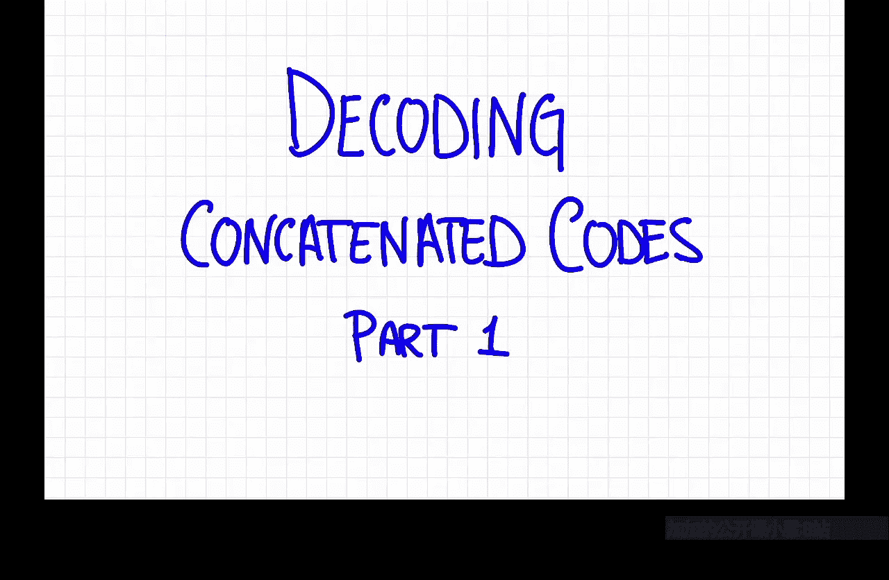
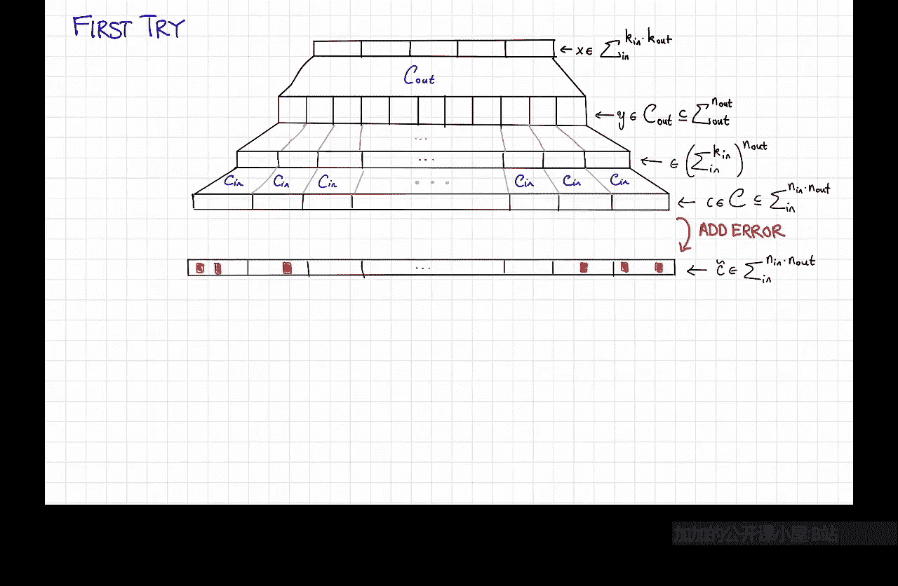

# 代数编码导论：2：级联码解码（第一部分）🎯

在本节课中，我们将要学习如何高效地解码级联码。我们将从一个直观的解码算法开始，分析其有效性和局限性，并探讨如何改进它以接近理论最优的解码能力。

---

上一节我们介绍了级联码可以构造出渐近好码。本节中，我们来看看如何高效地对它们进行解码。

我们的目标，在几个视频以来，一直是寻找具有高效编码和解码算法的、显式的、渐近好的二进制码。到目前为止，我们已经得到了“显式”和“渐近好”的部分。在本视频及下一个视频中，我们将解决“高效解码”的部分。

请记住，我们用于第一部分（构造）的码是一个级联码 **C = Cout ∘ Cin**。其中，**Cout** 是一个距离为 **dout** 的里德-所罗门码，而 **Cin** 的距离为 **din**。在本视频中，我们关心的是如何高效解码这个级联码。

让我们从一个初步尝试开始。

以下是级联码的结构。我们有一个级联码的码字。然后，一些错误会被添加进来。具体来说，字母表 **Σin** 中的某些符号会被破坏。假设有 **E** 个错误发生了，但我们不知道是哪些。

有一个非常自然的解码算法。实际上，你现在可以暂停视频，思考一下你会如何尝试解码这样的码。

好的，也许你想到了类似这样的方法。

以下是解码步骤：

1.  **第一步**：使用内码 **Cin** 解码每一个块。也就是说，对于每个块，我们希望找到 **Cin** 中与这个块尽可能接近的码字 **c‘**。
2.  **第二步**：从解码得到的 **c‘** 反向推导出原始消息，进而得到对应的外码符号 **α ∈ Σout**。我们对所有块执行此操作，最终得到所有外码符号的猜测值。
3.  **第三步**：使用外码 **Cout** 的解码器，从我们得到的符号中尝试恢复原始消息。

这是一个非常自然的算法。我们有两个问题：它高效吗？它正确吗（即能否真正纠正错误）？

首先，我断言它是高效的。第一步，因为 **Cin** 非常短，我们可以通过暴力搜索高效解码。第二步只是数据转换，是高效的。第三步，因为 **Cout** 是里德-所罗门码，我们可以使用Welch-Berlekamp等算法高效解码。所以，这个算法是高效的。

它正确吗？我断言，是的，在一定条件下它是正确的。更准确地说，我断言这个算法在错误数 **E** 不超过 **din * dout / 4** 时有效。这里，**din** 是内码距离，**dout** 是外码距离。

需要注意，乘积 **din * dout** 是级联码的设计距离。在理想情况下，我们可能希望解码能力达到其距离的一半，即 **din * dout / 2**。而我们证明的条件比这个少了一个因子2。我们稍后会再讨论这一点。

现在来证明这个断言。

**证明**：
首先，我们称一个块为“坏块”，如果其中的错误数量太多，以至于内码无法正确解码。即，一个块是坏块，如果其中的错误数 **> ⌊(din - 1)/2⌋**。

如果总共有 **E** 个错误，那么坏块的数量最多为 **E / ⌊(din - 1)/2⌋**。这是因为在最极端的情况下，每个坏块恰好有这么多错误，而其他块没有错误。

如果一个块不是坏块，那么内码 **Cin** 可以成功解码它。这意味着，在算法第二步中，我们能得到正确的外码符号。

现在考虑外码 **Cout** 的解码器。只要错误符号的数量（即坏块的数量）不超过 **⌊(dout - 1)/2⌋**，外码解码器就能成功。

利用坏块数量 **≤ E / ⌊(din - 1)/2⌋** 这一事实，我们看到，如果 **E ≤ ⌊(din - 1)/2⌋ * ⌊(dout - 1)/2⌋**，外码解码器就能成功。这便证明了我们的断言，因为满足此条件的 **E** 也满足 **E ≤ (din * dout) / 4**。

很好。所以，只要错误不太多，这个算法就有效。这确实实现了我们过去几个视频所追求的目标。我们得到了具有高效编码和解码算法的、显式的、渐近好的二进制码。其思想是，使用里德-所罗门码作为外码，使用达到吉尔伯特-瓦尔沙莫夫界的非显式码作为内码来构建级联码。之所以这是显式且最终算法高效，是因为内码非常短，我们可以对其使用高效的“暴力”算法。

让我们暂停片刻，庆祝一下目标的达成。

庆祝够了，因为现在我们要转向一个新的目标。

正如我们在前面的幻灯片中看到的，我们本希望做得比那个断言更好一些。断言表明我们可以解码到设计距离的 **1/4**。但实际上，我们应该能做到设计距离的 **1/2**。所以，这将是我们新的目标。

我们希望得到接近Zyablov界的显式二进制码。不仅仅是渐近好，而且要具有我们目前所知显式码中最好的权衡，并且具有高效解码算法，能纠正多达 **(D-1)/2** 个错误，其中 **D** 是码的设计距离。

为了获得如何实现这个新目标的直觉，让我们快速看一下在刚才分析的简单算法中，我们遗漏了什么。

我断言我们遗漏了一个因子2。并且我断言，我们可以通过以下观察找到这个因子2。

**观察**：当我们将损坏的码字块解码为内码的一个块时，我们不仅知道了纠正后的内码码字是什么，还知道了我们在进行这次纠正时修正了多少个错误。

为了理解这个观察为何重要，让我们考虑两个极端例子，看看对手如何破坏我们之前看到的解码算法。

**例子1**：对手在每个块中引入 **0** 个错误或恰好 **din/2** 个错误。也就是说，对手试图通过仅仅将每个它选择破坏的块破坏到刚好成为“坏块”的程度，来用其错误预算制造尽可能多的坏块。

在这种情况下，我们的算法解码这些坏块时可能会得到错误答案。根据计算，我们将得到 **E / (din/2)** 个错误块。这正是我们几页幻灯片前证明中的计算。

然而，如果对手真的采用这种策略，我们实际上可以做得更好。因为当我们纠正一个被破坏的块时（假设它被破坏了 **din/2** 个符号），由于内码距离为 **din**，即使我们纠正到了错误的码字，我们也至少改变了 **din/2** 个符号。另一方面，对于未受影响的块，我们什么也不会改变。

所以，如果对手采用此策略，我们正确的做法是：当我们发现纠正某个块时需要改变很多符号时，就直接将该整个块标记为“擦除”。这样，我们就能分辨出哪些块是错误的。如果你记得本课程最初的内容，一个距离为 **D** 的码可以处理 **D-1** 个擦除，而只能处理 **(D-1)/2** 个错误。也就是说，我们能处理的擦除数量是错误数量的两倍。这就是我们寻找的因子2。

**例子2**：对手在每个块中引入 **0** 个错误或 **din** 个错误。也就是说，对手要么不碰一个块，要么引入足够多的错误，使其变成另一个完全不同的有效内码码字。这样，我们甚至完全不知道出了什么问题，一切看起来都像是合法的码字。

在这种情况下，当解码一个特定块时，我们可能根本不会做任何改变，因为它已经是另一个有效码字了。这样，我们就不会检测到任何我们想标记为擦除的情况。另一方面，如果对手想这么做，他们必须在每个块上堆积两倍多的错误，这意味着他们只能破坏一半数量的块。看，我们的因子2又出现了。

我们在这里看到的是，至少在以上两个极端情况下，我们应该能够处理的错误数量，是我们几页幻灯片前所证明断言的两倍。这将实现我们的新目标。

---

本节课中我们一起学习了级联码的一个基础解码算法，它能在错误数不超过设计距离 **1/4** 时有效工作。我们还通过分析对手的两种极端策略，发现了算法有潜力将解码能力提升到设计距离的 **1/2**。下一次，我们将看到如何将这些例子变得更精确，并设计出真正实现这一目标的算法。