# 斯坦福大学【中英⚡代数编码导论｜Introduction to Algebraic Coding Theory】 p26 p25 7, Video 3： Decoding Concatenated Codes Part 2 -BV16sRYYTEwg_p26-

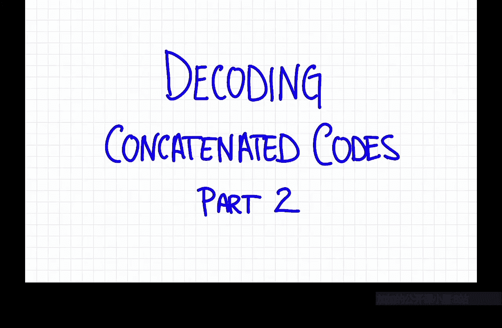

In this video， we will continue our quest to decode concatenated codes up to half of their designed distance。

Let's recall the motivating idea from the end of the previous video。

We had this first pass at an algorithm to decode concatenated codes。

But it could only get up to the design distance divided by 4。However。

 we are still hopeful that we could get up to the design distance divided by two because of two extreme examples。

In the first extreme example， the adversary introduced not too many errors per bad block。

But in that case， we won because we could tell which blocks were bad。

 because we had to correct a lot of errors in them。And then we can just treat them as erasureers。

 And that allows us to save a factor of two。On the other hand， and the other extreme example。

 the bad guy introduced many errors per bad block。And that was still fine for us as well because there were not so many bad blocks。

 and that also allowed us to save a factor of two。And so we hoped that by interpolating between these two different extreme scenarios。

We could somehow save that factor of two in general， not just in these two examples。

So that's the strategy that we're going to take in this video。To do this interpolation。

 we're going to use the following useful fact about read Solomon codes。

The useful fact is that if 2 E plus S。Is strictly less than D out。

Where D out is the distance of the outer read Solomon code， See out。

Then we can efficiently decode the Read Solomon code C out from E errors and S eraers。

I believe the proof of this fact is a fun exercise for the viewer。As a hint。

 you can use an efficient decoder for read Solomon code as a black box。

 you don't need to open it up or anything。 So there's an easy proof。Okay。

 but this useful fact is going to allow us to interpolate between erasureers and errors。

 which intuitively is going to allow us to interpolate between this extreme example and this extreme example。

More precisely， here's the algorithm that we're going to use。Okay。

 this isn't actually the algorithm that we're going to use。

 We're going to have to modify it a little bit。 but here's the algorithm we're going to start with。

So our algorithm takes as input， a received word WW1 up through WN out。

Which lives in sigma in to the N in， all to the n out。

 So that is each one of these W I's is a little vector of length N in over Sigma in。

And then we've stacked all these little vectors together to create a received word。

 just like we normally do with concatenated codes。And we' promised that our received word W lives close to a concatenated code word。

That is the hamming distance between W and C is strictly less than D in times D out divided by2。

For some code word， little C in C。Then we're going to do the following。For I from one to n out。

 that is for each one of these blocks in our received word。We're going to decode C in on that block。

 That is， we're going to let W I prime。Be the closest Y in the inner code C in。To the I chunk W I。

You might have noticed that I just moved some subscripts around here because there was a little bit of a typo。

 sorry about that before。 Now it's fixed。Okay， so we're going to find these WI primes that we get by decoding the inner code from each of the Ws。

And then。We're going to do something a little bit strange。We're going flip a coin。

 Do something random。And with probability， this。That is the minimum of one and this thing。

 two times the hamming distance between W I and W I prime divided by the distance of the inner code D in。

With that probability， we're going to set some parameter of beta I。To bought or erased。Otherwise。

 we're going to choose beta I so that the encoding under the inner code of beta I is equal to W I prime。

 which is our sort of corrected chunk there。😡，So basically what's going on here is that beta I is our best guess of what the original symbol in the Ith place should be in the code word from the outer code。

If it's the case that we had to fix a lot of errors， that is， if W I is really far from W I prime。

Then following the intuition we had from our two extreme examples with high probability。

 we're going to call that an erasure。We're going to， okay， I had to fix a bunch of errors。

 The bad guy probably did something here。 Let's just call that an erasure and give up on it。

Otherwise， we're just going to hope everything is okay。

 decode our inner code and kind of trace things back。Once we've done this for every symbol。

 we now have this vector， beta 1， beta 2 up through beta n。

 where some of these are elements of sigma out， and others of them are bought or erased。

Then what we're going to do is we're going to run C outs decoder。

 This is the one that takes the combination of eraers and errors from the useful fact that we saw on the previous slide。

We're going to run that decoder on this vector， the vector of betas， and just return the result。

 So that's the algorithm。Again， this algorithm is just implementing the intuition we had on the previous slide where。

If we had to correct a bunch of errors， the bad guy was probably up to something。

 So let's call it an erasure。Otherwise， we'll treat it as an error。Well， otherwise。

 we'll hope that it's correct， but if it's not correct， then we'll treat it as an error。Okay。

 so hopefully the intuition makes sense， but what might not make sense is why this particular expression and why are we looking at a randomized algorithm。

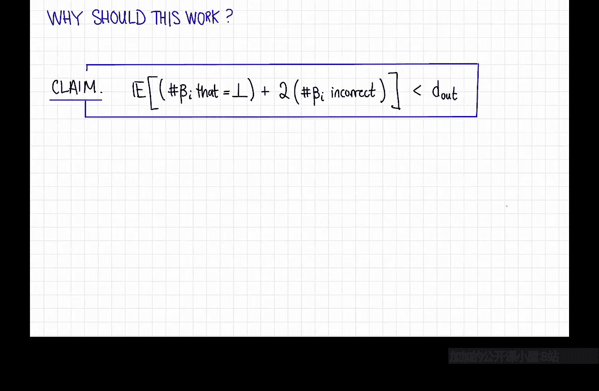

To answer that， we have the following claim。The claim is that。

The expected number of beta eyes that are equal to bot。Plus。

 two times the expected number of beta I that are incorrect。

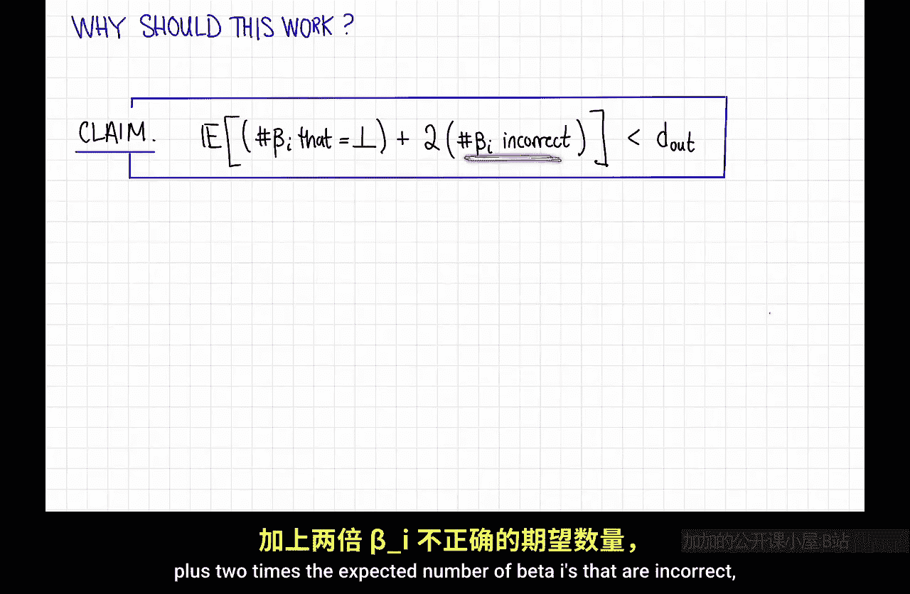

Is going to be strictly less than D out。The distance of the outer read Solomon code。In particular。

 that means that at least in expectation， the number of erasureers plus two times the number of errors in the word beta 1 dotta dot beta n that we're going to shoveen to see outs decoder is strictly less than D out。

And that was exactly the condition that we wanted in order for that decoder to be successful。

So intuitively， this claim is saying that at least in expectation。

 the outer code's decoder is successful。Okay， so for a proof。Actually， I'm going to pass on this one。

You can check out the lecture notes if you're curious， there's a proof there。

But if you were to go through that proof。It would explain why this probability is the thing that it is。

 Basically， we choose this probability。To be precisely so that this claim is true。Okay。

 but even given that this claim is true。It shouldn't be clear yet why this is enough。

 So I kind of explained intuitively why it should kind of feel like it's enough。 like in expectation。

 the decoder is going to work。 But that's not really what we want。 We want a decoder that works。

 not just an expectation， but all the time。

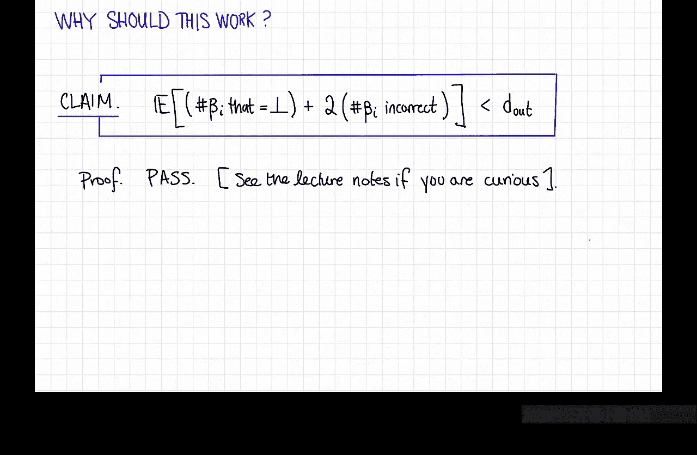

One strategy would be to try to repeat it a bunch of times and get some kind of result that works with high probability。

 and you could probably make something like that work。

 but instead we're actually going to deranize that randomized algorithm that we just saw and end up with a deterministic algorithm that works all of the time。

To see how this works， let's return to this algorithm up here。

 We're going to make a few modifications。So the first thing that we're going to do。

I we're going to reduce the amount of randomness that's in this algorithm。

So where do we reuse randomness here。Right now， we use randomness in this line。

So every time we pick a beta I， we independently decide whether or not it's going to be an erasure or not based on some probability that depends on that expression。

What we're going to do instead is we're going to make these beta I not be independent anymore。

In particular， we're going to do this。So we're going to choose some theta in the interval 0。

1 uniformly at random。And then instead of flipping this coin independently down here。

 we're going to use that theta to make this decision。That is， if theta is less than this thing。

We'll set beta I equal to bot， and otherwise we'll do the other thing。

Notice that if this choose Sata uniformly a random line， we're in here。

It would be exactly the same as the previous algorithm。

So all we're doing here is we're sort of moving the randomness outside the fore loop。

 We're using the same randomness， the same source of randomness for each one of these beta I decisions。

It turns out that this claim still holds， even with that modification。Okay。

 so now we have this modified algorithm。But what was the point of this。

We've reduced the amount of randomness a little bit instead of choosing a bunch of independent random things inside the forelo。

 Now， we're choosing this one random thing outside the forelo。

 but we still need to do something randomly。The reason that we did this is that it's going to make it easier for us to derandomize the algorithm。

In particular， we're going to modify it in the following way。

Instead of choosing theta uniformly at random， we're actually going to exhaust over all possible thetas。

 so that's going to look something like this。That is， instead of picking theta at random once。

 we're going to exhaust over all possible thetas。And do this thing。Okay。

 probably you're a little confused about for all thetas in this uncountable set。

 Just hold on for a second。 We'll come to that。 Imagine that we could exhaust over all thetas in this uncountable set。

So then we're looping over all of these uncountably many thetas。

We're doing the same thing that we did before， and then we're going to get some result X twiddle from the output of C out's decoder。

If X twiddle happens to be close to W。Then we'll return next Twiddle and say， hooray。

 we found the right answer。And I claim that this is going to work。

And the reason is that because of that claim we said before。That in expectation over theta。

We're going to get the right answer。That means that in particular。

 there exists a theta so that we're going to get the right answer。Therefore。

 if we exhaust over all such theta， one of them is going to be the right answer。

 We'll find it by just checking， and then we'll return the right answer。

So if it were possible to exhaust over this uncountable set， we'd be good。 However， obviously。

 that is not possible。 We have to do something else instead。

The thing we're going to do instead is to discretize the space of theta。In particular。

 I claim that in this algorithm， we actually may as well look at only n out plus two values of theta。

Why is this？I'm going to return to that algorithm again and let you look at it and maybe pause the video for a second and think about why this is true。

So here's the algorithm。 Why is it that I don't need to look at all possible theta。

 But instead that I only need to look at n out plus  two values of theta。

So the reason is that if you think about how different thetas behave in this algorithm。

All that really matters is whether theta is greater than or equal to each of these things。 That is。

 if two different thetas behave the same with respect to all of these tests。

 they're going to behave exactly the same in this algorithm。

Another way to put it is to draw this picture。So here's the interval0 to1。

And let's say that here's the point。 The minimum of one。

And two times the handling distance between W1 and W1 prime。Divided by Dn。

And let's say that this point here is the same thing for W2 and W2 prime。And so on。

So notice that there are n out of these dashes here。One for each block， W I。Also。

 notice that if we look at a particular interval here。

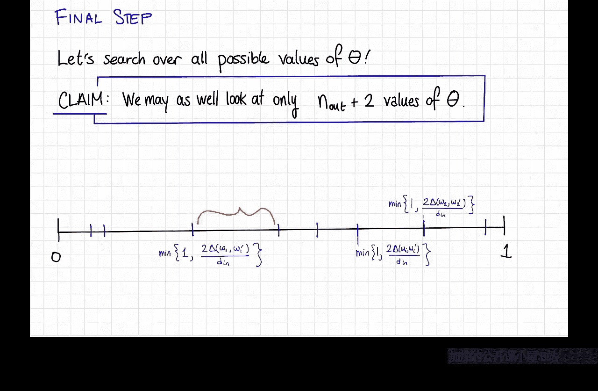

That any theta that we are to pick in this interval is going to behave the same in that algorithm。

Therefore， if we want to exhaust over all possible theta in this interval。

It suffices to pick one representative from each subinterval here。So I'll choose maybe theta 0 here。

And I'll choose some representative say to one in that interval。

Some representative the to two in that interval， and so on。Ending up with theta n out plus 1。Thus。

 if I just exhaust over all of these and out plus two choices of theta。

 that's going to give me exactly the same answer as exhausting over this entire continuous interval。

So let's go back to our algorithm and make that update。Okay。

 so instead of exhausting over all theta here， first。

 we're going to compute those representative theta I。

Notice that we can do that because we just need to figure out what these things are。

 and we can just compute that and then just pick whatever representatives we want。

And then instead of exhausting over all of those thetas。

We'll just loop over the ones that we computed。And then everything else is exactly the same。

So this is our final algorithm。As written right now， it's called algorithm。 The final one， Take four。

 but actually it has a name。This is called4ney's generalized minimum distance decoder。

I think this is pretty cool。 In particular， if you believe some of those details that we swept under the rug。

This algorithm is able to decode concatenated codes up to half of their designed distance。

And that was our original goal。Actually， our original goal was to do it efficiently。

 So let's take a look at that real quick。 What is the running time of this algorithm。Okay。

 so to think about the running time， I've simplified the algorithm somewhat to just sort of denote the expensive parts。

It's a good exercise to go and check that everything that I didn't list here is pretty fast and negligible compared to the cost of these things。

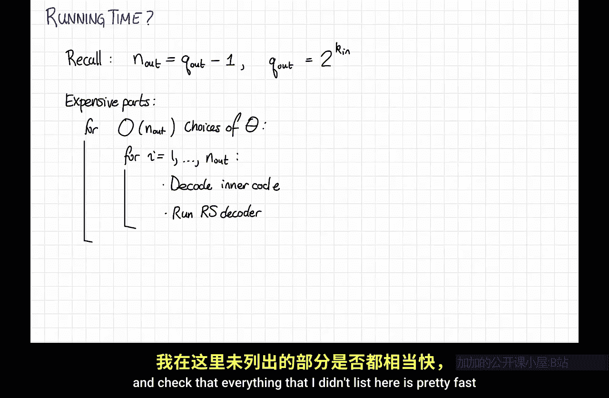

So here's the expensive parts。So for each of big O of n out choices of theta for each block。

 there's n out of those。I have to decode the inner code C in at that block。

whoops my loops are wrong here。 I have to run the readed sallomon decoder。

 although that's outside of this inner loop here。Okay， how long does each of these steps take？

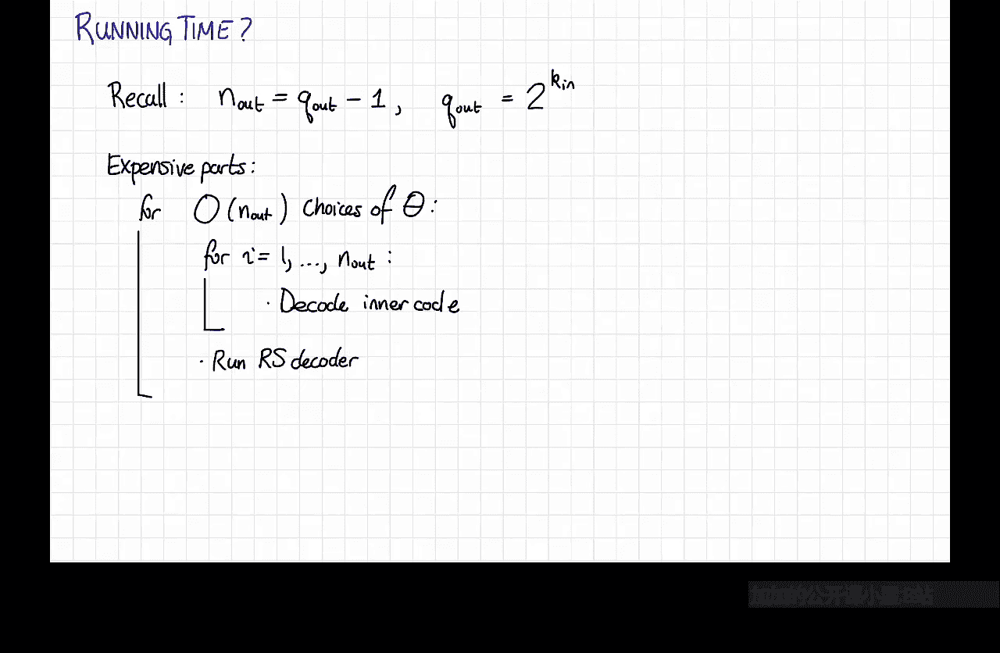

So this step here， decoding the inner code。So the length of the inner code is n in。Which。

 since it's a constant rate code is big O of K in。

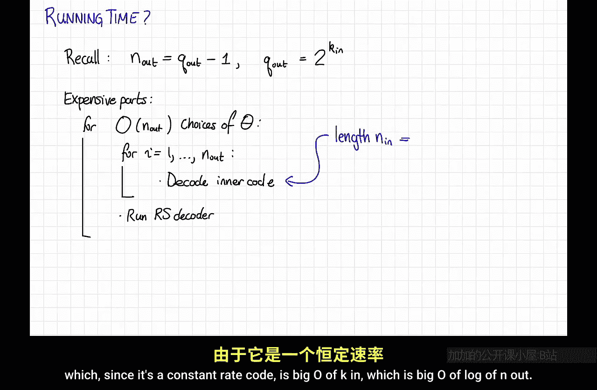

Which is big O of log of an out。And that's because Q out in this construction is 2 to the K in。

And Q out is basically the same as n out。

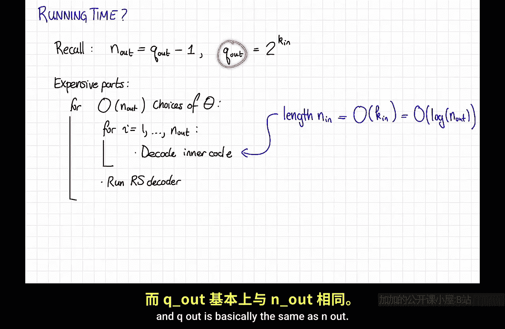

So here we've chosen to read Solomon code with n out equal to Q out minus1。

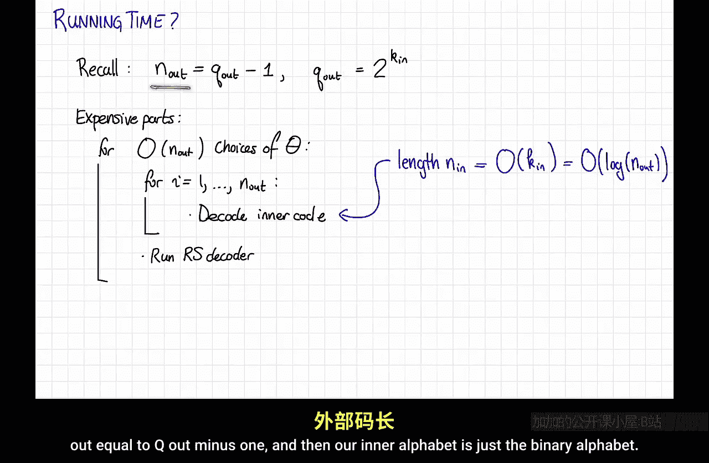

And then our inner alphabet is just the binary alphabet。 So we have Q out as equal to2 to the K in。

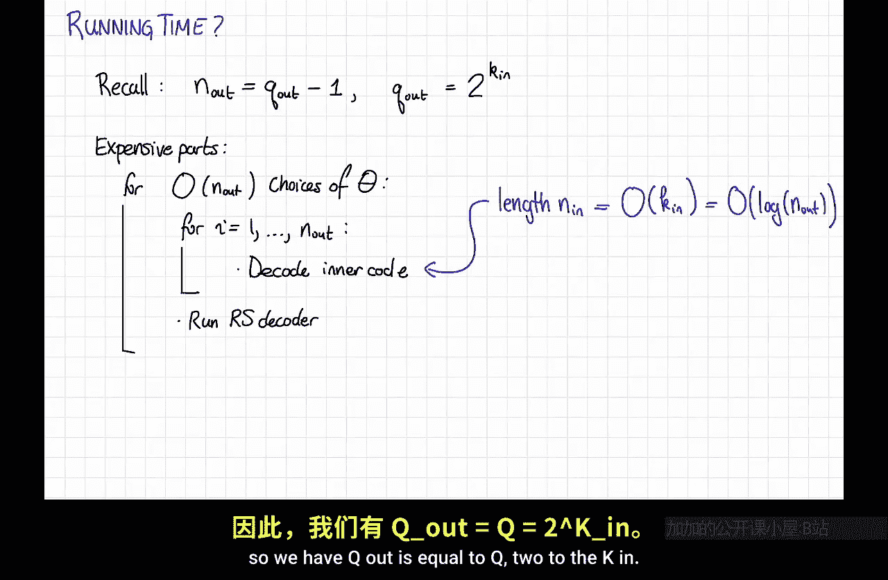

Okay， so then the length of this inner code is an in， which is big O of log of an out。

So decoding the inner code by brute force。This takes time。 Big， O。Of the size of the inner code。

Times， n in。That's because what is the brute force algorithm。

 We're just going to loop over all of the possible code words。

Check and see how far away they are from the received word and return the best one。

This is big O of2 to the K in times n in。Because the size of CN is just2 to the Can。

And I claim that this is polynomial in N。The reason that this is polynomial in N is that K in。

Is log of an out。And so this is2 to the big O of log n out， which is polynomial in n out。

 and out is less than n。 the block length of the final concatenated code。

 and so all of this is polynomial in n。

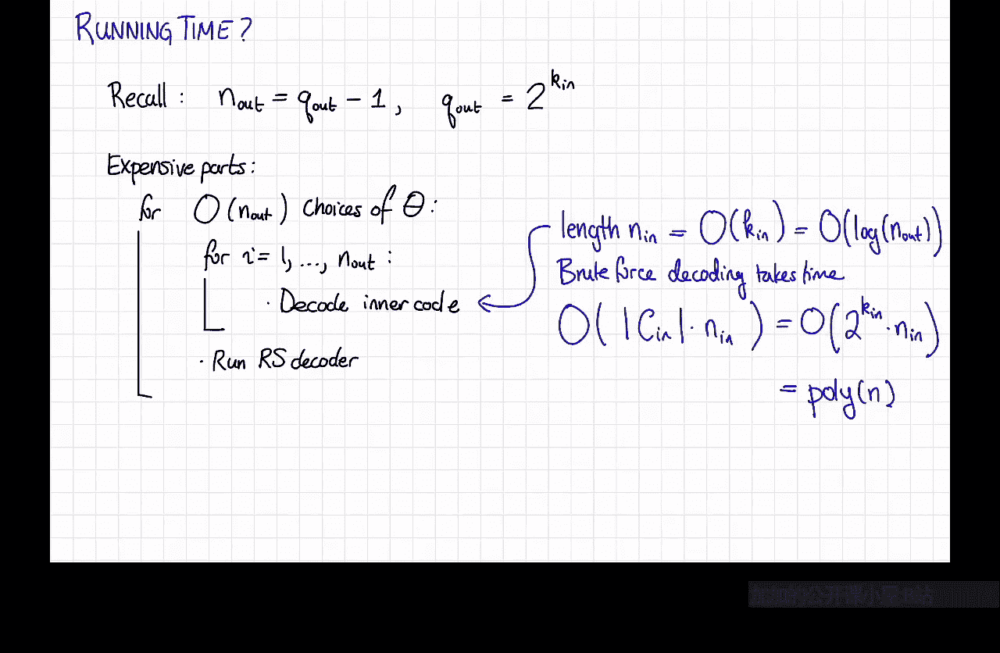

I being pretty fast and loose about the details here， because at the end of the day。

 all we're really looking for is polynomial in N。 So this is definitely polynomial in N。

 And the reason that's true is that the length of this code is logarithmic in it。 Therefore。

 we can handle exponential time algorithms。The next thing we need to do is run this read Solomon code decoder。

 How long does that take， Again， this is an efficient algorithm。 This takes time polynomial in n。

Altogether， the whole running time is polynomial in N。Horay， that's what we wanted。So， to summarize。

Success。Check。That is， we have achieved our new goal。 We now have explicit binary codes。

Near the Zabloov bound with efficient decoding algorithms up to half of their design distance。

And we did it with concatenated codes。 So the outer code is a read Solomon code。

 and the inner code is some code on the Gilber Vrsashov bound。 And once again。

 we can find this code and manipulate it efficiently because the block length is going to be so short。

However， as we just saw， in order to actually decode this up to D-1 over 2。

 we had to be a little bit clever。 It wasn't the first algorithm that we thought of。

 but we got there eventually。So to summarize the state of things that we know so far for binary coats。

The picture looks like this。 We have the relative distance on the x axis， the rate on the y axis。

The Gfi bound tells us that their exist codes。Which have this trade off。

But we don't know what they are， And we do not know how to efficiently decode them。However。

 the Zoblooff Bo says that there exist codes with trade offs here。

And what we just showed is not only do they exist， but I can tell you what they are efficiently。

 And also， we can decode them efficiently。Pretty cool。😊，Okay， that's it for this video。

 Thanks for watching。

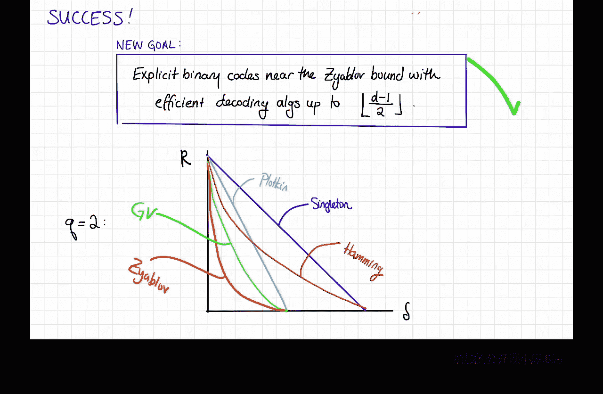