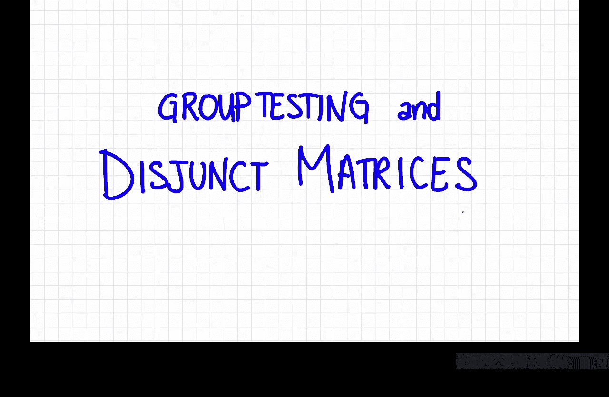
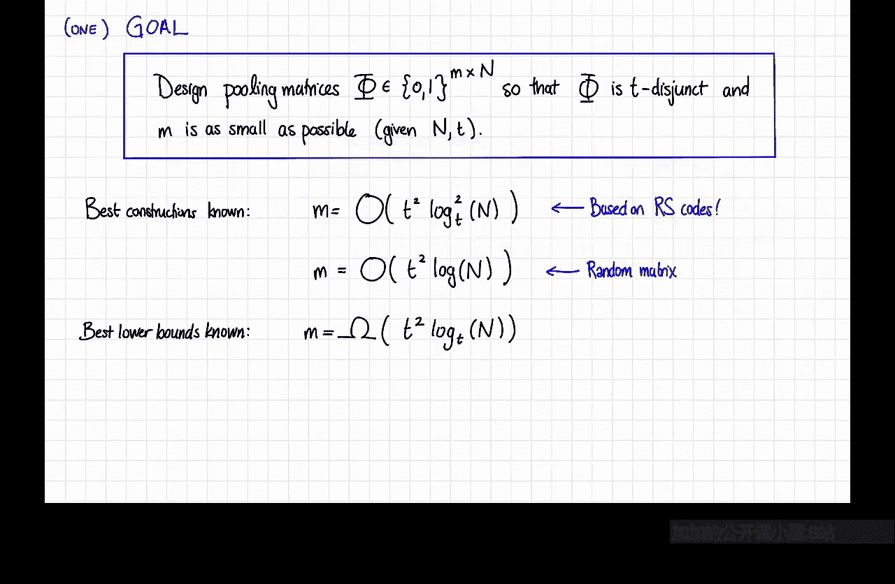

# 斯坦福大学【中英⚡代数编码导论｜Introduction to Algebraic Coding Theory】 p28 p27 8, Video 2： Disjunct Matrices -BV16sRYYTEwg_p28-

In a previous video， we introduced group testing in this video。

 we'll define the notion of a disjunct matrix， which will give us the tools necessary to see a nice read Solomon based solution to the group testing problem。

😊，So here's the definition of a t disjunct matrix。First， recall that curly B。

It's just the elements 01 where plus means the Boolean or and times means the Boolean and。

And recall that Phi is a pooling matrix。Which means that it's M by N。

 where M corresponds to the number of tests and N corresponds to the number of items or people that we want to test。

And Ph just has a one in it in the Ijath entry If we want to put person J into the Ithe test。Okay。

 so we say that a pooling matrix fee like that is t disjunct if the following holds。

There's a lot of quantifiers here， so I'm going to point at this picture while I read the definition。

So we say that it's t just junknced if for any set lambda subset of the numbers 1 through n。

So here the numbers one through n index the columns of phi。

 And so lambda is going to be some subset of the columns。

 It doesn't necessarily need to be contiguous。 I've just drawn it that way。And lambmbda has size tea。

Okay， so for any such lambmbda and also for any J， any column J that's not in lambmbda。

There should it be at least one row， at least one I in the numbers one through M。This eye here。

So that if I look at just that row， there is a one in the I Jaith position。

And all zeroes in the I elf position for all L and Lada。

And if a matrix satisfies this for any lambda of size T and for any J not in lambda。

 we say that it is T disjunct。Why do we care about disjunctness， Well。

 it turns out that a tea disjunct matrix yields a pooling design that can detect up to T positive items or T sick people。

More formally， here's a theorem。 If the pooling matrix phi is T disjunct， then as a pooling design。

 it can identify up to T positive items。Let's recall that。 This means。

That for any X of weight at most tea。Where x is a boolean vector of length n。

 then we can recover x given phi times x over the Boolean algebra。

So let's prove this we're going to do a proof by algorithm。That is。

 I'm going to write down an algorithm that's going to recover X given P X。

 and that will prove that we can do it。 So here's the algorithm。

So for each J in the numbers 1 through n， that is for each column of my pooling matrix。

If all of the tests that item J participates in come up positive。Then I'm just gonna say， okay。

 Jay was probably positive。Or in the testing for disease scenario。

 I would say that person J was sick。Otherwise， I will label J as negative， not sick。Okay。

 so this is a pretty straightforward algorithm。 Basically。

 what I'm going to do is I'm going to go through all of the possible items or all of the possible people。

 And I'm going to say， okay， are all of your tests positive。 If so， you're the culprit。

 And if any tests that you participated in came up negative， Well。

 that's proof that you are negative that you're not sick。

 So unless I have proof that you're not sick。 I'll just say you're sick。

I claim that if a matrix is T disjunct， then this algorithm works as long as there are no more than T positive items。

Okay， so first， if J is actually positive， that is if person J was actually sick， then obviously。

 the algorithm is going to say that they are positive。 So let's assume that J is negative。

In that case， let's let Lambda be the true set of positives。So the size of lambmbda is at most t。

 and J is not in lambmbda。Now， by the definition of disjunctness， remember。

 we're assuming that p is t disjunct。 There exists some row， I in M。Such that。VhiI J is equal to one。

And PIL is equal to zero。For all L inlandda。Okay， but what do these two things mean。

 This means that item J is in test I。And this means。That there is no positive item in test i。That is。

 this assures us that test I is going to come up negative。

 and this assures us that item J participated in test I。 So therefore。

 test I is proof that item J is not positive。And because that's how this algorithm worked。

 it just went through and looked for exactly such proof。

The algorithm is going to say that J is negative。Therefore， the algorithm is correct。

 which is what we were trying to show， so that proves this theorem。This inspires a new goal for us。

 at least with respect to group testing。 Our goal is now to design pooling matrices fee that our T is junked。

 And so that M， the number of tests is as small as possible， given capital N。

 the number of people and T， the number of six people。 This is just one goal。

 just like encoding theory， there are many different goals in group testing。

 But this is a reasonable one to think about for now。And in fact。

 lots of people haven't thought about it。Here's a quick overview of what's known。

 So here are two of the best constructions that are known。

So that is ways of actually coming up with a matrix phi。 We can either have M。

 the number of tests be big O of T squared log based T squared of n。

 And that solution is based on read Solomon codes， or we can have a number of tests。

 M that is big O of T squared log n to get this solution Fun exercise。

 You can just take a random matrix with an appropriate probability of having a one in it and show that that is t disjunct with high probability as long as M is about this big。

😊，In fact， there's also an explicit construction that gets this result。

 and it's also based on coding theory。 See the lecture notes for pointers to that。

Notice that these two results are incomparable。 This one is better in certain parameter regimes。

 and this one is better in other parameter regimes。As far as we know， neither are quite optimal。

 The best lower bounds that I'm aware of are that the number of tests M has to be at least T squared times log based T of n。

 So that's off by this one， by this base T。 So by a log T factor。 and it's off from this one。

 by this squared。 So by a log n factor。But basically， these two are pretty close to optimal。

There are also extremely fast algorithms for group testing。

 much faster than the try all of the elements method that we saw on the previous slide。

These algorithms can actually run in subline time in capital N。

 actually nearly linear in the number of tests。Some of those algorithms are also based on coding theory。

 and we might see them in a later video。In the next video， however。

 we'll focus on this construction known as the Countts Singleton Con， which uses Res Allomon codes。

