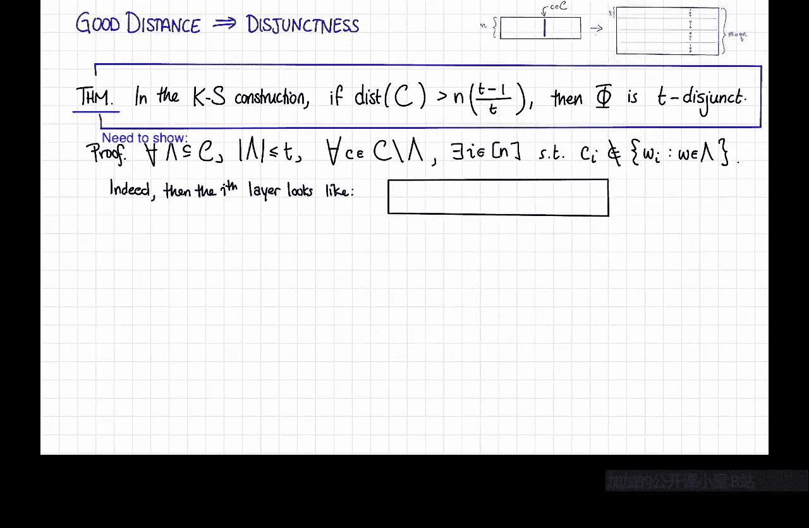
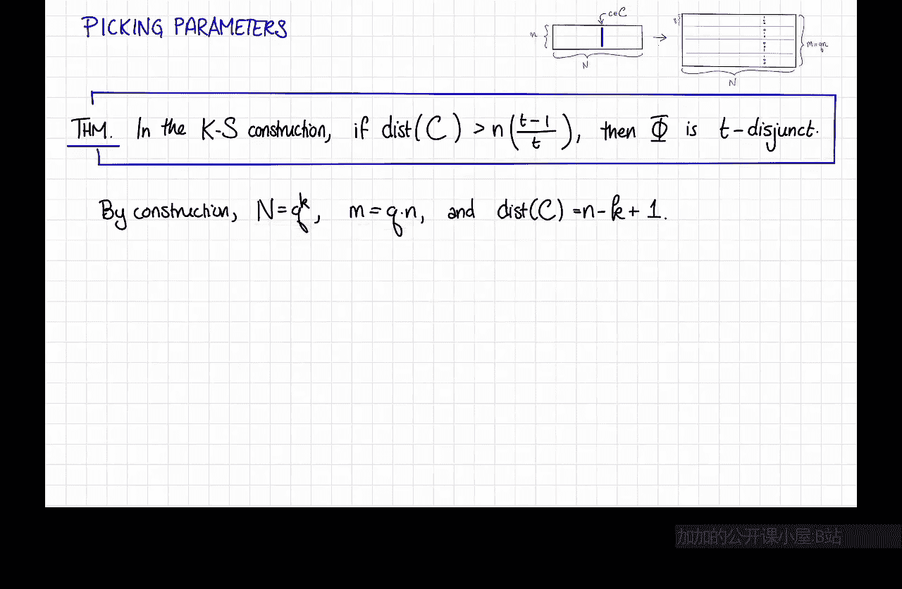
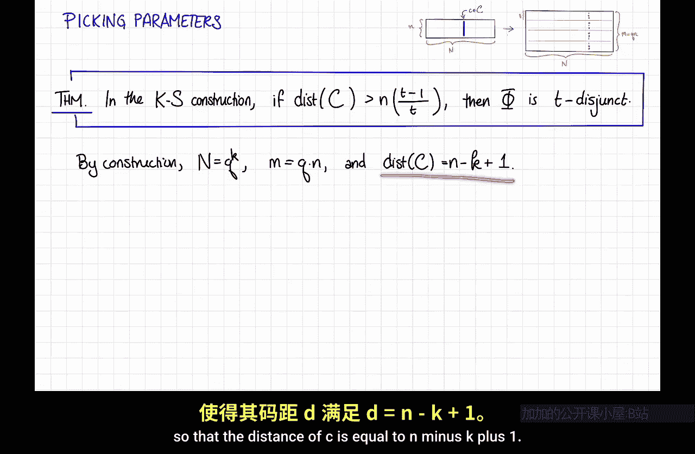
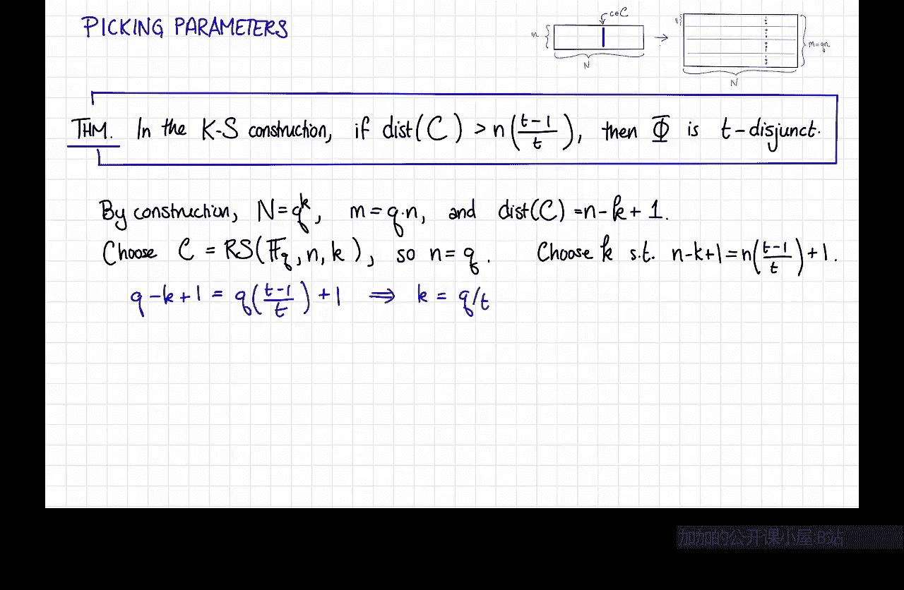
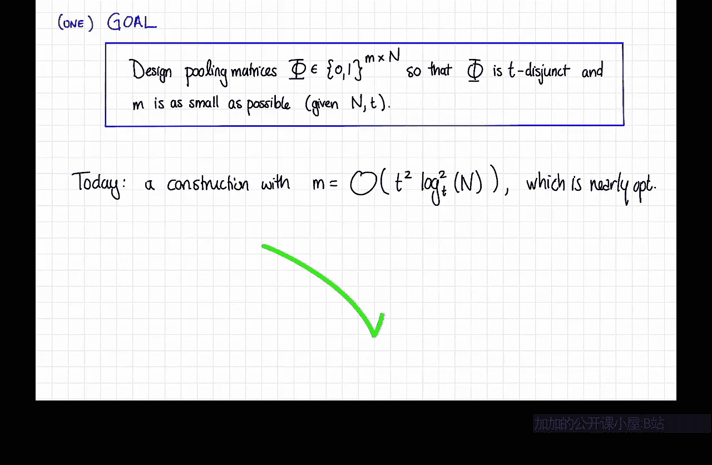

# 斯坦福大学【中英⚡代数编码导论｜Introduction to Algebraic Coding Theory】 p29 p28 8, Video 3： The Kautz-Singleton Construction -BV16sRYYTEwg_p29-

In a previous video， we saw the group testing problem。

 and we saw that disjunct matrices can solve it。In this video。

 we'll see a good solution that uses Re Solomon codes to get district matrices。

 known as the C Singleton Construction。Recall that at the end of the previous video。

 we had the following goal。 We wanted to design a pooling matrix fee。

With M tests for N items so that P is T disjunct and so that M is as small as possible。

 given N and T。Today， what we're going to see is a construction with M equals big O of T squared log based T squared of n。

 which， as we saw in the previous video is nearly optimal。Here's how the construction works。

 This is called the Cos Singleton Construct。We're going to start with any code。 So let's see。

Be a Qary code with block length N， dimension K and distance D。Let capital N be equal to Q to the K。

 That's our number of items。 And let M， our number of tests be equal to Q times N。

We're going to choose these parameters， N， K D and Q later。 But for now。

 let's just leave them as floating so we can kind of see how everything fits together。Now。

 given this code C， here's how we're going to form a pooling matrix。 First。

 we're going to form this matrix over FQ。So this is the matrix whose columns are all of the code words of C。

 So that is， the matrix is little n by capital N。And it lives in FQ to the little N times capital N。

 So it lives over the big field， F Q。And every column is just going to be some code word of C。

 And we're going to take all of the different code words of C and stack them up next to each other as the columns。

 And that's going to give us this matrix。Notice that the dimensions work out。

Every code word of C has length， little n， and there are Q to the K， such code words。

 and conveniently， I've defined capital n to be equal to Q to the K。

 So all of the possible code words are the columns of this matrix。Okay。

 so this matrix is not binary for a pooling design。 I want the matrix to be binary。

 so we need to take this matrix over FQ and turn it into a binary matrix。

The way that we're going to do that is that we're going to take every symbol over F Q and replace it with a little binary vector。

 So that is， I'm going to take this symbol right here。

And replace it with a little binary vector of length Q。 I'm going to do that for every single symbol。

 And what I'm going to end up with is kind of a layered matrix that looks like this。

 a layered binary matrix。 So this matrix is going to have little n layers。

 And each layer is going to have size， little Q。And what I'm going to do is I'm just gonna take every entry。

In a row and puff it up into a little vector。 And that's going to create the corresponding layer。

How am I going to do this puffing up operation， I'm just going to do it sort of in the most straightforward way possible。

 I'm going to replace an element Al in Fq with an indicator vector in 0，1 to the  Q。

 just saying which element that is。 So， for example， if I order the elements of F Q as alpha 1。

 alpha 2， dotta dot up to alpha  Q or Q of them。 Then alpha 1 is going to go to the first basis vector 1。

0，0，0，0。 Alpha 2 is going to go to the second basis vector 0，1，0，0，0，0， and so on。

 all the way up to alpha  Q， which is going to go to the last basis vector 0，0，0，0， and so on，1。

 What that means is that every column here is going to look something like this。That is。

 every column is going to contain a bunch of these little puffed up vectorexs。

 where each one of those vectors has exactly one one in it and just says。

 which was the field element that belonged to the corresponding that value you in the original matrix。

Okay， so this is going to result in a binary matrix。And the matrix is going to be M times n。

 where M has been defined as Q times n。And I claim that this matrix is going to be a good pooling design as long as C has good distance。

So let's state to improve a theorem to that effect。

Theorem in the Cat Singleton construction that we just saw on the previous slide。

 I've copied the little teeny， tiny cartoon version of it up here。

If the distance of the code C is greater than n times t -1 divided by T。

Then the matrix phi that we get this way is T disjunct。 Let's prove this theorem。

So we need to show the following。We need to show that for all Lambda subset of C。

With size at most tea。And for all code words， C in my code， but not in Lambda。There exists some I。

In the numbers one through n。So that C， I is not in the set。WI such that W is in Lambda。

I claim that this is just the translation of the definition of T disjunctness。

To this particular construction。Indeed。Suppose that this were true。

That means that the I layer of this matrix here is going to look like this。

Let's say that these are the columns corresponding to Lambda。

And this is the column corresponding to C。Now， what this is saying。Is that C。

 I is not equal to W I for any W in lambda。 That means that the symbol to which this little puffed up vector corresponds is not the same as the symbols to which any of these little puffed up vectors correspond。

 In other words， this little puffed up vector is not the same as any of those。Thus。

 if this one looks like， say， 1，0，0，0 or something like that。

 the puffed up vectors here cannot have a one in the first position because they must be different puffed up vectors。

 So those are all 0 in the first position。And then maybe they have one somewhere else。

But now this row here。Gives us the row that we need for the definition of disjuncness for our big matrix。

 That is， there's a one in this position and all zeroes in that position。

 So it suffices to show this。 If we can show this， then that will imply that this matrix is disjunct。

 So we need to show this。Okay， so to see why this is true。Let's draw a picture。

Let's write the code words in Lambda as these columns here。And let's write the code word C like this。

And we want to show that there exists some position， I。

So that C's value in that position is not the same as any of these values。

 That is not the same as the corresponding position in any of the code words in lambmbda。Okay。

 so why is this true。Let's note that the first column of Lada agrees with C in at most and minus D places。

Where D is the distance of C。And that just follows from the definition of distance。

If they must disagree in at least d places， then they can agree and at most n minus d places。

Let's suppose that those n minus D places look like this。Now。

 the next column of Gda is also going to agree with C in at most n minus D places。

Let's say that those places look like this or something like that。

 Maybe they overlap a little bit with the first ones。And so on。Altogether。

 how many positions of this code word C here are covered。By one of the code words in Lambda。

So the number of positions of C that are agreed with by any W in lambmbda。

Is it most the size of lambda times n minus D。Because each element of lambmbda can only agree in n minus D places。

And using our assumption on D here， this is strictly less than T times n n times t -1 over t。

Which is also known as N。Therefore， there exists at least one position。In this picture， one of these。

That is not agreed with by any of the code words in Lambda。And that's the eye that we're looking for。

So this is what we were trying to show。 We're done。Thus。

 in order to come up with a good group testing matrix， all we need is a code with good distance。

Fortunately， we do know a code with good distance。 Let's use a read Solomon code。😊，Okay。

 so let's pick some parameters to instantiate this theorem and make a good group testing matrix。

So just as a reminder， by construction， we have capital N equal to Q to the K M。

 the number of tests equal to Q times n。 And let's choose a read Solomon code so that the distance of C is equal to n minus K plus 1。

In fact， let's choose the Read Solomon code that has all Q of the evaluation points。

So that means that n is equal to  Q。Okay， so now we need to choose the parameters K and Q。

Here's how we're going to do it。So first， we're going to want this distance to be strictly greater than this value so that this theorem applies。

So， let's choose K。Such that this thing。Is equal to this thing plus one。

 Then this strict inequality will be satisfied。Okay。

 and now let's see what implications all of these choices have。So first。

 we said that n was equal to Q。 So let's just write this down and put a Q in for n。So， we get Q。

inus K plus 1 should be equal to Q times t -1 divided by t plus 1。And if we do some algebra。

 this implies that k is equal to Q divided by T。Okay， I guess technically。

 we should be choosing K with some floors or ceilings or somethingca it better be an integer。

 but let's just ignore that for now。

It won't matter at the end of the day for the big O answer that we're going to get。Okay。

 so capital N。Is equal by definition to Q to the K， which is equal to Q to the Q over t。

Rearranging this。This implies that Q is equal to T times the log base Q of n。

Now we also have that little M。Is equal to n times Q by definition。

 which is equal to  Q squared since we chose n equal to  Q。And plugging in this value of Q。

 This is equal to T squared。Log base Q squared of n。Now。

 I want to get rid of this Q and put everything in terms of T and n and M。

 So let's just observe that Q is equal to root M because of that。

So this is equal to t squared times the log squared of n base root M。

And you can check that this equation。Implies that M is equal to big O of T squared log based T of n squared。

And this is what we wanted to show。So returning to our goal here of designing pooling matrices that are t disjunct with M as small as possible。

 we have now seen a construction with M equal to big O of T squared times the log base T of n squared。

And as I mentioned in a previous video。This value is nearly optimal。Okay。

 so that's it for this video to summarize， coding theoretic techniques can be useful in group testing。

 We saw one way to use coding theoretic techniques in particular， read Solomon codes。

 known as the count Sleton constructionion。😊，There are actually many other ways to use coding theory techniques to help with group testing and its extensions and variants。

 We may see some of them， in a later video。

