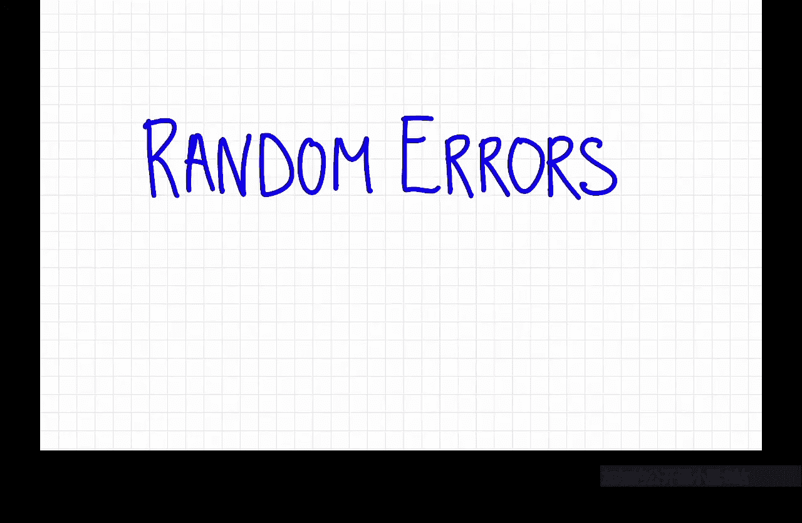
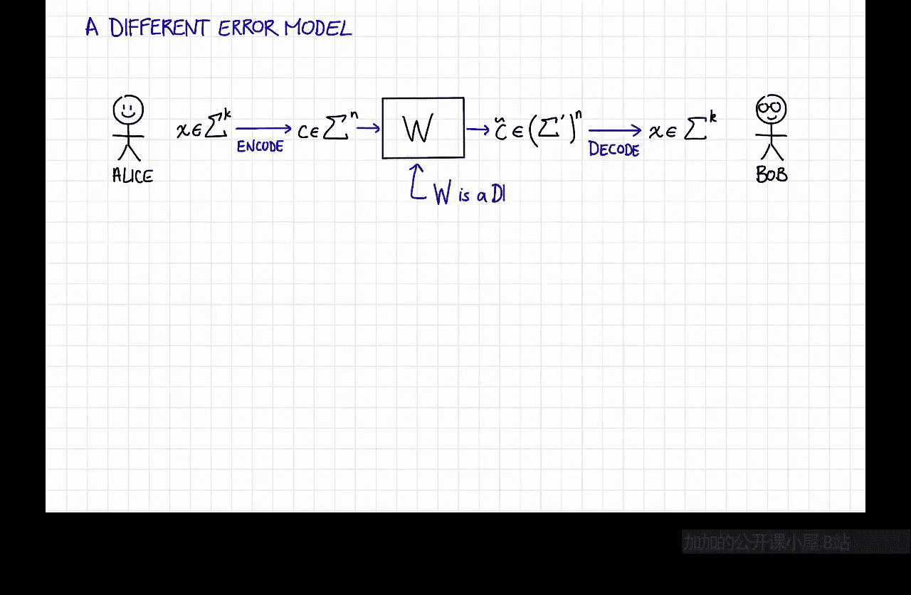

# 斯坦福大学【中英⚡代数编码导论｜Introduction to Algebraic Coding Theory】 p30 p29 9, Video 1： Random Channels -BV16sRYYTEwg_p30-

So far， we've considered the setting where errors were introduced adversarally。In this video。

 we'll take a quick look at the setting where errors are introduced at random。

Here's the error model that we will consider。As before we have a sender Alice with a message X of length K。

 she encodes it into a code word C of length n。Then this goes through a channel W。

 which I'll describe in a moment to get a corrupted code word C twiddle of length n in some different alphabet sigma prime。

Our receiver， Bob， receives that corrupted code word and can hopefully decode it to recover Alice's message X。

 At least we hope so。Here， this box W。Is a discreteet memoryless channel。

What the discrete part means is that these two alphabets。

 the input alphabet and the output alphabet are finite。

And what the memory list means is that W corrupts each symbol in this code word independently from all of the other symbols。

In other words， W is defined by a probability distribution of what's the probability of a symbol coming out based on the symbol coming in。

Let's note this W of Y， given X。This is the probability。That y comes out of this box。

Given that X went into it。And here， why is in the output alphabet sigma prime。

And x is in the input alphabet sigma。And again， we're imagining that W is going to act independently on every symbol of the code word C。

Let's see some examples。Our first example is the binary symmetric channel。

And I'm going to denote this BSC subP。Where p is a parameter between 0 and 1。

And this channel is given by the following probability distribution。

So the probability that y comes out of the channel， given that x goes into it。

Is equal to P If x is not equal to y and1 minus P if x is equal to y。

Where here X and Y are both in the alphabet 01。That is what the binary symmetric channel does is that every single bit of C that goes into W is flipped independently with probability P。

 and it stays the same with probability 1 minus P。Here's another example。The binary erasure channel。

Is the same thing except each bit is erased with probability P。

and we denote this by b e c sub p for some parameter p，The B， E。

 C is given by this conditional probability distribution。

 So the probability that y comes out of the channel， given that x went into it is P。

 If y is bought or erased，1 minus P， if y is equal to x and 0 otherwise。And here。

 why is in the output alphabet sigma prime。Which is zero or1 or bot。

And x is in the input alphabet sigma， which is just 0 or 1。So the B。

 E C just erases each bit independently with probability P。

Both the BSC and the BEC are very natural channel models。

And they're different than the models of errors and erasureers that we've been looking at so far。

In this case， on the B， SC and the B，EC C。The channel W is not nefarious。It's random。 Moreover。

 it's going to corrupt each symbol independently of all of the other ones。In that sense。

 this model is somewhat quote unquote eaier than the adversarial model we've been looking at before。

So we'd expect to be able to get stronger guarantees in this model。 and in fact， that's true。

This model where W is a random channel is extremely important， extremely natural。

 and extremely well studied。And to large extent， we're just not going to pay too much attention to it in these videos。

 That is， we're mostly going to focus on the adversarial case that we've already been looking at。

However， in this video and the few right after it， we will do a real quick introduction because。

 like I said， these models are important。So since W is a memoryless channel。 that is。

 it corrupts each symbol independently， we can't hope to always succeed。 or rather。

 Bob can't hope to always recover Alice's message。This is because there is some small but positive probability that all of the symbols are going to get messed up。

So instead of hoping to succeed all of the time， which is what we asked for for adversarial errors。

 we are instead going to hope to succeed with high probability。More formally。

 we have the following definition。Select W be a channel with input alphabet Sigma and output alphabet Sigma prime。

And suppose that C is a code of block length n over the alphabet sigma that has some encoding map and some decoding map。

We say that the failure probability of the code C on the channel W with respect to these encoding and decoding maps。

Is it most aer？Some number between 0 and 1。 If it is the case that for all possible messages。

 X and sigma to the K。The probability over the channel W。That the thing that Bob decodes。

 that is the decoder acting on the channel， acting on the encoding of X。Is not equal to x。

That is this is the event that Bob made a mistake。The probability that this mistake happening is at most。

 Ada。If that's true， we say that the failure probability is at most data。

When we were talking about worst cased errors， adversarial errors。

 our goal ended up being this sort of very combinatorial statement of figuring out the best trade off between rate and distance。

Now， for random channels， we once again want to know what is the best trade off between the rate and the ability to correct errors on this channel。

And to define that， we're going to use the failure probability。That is。

 we'll want to know what's the best rate at which you can communicate across this channel with failure probability at most。

 pretty small。It turns out that there is such a limit and it's called the capacity of a channel。

In particular， Shannon showed that every discreteet， memoryless channel， W。Has a capacity。

Let's call it C a number in 01。I'm sorry， this is very confusing。 this C， which is a code。

That's meant to be a curly C。 This one is not curly。 You can see the difference， right。Okay， anyway。

 so every memoryless channel has a capacity， and what it means to have a capacity is that failure probability going to zero is possible for rates below that capacity。

 but impossible for rates above that capacity。Further。

 it turns out that this capacity has a really nice expression in terms of information theory。

In particular， C is the maximum。Overall， distributions on inputs X to the channel。

Of the mutual information。Between x， this is a random variable that is the input to the channel and y。

 the random variable that is the output of the channel。If you don't know what mutual information is。

 it doesn't really matter we're not going to dwell too much on this。

 but I just wanted to throw this up there in case people do know what that means。

But the point here is that every memoryless channel W does have a capacity and the analog to the question that we were asking before about the best trade off between rate and distance is what is this capacity？

In the next video， we will state this theorem， which I haven't really stated as a theorem here。

 but we'll actually state it more formally as a theorem for the BSE in particular and sketchketchcher proof。

