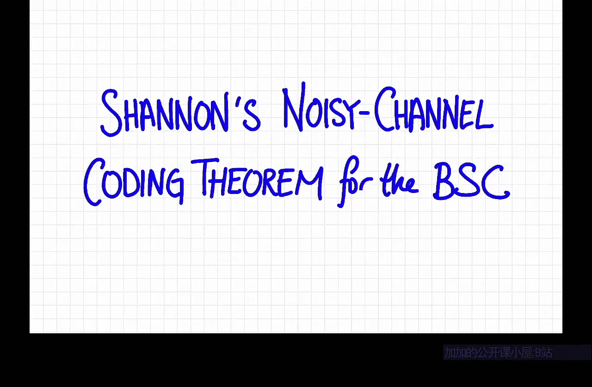
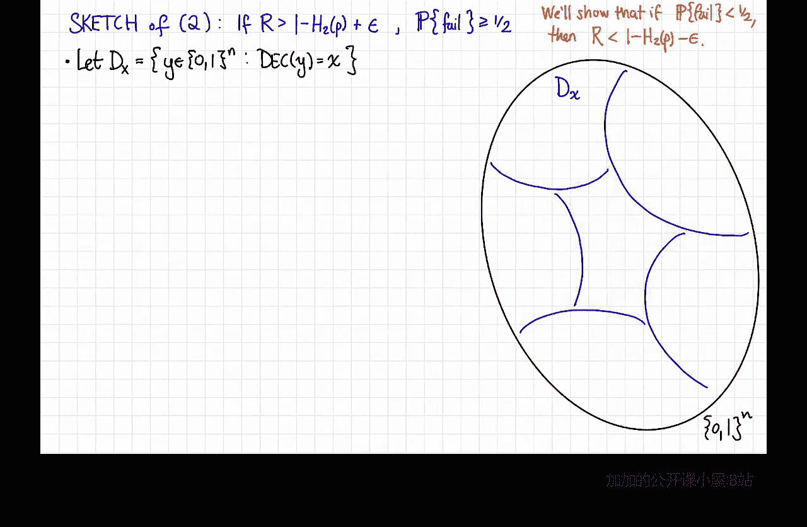

# 斯坦福大学【中英⚡代数编码导论｜Introduction to Algebraic Coding Theory】 p31 p30 9, Video 2： Capacity of the BSC -BV16sRYYTEwg_p31-

In this video， we'll state Shannon's noisy channel coding theorem for the binary symmetric channel。

 and we'll sketch the proof。Let's quickly recall the setup from the previous video。

We have a sender Alice， who wants to send a message to a receiver Bob as usual。

 and the thing that's different from our normal setup is that we now have a random channel W introducing the noise。

For this video， let's assume that W is the binary symmetric channel， BSCP。

That is W just flips every bit with probability P independently。In the previous video。

 we informally defined the capacity of a channel。The capacity of a channel W is the highest rate at which reliable communication is possible。

 That is， if the rate is less than the capacity， then the failure probability is going to go to 0。

 but if the rate is larger than the capacity， then the failure probability is bounded away from 0。

In this video， we will formalize and then sketch the proof of the following theorem。

The theorem says that the capacity of the binary symmetric channel with parameter P。

Is 1 minus the binary entropy of P。Here is a more precise way of stating this theorem。

For all parameters， P between 0 and a half。And for all epsilon between 0 and a half minus p。

The following holds。So first， there is some constant delta greater than 0。

 so that all sufficiently large n and K。If K is at most1 minus the binary entropy of P minus epsilon。

 all times n。AK， if the rate of the code is no more than this。

Then there exists an encoding algorithm and a decoding algorithm。 in particular。

 there exists a code so that for all messages X in 01 to the K。The failure probability。

 that is the probability that the decoder messes up and doesn't actually return the actual message。

Is teeny， tiny。Less than or equal to 2 to the minus delta times n。

 where Delta was this constant from the beginning。That is thing one here。

Says that if the rate is a little bit less than this。1 minus H2 of P。

 The probability of failure is tiny。The second part of the theorem， part 2。

Says that there exists some constant delta greater than 0 so that for all sufficiently large n in K。

If k is a little bit larger than that， so k is larger than 1 minus the binary entropy of P plus epsilon all times n a k。

 the rate is bigger than that。Then for all encoding and decoding maps， in particular， for all codes。

 there exists some input X on which the decoder is likely to mess up。

 That is the probability that the output of the decoder not being equal to the correct message X is greater than equal to a half。

So two is saying。That if the rate is a bit bigger than1 minus the binary entropy of P。

 then the probability of failure is large。At least as large as a half。

So this is a formal statement of what we mean by the capacity of the binary symmetric channel is this number one minus the binary entropy of P。

For the remainder of this video， we're going to sketch the proof of this theorem。However。

 we're not really going to give the best proof of this theorem。

I would argue that the correct way to prove this theorem uses information theory。

We're not covering information theory in these videos。 So we're not going to go that route。 instead。

 we're going to sketch a proof from first principles without explicitly using information theory just to convince you that it's true。

 This works， but I'd really encourage you to go learn more about information theory。

 to see the correct presentation of these results。 and in particular。

 to see the generalization of this result to any channel W。Okay， but let's sketch the proof。

For the first part， I'm not going to go into very much detail at all。 I'll just say。

 use a completely random code。That is just take your code C to be a completely random set in 0。

1 to the n。 chooseose a random encoding map for that code and then choose the decoding map。

 Pick the closest code word。 Okay， that doesn't entirely work。

You have to throw out a few code words that might land close together， but it basically works。

So I'm not going to say too much more about one fun exercise， try to implement this idea。Instead。

 let's talk a little bit about two。2 is saying that if the rate is too big。

Then doesn't matter what code you have， The probability that you fail on the binary symmetric channel has got to be pretty big。

So let's sketch the proof of this second part。 If the rate is too big。

 then the probability of failure must also be large。Actually。

 we're going to show the contra positivesitive that if the probability of failure is too small。

 then the rate must also be small。Okay， so here's the basic idea。

Imagine that this blob here is01 to the n。And suppose that we have a code whose failure probability is less than a half。

Now， let's let D sub X。Be the set of wises。In 0，1 to the n。Such that the decoding of y is equal to x。

Where deck is the decoder for our code that we're assuming exists with fairly probability less than a half。

So that's going to chop up our space into a bunch of different regions。Let's say they look like that。

That is。All of the points in here。If Bob sees any of these points， he's going to say，" okay。

 Alice meant to send X。Whereas if Bob sees any of these points。He might say， O。

 Alice meant to send some other X prime and so on。

Now， let's consider what happens to the encoding of x as it goes through the binary symmetric channel。

So let's say that this is the encoding of x。And consider the hamming ball around that encoding of radius p times n。

Maybe it looks something like that。 Now， if I start with this point here， the encoding of X。

 and I shove it through the B， SC。Then I expect about a P fraction of the bits to be flipped。

 it might not be exactly a P fraction， but it's about a P fraction。

So what that means is that after I pass the encoding of x through the binary symmetric channel。

 it's not going to end up exactly。On this shell here。 But it'll end up in some neighborhood of that。

Let's say that looks like this。So what's the width of this annulus here。

 It's going to be some parameter that depends on this epsilon。

 I don't want to do out the technical details for this proof sketch。 But let's just say that it's。

 it's wide enough so that with really high probability。

 when the encoding of X passes through the binary symmetric channel is going to end up somewhere in this annulus。

And let's call this annulus S sub x。So we have that with high probability。

 the binary symmetric channel acting on the encoding of X lands in S of X。 Therefore。

 since the failure probability is meant to be small， smaller than a half。

 A lot of the mass of S sub X here has to be contained。In Dive x。That is。

 the picture should look something like this。And that's because if this annulus were to lie somewhere else。

 not mostly contained within D sub X。Let's say it looks something like that。

 Then with really high probability， the encoding of X would end up out here somewhere。

And not in D of X。 And then we'd get a failure。So instead。

 we have to have S subex living mostly within D subex。There's some wiggle room here in the mostly。

 the probability of failure can be as high as one half。 So maybe， by mostly， I mean。

 like half of it has to be。 but a solid chunk has to be contained in D of X。

 And this is true for any X。So maybe the picture looks something like this。Each one of these regions。

 D sub X has its own little annulus living inside it or overlapping substantially with it。

What that means is that for each of these x's。The volume of the region D of x。Has to be。

Greater than or equal to ish。This twiddle means up to some constant factor， maybe。

The volume of S subex。And it turns out that the volume of S subex， this annulus here。

Is pretty close to the volume of this hamming ball。

That's because it turns out that the amount of mass in the interior of a hamming ball is basically negligible compared to the amount of mass going on outside。

So again， up to somequigglies squigglies。This is about equal to the volume。

Of the hamming ball of radius P times N。In F 2 to the n。

But we already know that this is approximately more squiggly squigglies。

Equal to 2 to the n times the binary entropy of P。And once again， to make all of these quicklyggly。

 Squigglies precise， it matters how wide this annulus is。

 which is something that we would pick depending on epsilon。So given that。

 up to some constant factor that may depend on epsilon。

 the volume of D sub x is at least2 to the n times the binary entropy of P。

But since this whole space，01 to the n is broken up into these regions。D sub X。

That means that the total volume in this space divided by this bound on the total volume of each of the D sub xs is going to give us on a bound on the number of D sub xs that we can possibly fit in this space。

 A K， the number of messages， X that we can possibly encode。So at most。

 this many Dce of x's can fit in 01 to the n。And that means that our code itself。

 the number of messages we can possibly encode， has size at most this big。

So the size of C is at most2 to the n times 1 minus。The binary entropy of P。

And then we can get a bound on the rate of the code。

 Remember that the rate is defined as the log base two of the size of C divided by n。

So that's just this bit up here。 So the rate。Is it most。Up to some squiggly squigglies。

1 minus H2 of P。Should have put some quickly， Squilys here， too。

And if you trace back all of the approximations that we made and you' you careful about it。

 you'll see that the correct way to resolve these approximations。

Is to say that the rate is less than or equal to 1 minus the binary entropy of P plus epsilon。

And basically， the smaller epsilon is the larger n has to be。

So that's a sketch of the proof of this second item。In the theorem here。Fun exercise。

Go through that sketch and try to make it precise and figure out where all the epsilons go and what's up with the Squiggly Squigglies。

But in any case， hopefully you mostly believe this theorem。 I promise you， it's true。

This theorem and its proof might seem somewhat familiar。

Both the quantitative statement and the argument itself。Might remind you of the hand bound。

 And indeed， this result basically exactly lines up with the hand bound。In a bit more detail。

 here's the story so far。 Here's how Shannon's theorem on the binary symmetric channel fits in all the results we have about worst case errors。

So I've switched up the plot a little bit。 Usually on the X axis here。

 I have the relative distance delta， and I've changed it now to have P。

 which is a fraction of errors or an expected fraction of errors in the random case。

Recall that a code of distance Delta can correct up to a delta over two fraction of worst case errors。

 And so when I go from deelta to P for the worst case errors stuff， I need to divide everything by 2。

 So that's why this ends at a half when it normally ends at one。Okay， so given that change。

 here's how we can plot everything together。Here， we had the hamming bound。

Which is an impossibility result for worst case errors。

It says we cannot have constructions for worst case errors。

 A P fraction of worst case errors that have rate better than this。

 The result that we just showed or that we just sketched。

 at least says that exactly the same bound holds for random errors。 That is。

 we cannot have constructions for random errors that are any better than this。However。

 unlike the worst case errors situation， this is also achievable。

 Shannon Siem also says that there are constructions。

 perhaps non efficient ones that can meet this bound。

So this is in pretty stark contrast to the worst case error case For worst case errors。

 we had this impossibility result， Hemings bound。And then we had some other impossibility results。

 like the plot can bound。And there are best possibility results， at least that we've seen so far。

 the G V bound and the Zabloov bound lie way below the impossibility results。

 So there's this whole region of uncertainty where we don't know whether or not there exist codes in that region。

We have no such uncertainty for random errors。This curve。

1 minus the binary entropy of P is just the right answer。

That's just the capacity of the binary symmetric channel。We cannot get rape any better than this。

 but we can get rate approaching this。So that's pretty cool， It's very clean。However。

 this picture does naturally raise a question for worst case errors。

 There's a difference in our knowledge between what we can get inefficiently and non constructively on the Gilberrshov bound。

 and what we can get efficiently on the Zobov bound。 So far for random errors。

 we haven't talked about efficiency at all。 The theorem that we sketched just now was an existential result。

 So this raises the question。 What about efficient algorithms for random errors。

 Are we going to get a similar gap there， or will we be able to meet this  one minus binary entropy of P bound。

We will answer that question in the next video。