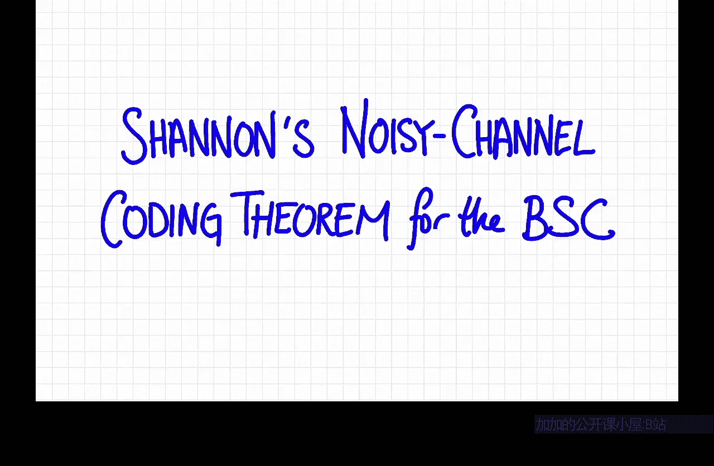
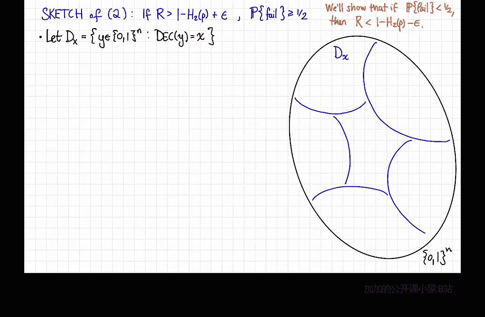

# 代数编码导论：2：二进制对称信道的容量 📊

在本节课中，我们将学习香农关于二进制对称信道的噪声信道编码定理，并概述其证明过程。

## 概述

上一节我们介绍了信道容量的非正式定义。本节中，我们将正式阐述并概述二进制对称信道容量的定理及其证明。

## 定理陈述

首先，快速回顾上一节的设定。我们有一个发送方爱丽丝和一个接收方鲍勃。与通常设定不同的是，我们有一个引入噪声的随机信道 **W**。本节假设 **W** 是参数为 **P** 的二进制对称信道 **BSC(P)**。这意味着 **W** 以概率 **P** 独立地翻转每个比特。

信道容量定义为可实现可靠通信的最高速率。即，如果速率低于容量，则失败概率趋近于0；如果速率高于容量，则失败概率将远离0。

我们将形式化并概述以下定理的证明：

**定理**：参数为 **P** 的二进制对称信道的容量为 **1 - H₂(P)**，其中 **H₂(P)** 是二进制熵函数。

更精确的定理陈述如下：

对于所有介于0和1/2之间的参数 **P**，以及所有介于0和 **(1/2 - P)** 之间的 **ε**，以下成立：

1.  存在某个常数 **δ > 0**，使得对于所有足够大的 **n** 和 **K**，如果 **K ≤ (1 - H₂(P) - ε) * n**（即码率不超过此值），则存在一种编码算法和解码算法（特别地，存在一个码），使得对于所有消息 **X ∈ {0,1}^K**，失败概率（即解码器出错且未返回实际消息的概率）极小，满足 **≤ 2^{-δn}**。
2.  存在某个常数 **δ > 0**，使得对于所有足够大的 **n** 和 **K**，如果 **K ≥ (1 - H₂(P) + ε) * n**（即码率大于此值），则对于所有编码和解码映射（特别地，对于所有码），都存在某个输入 **X**，使得解码器很可能出错，即解码器输出不等于正确消息 **X** 的概率 **≥ 1/2**。

简而言之，第一部分说明如果速率略低于 **1 - H₂(P)**，则失败概率极小；第二部分说明如果速率略高于 **1 - H₂(P)**，则失败概率很大（至少1/2）。

## 证明概述

本节我们将概述该定理的证明。需要说明的是，这不是证明此定理的最佳方法。最佳方法应使用信息论，但本系列视频不涵盖信息论。因此，我们将概述一个基于基本原理的证明，旨在使您相信其正确性。我们鼓励您学习更多信息论知识，以了解此结果及其对任意信道 **W** 的推广的正确表述。

### 第一部分证明思路（可达性）

对于定理的第一部分（可达性），我们不会深入细节，仅简述思路：使用完全随机的码。即，从 **{0,1}^n** 中随机选择一个集合作为码 **C**，为其选择一个随机编码映射，然后选择解码映射（例如，选择最接近的码字）。这基本可行，但可能需要剔除少数可能靠得太近的码字。这是一个有趣的练习，您可以尝试实现这个想法。

### 第二部分证明思路（逆命题）

现在，让我们重点讨论第二部分的证明思路。第二部分表明，如果速率过高，那么无论使用什么码，在二进制对称信道上的失败概率都会相当高。

实际上，我们将证明其逆否命题：如果失败概率太小，那么速率也必须很小。

以下是基本思路：

假设码的失败概率小于 **1/2**。对于每个消息 **X**，定义集合 **D_X** 为所有满足 **解码器(y) = X** 的 **y ∈ {0,1}^n**。这将整个空间 **{0,1}^n** 划分为多个区域，每个 **D_X** 对应一个区域。

接下来，考虑消息 **X** 的编码码字通过二进制对称信道后的情况。以该码字为中心，考虑一个半径为 **P * n** 的汉明球。当码字通过 **BSC(P)** 后，期望大约有 **P** 比例的比特被翻转。因此，输出有很大概率落在一个以 **P * n** 为中心的“环带” **S_X** 内。

由于我们假设失败概率很小（小于 **1/2**），因此 **S_X** 中的大部分点必须包含在 **D_X** 中。否则，如果 **S_X** 大部分位于 **D_X** 之外，那么当码字通过信道后，输出很可能落在 **D_X** 之外，从而导致解码失败。

这意味着对于每个 **X**，区域 **D_X** 的体积至少（在某个常数因子内）与 **S_X** 的体积相当。而 **S_X** 的体积又近似等于半径为 **P * n** 的汉明球的体积，该体积约为 **2^{n * H₂(P)}**。

因此，每个 **D_X** 的体积至少约为 **2^{n * H₂(P)}**。由于整个空间 **{0,1}^n** 被这些互不相交的 **D_X** 区域所划分，因此我们能容纳的 **D_X** 区域数量（即可编码的消息数 **K**）最多为总空间体积除以每个 **D_X** 的最小体积。

计算可得，码 **C** 的大小最多约为 **2^{n * (1 - H₂(P))}**。因此，码率 **R = (log₂ |C|) / n** 最多约为 **1 - H₂(P)**。通过仔细处理证明中的近似和常数，最终可以得出：如果失败概率小于 **1/2**，则码率 **R ≤ 1 - H₂(P) + ε**。这就完成了第二部分的证明概述。

## 与最坏情况纠错的联系

这个定理及其证明可能让您联想到汉明界。确实，这个结果基本上与汉明界完全对应。

为了将随机错误与最坏情况错误的结果放在一起比较，我们可以绘制下图（通常横轴是相对距离 **δ**，这里换成了错误比例 **P**。请注意，对于最坏情况错误，一个距离为 **Δ** 的码可以纠正最多 **Δ/2** 比例的错误，因此从 **δ** 到 **P** 的转换需要将所有值除以2）。

*   **汉明界**（红色虚线）是针对最坏情况错误的不可实现性结果。它表明，对于纠正 **P** 比例最坏情况错误的构造，其码率不能优于这条曲线。
*   **香农定理**（蓝色实线）表明，对于随机错误，完全相同的界限也成立。我们无法获得比这更好的构造。
*   然而，与最坏情况错误情形不同的是，这个界限是**可达的**。香农定理指出，存在（可能是非高效的）构造可以达到或接近这个界限。

这与最坏情况错误形成了鲜明对比。对于最坏情况错误，我们有汉明界这样的不可实现性结果，以及吉尔伯特-瓦尔沙莫夫界和乍博洛夫界这样的可实现性结果，但它们之间存在一个巨大的“未知区域”。而对于随机错误，不存在这种不确定性。曲线 **1 - H₂(P)** 就是确切的答案，即二进制对称信道的容量。我们无法获得比这更好的速率，但可以无限接近它。

## 遗留问题与下节预告

这个结果很简洁，但也自然引出一个问题：关于效率。我们刚刚概述的定理是一个存在性结果，并未讨论高效算法。那么，对于随机错误的高效算法呢？我们是否会遇到类似最坏情况错误那样的效率鸿沟，还是能够达到这个 **1 - H₂(P)** 的界限？我们将在下一个视频中回答这个问题。

## 总结

本节课中，我们一起学习了香农关于二进制对称信道的噪声信道编码定理。我们正式定义了信道容量，并概述了定理的证明，了解到二进制对称信道的容量为 **1 - H₂(P)**。这个结果清晰地划分了可靠通信的可能与不可能区域，并与最坏情况纠错中的汉明界相联系，揭示了随机错误模型下通信极限的完整图景。