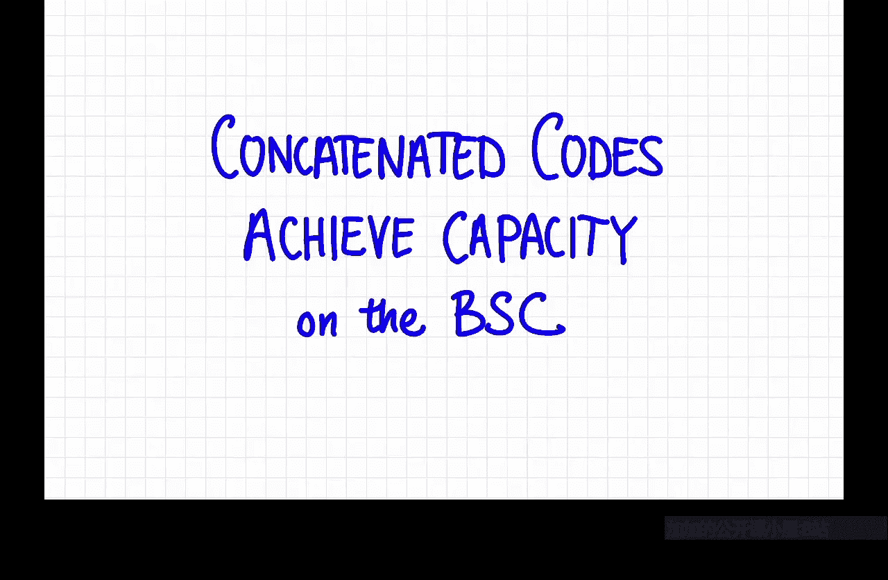
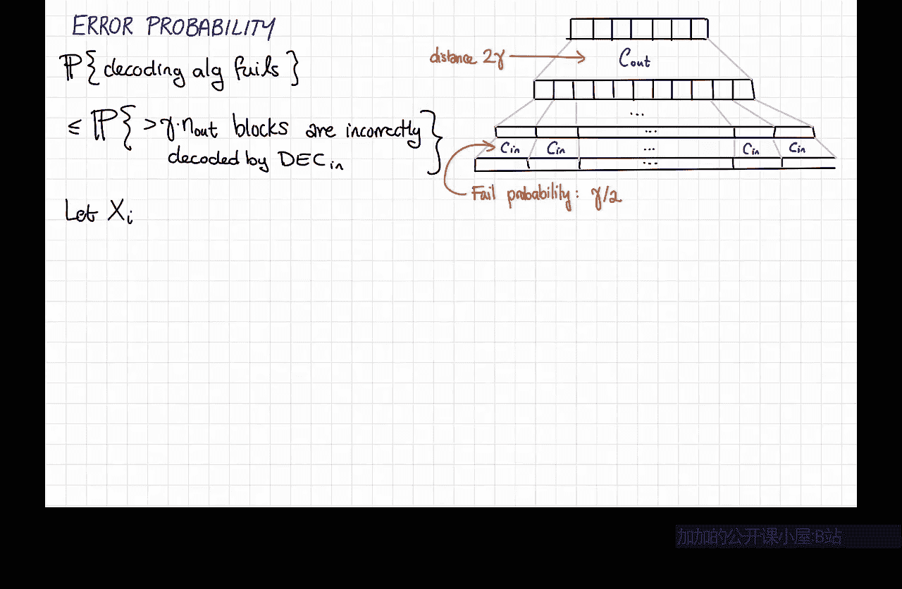
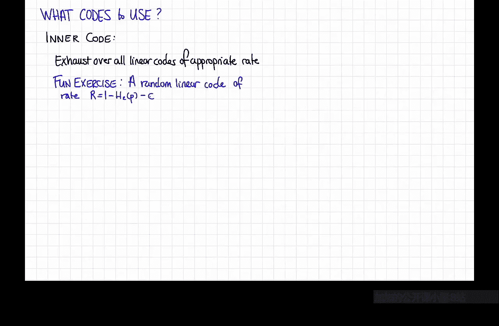

# 斯坦福大学【中英⚡代数编码导论｜Introduction to Algebraic Coding Theory】 p32 p31 9, Video 3： Efficient Algorithms for the BSC -BV16sRYYTEwg_p32-

In this video， we'll see how to achieve capacity on the binary symmetric channel with efficient algorithms using concatenated codes。

In particular， we'll prove or at least sketch the proof of this theorem。

For every P between zero and a half。And for every epsilon between0 and1 minus the binary entropy of P。

Remember that this is the capacity of the binary symmetric channel with parameter P。

And for any large enough n。There is a binary linear code C subset of F 2 to the N。

With rate at least one minus the binary entropy of P minus epsilon。

 So that is nearly achieving capacity on the BSC。So that the following things hold。First。

C is an explicit code。 in particular， it could be constructed in time polynomial and N plus some constant。

 as long as epsilon is a constant with some unspeakable dependence on epsilon。Second。

 it has efficient encoding algorithms， It can be encoded in time Big O and n squared。And third。

 it has efficient decoding algorithms。 In particular。

 there is a decoding algorithm for this code that runs in time polynomial and n plus some linear term in N。

 where the constant on the linear term again has some unspeakable dependence on epsilon。Moreover。

 this decoding algorithm has failure probability， teeny， tiny。Exponentialally small in N。

On the binarysymmetric channel with parameter P。So an observation here。

Is that everything is polynomial time。As long as epsilon is a constant。However。

 if epsilon is not a constant。Or if epsilon is just really， really small。

 these exponential dependencies are not particularly nice。But for now， let's just say， okay。

 Epsilon is a constant。 So everything in sight is polynomial time。 And in that case。

 this theorem would be a big win。It says that there exist explicit codes that achieve capacity on the binary symmetric channel with efficient encoding and decoding algorithms。

That's pretty cool。To prove this theorem， we're going to use our old friend concateated codes。

Now there are going to be a lot of parameters， so I've made this big table to keep track of them all。

First， let's choose a parameter gamma to be determined。Now， as usual with concatenated codes。

 we're going to have an inner code C in and an outer code C out。

The inner code will have dimension K in and block length N in， and it's going to be a binary code。

 so alphabet size 2。The outer code similarly will have dimension K out， block length n out。

 and alphabet size 2 to the K in， which is what it needs to be so that the concatenation works out。

The rate of the inner code。Is going to be。Basically， capacity achieving。

 So that is going to be one minus the binary of entropy of P minus a smidge。

The rate of the outer code is going to be really， really close to1， one minus epsilon over two。

The inner code is going to be decodable in time T in。

We'll specify more about what this is later after we pick the codes。

And the outer code C out will have decoding time T out。Other things of note。

I want the failure probability on the BSC of C in the inner code to be gamma over 2。

 where gamma is this parameter that we're going to choose later。And at the same time。

 I want C out to have distance two times gamma。In the following slides。

 we're going to go through and say what C in and what C out are going to be。

 and then we're going to see how to pick all of these various different parameters。

So that everything is going to work out。But first， let's check that the rate of the concatenated code is what we want it to be。

So assuming we can get these rates for our inner and our outer code。

 we have the rate of the concateninated code。Is the product of the rates of the inner code and the outer code？

And that's going to be one minus。Binary entropy of p minus epsilon over2。

Times 1 minus epsilon over 2。And you can check that this is at least one minus the binary entropy of P minus epsilon。

To check this， basically just multiply everything out， you'll get these terms。

 and then you'll also get some lower order terms that happen to be going in the right direction。Okay。

 so already， this is great。 This is what we wanted from the rate。

So let's go back to this theorem statement and put a check there that we're going to get the right rate。

 assuming we can instantiate everything else。Check。Okay， so back to this slide。

The next thing we need to do。In order to figure out how to set all of these various different parameters here。

Is to talk about what decoding algorithm we're going to use。So here's our decoding algorithm。

This might look somewhat familiar。This is actually the same decoding algorithm that we started out with when we were talking about decoding concatenated codes for worst case errors。

For worst case errors， we had to do a bunch of fancy stuff in order to make this algorithm work out。

But it turns out that for random errors， we don't have to do fancy stuff at all。

 This algorithm works just fine。So let's quickly recall what the algorithm is。

 So here's my little cartoon of a concatenated code。So we have our original message。

 which we encode with the outer code C out。Then we treat each symbol of that code word。

 which is a symbol over some big alphabet as a little binary vector。

And then we encode each of those little binary vectors with the inner code C in to get some bigger binary vectors。

 and this whole big binary code word that results is going to be our encoding under the concatenated code。

All right， given that setup， here is our decoding algorithm。We're going to take as input。

 a corrupted version of this。So I'm going to think about chunking it up into blocks just like this。

And then we're going to run C in's decoder to hopefully go back from these things to those things。

That's what this step here is doing。 So we're going to start out with the blocks Y1 through Y n out。

 Those are these blocks。Corrupted versions of those blocks。

Then we're going to let Yi prime be the result of running the inner codes decoder。

 hopefully that will end up with these blocks， at least in most of the cases。

Then we're going to put all those together。And recast them over the big field to form this corrupted code word y prime here。

 which is a corrupted code word of C out。And then we'll run C outs decoder to hopefully arrive at the original message。

So let's talk about the decoding time and the encoding time of this algorithm。 So the decoding time。

This is big O of n out times T in of n in。So this is some function of n in it's the amount of time to decode the inner code。

 so this whole term comes from the fact that we need to run the inner codes decoder and out different times。

And then we also need to run the outer codes decoder once。So that will take time T out of n out。Okay。

 and what is this decoding time？Well， we don't know because we haven't decided yet what T in and T out are going to be or what n in is going to be with respect to N out。

So let's just leave this as TBD for now， we'll come back to that。What's the encoding time？Well。

 it turns out we're going to choose C in to be a linear code。

 just like we did when we did this construction for worst case errors。

And so that means that the entire concatenated code can also be taken to be linear。

The encoding time for any linear code is just quadratic。

 All you need to do is multiply by a generator matrix。

 So the encoding time here is going to be big O of n squared。

So let's go back to our theorem statement。And put a check here for the encoding time。Again。

 assuming we can get everything else settled。And then come back down here。

The other thing we might be interested in is the construction time of this code。

 let's come back to that too。Okay， so that is our decoding algorithm Still we haven't yet said what these codes are actually going to be。

 we'll come to that later。But first， let's analyze the error probability of this decoding algorithm in terms of the error probability of the inner code。

😡，So here's an analysis of the error probability。 Remember that C out。

 we chose to have distance to gamma and C in， we decided we was going to have failure probability gamma over2 for this parameter gamma that we haven't chosen yet。

Now the probability that this decoding algorithm fails。Is at most。

The probability that greater than gamma times n out blocks。

Are incorrectly decoded by the inner decoder。Indeed， if this thing doesn't happen。That is。

 if less than or equal to gamma times n out blocks。Here。Are incorrectly decoded。

That means that less than or equal to gamma times and out symbols here are going to be incorrect。

And that means that sea out can correct those symbols that are in error because it has distance to gamma by assumption。

And so if only a gamma fraction of the symbols are in error， that's half the distance。

 and the code can correct it。Okay， so the probability that the decoding algorithm fails is at most the probability that this occurs？

So now let's try to figure out what this probability is。To do that。

 consider the random variable X I defined as follows。

So X I is the indicator random variable， which is one if the I block is incorrectly decoded and0 otherwise for I between one and an out。

Notice that the probability。That X I is equal to one。

That is the probability that the I block was incorrectly decoded。Is it most gamma over two？

Since that's the assumption that we made about the inner code。

 that the failure probability is at most gamma over2。And further notice that the XI are independent。

The reason that the X I are independent random variables is because whether or not this block is incorrectly decoded。

 Depend only on which bits are corrupted in this block。

And since all of the bits are corrupted independently。

Because that's how the binary symmetric channel works。 That means that what happens to this block。

 for example， is independent of what happens to this block is independent of what happens to this block and so on。

So all of these Xi are mutually independent。Therefore， the probability that decoding fails。

Is it most the probability。Like we said up here that too many blocks are incorrectly decoded。

 Another way of writing that in terms of these X I's is that the sum of these X I's is too large。

In particular， this is at most the probability that the sum。From I equals 1 to n out of X I。

 that's the number of incorrectly decoded blocks is greater than gamma times n out。

But notice that gamma times and out。I。At least twice the expectation。Of this random variable。

That's because the expectation is gamma over two times n out。So let's write that in。

And at this point。We're going to use something called a turnoff bound。So a turn off bound。

 if you haven't seen it before， is a tail bound for the sums of independent random variables。

It says that this random variable here， which is the sum of a bunch of independent random variables。

Is not very likely to be twice as big as its expectation。In this case。

 a turn off bound says that this quantity is at most。一。😊，To the minus gamma times n out divided by6。

Here， the constant 6 won't really matter because we're interested in biggo stuff anyway。

 but let's just put it in there for completeness。Okay， so this seems pretty small。

 but we haven't chosen gamma yet， so we don't actually know how small it is。

 so for now let's just leave it as to be determined。We'll come back to it once we pick gamma。Okay。

 so finally， now that we've talked about what our decoding algorithm is going to be and we've analyzed its error probability。

 I guess we should probably say what these codes are See in and see out。 Let's do that next。😡。

So what codes should we use。We're going to do a similar thing to what we did before。

 for the inner code。 We're going to basically just do an exhaustive search for to find a good one。

 and for the outer code。We'll use something。 read Solomon Esque。 We'll see in a moment。Okay。

 so for the inner code。We're just going to exhaust over all linear codes of the appropriate rate。

This worked before when we were considering worst case errors because we knew from the Gilbert Vsashov bound that a good code existed。

 So we're going to need to prove an analogous statement here for the random error model。

So here's a fun exercise。Show that a random linear code。

Achievees capacity on the binary symmetric channel。

More precisely， show that a random linear code of rate 1 minus the binary entropy of P minus epsilon。

Is very likely to have tiny fail probability on the BSC。In particular， failure probability。

 something like 2 to the minus big omega of epsilon squared n。Here。

 notice that our use of probability is a little bit subtle。

 We're going to choose a random linear code， and then we're going to fix it。

 And we're going to show that with high probability over that random linear code。Now。

 with high probability over the binary symmetric channel， that code wins。

So there' are sort of two sources of probability。Okay， so let's assume that this is true。

In that case， this suggests how we should choose K in。

We should choose k in to be big omega of log 1 over gamma divided by epsilon squared。

The reason is that we want this failure probability 2 to the minus big omega of epsilon squared n。

To be gamma over2， because that's what we requested from our inner code。

 So we have to choose K in like this to make that work out。Let's go add that to our big table。Okay。

 so K in。Let's choose to be theta of。Log1 over gamma， divided by epsilon squared。

And we'll just note that that will ensure this failure probability。Okay， back to this slide。

We've now chosen our inner code， we're going to exhaust over all the linear codes of at appropriate rate and use this fun exercise to assert that a good one exists。

What's the construction time here。That is， how long does it take to find our good inner code？

Just like it did when we were searching for a good inner code for concatenated codes when we were looking at worst case errors。

 this is going to take time 2 to the big O of n in squared。

That's because essentially what we have to do is search over all possible generator matrices。

And there are about this many of those。Notice that n in is going to be big O of k in because our inner code is going to have constant rate。

And we just decided what Can should be。So let's change this big omega to a big theta。

It's true that we want Cain to be at least that big。

 but we also don't want to take it too much bigger。

So that means that the construction time in terms of gamma and epsilon。Is going to be equal to 2。

To the big O。Of log squared。Whenever gamma。Divided by epsilon squared。How about the decoding time？

Once again， just as it was when we looked at a similar construction before。

 the decoding time is going to be 2 to the big O of K in。

That's because we need to exhaust over all possible code words to find the closest one。

And with our choice of K in， this is going to be two to the big O of log。

1 over gamma over epsilon squared。So， up here， this was meant to be epsilent to the fourth。

Let me fix that。Okay， so now we know the construction time and the decoding time for our inner code C in。

Let's go put the decoding time back in our big table。Alright， so the decoding time T in of n in。

Going to erase this end in。 just we have room to write the decoding time。This is equal  to。2。

To the big O of log went over gamma。Over epsilon squared。And back to this slide。😡，Okay。

 so that was the inner code， How about the outer code？At this point， you're probably thinking。

 read Solomon codes。Because like what else would we use？But it turns out that actually。

 we're not going to use a read element code。And the reason is that if you work it out。

Then we need n out， the block length of the read Solomon code to be 2 to the K in。

 just like we did before， which means that K in would need to be logarithmic in and out。

In particular， that means that this construction time is going to be quasi polynomial in the final block length。

 and it also means that we're not going to be able to take gamma to be a constant。

That's a little bit obnoxious。 So instead， we're going to do something else。

What we're going to do is not quite use a read Solomon code， but in fact。

 use the concatenated code on the Zoblooff bound that we saw earlier。

 which itself did use a read Solomon code。So let's erase that。

And write concatenated code on the Zablo Bo。More precisely， it's gonna look something like this。

We're going to start with a concatenated code。Where the outer code is read Solomon and the inner code is this random linear code that we looked at earlier when we constructed concatenated codes on the Zaplooff bound。

And then what we're going to do is we're just going to kind of fiddle with the size of these blocks in order to make this have the alphabet size that we want。

So what we're going to do is we're going to first forget about the blocks。

To guess some nice binary code would like that。And then we're going to make new blocks。

And the new blocks are going to be a little bit shorter than the old blocks。

 So the alphabet size is a little bit smaller。 In particular。

 each of these blocks is going to have K in bits。So that we can concatenate it with our inner code。

 C in that we just defined。And now this whole thing is going to be our outer code。Or more precisely。

 this picture describes the encoding map for the outer code。

You can check that when we do this shuffling about changing the block size here。

 we don't change the rate of the code at all。 we still have the same amount of information getting sent。

 we're just changing how we're presenting that information。😡，Moreover。

 you can check that the distance is not going to get worse。

So that means that C out here still lives at or above Zoblooff bound。

Remember that we want the distance of this code to be two times gamma。

And if this code also lives on the Zabloav bound， that tells us what the rate should be。

In particular， the rate is going to be at least。1 minus big O。Of the square root of gamma。

Times log went over gamma。This is not at all obvious。

 just looking at the expression from the Zopov Bo。But if you work it out， this is what you get。

Fun exercise， work this out。Okay， so now we have our outer code。We know what we want the rate to be。

And we also know the decoding time， it's going to be polynomial in N because that was the whole point of this construction。

The construction time is also polynomial in and out。

At least if you believe me in an earlier video when I asserted we could do that。Okay。

 so let's go put these results in our big table。Okay。

 so we said that the rate of the outer code was supposed to be  one minus epsilon over 2。

 We've now said that it's also equal。To1 minus big O of root gamma log one over gamma。

And notice that this tells us how to pick a gamma， in particular。

 we need to pick a gamma so that this expression is the same as epsilon over 2。So let's do that。

That means that we need to pick gamma equal to big O of epsilon cubed。

Or at least big O of Epsilon cube will， will do the trick。 If we pick gamma big O of Epsilon cube。

 then this will be true。So let's do that。Next， let's write in the output decoding time here。

So he said that this was polynomial in and out。Okay。

 so I think now we have finally assembled all of the sort of parameters and values that we need to put together the remaining things in the theorem statement。

RightSo we already verified the rate， so let's erase that there to give us room to verify other things。

The next thing we need to verify is the decoding time of the overall algorithm。

So if you remember when we were talking about the decoder。

 we said that it ran in time big O of n out。Times T in because we need to run the inner decoder and out times。

Plus T out because we need to run the outer decoder once。And now that we have these values。

We can plug that in。This is big O of n times， so I just replaced n out with n。

 the block length of the concatenated code because that's only bigger。And T in， okay。

 it's this nasty thing。I'm just going to be a little bit lazy and say that this big nasty thing is some constant that depends only on epsilon because here's an epsilon and it's got a gamma in it。

 but gamma also depends only on epsilon。So， let's say。N times C sub epsilon for some nasty constant。

 depending on salon。And then this T out was polynomial in n， so I'm just going to write polyn。Okay。

 let's go back to our theorem statement and check this off。So here's thethereum statement。

So I claim that it could be decoded in time polyn plus n times some nasty constant that depends only on epsilon。

I hope this is the right nasty constant。If it's not apologies。

 but the main point is that this is some nasty concept that depends only on epsilon。

 so let's put a check here。Coming back here， let's check the construction time。Wops。

 I forgot to have a cell for construction time in my giant table here， we did work it out。

The construction time for the inner code。Was 2 to the big O of n in squared。Remember。

 because we just had to exhaust over all possible generator matrices。

And the construction time for the outer code。Was polynomial in and out。

Because the outer code was an explicit code on the Zabloov Bo。

 which we constructed in a previous video， and we claimed that it took time polyly and out。

Altogether， this is equal to， I claim some constant that depends only on epsilon plus。

Something that's polynomial in N。So here again， I've replaced n out with n because that's only bigger。

And now I've used the fact that N in is big O of K in and K in。Depends only on epsilon， right。

 because there's an epsilon here。 And then there's a gamma， but gamma also depends only on epsilon。

So that's some constant that depends only on Epsilon。Okay， so that's the construction time。

Let's go check that off in our theorem。Here's the theorem。

 and I claimed construction time polynomial and n plus some nasty constant that depends only on epsilon。

Let's put a check。Once again， what exactly this nasty constant is， doesn' itt matter too much。 Well。

 okay， it would matter if it were good， but given that it's bad。

 I'm not going to think too much about it。Okay， and finally。

 let's figure out the failure probability。So we computed earlier that this was equal to。

E to the minus gamma n out divided by 6 or some constant like that。Now notice that gamma。

Depends only on epsilon。 And N out is N divided by N in， where N in。Is big O of K in。

 which also depends only on Epsilon。So， altogether。

This thing here is n times some constant that depends only on epsilon。

So this is exponentially small in。C epsilon times n， where again。

 C epsilon is some constant that depends only on epsilon。

Notice that this C epsilon and this C epsilon and this C epsilon are all meant to be different。

 Sorry about that。Let's put some primes there。I'm just using them as generic stand ins for I don't feel like keeping track of the dependence on Epsilon。

Okay， so let's go back to our theorem statement and check off this failure probability。

So the failure probability that I claimed in the theorem statement was2 to the minus big omega of some constant depending on epsilon times n。

And that's indeed what we just showed， so let's put a check there。Okay。

 so altogether now I think we've checked off all of the things。We got the rate。

We got the construction time， we got the encoding time， we got the decoding time。

 and we got the failure probability。So altogether， that proves this theorem。

Let's put a big fat check somewhere just because it's cathartic。There we go。So to summarize。

 what does this mean for the status of decoding on the binary symmetric channel， Well。

 the picture looks like this。What we're seeing is that the story is so much nicer and cleaner for random errors than it is for worst case errors。

 at least for binary codes。For worst case errors， we have these impossibility results。And then。

 we had one possibility result。With non efficient algorithms。

And then we had another possibility result with efficient algorithms。

 and that all of these things are different。On the other hand， for random errors。

 we have this one result。Shannon serum。Which is both an impossibility result。

 a possibility result and an efficient possibility result。That is。

 Shannon's Theorem says you can't do any better than this trade off。Between P。

 the expected fraction of errors and or the rate of the code。And we just saw that， in fact。

 we can get explicit constructions with efficient algorithms that lie on this trade off。

So that's pretty nice。One thing to note is that we only showed this the efficient part。

In the limit as N goes to infinity， N has to be pretty large。

 like exponential in something polynomial in one over epsilon for this to kick in。

 That's because of all that nasty dependence on epsilon that we had in the theorem。In fact。

 it turns out that you can do better in terms of the dependence on Epsilon using something called polar codes。

We probably won't talk about them in these videos， but they're super cool。

 And you should check them out。However， for now， let's leave it with here。

 And this really satisfying single curve。That tells the entire story for binary codes on the BSC。

