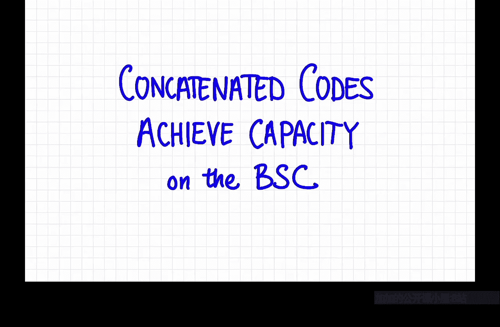
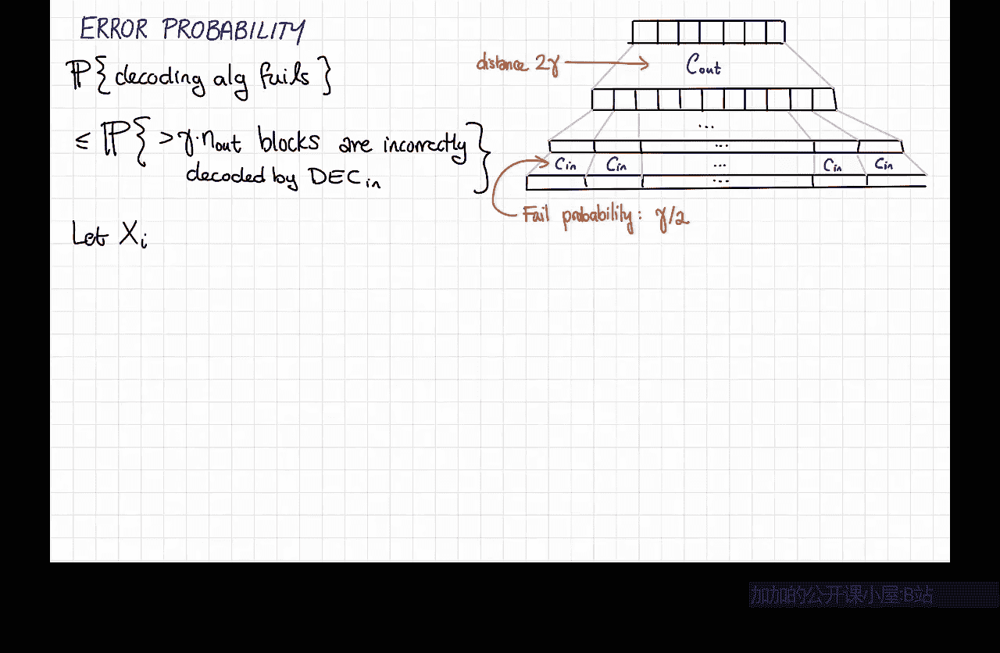
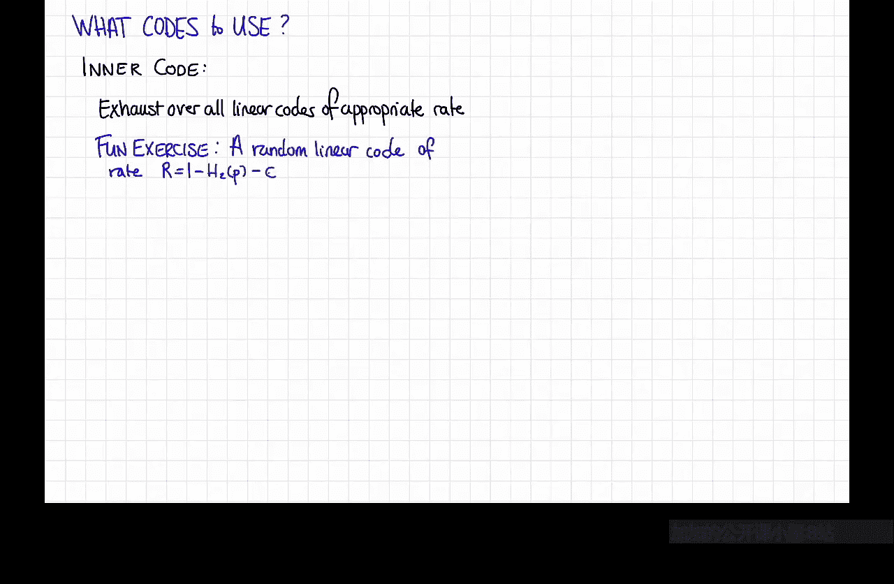

# 代数编码导论：3：BSC的高效算法 🚀

在本节课中，我们将学习如何通过级联码，使用高效算法在二进制对称信道上达到信道容量。我们将证明一个核心定理：对于任意参数P和ε，存在一个显式的二进制线性码，其速率接近信道容量，并且具有高效的编码与解码算法。

## 定理概述 📋

对于任意介于0和1/2之间的P，以及任意介于0和1 - H(P)之间的ε（其中H(P)是二进制熵函数，代表参数为P的BSC的信道容量），以及任意足够大的n，存在一个二进制线性码C ⊆ F₂ⁿ，其速率至少为1 - H(P) - ε。这意味着该码在BSC上几乎达到了容量。此外，该码满足以下条件：
1.  C是显式码，可在多项式时间内构造。
2.  具有高效的编码算法，编码时间为O(n²)。
3.  具有高效的解码算法，解码时间为多项式时间加上一个与n成线性关系的项，且解码失败概率在n上呈指数级小。

## 级联码框架 🧩

为了证明这个定理，我们将使用级联码。级联码包含一个内码C_in和一个外码C_out。我们需要管理许多参数，以下是参数表：

| 参数 | 描述 | 设定/目标 |
| :--- | :--- | :--- |
| γ | 待定参数 | 稍后确定 |
| C_in | 内码（二进制） | 维度k_in， 码长n_in |
| C_out | 外码（字母表大小为2^{k_in}) | 维度k_out， 码长n_out |
| R_in | 内码速率 | ≈ 1 - H(P) - ε/2 |
| R_out | 外码速率 | ≈ 1 - ε/2 |
| T_in | 内码解码时间 | 稍后确定 |
| T_out | 外码解码时间 | 稍后确定 |
| P_fail_in | 内码在BSC上的失败概率 | ≤ γ/2 |
| δ_out | 外码距离 | = 2γ |

上一节我们介绍了定理和级联码的基本框架，本节中我们来看看级联码的速率如何满足要求。

### 速率分析 📈

假设我们能获得具有上述速率的内码和外码，那么级联码的速率R_concatenated为两者速率的乘积：
`R_concatenated = R_in * R_out = (1 - H(P) - ε/2) * (1 - ε/2)`
展开后可以验证，该值至少为`1 - H(P) - ε`。因此，在速率方面我们已经达到了定理的要求。

## 解码算法与时间分析 ⏱️

现在，我们来讨论将使用的解码算法及其时间分析。这个算法与我们之前讨论应对最坏情况错误时的级联码解码算法类似，但对于随机错误，它可以直接工作。

以下是解码算法的步骤：
1.  **输入**：接收到的、被BSC损坏的级联码字。我们将其按内码块长度分块，得到y₁, y₂, ..., y_{n_out}。
2.  **内码解码**：对每个块y_i，运行内码C_in的解码器，得到解码结果y_i‘。理想情况下，大多数块能被正确解码。
3.  **重组外码字**：将所有y_i‘组合起来，并将其视为外码C_out字母表上的一个接收向量y‘。
4.  **外码解码**：对外码向量y‘运行外码C_out的解码器，最终得到原始消息。

以下是该算法的时间复杂度：
*   **解码时间**：`O(n_out * T_in(n_in) + T_out(n_out))`。其中第一项源于需要运行n_out次内码解码，第二项是运行一次外码解码。
*   **编码时间**：我们将选择内码为线性码，因此整个级联码也是线性的。线性码的编码只需乘以生成矩阵，因此编码时间为`O(n²)`，满足定理要求。

## 解码失败概率分析 📉

接下来，我们分析该解码算法的失败概率。我们设定外码C_out的距离为2γ，内码C_in在BSC上的解码失败概率至多为γ/2。

解码算法失败的概率，至多是“被内码解码器错误解码的块数超过 γ * n_out”的概率。因为如果错误解码的块数不超过γ * n_out，那么外码接收向量y‘中错误的符号数就不超过γ * n_out，这小于外码距离2γ的一半，因此外码解码器可以成功纠正这些错误。

为了量化这个概率，我们定义随机变量X_i：如果第i个块被错误解码，则X_i=1，否则为0。根据内码性质，`P(X_i = 1) ≤ γ/2`。由于BSC信道对各比特的干扰是独立的，因此这些X_i也相互独立。

解码失败的概率满足：
`P(解码失败) ≤ P( Σ_{i=1}^{n_out} X_i > γ * n_out )`
注意，`γ * n_out`至少是随机变量和`ΣX_i`的期望值`E[ΣX_i] ≤ (γ/2) * n_out`的两倍。

此时，我们可以使用**切尔诺夫界**来估计这个尾概率。切尔诺夫界指出，对于独立随机变量和，其值超过期望值两倍的概率呈指数衰减：
`P( ΣX_i > 2 * E[ΣX_i] ) ≤ exp( - (γ * n_out) / 6 )`
因此，解码失败的概率至多为`exp( -Ω(γ * n_out) )`。

## 内码与外码的选择 🔍

在分析了算法框架和性能之后，我们需要具体选择内码和外码。

### 内码C_in的选择

对于内码，我们将通过穷举搜索找到一个好的线性码。一个理论依据是：一个随机线性码能以高概率在BSC上达到容量。更精确地说，一个速率为`1 - H(P) - ε`的随机线性码，在BSC上的失败概率约为`2^{-Ω(ε² * n)}`。

基于此，为了满足内码失败概率≤ γ/2的要求，我们需要选择内码维度k_in满足：
`k_in = Θ( log(1/γ) / ε² )`

*   **构造时间**：穷举所有可能的生成矩阵，需要时间`2^{O(n_in²)}`。由于n_in = O(k_in)，这可以写为`2^{O(log²(1/γ) / ε⁴)}`。
*   **解码时间**：通过穷举搜索寻找最近码字，解码时间`T_in`为`2^{O(k_in)} = 2^{O(log(1/γ) / ε²)}`。

### 外码C_out的选择

我们不会直接使用里德-所罗门码，因为那会导致外码码长n_out = 2^{k_in}，从而使整体构造时间成为最终码长n的拟多项式时间，并且γ无法取为常数。

取而代之，我们将使用之前在**Zyablov边界**中构造的级联码。具体来说，我们以一个里德-所罗门码为外码，以一个良好的二进制线性码为内码，构造一个级联码。然后，我们调整这个级联码的分块大小，使其字母表大小恰好为2^{k_in}，以便与我们选择的内码C_in进行级联。

这个构造的外码C_out具有以下性质：
*   **速率**：`R_out ≥ 1 - O( √γ * log(1/γ) )`
*   **距离**：`δ_out = 2γ`（通过构造保证）
*   **解码时间T_out**：多项式时间（基于之前的构造）。
*   **构造时间**：多项式时间。

我们需要外码速率约为`1 - ε/2`。令`1 - O( √γ * log(1/γ) ) = 1 - ε/2`，可以推导出，选择`γ = O(ε³)`即可满足要求。

## 参数汇总与定理验证 ✅

现在，我们汇总所有参数选择，并验证定理的各个部分。

1.  **速率**：如前所述，`R_concatenated ≥ 1 - H(P) - ε`。✅
2.  **编码时间**：级联码是线性的，编码时间为`O(n²)`。✅
3.  **解码时间**：
    `T_decode = O(n_out * T_in + T_out) = O(n * 2^{O(log(1/γ)/ε²)} + poly(n))`
    由于γ = O(ε³)，`2^{O(log(1/γ)/ε²)}`是一个仅依赖于ε的常数C_ε。因此，解码时间为`poly(n) + C_ε * n`。✅
4.  **构造时间**：
    `T_construct = 2^{O(log²(1/γ)/ε⁴)} + poly(n_out)`
    同样，第一项是仅依赖于ε的常数，第二项是n的多项式。因此，构造时间为`poly(n) + C‘_ε`。✅
5.  **失败概率**：
    `P_fail ≤ exp( -γ * n_out / 6 ) = exp( -C‘’_ε * n )`
    其中C‘’_ε是仅依赖于ε的常数。因此，失败概率为`2^{-Ω_ε(n)}`，在n上指数级小。✅

至此，我们完成了定理的证明。

## 总结与展望 🎯

本节课我们一起学习了如何在二进制对称信道上使用级联码实现达到容量的高效通信。

*   **核心成果**：我们证明了一个显式的、可高效编码和解码的二进制线性码，可以几乎达到BSC的信道容量。这与处理最坏情况错误时复杂的结果形成了鲜明对比。
*   **关键工具**：我们使用了级联码框架，内码通过随机编码论证找到，外码采用了基于Zyablov边界的构造，并利用切尔诺夫界分析了随机错误下的解码失败概率。
*   **意义**：对于BSC上的随机错误，香农定理给出的容量界限同时是**不可突破的极限**、**非构造性的存在证明**以及**可高效实现的构造性证明**。这为实际通信系统设计提供了坚实的理论基础。

需要指出的是，我们的构造中，为了达到任意小的ε，所需的码长n会非常大（与ε的某种负指数幂相关）。在实际中，可以使用**极化码**等更先进的构造来改善对ε的依赖关系。但无论如何，本节课展示的理论框架揭示了在随机错误模型下实现信道容量的美妙可能性。