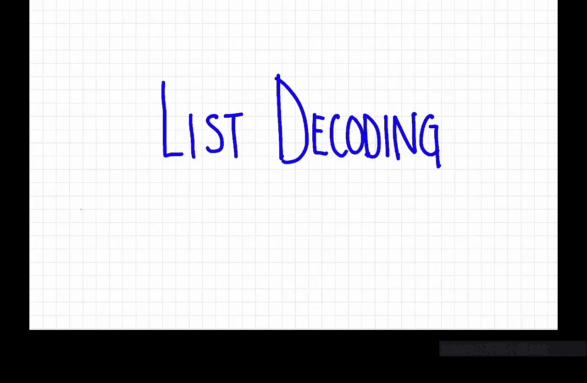
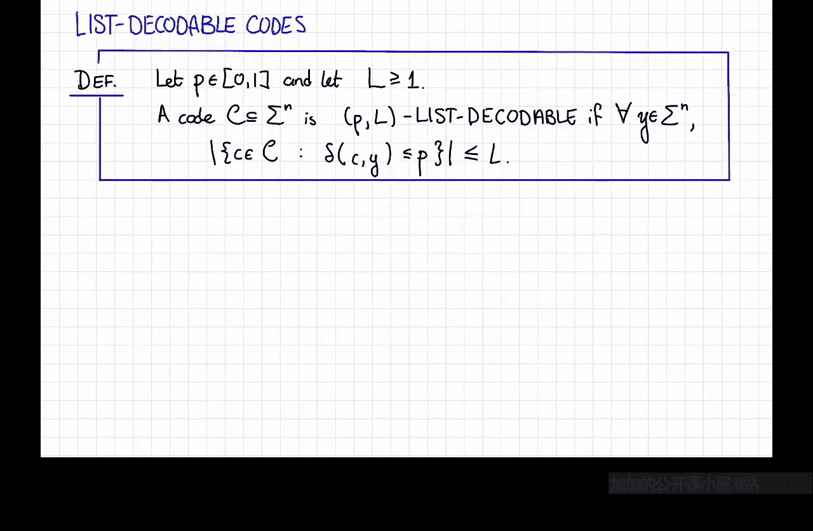
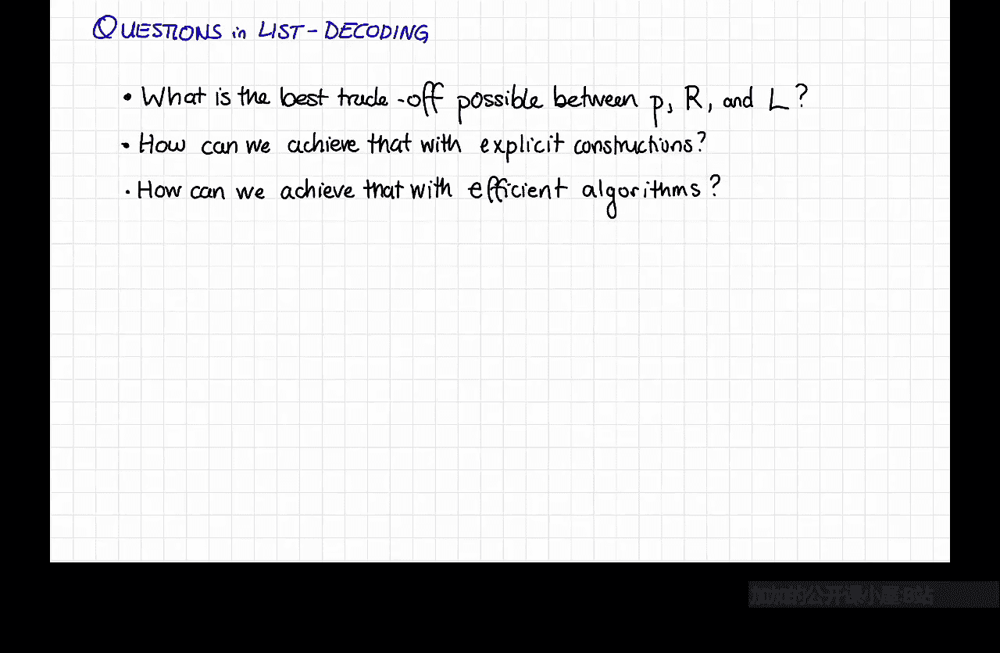
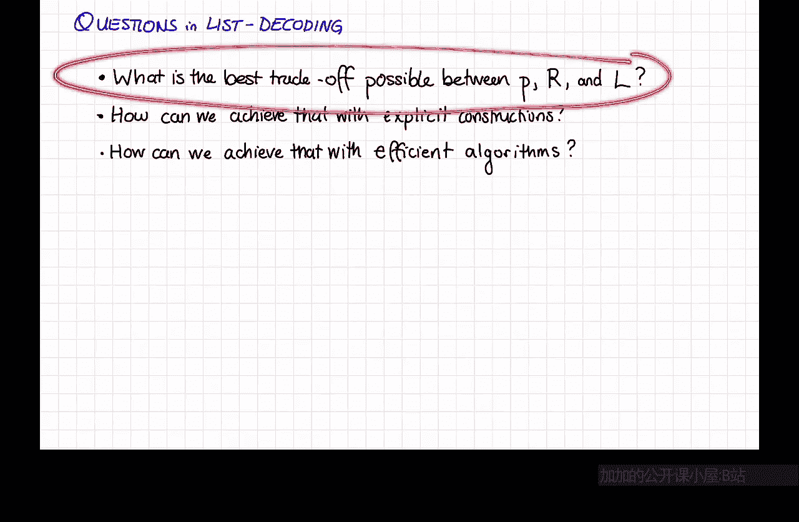

# 斯坦福大学【中英⚡代数编码导论｜Introduction to Algebraic Coding Theory】 p33 p32 10, Video 1： List Decoding -BV16sRYYTEwg_p33-

In this video， we'll introduce a new topic called list decoding。

Here's the definition of a list decodable code。

Let P be a parameter between 0 and 1， and let capital L be an integer that is greater than or equal to 1。

We say that a code C in sigma to the N。Is P comma L list dedable， if， for all Y in sigma to the N。

The number of code words， C and C。That have relative distance at most P from y。Is it most L？

In this context， we say that L is the list size。And P is the list decoding radius。

 or sometimes just radius。Okay， so what does this definition mean？As usual。

 we have both a geometric view of the situation and an Allson Bobb view。

The geometric view looks something like this。 Suppose that this is our set sigma to the end。

And here's our code， C。It's a bunch of code words insma to the end。

Then this definition says that C is list decodable or P， L list decodable。If， for any point， why。

 let's say that one in Singma to the end。If we look at the ball。

 the handing ball of radius P times n around y。Say it looks like that。

Then the number of code words in that ball。Is no more than L。

 And this should happen no matter what center why we choose。

We also have an Allison Bob view of the situation。Here we have a sender， Alice and a receiver， Bob。

And as usual， there's some noisy channel between them。

This is going to be an adversarial channel that can corrupt up to a P fraction of the symbols。

As usual， Alice has a message X that she's going to encode into a code word C。

 which she's going to send to Bob。And what Bob receives is a corrupted coat word。 Let's call that。

 why。And from this corrupted code word。Well， before Bob was supposed to be able to figure out exactly what Alice meant to say。

In list decoding， Bob is supposed to figure out a short list with the guarantee that what Alice had to say was in the list。

That is， Bob is supposed to recover a list curly O。Which is equal to x1， X 2， dott， dot up to x。

 capital L。So that Alice's true message X is in Curliio。

Notice that this geometric view here implies the Alice and Bob view， at least combinatorially。

 if we're not asking for efficient algorithms。That's because if Bob looks at his received word here。

He can construct this list curly L by just taking all of the atmost L points that live within radius P of that received point y。

List decoding generalizes the decoding situation that we've seen before。

 which I'm going to call unique decoding。In the sense that the setting we were looking at before was list decoding for capital L is equal to1。

That is。P comma 1 listed codeability。Is equivalent。To saying that the code has distance at least 2 P。

We've already studied this question how to get good distance a whole bunch。

And so you can see list decoding as a generalization of that when L becomes larger than one。Okay。

 so that's the definition of a list decodable code。 Why do we care about such a thing？

So there's a number of reasons why we care。First， as we will see later。

 it turns out that Alice and Bob can tolerate a lot more error if Bob is only supposed to return a short list。

 In some cases， they'll be able to tolerate up to twice as much error at the cost of Bob having to return a constant size list。

That's pretty useful in the unique decoding context。 For example。

 maybe Bob has some side information to help him narrow the list down。

 or perhaps especially under some cryptographic assumptions or something like that。

 Alice could send him that side information encoded as part of the code word。

But beyond communication， it turns out that list decodable codes are just really useful combinatorial objects。

They have applications in pseudo randomness， complexity theory and algorithm design just to name a few。

We may see some of these connections in later videos。

We can ask the same questions about list decoding as we did about unique decoding。

So the first question is what is the best possible trade off between P， the list decoding radius， R。

 the rate of the code and L， the list size。Second， how can we achieve good trade offs or ideally the best possible trade off with explicit constructions。

 And how can we do that with efficient algorithms， An efficient list decoding algorithm is an algorithm for Bob that given that received word Y will efficiently recover all at most L code words within the appropriate radius of y。

With unique decoding， that is when L equals one for worst case errors。

 we saw that this question was already really hard。

That is， it's still open， at least for binary codes， what the best trade off is between P and R。

 even just for L equals 1。So it might seem like we're asking for trouble generalizing this question and hoping to do better。

 But it turns out that actually， when L is allowed to be a little bit larger。

 say some large constant or slightly growing with N。

 It turns out that we can actually pin down the best possible trade off between P and R。

And it looks just like the best possible trade off for random errors that we saw in a previous video。

This result about the best possible trade off between P and R for list decoding is called the list decoding capacity theorem。

 and we will see it in the next video。