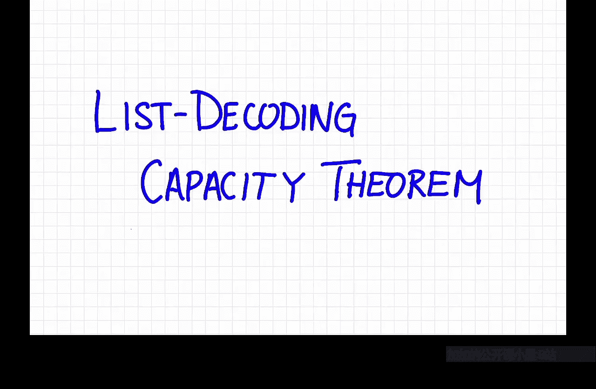
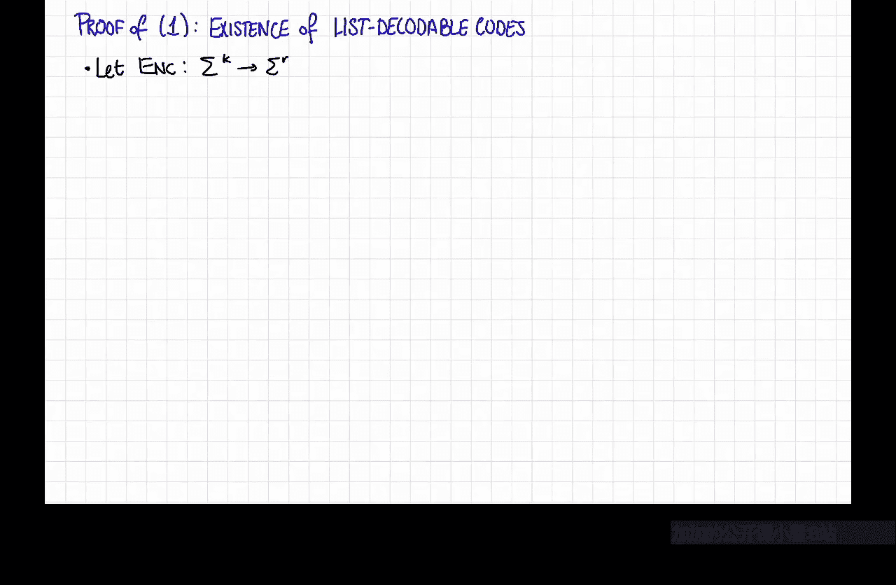
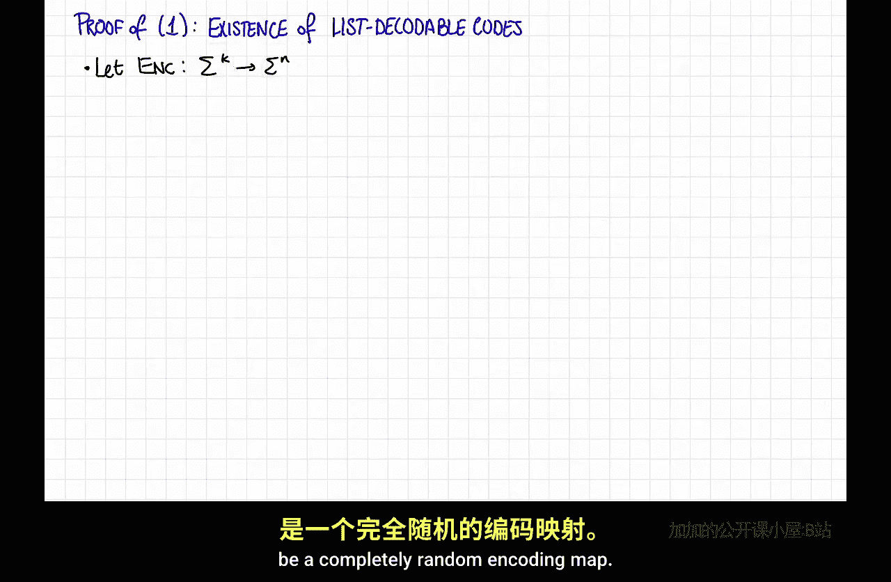
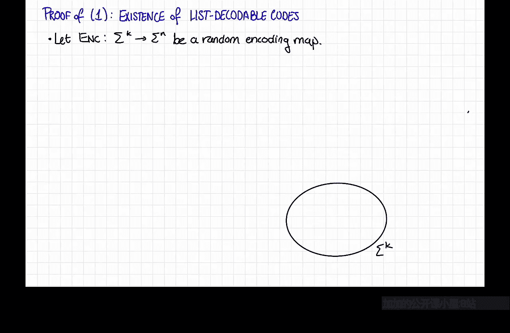
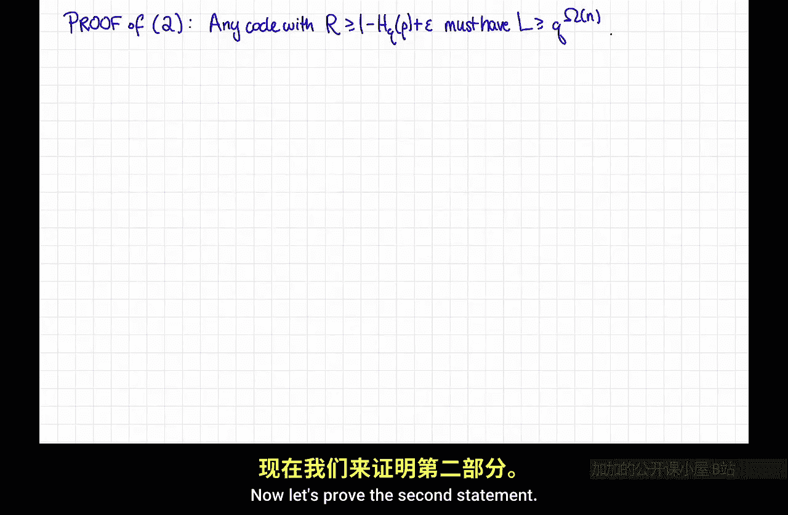
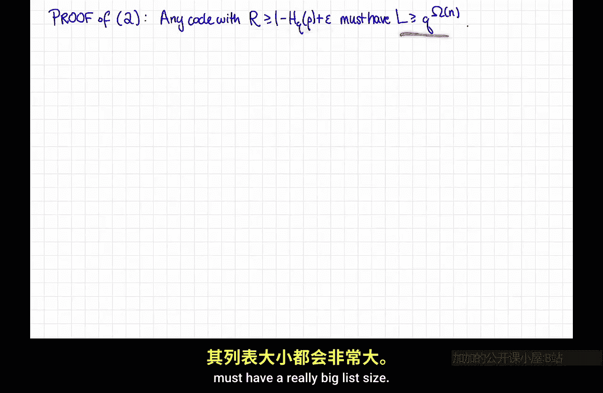
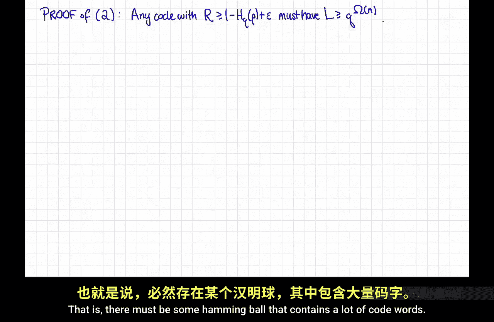
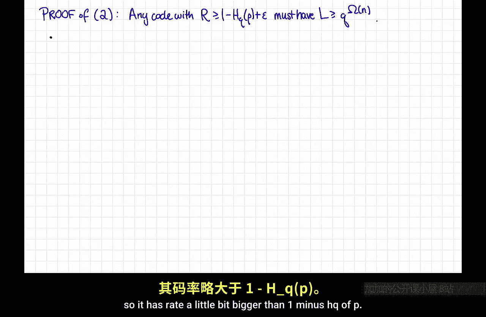
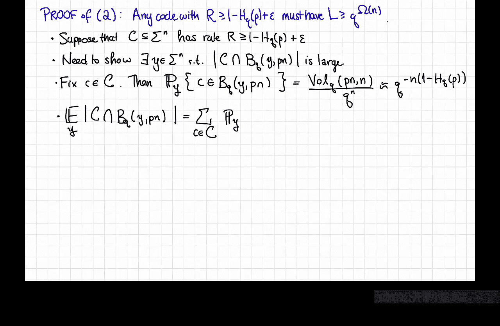

# 斯坦福大学【中英⚡代数编码导论｜Introduction to Algebraic Coding Theory】 p34 p33 10, Video 2： List Decoding Capacity Theorem -BV16sRYYTEwg_p34-

In this video， we'll see the list decoding capacity theorem。

 which pins down the best trade off between the rate R and the list decoding radius P for a list decodable code。

Informally， the list decoding capacity theorem says that the capacity for list decoding that is the best possible trade off between the rate R and the radius P。

Is R equals 1 minus the Qary entropy of P。More formally， we have the following theorem。

Let Q be greater than equal to 2。And let p be greater than 0 and less than 1-1 over  Q。

 And let epsilon be greater than 0。 Then the following two things hold。First。

 if the rate R is just a little bit less than this threshold 1 minus H Q of P。

 So say it's that minus epsilon。Then there are good list decodable codes of that rate up to radius P。

 In particular， there exists a family of Qary codes that are P comma biggo of one over Epsilon list decodable。

So P here is the list decoding radius。And this big o of one of epsilon， that's the list size。

 capital L。So this says that if the rate is not too big。

 if it's just a smidge less than this capacity here。Then there are codes at that rate。

 so that any hamming ball of radius P times N has at most big O of one of Repson code wordss in it。

On the other hand， thing 2， If the rate is a little bit bigger than that capacity。

That is 1 minus the Q R entropy of P plus epsilon。Then any list deable family。

With radius P and list size L has to have L exponentially large， at least Q to the omega n。

So the second thing is saying that if the rate is too big。

 just a little bit bigger than the capacity， then we cannot hope to have any sort of decent guarantee on list de codedability。

 We're always going to have an exponential number of code words in any hamming ball of radius P times n。

Before we prove this statement， let's interpret this quantity here。In particular。

 that might look a little bit familiar。So let's return to our plot here that we had before。 So here。

 P， the fraction of errors is on the x axis， and R， the rate is on the y axis。

And what we see is that the e listtic codingding capacity theorem 1 minus the Q area entropy of P。

 This picture is for  Q equals 2， is exactly the same as both the handing bound and Shannon's theorem for the binary symmetric channel。

So the takeaway here is that if Bob is allowed to return a short list in the setting with worst case errors。

 then Alice and Bob can do as well as they could with random errors。

 even though the errors are worst case。In particular。

 we can let P get arbitrarily close to a half and still have positive rate and have a good list decodable code。

On the other hand， the Pkin bound says that for worst case errors， if I want P to be that large。

 In fact， any larger than a quarter。Then I have no hope of being able to uniquely decode。

From a P fraction of worst case errors， at least for binary codes。

So this says that if Alice and Bob are willing to make this sacrifice to return just a little bit of a short list。

 they can get huge gains in terms of the amount of error that they can tolerate。Okay。

 so let's prove the list decoding capacity theorem。 We'll start with bullet point1。

 which says that there exist good list decodable codes。

So we're going to do this proof by the probabilistic method。

We're just going to pick a completely random code and show that with high probability。

 it does the job。So let ink， which maps sigma to the K to sigma to the N。

 be a completely random encoding map。

We would like to show that as long as the rate is a little bit less than that 1 minus the cur entropy of P。

The code C， that is the image of this random encoding map is P comma L list decodable for L not too large。

To show this， let's think about what it means to not be list decodable。

It means that the picture looks like this。So here's S to the K。

Here's Singma to the end。Our encoding map maps the one into the other。And our code C。

Which is the image of the encoding map。Is not P comm L list decodable。

If there exists some set of L plus one messages that all map into some hamming ball。

That is suppose that I have L plus1 messages here。Let's call this set Lambda。My code C。

 which is the image of this random encoding map， fails to be list decoable。

If all of these things land close to some received word why。So let's say here's why。

And here's the hamming ball around Y of radius P N。And then， let's say that all of these。

Messages here happen to map to points inside that ball。

This would mean that the code is not list decodable。

 because here's a ball that has more than L points in it。

 So what we're going to do is we're going to compute the probability。Over this random encoding。

That this happens。And then we're going to show that it's unlikely that it happens for any lambmbda。

And that will mean that the code is listeddable with high probability。In more detail。

 let's fix such a lambda。And let's pick such a why。Now。

 let's compute the probability that this bad event happens。

So the probability that the encoding of the set lambmbda lives in。

The hemmingball about Y of radius PN。Okay， so the probability that any one of these points ends up in this ball is just the volume of the ball divided by the volume of the whole space。

And since the encoding map is completely random。The event that this guy lands in the ball and the event that this guy lands in the ball and this one and that one and so on are all independent。

 So I can compute the probability that all of these land in the ball by just raising this probability to the L plus one。

And now we can use our handy dandy approximation of the volume of hammmingballs。

To say that this is less than or equal to 2 to the minus n。Times 1 minus the Qary entropy of P。

All times L plus1。Okay， so that's the probability that this bad event happens for a fixed lambmbda and for a fixed y。

Now we need to union bound over all such lambdas and all such whys。So， the probability。

That there exists such a lander and a why。Such that this bad event occurs。Okay。

 so this is at most by the Union bound。Q to the K， choose L plus 1。

That's the number of possible sets， Lambda。Times cud the n。

That's the number of possible ys times this probability here。

Now I'm going to bound this binommial coefficient here。By Q to the K。

 choose L plus 1 is less than or equal to the Q to the K times L plus1。

And I'm also going to use the fact that K is equal to r times n。To bound this whole thing。

By Q to the n。Times。R plus  one。Mus H Q of P。All times L plus 1。Plus， one。Now。

 we can use our assumption that the rate is not too large。To say that this thing is at most。

Q to the n。Times 1 minus epsilon times L plus 1。And this is Q to the minus big omega of n provided that L is big enough。

In particular， we can take L to be big O of one of Repson and still have L B big enough。

So we conclude that a random code C is P comma L with decodable with high probability。

 and in particular， such a code exists。So that proves statement  one of the list codinging capacity theorem。

Now， let's prove the second statement。 We need to show that any code with slightly too large a rate must have a really big list size。

 That is， there must be some hamming ball that contains a lot of codes。

So let's suppose that C is such a code， so it has rate a little bit bigger than 1 minus H Q of P。

And we need to show that there exists some y。 so that the hamming ball of radius P N about Y has a lot of code words in it。

Our strategy is once again the probabilistic method。

 We're going to choose a random Y and show that in expectation， this quantity is big。

That will apply that there exists So why so that this quantity is big。To do that。

 let's consider fixing some particular codeword and C。Now。

 let's compute the probability over choosing a random Y。That sea。Lives in this hanging ball。Here。

 C is fixed， and the centre of the hamming ball is random。

 but we might as well think about it the other way around。

 We might as well think about the hamming ball as being fixed and C as being random。

 So then the probability that this occurs is once again。

 just the volume of that hamming ball divided by the volume of the entire space。And as before。

 this is approximately。Q to the minus n times the1 minus the  QR entropy of P。Okay。

 so that's just for a single code word。But now we can use this， along with linear of expectation。

 to compute the expectation of this quantity。We have that the expected number of code words that happened to live in that handming ball。

Where the expectation is over a random why。Is by linearity of expectation， the sum。

Over all code words in the code。Of the probability over why。

That sea lives in that haming ball。Which we just computed is approximately size of C times Q to the minus N 1 minus Q orenttropy of P。

n， how large is C。C has size Q to the K， which is Q to the R N。

 And we've assumed that R is at least this large。So， this is， at least。Q to the n。

Times 1 minus H Q of P plus epsilon。Times Q to the minus n1 minus H Q of P。Now stuff cancels。

 and this is just equal to Q to the epsilon N。Which is indeed Q to the omega n。

Which is what we claimed。So this shows that in expectation over Y the hamming ball centered at Y contains exponentially many code words。

 and in particular， such a y must exist。So that proves part 2。And that proves the entire theorem。

Okay， so we've just shown the list decoding capacity theorem， check。

The lististic coding capacity theorem tells us what the right trade off between the rate R and the error radius P is for lististic codingding。

 assuming that the list size is a large enough constant。However， as we just saw。

 the proof was definitely not constructive and does not come with efficient algorithms。

In the next video， we will start to address the question of how we can achieve this or at least something non trivialvial with explicit constructions。

