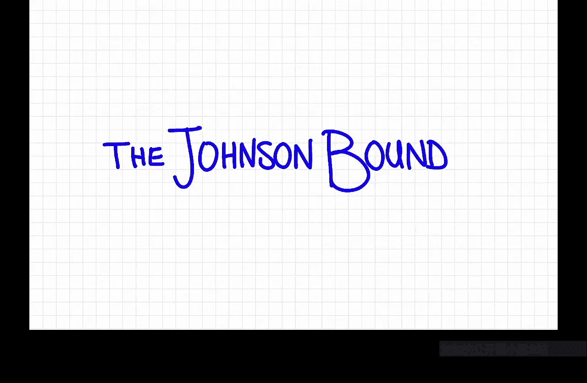
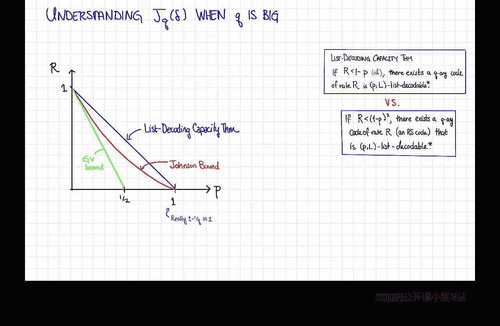

# 斯坦福大学【中英⚡代数编码导论｜Introduction to Algebraic Coding Theory】 p35 p34 10, Video 3： The Johnson Bound -BV16sRYYTEwg_p35-

In this video， we'll see the Johnson Bo， which states that any code with good distance is decently list decodable。

So here's what the Johnson bound says。Let J sub Q of Delta be equal to this quantity。

1-1 over  Q times 1 the square root of 1 minus Q delta divided by  Q -1。Now， let's see。

Subet of sigma to the N be a code with alphabet size Q that has relative distance， at least Delta。

Then， the theorem says。If P our list decoding radius is less。Than this quantity， J Q of Delta。

Then C is list decodable with radius P and list size Q times delta times n squared。So qualitatively。

 what the Johnson bound is saying is that if a coat has good distance。

 then it has good list decodability。Indeed， we notice that this quantity。

 which is called the Johnson radius， is increasing in Delta。So qualitatively。

 what this means is that as deelta gets bigger， then this radius P。

 for which we have a decent guarantee on the list size， is also getting bigger。

Notice that maybe we might hope for a better list size than n square。

 We might hope for constant or something like that。 But for us。

 we're going to call anything polynomial in N a decent list size。Okay。

 so that is qualitatively what the Johnson bound says。Quantitatively， though。

 it's a little bit hard to parse this expression。Looks a bit gross。For the rest of this video。

 we will try to quantitatively compare the Johnson bound to the list decoding capacity theorem that we saw in the previous video。

We're not going to prove the Johnson bound in these videos。

 There are actually a lot of different proofs of the Johnson bound。

 You can check out the lecture notes for some pointers to those proofs。But for now。

 let's focus on understanding what this quantity is and how it compares to what we know already。

Let's start with a binary case。 That is when Q equals 2。In this situation。

 the etic code and capacity theorem says this。 It says that when the rate is less than one minus the binary entropy of P minus sum epsilon。

Then there exists a binary code of rate R that is P commma L list decodable。

And there's little asterisk here， which says for reasonable L。So in this case。

 L was big O of one of Repsilon， but for this quantitative comparison。

 I really want to focus on the trade off between P and R。

 So I'm not going to care too much about the list size。

 I'm just going to say we'll call the list size reasonable if it's polynomial and everything in sight。

And then I'll just put this little asterisk here。 Just say list equitable。Okay。

 so that's what the list decoding capacity theorem says for binary codes。 The Johnson bound。

 instantiated for binary codes， says that if P is less than the Johnson radius。

 which happens to be1 half times 1 the square root of 1-2 delta when  Q equals 2。

Then any binary code of distance Delta is P comma L lististicoiddable。Again。

 for some reasonable list size L。Unfortunately， it's not directly obvious how to compare these two things。

This says that if the rate is small enough， there exists aisticoiddable code。

 And this says that if the distance is big enough， then there exists aisticoidable code。

So in order to compare these， let's turn the Johnson bound here into a statement about rate。

One thing we can do is plug in the best statement about rate that we know。

 namely the Gilbert Vsashov bound to get a statement of the form。 If the rate is small enough。

 then there exists。 a lististicoidable code。So here， let's plug in the Gilbert Vshov bound。

So the Gilbertbarshov bound says that there exists a code of rate 1 minus the binary entropy of Delta。

 or in other words， that there exists a code where Delta。Is H2 inverse of 1 minus the rate。Then。

 this says。If P is less than one half。Times 1 minus the square root。Of 1-2。Times this quantity。

Then there exists a binary code of rate R。That is P comma L list decodable。

For a reasonable list size L。Okay， almost there。To make this statement look a little bit more like this statement。

 Let's just solve for R。When we do that， we get the following。

If r is less than1 minus the binary entropy of 2 p times 1 minus p。

Then there exists a binary code of Ra R that is P comma L list decodable for reasonable list sizes。

And now， these two statements。We can directly compare。Cause they're both of the form。

 If the rate isn't too big， then there exists a lististic codeable binary code of that rate。

Let's plot these two curves next to each other。When we plot both of these trade offs together。

 we get something that looks like this。So here's the trade off that we get from the listed coding capacity theorem。

That's this one minus binary entropy of P。And here's the trade off that we get from the Johnson bound。

That's this one minus binary entropy of 2 p times 1 minus p。We see that， as expected。

 the Johnson bound is worse than the listtic codingd capacity theorem。

 It can't be better because the list coding capacity theorem was both an existence result and an impossibility result。

But the Johnson bound does let us take P。 the list deco codingding radius all the way up to a half and still get positive rate。

 just like the list decoding capacity theorem did。Moreover， the Johnson bound is， in some sense。

 more general because it's not just an existence result。 It gives us a hint of how to achieve it。

 We just need to come up with a code of good distance。Okay。

 so that's what the situation looks like for Q equals 2。 How about for larger Q。For larger Q。

 we can repeat this exercise。So now think of Q as growing。

 maybe greater than equal to n In this parameter regime。

1 minus the cur entropy of P is approximately 1 minus P。 And this Johnson radius。

Which is actually equal to this thing is approximately1 minus the square root of 1 minus Delta。

To get that， I basically said， O，1 over  Q， That's basically 0 and  Q divided by  Q -1。

 That's basically one。In this setting， the list decoding capacity theorem says that if R is less than1 minus P。

Which is approximately 1 minus H Q of P when  Q is big。

Then there exists a Qary code of rate R that is P comma L list decodable with reasonable list sizes。

On the other hand， the Johnson bound says that if P is less than this approximate Johnson radius thing。

1 minus the square root of 1 minus delta， then any Qary code of distance Delta is P comma L list decodable with reasonable list sizes。

Once again， it's not immediately obvious how to compare these two things。

Cause this is in terms of rate， and this is in terms of distance。

But we can use the Johnson bound to get a statement that is comparable to list codingding capacity theorem by plugging in a code with good distance。

In this case， when Q is large， we don't need to appeal to the Gilbert Vrashov bound。

 We actually have codes that have the best possible trade off between rate and distance。

 When Q is large。 Those are read Solomon codes。 So let's go ahead and plug in read Solomon codes to the Johnson bound and see what we get。

This says that， if P。Is less than one minus the square root of R。

Remember that for read sallomon codes，1 minus delta is equal to R。

Qary reads settlementmon codes of rate R R P comma L list decodable with reasonable list sizes。

And once again， we can solve for R to get something that's more directly comparable to the e coding capacity theorem。

In particular， we get that if R is less than the square of 1 minus p。

Then there exists A Q A code of rate R， or reads Solomon code。

 That is P comma El lististic codedable。For reasonable list sizes。Once again。

 we can plot these trade offs。So here's the list of coding capacity theorem for large Q is just a straight line。

And here's what the Johnson bound looks like。Once again。

 we see that the Johnson bound is not as good as the listtic codinging capacity theorem。However。

 it does have some good things going for it。So first。

 it shares the property of the list codingd capacity theorem that it guarantees list de codedability all the way up to P equals 1-1 over Q。

 which looks like one on this plot， because we think that Q is really， really big。Additionally。

 the list de decoding capacity theorem was non constructive。 We took a completely random code。

 while for large queue。The codes that live here on the Johnson bound。

Are just our old favorites read Solomon codes。 So we have explicit constructions here on the Johnson Bo。

Next time， we will see how to efficiently list a code read Solomon codes。Up to this point。

