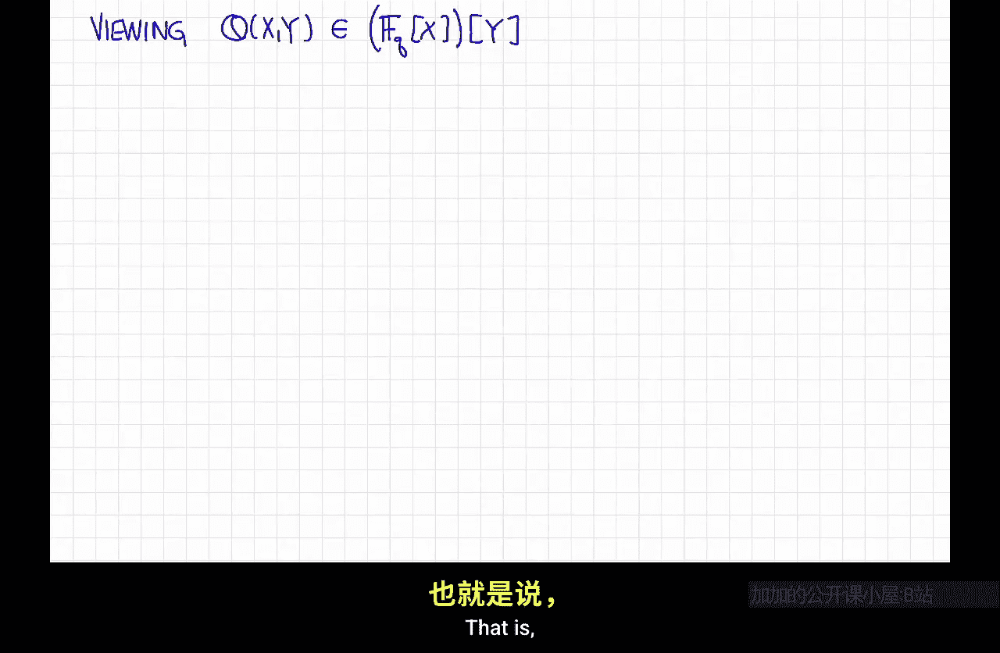
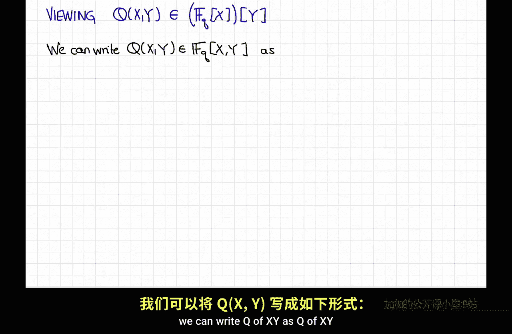
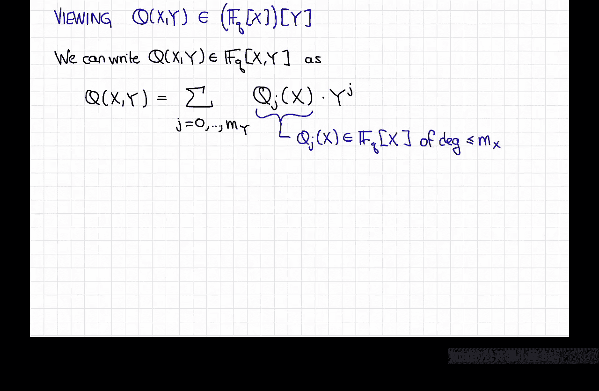
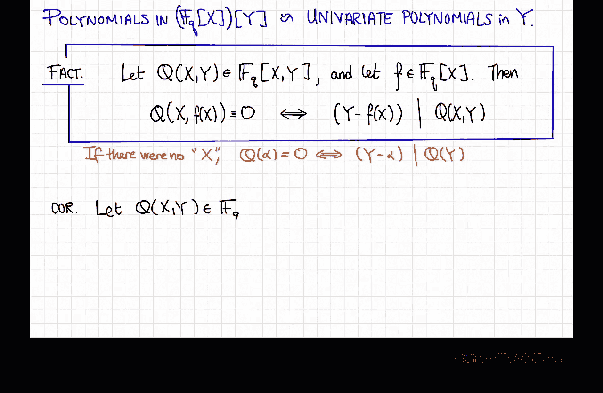

# 斯坦福大学【中英⚡代数编码导论｜Introduction to Algebraic Coding Theory】 p36 p35 11, Video 1： Useful facts about bivariate polynomials -BV16sRYYTEwg_p36-

In the next few videos， we'll be looking at algorithms to list， Decode， read Solomon codes。

Before we do that， we will need to record a few useful facts about bivariate polynomials。First。

 what is a bivariate polynomial。 Okay， well， a bivariate polynomial over the field FQ is。

A bivariate polynomial over the field FQ。That is， it's a polynomial Q in two variables， X and Y。

And we use this notation F sub Q square brackets X Y to denote the set of all such vivariate polynomials over FQ。

 And these are just polynomials of this form。So that is， it's the sum。

Over I and J of some coefficient alpha I J that lives in F Q times the monoial x to the I Y to the J。

Some jargon， we say that the x degree of Q is MX。 That's the maximum of this sum here。

 It's the maximum degree on x that appears in the polynomial。The Y degree similarly is M。

 the maximum degree on Y that appears in the polynomial。

The degree or total degree of a mononomial x to the I Y to the J is just I plus J。

 And the degree or total degree of the whole polynomial Q is just the maximum total degree of any mononomial that appears in Q。

So for any bivariate polynomial Q of X， Y over Fq。We can actually view this as a univevariate polynomial in y。

 whose coefficients are themselves Uniivevariate polynomials in X。 That is， we can write Q of x， Y。

As Q of X， Y is equal to the sum。

From J equals0 up to M sub y。Of Q sub J of x。Times Y to the J。Were this Q subj of x。

Is a Uniivariate polynomial in x？Of degree at most MS of X。

Just as a quick example。If Q of x comm a y。Is equal to， say， x squared minus y times x minus y。

So we can expand this out。And get a sum of a bunch of monoials。And if we want， we can group together。

The terms， according to the powers of why。To say that this is equal to。Excused。Times y to the0。Plus。

Minus x， minus x squared。Times y to the one。Plus1 times y squared。

And so these are the Uniivariate polynomials in X that are the coefficients of this polynomial when viewed in this space。

It's sometimes useful to think about bivariate polynomials as univariate polynomials with coefficients that are themselves univvariate polynomials。

Because nice things happen for unvariate polynomials。

 and those same nice things can happen for bivariate polynomials when viewed in this way。

In particular， here's a true fact。 Suppose that Q of X， Y is a bivariate polynomial over F Q。

 and let F be a univariate polynomial in the variable X。

Then suppose that Q of x comma F of x is identically equal to 0。So by this。

 I mean that all the coefficients are equal to 0。Then the fact says that is equivalent to saying that the polynomial y minus F of x divides Q of x。

 Y as polynomials。This should look kind of familiar。

It basically says that if F of x is a root of Q of x。

 Y in the sense that when I plug in F of x for y， I get 0。

 then y minus that root divides the polynomial。We've already seen this in the case for univariate polynomials。

 So， for example， if there were no X。And we just had a univevariate polynomial in y。

 Then we know that， for example， if  Q of alpha is equal to 0。

That means precisely that y minus alpha divides Q of y。

And so this is saying that exactly the same thing is true if we replace this alpha with some polynomial in x。

To illustrate this， let's see an example。So let's say that Q of x Y is the example from the previous slide。

That was x cubed minus。X plus x squared times y plus y squared。

Now I claim that if we plug in x squared for y， we're going to get a polynomial that is identically zero。

So we get Q of x comma x squared。Is equal to x cubed， minus x cubed。Minus x to the fourth。Plus。

 x to the fourth， everything cancels， and this is just 0。

 So our fact says that x squared minus y should divide Q。

Which is true because we originally defined Q as x squared minus y times x minus y。Okay。

 let's erase this example， so I have room to write a corollary。A corollary of this fact is that。

 all right。 Mo polynomials don't have too many roots。 Yes， thank you， Polly。 Yes， so a corollary is。

Let Q of x comma Y be a bivariate polynomial over FQ。

So that the degree in y is equal to D。Then I claim that there are at most D polynomials that are quote unquote roots of this bivariate polynomial。

That is there at most d polynomials f of x over fq。

 so that q of x comma f of x is identically equal to 0。As Polly was sayinging earlier。

 this essentially means that low degree polynomials don't have too many roots。 where here。

 low degree refers to the y degree and roots refers to polynomials F of X that I can plug in to get something identically equal to 0。

 Here's a quick proof of the corollary， assuming that fact。

So suppose that there are lots of f's so that Q comma f of x is equal to 0。

Let's say that Q of x comma F of x is equal to 0 for d plus1 different values of I。Then by the fact。

 that implies that the polynomial， which is the product from I equals 1 to D plus 1。

Of y minus Fi of x。Must divide Q of X， Y。But this polynomial has degree D plus one in y。

And this polynomial has degree only D and Y， and that's a contradiction。So if you believe this fact。

 then this coroll Larry follows。Okay， so those are a few useful facts about bivariate polynomials。

 and we will use those in the upcoming videos to design list decoding algorithms for read Solomon codes。

