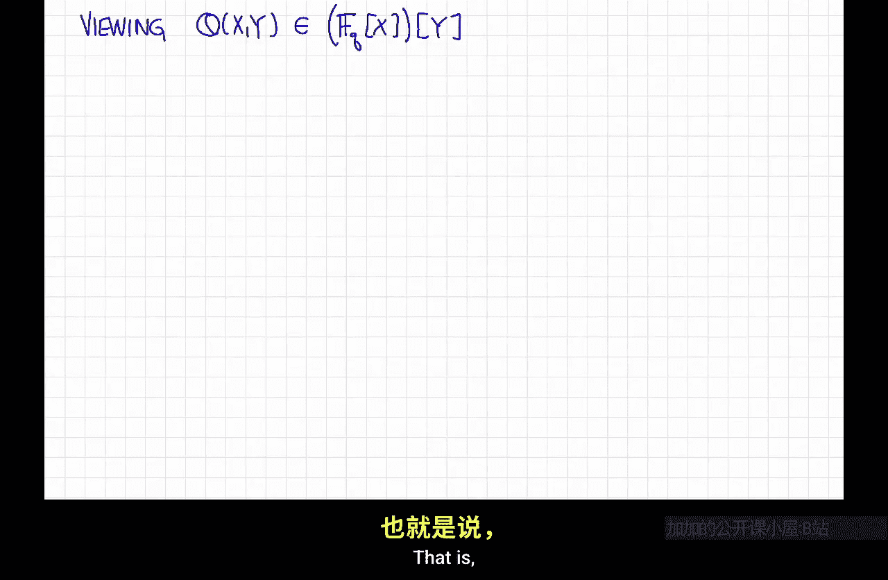
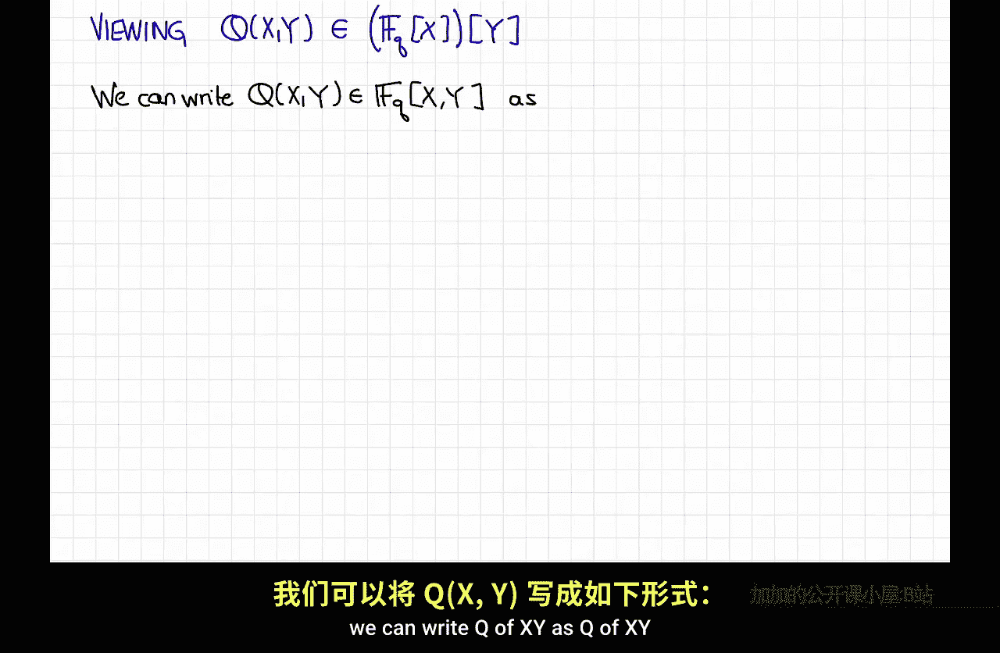
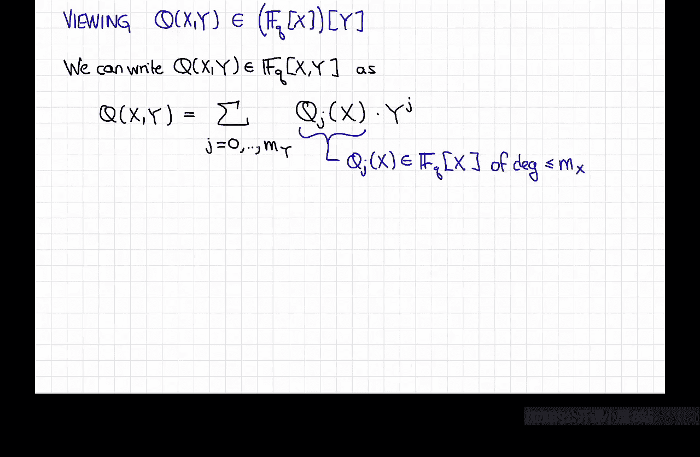
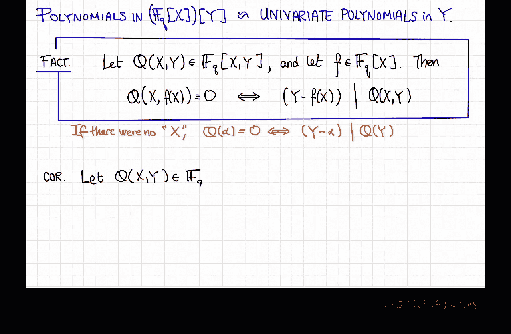

# 代数编码导论：1：关于二元多项式的有用事实 📚

在本节课中，我们将学习关于二元多项式的一些关键事实。这些知识是后续设计里德-所罗门码列表解码算法的基础。

## 什么是二元多项式？ 🤔

首先，我们来定义什么是二元多项式。在域 **FQ** 上的一个二元多项式，是指一个包含两个变量 **X** 和 **Y** 的多项式 **Q**。我们用符号 **FQ[X, Y]** 来表示所有这类二元多项式的集合。

这些多项式具有以下形式：

**Q(X, Y) = Σ α_ij * X^i * Y^j**

其中，系数 **α_ij** 属于域 **FQ**。

关于二元多项式，有几个重要的术语：
*   **X 次数 (mx)**：指多项式中 **X** 变量的最高次数。
*   **Y 次数 (my)**：指多项式中 **Y** 变量的最高次数。
*   **单项式的总次数**：对于单项式 **X^i * Y^j**，其总次数为 **i + j**。
*   **多项式的总次数**：指多项式中所有出现的单项式的最大总次数。

## 将二元多项式视为一元多项式 🔄

上一节我们介绍了二元多项式的定义，本节中我们来看看它的一个重要视角。对于域 **FQ** 上的任意二元多项式 **Q(X, Y)**，我们实际上可以将其视为一个以 **Y** 为变量的一元多项式，而其系数本身又是以 **X** 为变量的一元多项式。

也就是说，我们可以将 **Q(X, Y)** 写成如下形式：

**Q(X, Y) = Σ_{j=0}^{my} Q_j(X) * Y^j**

其中，每个 **Q_j(X)** 是一个以 **X** 为变量的一元多项式，其次数至多为 **mx**。

以下是一个简单的例子：
假设 **Q(X, Y) = (X^2 - Y) * (X - Y)**。
展开后，我们可以按照 **Y** 的幂次合并同类项，得到：
**Q(X, Y) = X^3 * Y^0 + (-X - X^2) * Y^1 + 1 * Y^2**
此时，**Q_0(X) = X^3**, **Q_1(X) = -X - X^2**, **Q_2(X) = 1**。

这种看待二元多项式的方式非常有用，因为一元多项式有许多良好的性质，当我们以这种方式看待二元多项式时，这些性质同样适用。

## 一个关键事实及其推论 🧠

基于上述视角，我们可以得到一个关键事实及其重要推论。

**关键事实：**
假设 **Q(X, Y)** 是域 **FQ** 上的一个二元多项式，**F(X)** 是一个以 **X** 为变量的一元多项式。
如果 **Q(X, F(X)) ≡ 0**（即恒等于零多项式），那么这等价于说多项式 **(Y - F(X))** 可以整除 **Q(X, Y)**。

这类似于一元多项式的情况：如果 **α** 是 **Q(Y)** 的根（即 **Q(α) = 0**），那么 **(Y - α)** 整除 **Q(Y)**。这里只是将常数根 **α** 替换成了多项式 **F(X)**。

**举例说明：**
沿用之前的例子 **Q(X, Y) = X^3 - (X + X^2)Y + Y^2**。
如果我们代入 **Y = X^2**，得到 **Q(X, X^2) = X^3 - X^3 - X^4 + X^4 = 0**。
根据上述事实，这意味着 **(X^2 - Y)** 整除 **Q(X, Y)**，这确实是成立的，因为 **Q(X, Y)** 原本就是由 **(X^2 - Y) * (X - Y)** 定义的。

**推论：**
设 **Q(X, Y)** 是域 **FQ** 上的一个二元多项式，其次数 **deg_y(Q) = D**（即 **Y** 的次数为 **D**）。
那么，最多存在 **D** 个多项式 **F(X)**，使得 **Q(X, F(X)) ≡ 0**。

这个推论可以理解为：低次（指 **Y** 的次数）的二元多项式没有“太多”的“根”（这里“根”指的是代入后使多项式恒为零的多项式 **F(X)**）。

**推论证明（基于关键事实）：**
假设存在超过 **D** 个（比如 **D+1** 个）不同的多项式 **F_i(X)** 使得 **Q(X, F_i(X)) ≡ 0**。
根据关键事实，每个 **(Y - F_i(X))** 都整除 **Q(X, Y)**。因此，它们的乘积 **Π_{i=1}^{D+1} (Y - F_i(X))** 也整除 **Q(X, Y)**。
然而，这个乘积多项式的 **Y** 次数是 **D+1**，而被除数 **Q(X, Y)** 的 **Y** 次数仅为 **D**，这产生了矛盾。因此，假设不成立，这样的多项式 **F(X)** 最多只有 **D** 个。

## 总结 📝

本节课中我们一起学习了关于二元多项式的几个核心概念和有用事实：
1.  我们定义了二元多项式及其相关术语（次数等）。
2.  我们学会了将二元多项式 **Q(X, Y)** 重新组织为以 **Y** 为变量、系数为 **X** 的多项式的一元多项式形式。
3.  我们掌握了一个关键事实：如果 **F(X)** 是 **Q(X, Y)** 的“根”，那么 **(Y - F(X))** 整除 **Q(X, Y)**。
4.  基于此，我们推导出一个重要推论：一个 **Y** 次数为 **D** 的二元多项式，最多有 **D** 个多项式“根” **F(X)**。

这些结论为后续理解里德-所罗门码的列表解码算法奠定了重要的理论基础。在接下来的课程中，我们将利用这些工具来设计具体的解码算法。