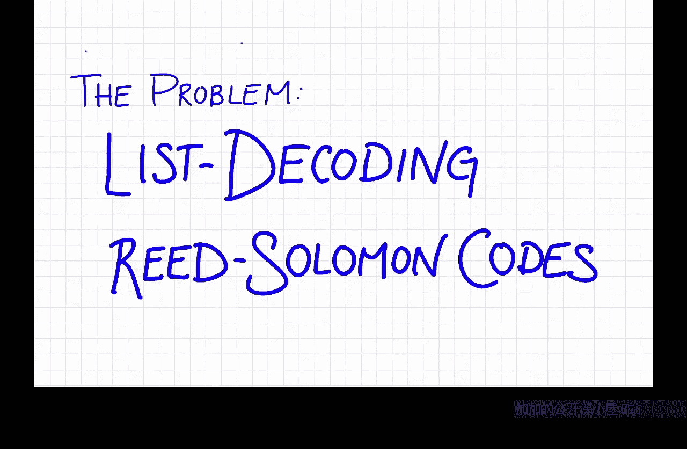
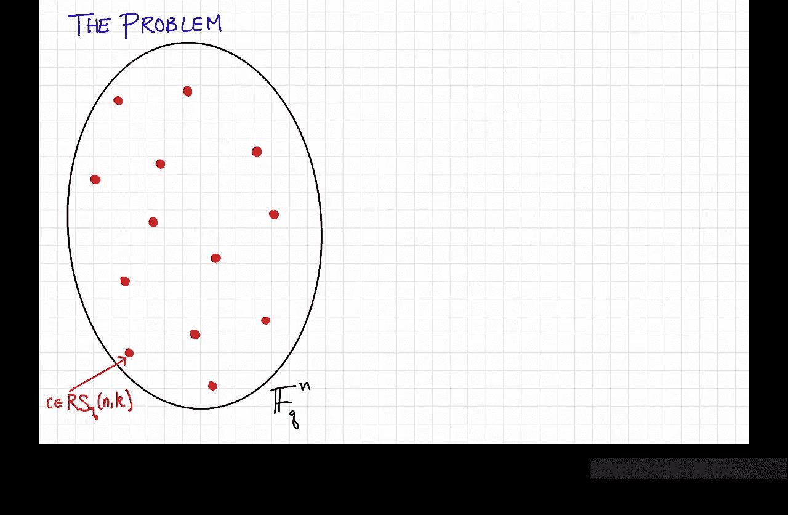

# 斯坦福大学【中英⚡代数编码导论｜Introduction to Algebraic Coding Theory】 p37 p36 11, Video 2： The Problem： List Decoding RS Codes -BV16sRYYTEwg_p37-

In this video， we'll set up the problem that we'll solve in the next two videos。

 list decoding Re Solomon codes up to the Johnson bound。

So here's the problem。Suppose that this big blob here is all of FQ to the N。

 and these red dots are the code words of some read Solomon code of dimension K and length n over FQ。

So let's C be that read Solomon code。 So C is the read Solomon code over Fq with evaluation points。

 let's say alpha 1 up through alpha n。Block length N and dimension K。

We saw in a previous video that the list decoding problem was given some y equal to y 1 dott dot up to Y N。

In F Q to the N。We would like to find all of the code words， C。

That are close enough to this received word， why。In particular。

 so that the relative hamm distance between Y and C。Is it most。Something。

 we'll come back to that in a moment。So this was the list decoding problem。

We are interested in algorithms to solve this， so we'd like to efficiently find all of those code wordss。

Okay， so what should go in this blank？Let's take a look on our picture， here。

So suppose that y is like this， there's Y。We know that if we look at a hamming ball of radius 1 minus R divided by 2。

 where R equals k over n is the rate of the code。Then there is at most one code word that lives in that ball。

That's because the distance of read Solomon code of rate R is 1 minus R。

 And if I look at a hamming ball of radius half the distance。

 I'm only going to see one codeward in that ball。The point of list decoding is that I can look at a slightly bigger ball and hope that there are not too many code wordss in that slightly bigger ball。

 So I'm going to look at a slightly bigger ball。 Maybe it looks something like this。Of some radius。

And my goal here is to efficiently return all of these code words that live in that ball when I'm given Y as input。

Okay， so how big can this ball be for us to still hope to be able to do that？

If the ball gets too big。Then at some point it's going to contain exponentially many code words。

 we can't really hope for an efficient algorithm， a polynomial time algorithm to return exponentially many things because it would take an exponential amount of time just to return the output。

So we should focus on a radius where we know that there's only at most a polynomial number of points in the ball。

You might recall from a previous video that the Johnson Bo gives such a radius。

So the Johnson bound says if we look at a radius 1 minus the square root of R。

Then we are guaranteed that there are at most a polynomial number of code wordss in this ball。

So that sounds like a good goal to start with。 So that's going to be our goal for the next couple of videos。

 We're going to put one minus the square root of R here。And try to solve this problem。

That is given why this center here。Let's look at this ball of radius 1 minus root R in relative hamming distance。

And we want to efficiently return all of these points。

We can phrase this problem equivalently in terms of polynomials。So equivalently， if we're given why？

We'd like to efficiently find all of the polynomials of low degree that agree a lot with why。That is。

 we want to find all polynomials F over F Q。 so the degree is at most K -1。

 And so that F of alpha I is equal to y I for at least square root of R times n values of I。

 where R once again is k divided by n， the rate of the read solomon code。If we can achieve this goal。

We'll say that we can efficiently list a code， read Solomon codes up to the Johnson Bo。

In the next two videos， we will see how to achieve this goal。

