# 斯坦福大学【中英⚡代数编码导论｜Introduction to Algebraic Coding Theory】 p38 p37 11, Video 3： Sudan's Algorithm -BV16sRYYTEwg_p38-

In this video， we'll see an algorithm for list decoding read Solomon coats。

It's not going to get quite to the Johnson Bo， but we'll fix that later。

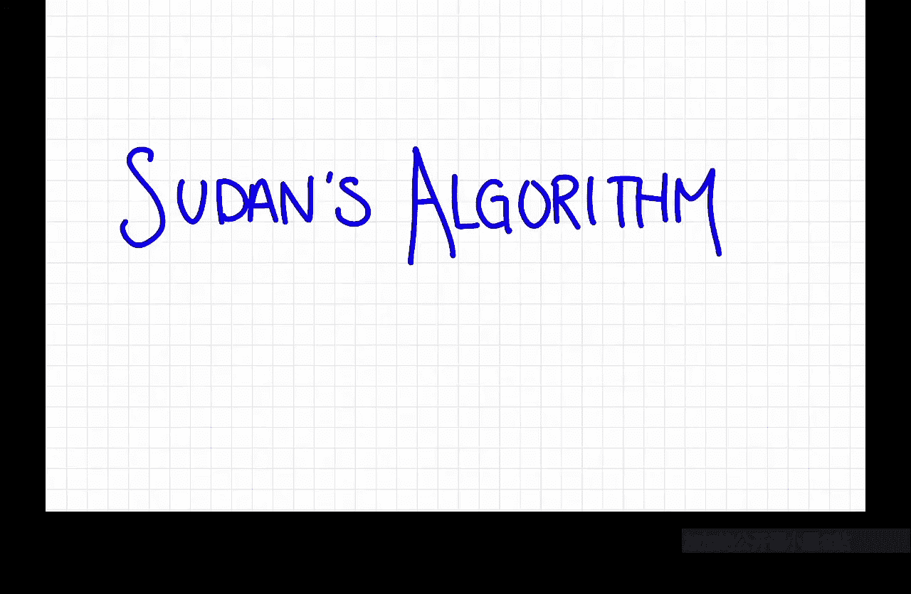

To start for some inspiration， let's recall the Burleamp Welch algorithm。

 Remember that this was an algorithm that we saw earlier for efficiently uniquely decoding read Solomon codes up to half their distance。

 So suppose that we have some read Solomon code。Remember that this is how the Burough Camp Well algorithm worked。

 If we were given some receive word Y in F Q to the N。The first step was to find some polynomials。

 E of x and B of x over FQ of appropriate degrees。So that this holds for all I N N。

 That is so that E of alpha I times y I is equal to B of alpha I for all I and N。

Recall here that E of x is meant to be the error locator polynomial。

 so it vanishes whenever Y I disagrees with the correct answer F。

And B of X is meant to be F of X times E of X。 If you recall in the previous video， B was called Q。

 But I'm going to want us to name something else Q shortly。 So I've renamed it to B。 Sorry， Okay。

 so that was step 1。 We did some polynomial interpolation to find these polynomials。

And then we returned F of x， which we proved would always be equal to B of x divided by E of x。

 no matter what B and E we came up with。To give us some inspiration for how to generalize this。

 to list decoding， I'm going to recast this algorithm in terms of bivariate polynomials。

So here's an equivalent algorithm。Once again， we're given some Y in F Q to the N。

And now our first step is going to find a bivariate polynomial。Of appropriate degrees。

Whatever that means， we'll come back to that in a moment。So， that。

Q of alpha I comma Y I is equal to 0 for all I from one to n。Here we're thinking of Q of x Y。

As supposed to be being e of x times y minus b of x。

And this tells us what of appropriate degrees is supposed to mean。It means that we should choose。

Q of X， Y of the form， some polynomial and X times Y plus some other polynomial and X。

 where these polynomials should have whatever degrees they were supposed to have over here。Okay。

 so that's step one。Then， step 2。Is to find。Some polynomial f of x over Fq of degree at most k -1。

So that Q of x comma F of x。So this is a univariate polynomial in x。

 I want this polynomial to be identically equal to 0， meaning that when I expand it out。

 all of its coefficients are equal to 0。And once we find that F of x， we're going to return it。

So notice that if f of x happens to be b of x divided by e of x。Where B and E are。

 as they were over here。And further， if Q of X， Y is what it's supposed to be， then indeed。

 this is going to be true。That is Q of x comma F of x is going to be identically equal to 0 if we got the right Q。

Okay， so this is just a slightly different way of looking at the same algorithm or a very similar algorithm。

And we showed that this algorithm， or at least this version of it。Works to uniquely decode。

 read Somon codes efficiently up to half their distance。It turns out that this view of it。

Can also be adapted to do list decocoding。The key is that this byvari view here is going to give us a little bit more flexibility。

 So instead of picking Q to have a very， very particular form。

 we're going to allow a little bit more flexibility in Q。

And it turns out that's going to help us list a code。We'll see the details of that in a moment。

But first， let's see what we can get out of it。 So this is called Sudan's algorithm。

So here's a theorem。Let alpha1 through alpha n be distinct evaluation points in F Q and fixed parameters n in K。

Then there is a polynomial time algorithm， Sudan's algorithm that we'll see on the next slide。

So that given an input Y and F Q to the N。It returns a list curly L。

That contains all of the polynomials F of x over F Q。 So that F agrees with y in a lot of places。

 in particular， so that F of alpha I is equal to Y I for greater than two times the square root of N K values of I from one to n。

Okay， so before we see the algorithm or prove the theorem， let's parse this expression there。

 So I claim that this doesn't quite get us to the Johnson bound， but it gets us somewhat close。

So in particular， this means we can list decode up to a radius。P， which is equal to okay。

1 minus the relative agreement。So， that's  one minus。To root N K divided by N。

 I just normalizing by dividing by n。And this is equal to 1-2 times the square root of R。

 where R equals K over n is the rate of the read Solomon code。

 So recall that we wanted 1 minus the square root of R。

 That would be the radius that the Johnson bound gives。

But let's take this for now and in the next video we'll see how to improve on it。

So for the rest of this video， we'll see how to achieve this result。Also。

 just note that in this theorem， since the algorithm runs in polynomial time。

 this list that it spits out better have polynomial size as well。

We'll see when we do the proof exactly what that list size is going to be。Okay。

 so here's the algorithm。So we're given as input some Y and F Q to the N。

 And then the algorithm has two steps， just like we discussed before for the bivariate version of the Welch Burlec algorithm。

So step1， the interpolation step is as follows。We're going to find some bivari polynomial Q of X， Y。

 so that the x degree of Q is at most L。And the Y degree of Q is at most n over L。

Where here L is a parameter that I'm going to set equal to square root of n times K for the rest of this video。

And we also want Q to have the property that Q of alpha I comma y I is equal to0 for all i from1 to n。

Notice that the difference between this and the bivariate version we had for the Burlac Welch algorithm is that the structure of this cu can be much more lax。

 it's anything with x degree and y degree not too large。This condition is exactly the same though。

The second step called the root Find step。Is exactly the same as it was that we saw before。

 We're going to return all F in Fq of x so that Q of x comma F of x is identically equal to 0。Okay。

 so that's the algorithm。At this point， you might have a few questions。So， the first question is。

How do we do step 1。That is， how do we find this polynomial cu if it exists at all？

Question two is first， how do we do step two and also why is that a good idea？That is。

 if we knew how to find all the F's so that this were true。It's not at all clear。

 or at least it's not a priori obvious to me why this particular list of Fs is going to solve our problem。

So we're going to answer these two questions， starting with the first one。Okay。

 so how do we do step one， if you haven't figured it out already。

 pause the video now and think about it for a second。

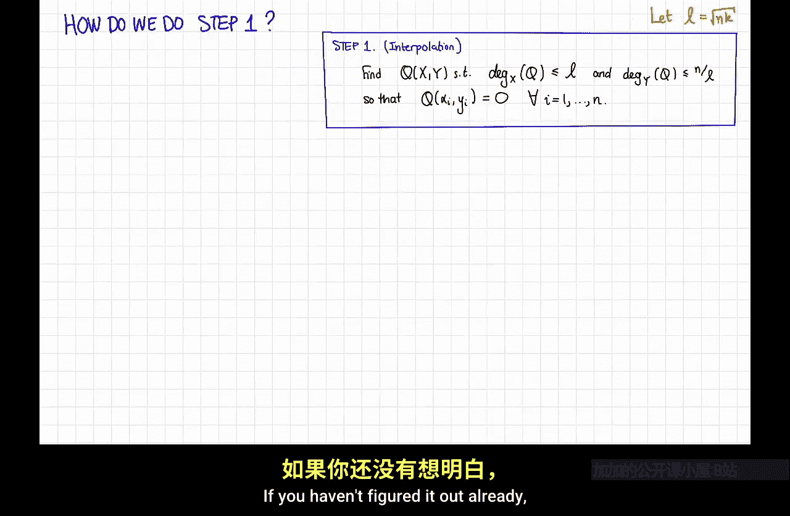

Okay， so we're going to do exactly the same thing we did to solve step1。

 the interpolation step for the Burley Camp Welch algorithm when we talked about it earlier。

 we're going to do polynomial interpolation， Aka solving a linear system。That is。

 we're going to set up a linear system where the variables are the coefficients of Q。

 and the constraints are these constraints。That Q of alpha I， Y I should be equal to 0 for all I。

As long as the number of variables is more than the number of constraints。

 there exists a non trivial solution to this problem。

 So let's count variables and let's count constraints。

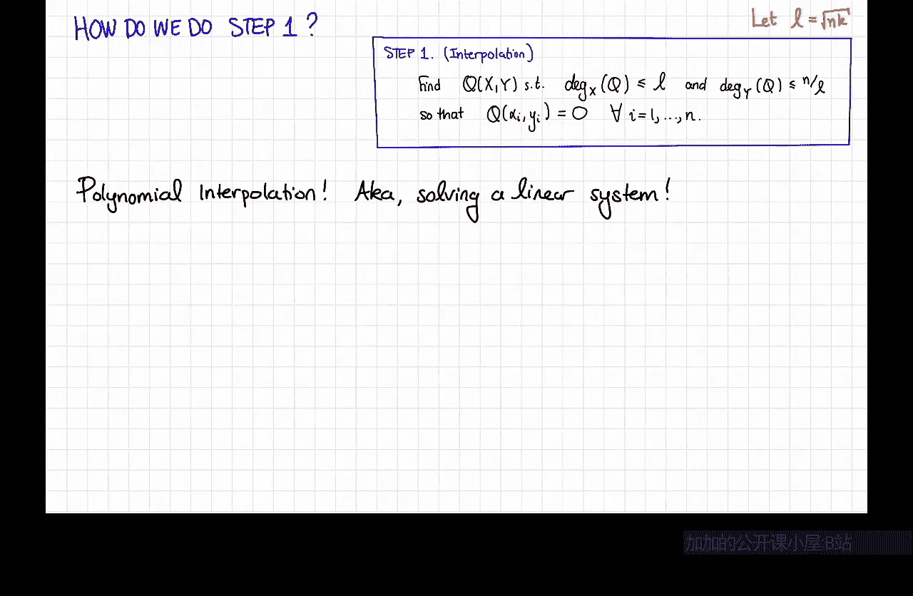

So the number of variables。In this system that we're going to set up。

 that's equal to the number of coefficients in such a polynomial Q。And that's equal to L plus1。

Times n over L plus1。That's because this is the number of monoials X to the I Y to the J。

 so that I is at most L and J is at most n minus L。 The plus 1 is because we're 0 indexing there。

 It's also okay to have x to the 0。Okay， so that's the number of variables。

 how many constraints are there？The number of constraints is n。

That's because these are the constraints and there are n of them。Okay。

 so we need number of variables greater than number of constraints。Plugging things in。

 we need L plus one。Times n over L plus1 to be greater than n。 and expanding this out， we need N。

Plus n over L plus L plus1 to be strictly greater than n。 And that's true。

That's true because all of this stuff is strictly greater than zero。Great， okay。

 so that means we can do step 1。 We just set up and solve this linear system。

 and then we can find a polynomial queue。😊，It does this。How about our next question。

Is step 2 a good idea。 We'll come back to how we would do it efficiently later。 But first。

 is it a good idea。So here's step two， the root finding step。

We're just going to return all polynomials F so that Q of x comma F of x is identically equal to 0。

 So I claim that it is a good idea， obviously， So let's see why。First。

 let's suppose that F is a polynomial that we would like to return。

That is suppose that F has degree at most K -1， and F of alpha I is equal to Y I for strictly greater than two times the square root of N K values of I。

 We want to show that our algorithm is going to return F。

 So that means that we want to show that this is satisfied。That is。

 we want to show that Q of x comma F of x is identically equal to 0。 to do this。

 Let's consider this polynomial， which is a univevariate polynomial in X。 Let's call it R of x。

Our strategy to show that R is identically equal to 0 will be a strategy that we have seen before will show that R does not have degree that is too large。

 and yet it has many roots。So to do that， let's consider the degree of R。So the degree of R。

 this is at most。

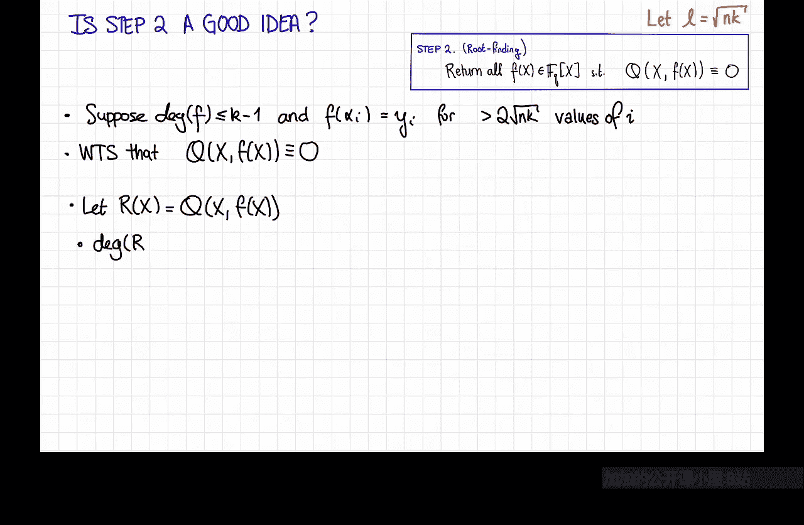

The x degree of Q。Plus， the degree of F。Times the y degree of Q。

That's just what happens when you plug in F of x for y here and compute the degrees。

And by our choice of Q and assumptions on F， this is strictly less than L plus K times n over L。

Which conveniently is equal to two times the square root of N K。Here I'm using our choice of L。

 which is squared to Ven K。And in fact， this explains why we chose L this way。

 We chose L to balance these two terms。Okay， so the degree of this polynomial R is strictly less than two times the square root of Nk。

On the other hand， I claim that it has a lot of roots。In particular。

 I claim that it vanishes at a bunch of the alpha eyes。So r of alpha I， by definition。

 this is equal to Q of alpha I times f of alpha I。And this is equal to Q of alpha I， comma Y I。

For strictly greater than two times squared N K values of I。

That's because we're assuming that F of alpha I is equal to y I for that many values of I。

 But then this thing here is equal to 0 by the definition of  Q。That is。

 we chose Q precisely so that it vanished on all of the alpha I comma Y I。So now all right。

 Mo polynomials don't have too many roots。 Thanks， Polly。 Yes。

 so since low degree polynomials don't have too many roots here we have a polynomial R of degree less than two times the squared of N K。

But it has greater than two times the squared of NK roots。

That implies that R must be identically equal to0。This shows why step 2 is a good idea。 That is。

 if F agrees with y enough， then in this step 2， we're going to return it。Okay。

 so now we know that step one can be done efficiently and step two is a good idea。

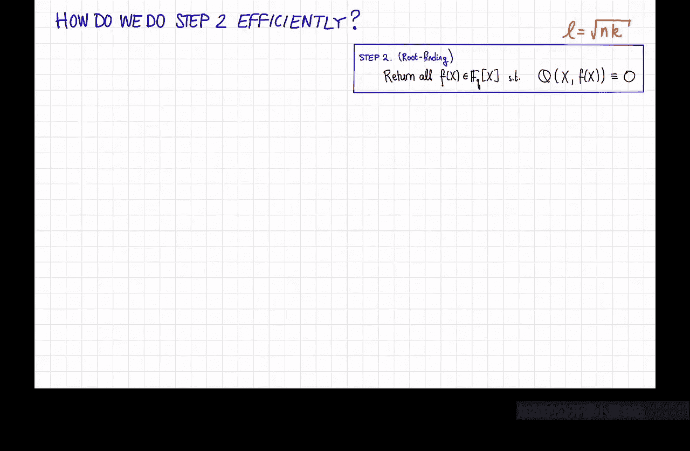

How do we do step 2 efficiently， So first， let's note that the number of polynomials F。

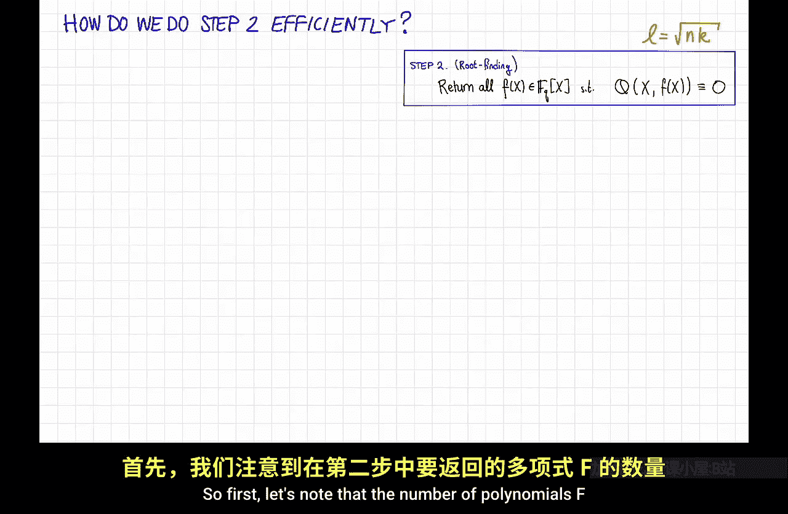

That we're going to return in step  two is not too large。

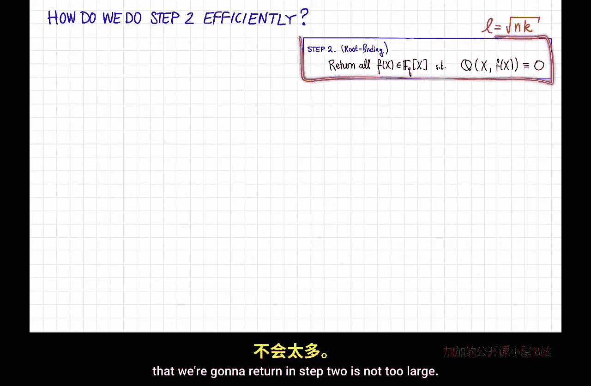

In particular， by one of the useful facts we saw in an earlier video there at most。Y degree of Q。

 which is equal to n divided by L。

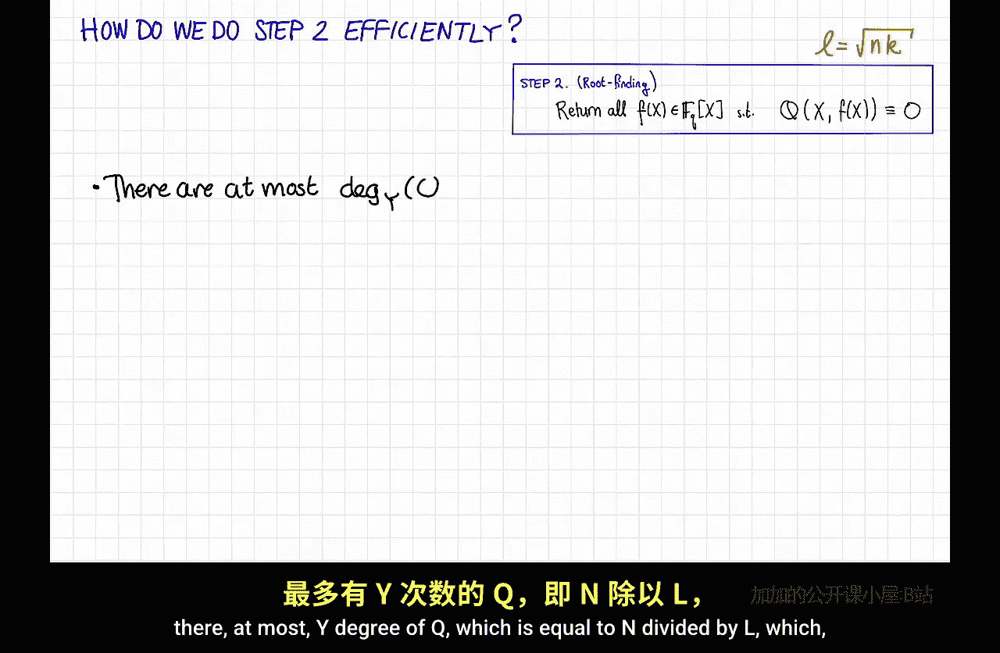

Which plugging in our choice of L is equal to root n over k。

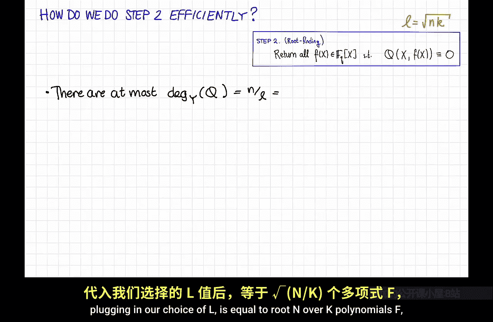

Polynomials F。

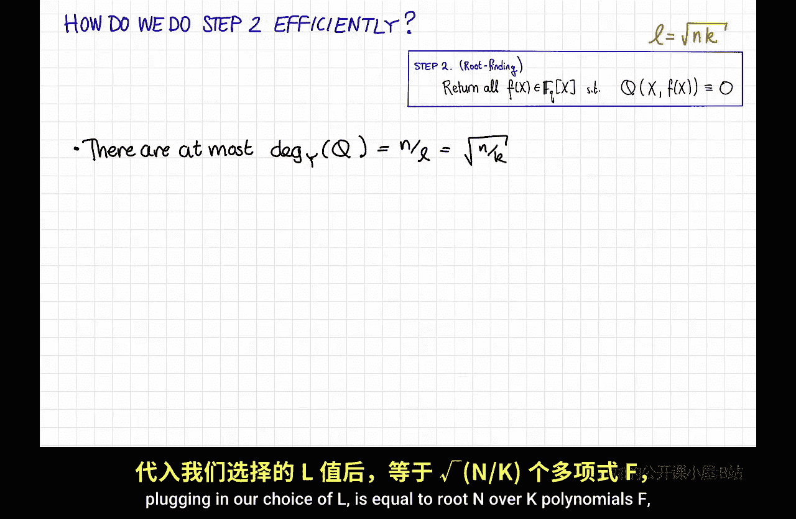

Such that Q of x comma F of x is identically equal to 0。

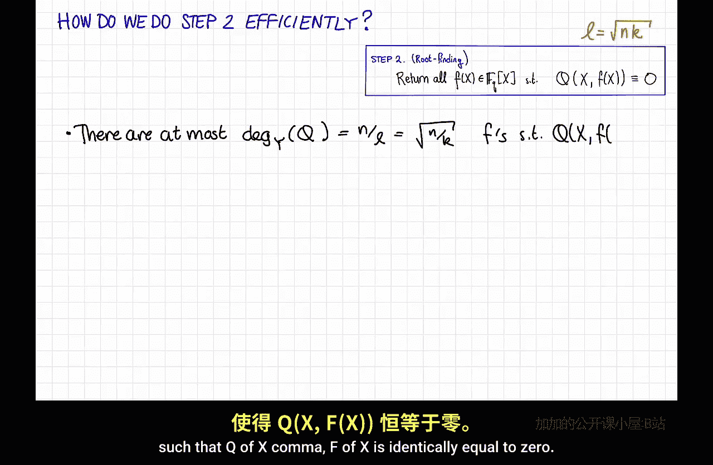

Once again， that's because low degree polynomials in Y don't have too many roots When you think of the coefficients as polynomials in F。

I guess Paully's tired。Okay， so that means that there are not too many polynomials that satisfy this requirement。

 and in particular， the list that we return is not going to be too big。In particular。

 this is just the square root of1 divided by capital R， the rate of the code。

 so if the rate is constant， the list size is also going to be a constant。Okay。

 so we're trying to find these polynomials。 We know that there are not too many of them。

 We want to be able to do it efficiently。Okay， so I'm just going to punt a little bit here and say。

 do some algebra。That is， I'm not going to talk about how to actually do this efficiently in these videos。

 but just believe me that you can， there is an algorithm that will do it efficiently。

 but if you trust me on that， that's Sudan's algorithm。It lets us list a code。

 read Solomon codes well beyond half the distance up to a bit less than the Johnson found。

In the next video， we'll see how to improve on this idea to get all the way up to the Johnson Bo。

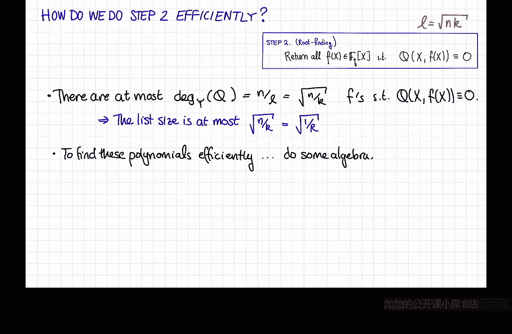