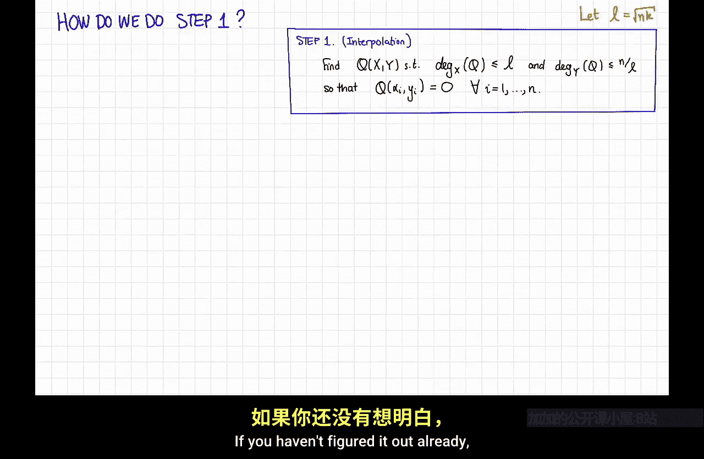
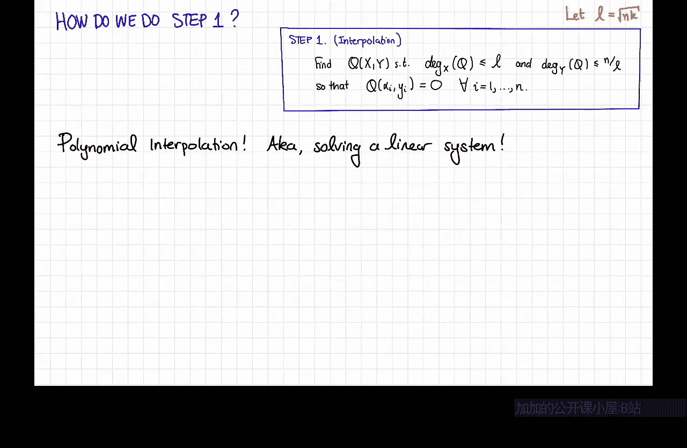
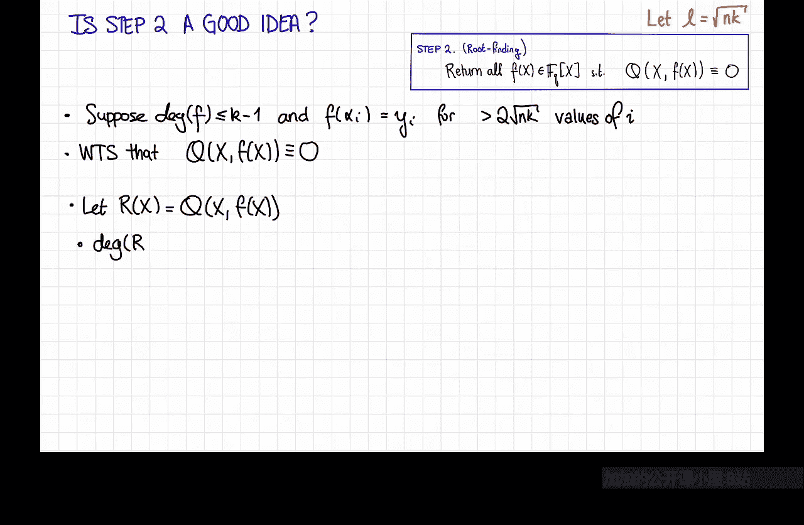
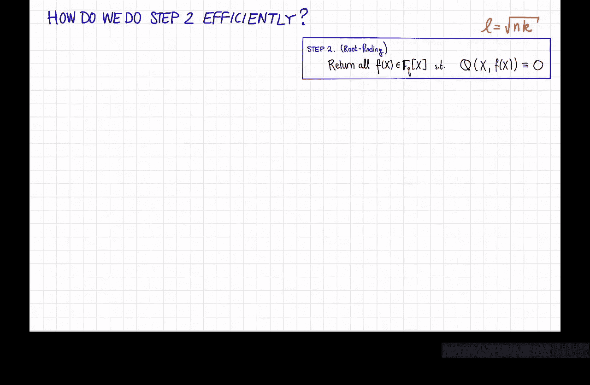
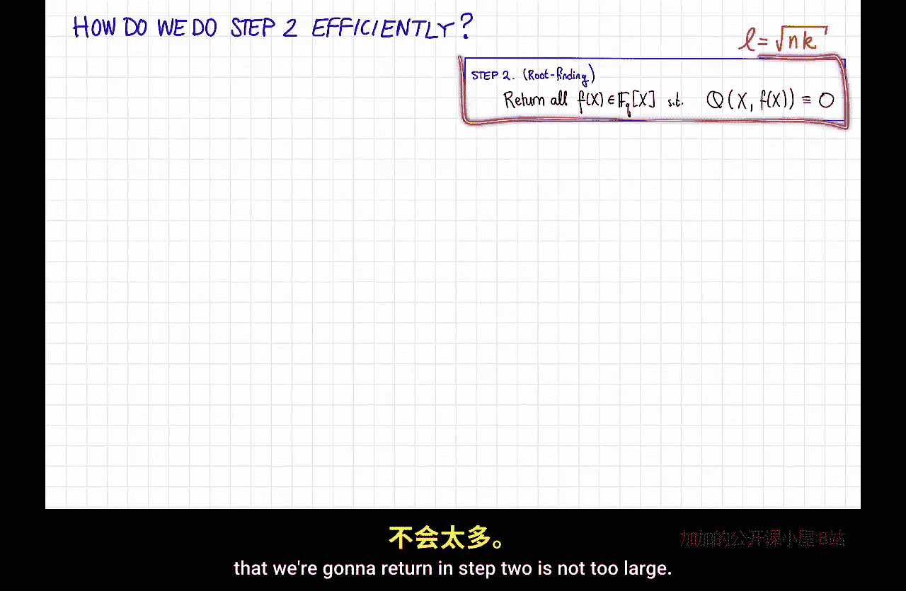
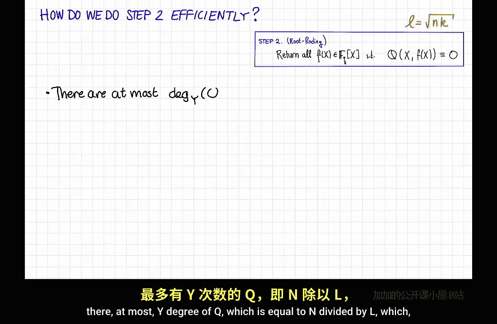
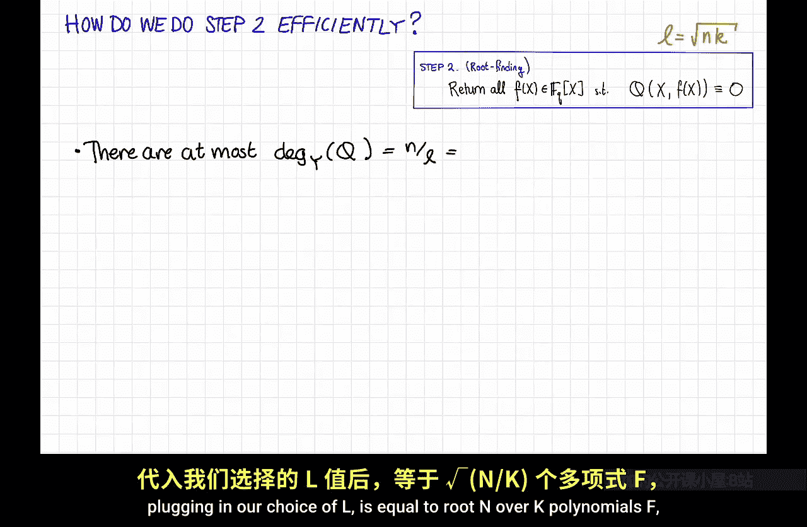
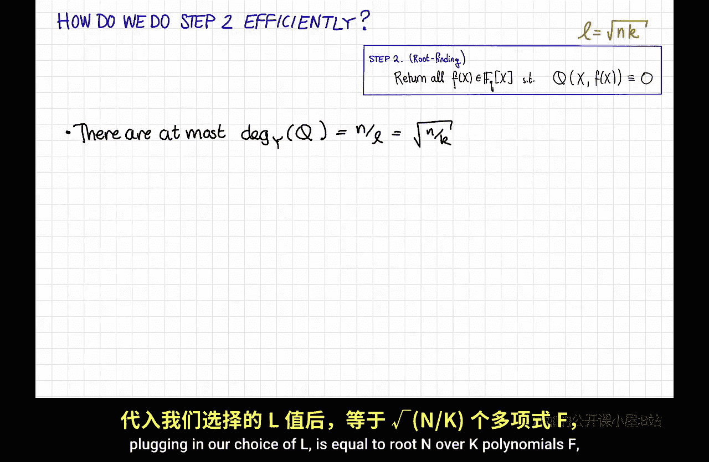
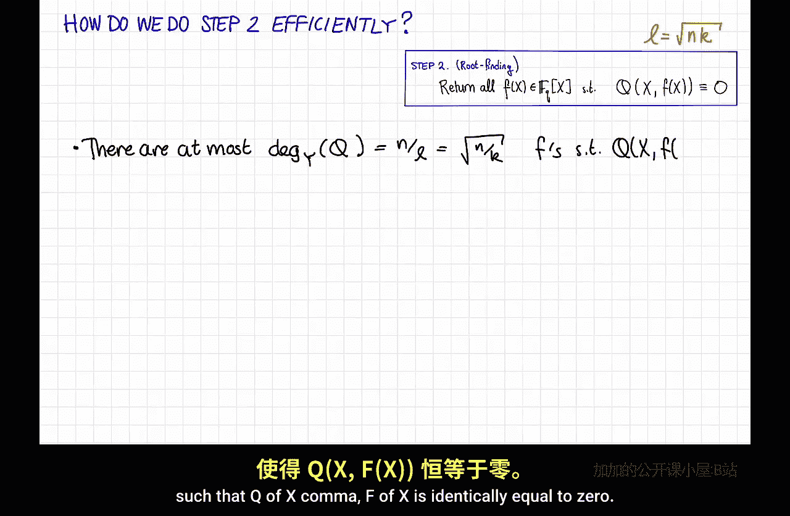
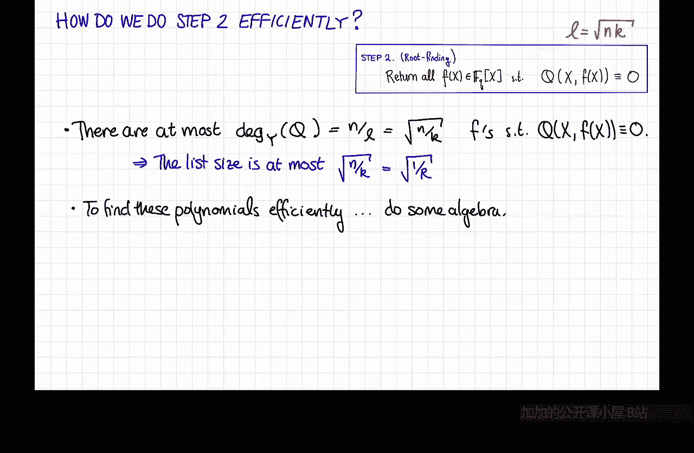

# 代数编码导论：3：苏丹算法

在本节课中，我们将学习一种用于列表解码里德-所罗门码的算法——苏丹算法。该算法虽然不能完全达到约翰逊界，但能让我们解码到远超半距离的错误，为后续改进奠定基础。

## 算法灵感：伯利坎普-韦尔奇算法的双变量视角

上一节我们介绍了伯利坎普-韦尔奇算法，它是一种能高效唯一解码里德-所罗门码至半距离的算法。本节中，我们来看看如何将其重新表述为双变量多项式形式，从而为列表解码提供灵感。

假设我们有一个里德-所罗门码，并接收到一个码字 **Y ∈ F_q^n**。伯利坎普-韦尔奇算法的第一步是找到两个多项式 **E(x)** 和 **B(x)**，使得对于所有 **i ∈ [n]**，满足：

**E(α_i) * y_i = B(α_i)**

其中，**E(x)** 是错误定位多项式，**B(x)** 等于 **F(x) * E(x)**，而 **F(x)** 是我们要找的原始编码多项式。

第二步是返回 **F(x) = B(x) / E(x)**。

为了将其推广到列表解码，我们可以用双变量多项式来等价地描述这个算法：

1.  **插值步骤**：找到一个双变量多项式 **Q(x, y)**，其形式为 **Q(x, y) = E(x) * y - B(x)**，并满足对于所有 **i**，有 **Q(α_i, y_i) = 0**。
2.  **求根步骤**：找到所有满足 **Q(x, F(x)) ≡ 0**（即恒等于零多项式）的 **F(x)**，并返回它们。

这种双变量视角为我们提供了更多的灵活性，因为我们可以放松对 **Q(x, y)** 形式的严格限制，允许其具有更一般的结构，这将有助于实现列表解码。

## 苏丹算法定理 📜

基于上述灵感，我们得到苏丹算法定理：

设 **α_1, ..., α_n** 是域 **F_q** 中互不相同的估值点，**n** 和 **k** 是固定参数。存在一个多项式时间算法（苏丹算法），对于任意输入 **Y ∈ F_q^n**，该算法返回一个列表 **ℒ**。此列表包含所有满足以下条件的多项式 **F(x) ∈ F_q[x]**：**F(x)** 与 **Y** 在超过 **2√(nk)** 个位置 **i** 上一致，即 **F(α_i) = y_i**。

这意味着我们可以列表解码到一个半径 **ρ = 1 - 2√R**，其中 **R = k/n** 是码率。虽然这尚未达到约翰逊界给出的 **1 - √R**，但已经远超半距离。我们将在下一节中看到如何改进它以达到约翰逊界。

## 苏丹算法步骤 🛠️

以下是苏丹算法的具体步骤，输入为接收到的码字 **Y**。

### 步骤一：插值

首先，我们需要找到一个双变量多项式 **Q(x, y)**。

以下是具体约束条件：
*   **Q(x, y)** 关于 **x** 的次数至多为 **L**。
*   **Q(x, y)** 关于 **y** 的次数至多为 **n/L**。
*   对于所有 **i ∈ [1, n]**，满足 **Q(α_i, y_i) = 0**。

其中，参数 **L** 被设定为 **√(n * k)**。与伯利坎普-韦尔奇算法的双变量版本相比，关键区别在于 **Q(x, y)** 的结构限制更宽松，它不必是 **E(x)y - B(x)** 的形式，只需满足上述次数约束即可。

### 步骤二：求根

第二步与之前描述的类似：
*   找出所有满足 **Q(x, F(x)) ≡ 0**（即恒等于零多项式）的多项式 **F(x) ∈ F_q[x]**，其次数小于 **k**。
*   返回这些 **F(x)** 的列表。

## 步骤一：如何实现插值？ 🤔

现在我们来解答第一个问题：如何高效地找到满足条件的多项式 **Q(x, y)**？

答案是：通过建立并求解线性方程组。我们将 **Q(x, y)** 的系数作为未知变量，将 **Q(α_i, y_i) = 0** 的条件作为线性约束。

以下是变量与约束数量的计算：
*   **变量数量**：等于 **Q(x, y)** 中单项式 **x^i y^j**（其中 **i ≤ L**, **j ≤ n/L**）的个数，即 **(L+1) * (n/L + 1)**。
*   **约束数量**：等于点的个数 **n**。

只要变量数量大于约束数量，就存在非零解。代入 **L = √(nk)** 计算：
**(L+1) * (n/L + 1) = n + n/L + L + 1 > n**
由于 **n/L** 和 **L** 均为正数，不等式成立。因此，我们可以通过求解这个线性系统来高效地完成步骤一。

## 步骤二：为何有效？ ✅

接下来解答第二个问题：为什么返回所有使 **Q(x, F(x)) ≡ 0** 的 **F(x)** 是一个好主意？这能解决我们的列表解码问题吗？

是的，这是有效的。我们可以证明，任何与接收码字 **Y** 在足够多位置上一致的正确多项式 **F(x)**，都会满足这个条件。

证明思路如下：
1.  假设 **F(x)** 是一个次数小于 **k** 的多项式，并且它在超过 **2√(nk)** 个点 **i** 上满足 **F(α_i) = y_i**。
2.  构造一个单变量多项式 **R(x) = Q(x, F(x))**。
3.  分析 **R(x)** 的次数：根据 **Q** 的次数限制和 **F** 的次数，可证 **deg(R) < L + k*(n/L) = 2√(nk)**。
4.  分析 **R(x)** 的根：在那些满足 **F(α_i) = y_i** 的点上，有 **R(α_i) = Q(α_i, y_i) = 0**。因此，**R(x)** 有超过 **2√(nk)** 个根。
5.  一个非零多项式的根数不能超过其次数。这里 **R(x)** 的次数小于其根的数量，这迫使 **R(x)** 必须是零多项式，即 **Q(x, F(x)) ≡ 0**。

因此，任何与 **Y** 高度一致的正确编码多项式 **F(x)** 都会被步骤二返回。

## 步骤二：如何高效实现及列表大小 📏

最后，我们探讨如何高效执行步骤二，以及返回的列表会有多大。

首先，列表大小是受控的。根据之前课程中的一个有用结论，满足 **Q(x, F(x)) ≡ 0** 的多项式 **F(x)** 的数量，最多不超过 **Q(x, y)** 关于 **y** 的次数，即 **n/L**。

代入 **L = √(nk)**，得到最大列表大小为 **√(n/k) = √(1/R)**，其中 **R** 是码率。如果码率 **R** 是常数，那么列表大小也是一个常数，这对于高效算法至关重要。

关于如何高效地找到所有这些 **F(x)**，虽然本视频不深入讨论具体算法细节，但可以确信存在多项式时间的算法（例如，通过将问题转化为关于 **F(x)** 系数的线性系统，或使用特定的多项式因式分解技术）来完成这一“求根”步骤。

## 总结 📝

本节课中我们一起学习了苏丹算法，这是一种用于列表解码里德-所罗门码的强大工具。

*   我们首先从伯利坎普-韦尔奇算法的**双变量多项式视角**获得了灵感。
*   接着，我们介绍了**苏丹算法定理**，它允许我们解码到半径 **ρ = 1 - 2√R** 的错误。
*   然后，我们详细阐述了算法的两个核心步骤：**插值**（通过解线性系统找到双变量多项式 **Q**）和**求根**（找出所有使 **Q(x, F(x)) ≡ 0** 的 **F(x)**）。
*   我们证明了步骤一的可行性（变量数多于约束数），以及步骤二的有效性（正确的 **F(x)** 必然满足条件）。
*   最后，我们指出返回的**列表大小是多项式有界的**（最多 **√(1/R)** 个），并且步骤二可以在多项式时间内完成。

苏丹算法让我们能够列表解码到远超半距离，虽然尚未达到理论极限的约翰逊界，但已经是一个重大突破。在下一节课中，我们将看到如何改进这个算法，最终达到约翰逊界。