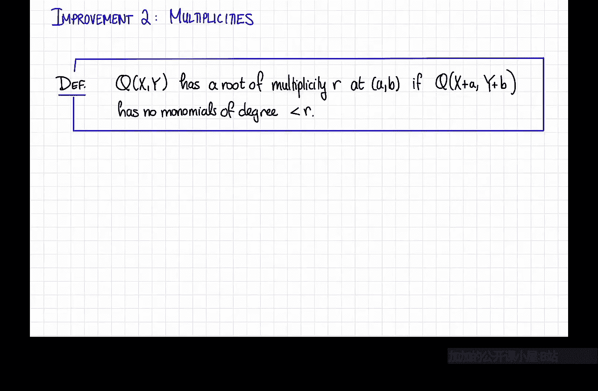
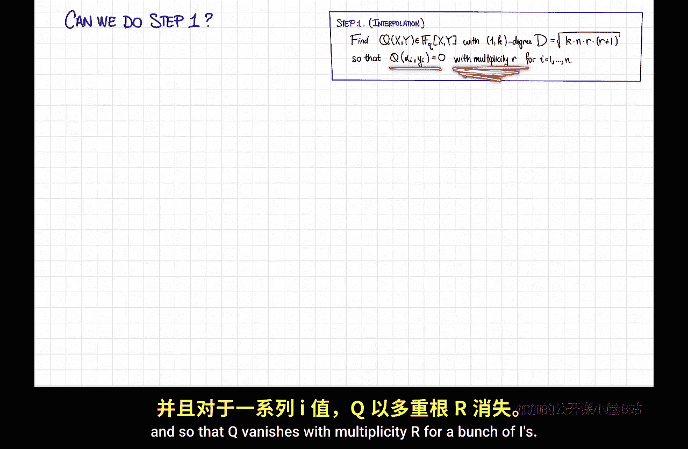
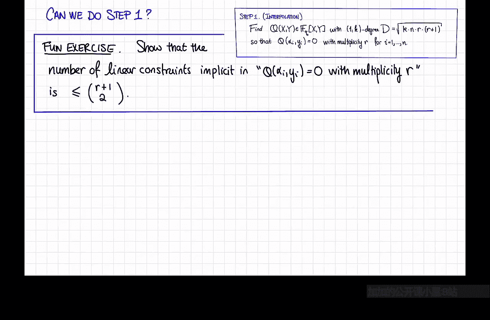

# 斯坦福大学【中英⚡代数编码导论｜Introduction to Algebraic Coding Theory】 p39 p38 11, Video 4： The Guruswami-Sudan Algorithm -BV16sRYYTEwg_p39-

In the last video， we saw Sudan's algorithm， which let us efficiently list to code read Solomon codes almost to the Johnson Bo。

 In this video， we see a modification called the Gurawami Sudan algorithm。

 which we get all the way to the Johnson Bo。😊。

Okay， so here's the story so far for efficiently decoding read Solomon codes。

 Suppose we're given some received word why。We saw that the Burlac Welsh algorithm allows us to uniquely decode efficiently up to half of the distance。

 which for the case of read Solomon codes is 1 minus the rate divided by 2。That is。

 we're guaranteed that there is at most one code word that lies in this ball。

 let's say it's this one and the Bele Camp Welsh algorithm can find it。In the previous video。

 we saw Sudan's algorithm。Which efficiently listed codes。Up to a larger radius。

 up to 1 minus2 times the square root of R。 When R is kind of small， this is larger than that。

 Let's assume we're in that parameter regime。And in this case， we know from the Johnson bound。

That there's at most a polynomial number of code words in this ball。

 And Sudan's algorithm gave us an efficient way to find them。In this video。

 we're going to try to improve on Suan's algorithm， we're actually going to do it in two steps。

In our first step， we'll see an algorithm that doesn't have a name。

 It's more for pedagogical purposes， which is going to allow us to increase this radius a little bit up to radius 1 the square root of two times R。

Then in our final step， we'll increase that even more。Up to radius1 minus root R。

 which is the Johnson bound。 And that final algorithm will be the Girl Swmi Sudan algorithm。Okay。

 so that's the plan for this video。 First we're going to see this intermediate step。

1 minus squared of 2 R， and then we're going to see the real thing。So our first improvement。

 which is going to get us up to1 minus the square root of two times R。

 is going to come by changing how we measure the degree of the bivariate polynomial Q。

Towards that end。Let's make the following definition。

So let's say that the1 comma K degree of a monoomial x to the IY to the J is I plus k times j。

And then similarly， we're going to define the one comma K degree of a bivariate polynomial Q as the maximum one comma K degree of any monomial that appears in that bivariate polynomial。

This definition might seem a little funny now， but hopefully soon。

 itll be very clear why we made this definition。Okay， so with that definition in mind。

 here is the slightly improved algorithm that's going to get us up to1 minus the square root of two times R。

 As with Sudan's algorithm， it has two steps， an interpolation step and a root finding step。

So step1 interpolation， we're going to find a polynomial Q of x Y so that the1 comma K degree is less than or equal to the square root of two times k times n。

 And just like we had before， we're also going to demand that Q of alpha I comma Y I is equal to 0 for all I between 1 and n。

So that's step one。Step 2 is exactly the same， the root finding step。

 we're just going to return all polynomials F over Fq。

So that Q of x comma f of x is identically equal to 0。Okay。

 so let's analyze this algorithm real quick。Notice that when we analyzed Sudan's algorithm。

 I took a couple of slides to do it。 And now I'm reserving myself approximately this much space。

 So I'm going to go a little bit fast because the proof is basically the same as for Sudan's algorithm。

 Actually， in this whole video， I'm basically just giving a proof sketch。

 I'm going to leave some fun exercises to the reader for you to fill in。 Okay。

 so let's analyze this algorithm。 sketchily。😊，As before， we need to show that we can do step1。

 both that we can do it efficiently and that such a cue exists。

And then we need to show that step  two is a good idea。And as before。

 I'm just going to assert that we can do step 2 efficiently provided that it's a good idea。

 So let's just try to figure out， can we do step 1 and is step 2 a good idea。Okay。

 so to answer the question， can we do step 1， I'm going to give you a fun exercise。

Which is to show that there are strictly greater than d squared divided by 2k coefficients in a polynomial that has one comma K degree at most D。

Given that fun exercise， we want to do exactly the same thing that we did in Sudan's algorithm。

 We want to show that the number of variables for the linear system that we're going to set up exceeds the number of constraints in that linear system。

As before， the number of variables is just the number of coefficients in this polynomial。

Which is strictly greater than d squared over 2 k by the fun exercise。So in this context。

 capital D is going to be the square root of 2 k N。

 so that squared divided by 2 k is just equal to n。But that's exactly the number of constraints。

Because our constraints in this linear system are just these things， and there are n of them。

 So this means that we can do step 1。 We solve some linear system where the number of variables is greater than the number of constraints。

The next question is， is step 2 a good idea。As before。

 we're going to analyze this by letting R of x be equal to Q of x comma F of x and hoping to show that R of x is identically equal to0。

And as before， we're going to show this by showing that the degree of R is not too large。

 and yet it has many roots。So what's the degree of R。Well， it's， in fact。

 exactly equal or at least bounded above by the one comma K degree of Q。So if this isn't obvious。

 pause the video now until it becomes obvious。And hopefully， at this point。

 it's also clear why we wanted to consider this funny definition。

 because this is exactly the right notion of degree that we want in order to de the degree of R in terms of the degree of Q。

By assumption， this is at most the square root。Of two times N K。However， as before。

If F of alpha I is equal to Y I。For strictly greater than square root of2 N K values of I。That is。

 if F is a polynomial that we'd like to return， then R must have this many roots strictly greater than the square root of two times N K。

All right， load of polynomials don't have too many roots。Thanks Polly， yeah。

 and that's going to imply that r is identically zero。

All of this shows that step 2 is a good idea in the sense that if F agrees with the received word Y to the tune of this many agreements。

 then we will return it。And now all this is going to imply that the Reed Solomon code C。

Is P comm L list decodable efficiently。For p equal to1 minus the square root of 2 R。And L。

 something reasonable。So this root2 R here that comes from taking this and then dividing it by n and something reasonable that's just going to be the number of f's that are roots of this thing here。

Okay， so in just one slide， we've managed to take the two from outside the square root to inside。

 which is definitely an improvement。 But that's not all the way there。

 We wanted to be able to turn this P into  one minus the square root of R。

 So we still have another root2 to go。That's gonna to be our next improvement。

So our next improvement is to look at roots with multiplicity。 Here's a definition。

A polynomial Q of X， Y has a root of multiplicity R at the point A comma B。

 If the polynomial Q of x plus a comma Y plus B has no mononomials of degree strictly less than R。

So here's an example。Suppose that Q of x comm a y。Is equal to， say。

 x minus alpha I squared times y minus Y I for some alpha I and Y I and F Q。

 Then I claim that this has a root of multiplicity 3 at alpha I comm a Y I。

And the reason is that if we look at Q of x plus alpha I come a y plus Y I。

This is equal to x squared times y， which indeed has no terms of total degrees less than three。

 It only has the one term， which has total degree exactly equal to3。So why do we care about this？

Well， intuitively， it's because it's going to let us get more roots for less。To see an example。

 at least in the context of this example of how that might work out。

Suppose that r of x is equal to Q of x comma f of x。Just like we've been doing in our proofs。

And in this particular example， that's equal to x minus alpha I。Squared times F of x minus y I。

But now， let's say that F of alpha I is equal to Y I。

Before that allowed us to say that r of alpha I is equal to 0。Namely， it has a root。But in this case。

 it's not just that it has a root at alpha I。 It actually has a root of multiplicity 3。That is。

 in some sense， this root at alpha I morally should count for three roots。

 I get two roots here and another root here。So instead of getting to count one root in our low degree polynomials don't have too many roots analysis。

 we now get to count 3。 And that's going to be a win for us。 This is pretty informal。 Just intuition。

 We'll make it precise in just a moment。Okay， so with that definition of multiplicities out of the way。

 here is the G Sammi Sudan algorithm。We're going to start by choosing a parameter R。

 Moding R is going to give us a trade off between the radius and the list size。

 Basically making R bigger is going to let us approach the Johnson bound closer and closer。

 but it's also going to ratchet up the list size。Let's suppose that T is a parameter that is strictly greater than the square root of k times n times 1 plus 1 over R。

So T is going to be the parameter that is the agreement between F of x and y。

 we're going to hope to return all polynomials F， the degree with y in at least t places。

And now you see what I mean by ratcheting up R is going to let us approach the Johnson bound。

 If R were equal to infinity here， we'd have T the amount of agreement。

 what we want squared of k times n， and now it's just a little bit bigger。Okay。

 so we have these parameters R and T， and now just as before we have two steps。

 an interpolation step and a root finding step。The interpolation step goes as follows。 Once again。

 we're trying to find a bivariate polynomial Q over F Q。That has one comma K degree capital D。

 where I'm defining capital D to be this thing， the squared of K times n times R times r plus1。

 We'll see in a moment why we're choosing this。And we're going to want Q of alpha I comma Y I to be equal to0 with multiplicity R。

For all I from one to n。 So this is the change between the last version of the algorithm that we saw in this version。

 So it's not enough for a Q to just vanish on these points。

 I want them to vanish with multiplicity R。Okay， that's step one。Step 2 is the root finding step。

 This is exactly the same as before。We're going to return all F of x so that Q of x comma F of x is identically equal to 0。

And notice that there are at most， the Y degree of Q， which is at most capital D divided by K。

Such polynomials。 And if you work it out， that's about little R divided by the square root of the rate。

In particular， as long as R is some constant and the rate capital R is some other constant。

 this is going to be constant。Notice that we actually don't need to take R as large as infinity in order for this to be roughly the square root of k times N。

 If R is polynomial in K and N， then that'll do it， at least asymptotically。

 So it might make sense also to take little R here to be polynomial and n in K in which case our list size is going to be polynomial。

Also， another quick note， I guess， technically here， D should be an integer。

 so take a floor or a ceiling or something is appropriate。 and I'm just going to ignore it。Okay。

 so that's the algorithm。 and I claim。That this algorithm。

Will P L Litic code read Solomon codes efficiently？For P equal to， okay。

 it should be one minus the agreement。 So1 minus t divided by n。

Which is equal to 1 minus the square root of 1 plus1 over R。Times， capital R。And list size L。

 which is big O of R divided by root R。And this is just going to follow as long as we can show the same things we've been trying to show before。

 namely that we can do step1， and that step two is a good idea。So in the rest of this video。

 let's do that。 First， can we do step 1 and then is step 2 a good idea。Okay， can we do step one。

 So step one is we want to find some Q that has the appropriate 1 k degree and so that Q vanishes with multiplicity R。

For a bunch of eyes， as before， we're going to count constraints and count variables。

And I'm going to leave it as a fun exercise for you to count the constraints。In particular。

Here's a fun exercise。 Show that the number of constraints。

That are implicit in this requirement here。Is at most R+1 choose2。

Okay， so I'll leave that for you to do。But， given that。

We can now verify that the number of variables that is the number of coefficients in this polynomial that we're trying to interpolate is greater than the number of constraints that we have。

So the number of variables。Is still strictly greater than d squared divided by 2 k。

That's by the fun exercise that you did earlier。The number of constraints is thus n times R plus1。

 chooseose 2。And so in order to do step one by solving a linear system。

 we need number of variables strictly greater than the number of constraints。

So it's enough to show that d squared divided by 2 k is greater than or equal to n times r plus 1 choose 2。

And now we'll see where the definition of D came from。 If we solve for D in this expression。

 we need D to be greater than or equal。To the square root of 2 k times this thing。

Which when we write out the definition of the binomial coefficient。

 we're going to get this square root。Of K times n times R times r plus1。

That was very conveniently exactly how we chose D。 So this is true。Therefore， we can do step one。Now。

 we move on to our next question。 Is step 2 a good idea。As before。

 hopefully this formula is getting pretty boring at this point。

We're going to let r of x be equal to Q of x comma f of x。

And we want to show that R x is identically equal to 0。As before。

 we're going to do this by counting degrees and counting roots。

 but now we're going to use the multiplities to help us count the roots。Let's start with a degree。

 though， because that's a little more straightforward。So the degree of R。As before。

 this is at most the1 comma K degree of Q。Which， by definition， is equal to D。

Which is the square root。Of K times n times R times r plus1。

Now we're going to show that if f of alpha I is equal to yi。

 then r of alpha I is equal to 0 and not only equal to0， but equal to0 with multiplicity R。

 and that will mean that we can count it r times。A little more precisely。

 we have the following claim。If F of alpha I。Is equal to Y I？Then。

X minus alpha I raised to the Earth power divides this polynomial R of x。Let's prove this。

We have Q of x plus alpha I， Y plus Y I。Has no terms of degree， strictly less than R。

This is because of how we interpolated Q。It was supposed to vanish with multiplicity R at each alpha I comma Y I。

 And this is just the definition of what it means to vanish with multiplicity R。

 So now consider the polynomial F bar of X。Which I'm going to define as F of x plus alpha I minus y I。

Then R of x plus alpha I。Is， by definition equal to Q of x plus alpha I， comma F of x plus alpha I。

Which plugging in our new definition of F bar is equal to Q of x plus alpha I。Coma F bar of X。Plus。

 y I。And now this thing is conveniently in the form of that thing。

 except I've plugged in F bar for Y。So that means that this thing， all of its monoials。

 sort of mononoials and X and Y， where then I've plugged in F bar for Y are not going to have any terms of degree strictly less than R。

 In other words， this has a bunch of terms。That look like x to the C times F bar of x to the D for C plus D。

Greateaer than or equal to R。Further， let's notice that F bar has no constant term。That is F bar of0。

Is equal to F of alpha I minus Y I， which by the assumption that F of alpha I is equal to y I for this particular I。

Is equal to 0。And that exactly means that F bar has no constant term。So， that implies。

That x to the C plus D divides all of these terms X to the C times F bar of X to the D。

That show up in this thing。 And since C plus D has to be greater than equal to R。

 that implies that X to the R divides all such terms。

And if x to the R divides all of the terms that show up in this thing。

 which remember was equal to this thing， which remember was equal to this thing。

Then X R must divide this thing itself。So XR divides r of x plus alpha I。And by changing variables。

 that implies that x minus alpha I to the R divides R of x。And that's what we wanted to show。

So that proves the claim。Next， we can use this claim to realize this intuition that we had before。

To give me space to do that， I'm going to erase the proof。Okay。

 so let's continue showing that step 2 is a good idea。We have this polynomial R of x。

 which is Q of x comma F of x。 And we want to show that R of x is identically equal to 0 as before。

 where here we are assuming that F of x agrees a lot with y。

So let is assume that F of alpha I is equal to Y I。For at least T values of I。

And remember here that we're choosing T to be strictly greater than k times n times 1 plus1 over R。

 Disc square root of that。Now， our claim here means that for such an F。

 this polynomial R must have at least T times R roots counting multiplicities。And that implies that。

 either。R of x has degree， at least T times R。Or R of x is identically equal to0。All right。

 lotary polyormials don't have too many roots。 Thanks， Polly。Yeah。

 so notice that this principle that low degree polynomials don't have too many roots works even when we're counting multiplicities too。

To see why notice that this claim shows that for each alpha I， so that F of y I is equal to alpha I。

 we get a polynomial of degree R dividing R of x。If we multiply together the T different terms of this form for all the T different alpha I' that this is true。

 we're going to get a polynomial here of degree T times R T factors that look like this degree R each。

 And that product of degree T times R needs to divide R of x。

 So that means that R of x needs to have degree at least T times R， unless it's identically 0。Okay。

 so this is true。Now we're in the home stretch。Because T times R by our choice of T here is strictly greater than R times。

The square root of k times n times 1 plus1 over R。Which is equal to the square root of K times n times R times R plus 1。

And conveniently， this is exactly the bound we had on the degree of R。

So this shows that this cannot be the case。 It's not the case that the degree of R is greater than or equal to T R。

 In fact， it's strictly less than that。 So therefore， R is identically 0。

This further implies that if F of alpha I is equal to Y I for at least T different values of I。

We're going to return F。Thus， step 2 is a good idea for any such F。

 It's going to be in the list that we return。And that shows that this algorithm。

 the girl saw me Sudan algorithm， is correct。Moreover， we can do it efficiently。

 We saw that we can do step1 efficiently by solving the linear system。

 and I promise that step 2 is efficient。 I really do。Okay， so to recap in this video。

 we saw the Gouraswami Sudan algorithm， which gives an algorithm to list decode。

 read Solomon codes efficiently up to the Johnson bound。We started with Sudan's algorithm。

 which didn't quite get there。 it got up to 1 minus2 times the square root of R。

We made one improvement。Which was to introduce the one comma K degree。

And that saved us the factor of the square root of 2。

 So that got us up to1 minus the square root of  two times R。

And then we made a second improvement by introducing multiplicities。

 and that got us all the way up to 1 minus the square root of R。

You might be wondering if it's possible to push this even further。

Could we hope to extend the radius beyond the Johnson bound。

 We saw in a previous video that the list decoding capacity theorem was beyond the Johnson bound。

 Maybe we could hope to efficiently list decocode read Somon codes all the way up to that。In fact。

 it turns out that largely this is still an open question， so I encourage you to think about it。

But for now， let's be happy with achieving the Johnson bound。 I think that's pretty good。

