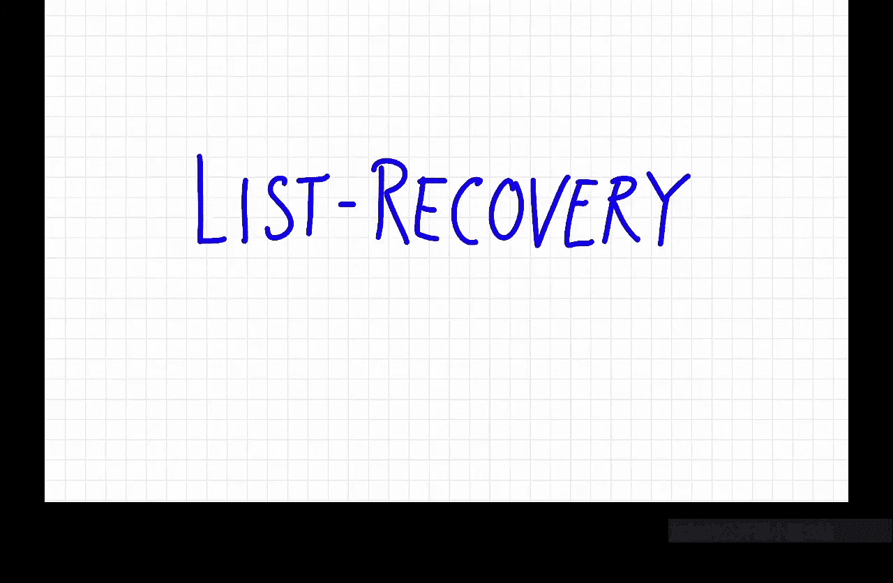
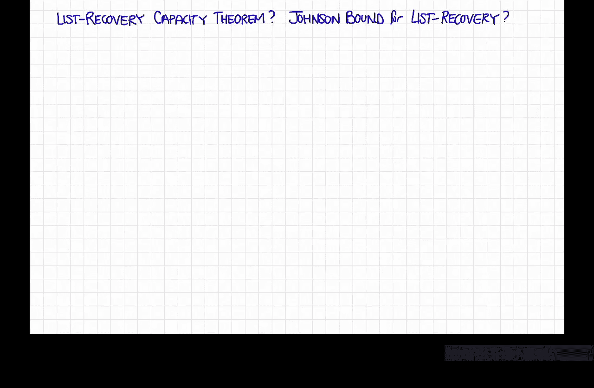
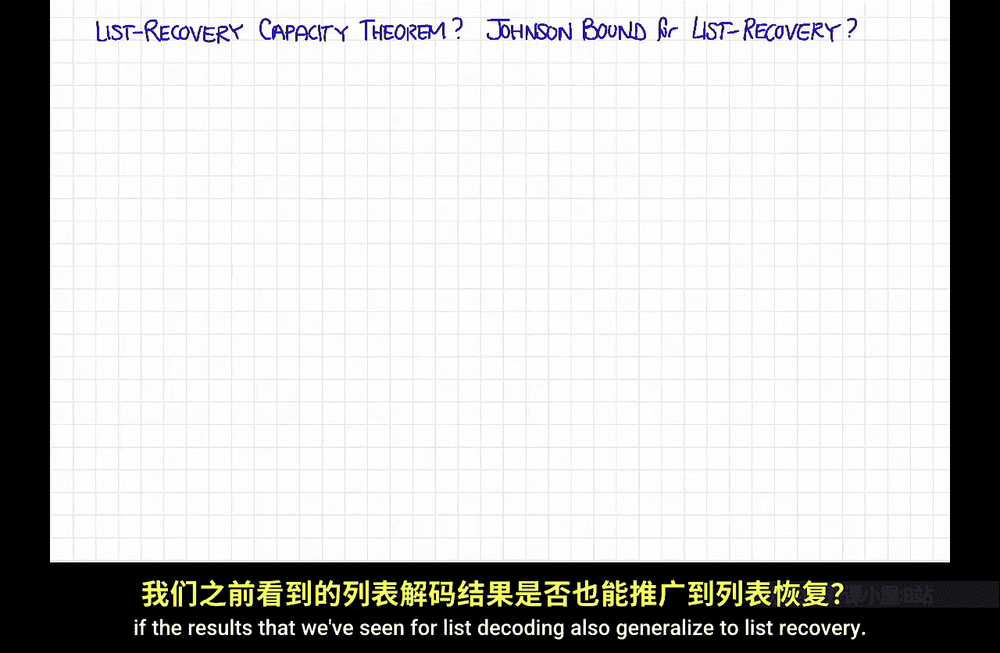
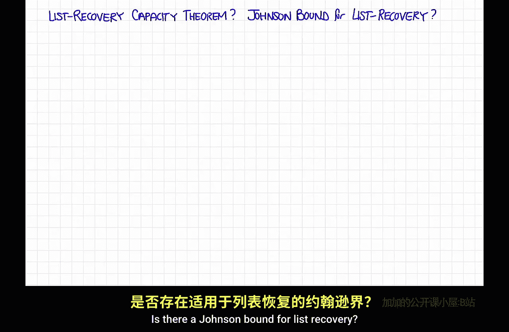
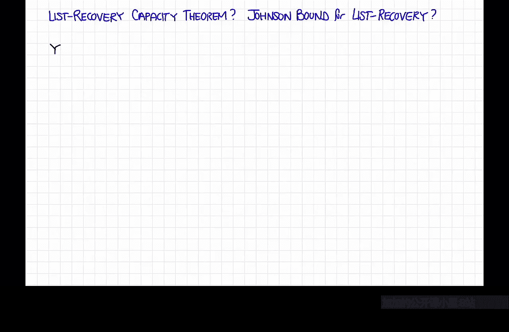
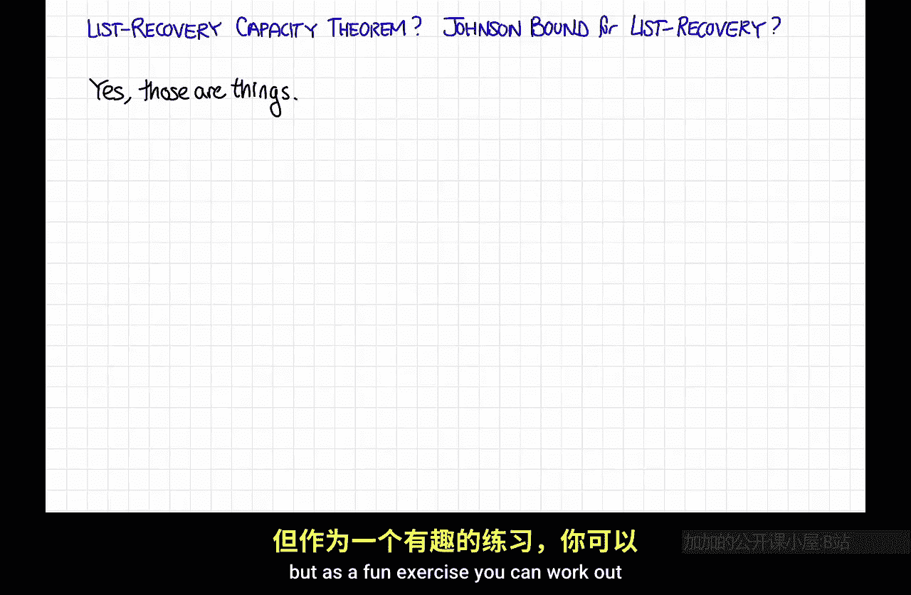
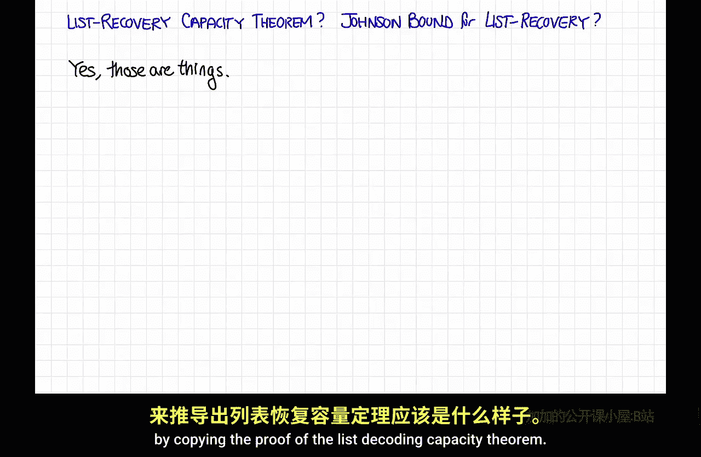
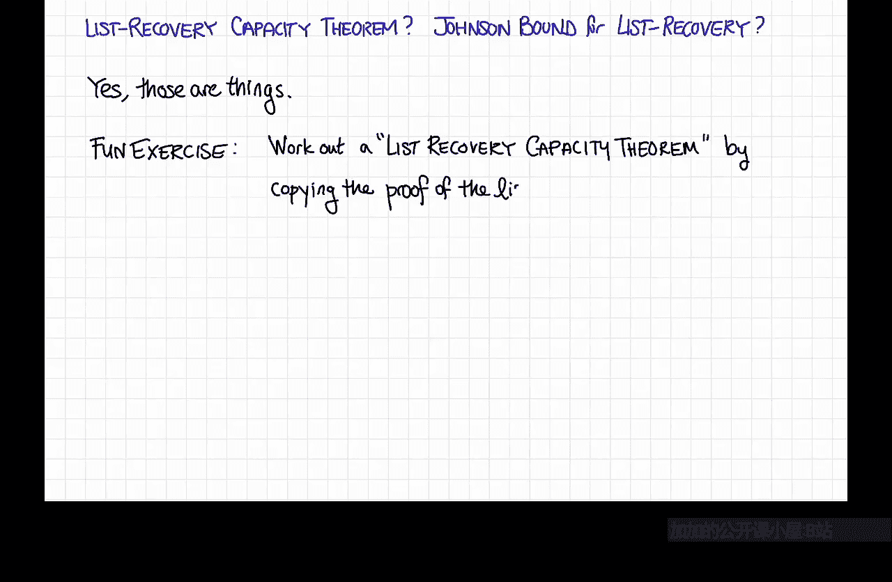
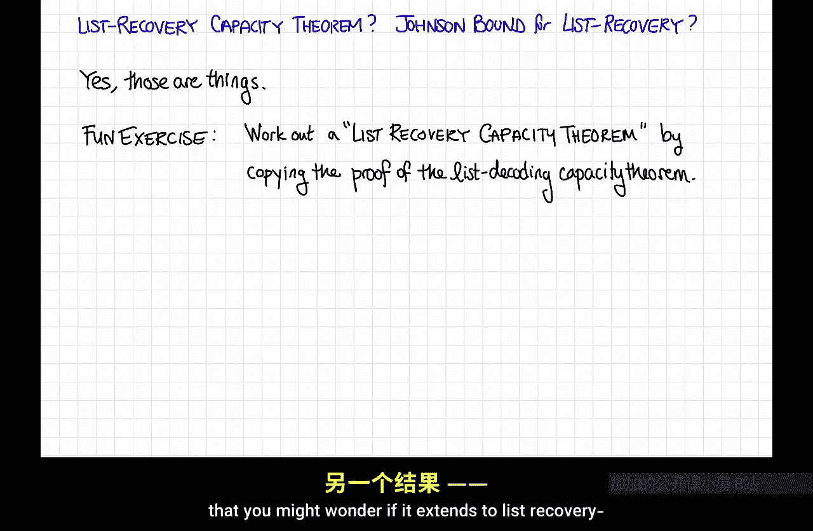
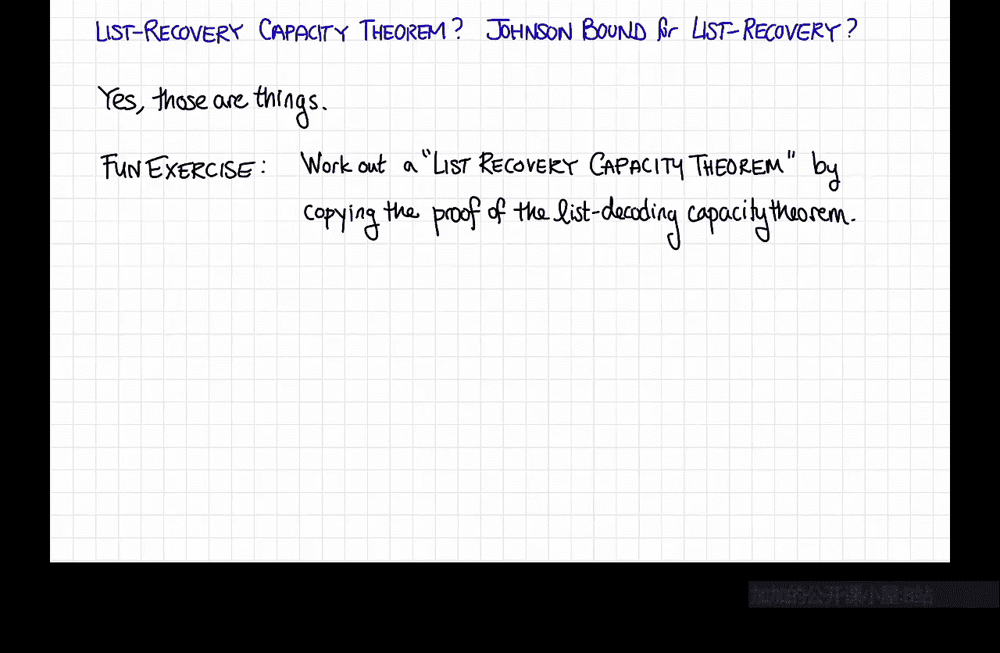

# 斯坦福大学【中英⚡代数编码导论｜Introduction to Algebraic Coding Theory】 p40 p39 12, Video 1： List Recovery -BV16sRYYTEwg_p40-

In this video， we'll introduce a generalization of list decoding called L Recovery。

So here's the definition of list recovery。Let's choose parameters。 capital L and little L。

 so that capital L is larger than little L。 and that both are integers greater than equal to  one。

And let's choose a parameter P between 0 and 1。We see that a code C over an alphabet sigma of length N is P comma little L come a big L list recoverable。

 if for all sets S1 up to S N， which are subsets of sigma of size at most little L。There are at most。

 capital L codeword C。That。Disagree with the lists in at most A P fraction of the places。

 That is so that the number of eyes， so that the e symbol of C is not in the ethe list。

Is it most P times n。To parse this， let's see a picture。So imagine that this is a code word C。

In our code seat。We don't know what it is。 All we know is that it's in the code。However。

 what we do know is some information about where each of the symbols live。

 Like we know that the first symbol here， C 1 is in some list。 S。1。

 Let's say it's either A or B or C。And let's say we know that the second symbol C2 is either。

 I don't know， B or D or F。And so on。 And we have a constraint like this for every single symbol all the way up to C sub N is either。

X or a or R。Or something like that。Now， it is our job to find all of the code words in this code that satisfy these constraints or at least satisfy them for at least a one minus P fraction of the symbols。

And we say that a code is P come a little L come a big L list recoverable。

If there are no more than big L， such code words。Let's make a few observations about this definition。

 In order to have space， I'm going to erase the picture。So observations。

The first observation is that list recovery generalizes list decodability。In particular。

 P comma 1 comma L list recovery is the same as P comma L list decodability。

If this isn't immediately clear， pause the video now and stare at it until it is。

The second observation is that unlike for list decodability。

 list recovery is actually interesting when p is equal to0。In that case。

 we're asking for the number of code words that agree with all of the lists to be no more than capital L。

This is a pretty common case of list recovery， and in this case we just drop the P and say that it's little L。

 big L list recoverable。The third observation is that we're always going to have big L greater than or equal to little L。

 even if we didn't stipulate it in the definition。Pasuse the video now and think about why this is true。

Okay， so here's the reason。 I claim that for any code。

 I can come up with lists S1 up through S N of size little L。So that there are little L code words。

That go through those lists。Indeed， consider the list that I get in the following way。

Take any little L code words。 Let's call them C1 through C little L。Let's say they look like this。

So they have length n。And then let's form the Ith list by looking at all of the symbols in the eh position of these little L code words。

So if this is position I here， I'm going to look at all of these symbols。That show up there。

And turn that into my list。 It has size no larger than little L。

 And if I do this for all the positions I， then clearly。

 each one of these little L code words agrees with all of them。So therefore。

 we can't hope to have a definition like this。Unless capital L is at least little L。

Now that we've seen this definition of list recovery and seen that it generalizes list decoding。

 It's a very natural question to ask if the results that we've seen for list decoding also generalized list recovery。

 For example， iss there a list recovery capacity theorem， Is there a Johnson bound for list recovery。

The answer to both those questions is yes。

I'm not going to work these things out in these videos， but as a fun exercise。

 you can work out what the list recovery capacity theorem should be by copying the proof of the list decoding capacity theorem。

😡。

Another result that we saw for list decoding that you might wonder if it extends to list recovery is the list decodability of read Solomon codes。

 and in particular the Gouras Samami Sudan algorithm。

The answer to that is yes as well。 And we will see that in the next video。

