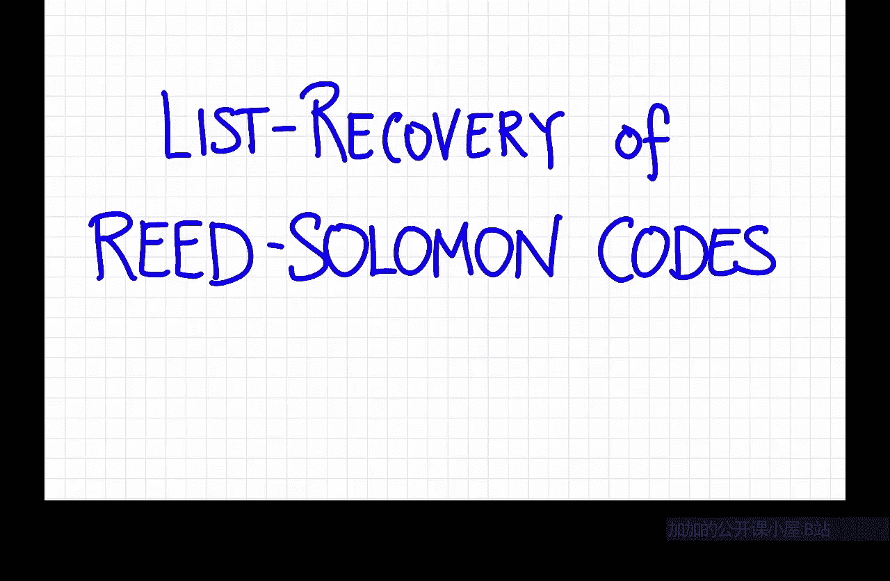

# 斯坦福大学【中英⚡代数编码导论｜Introduction to Algebraic Coding Theory】 p41 p40 12, Video 2： List Recovery of RS Codes -BV16sRYYTEwg_p41-

In this video， we'll investigate how L recovery works out for read Solomon codes。

So remember that in the list recovery problem， we are given a bunch of lists S1 through S N of size at most little L。

 and we wanted to define find all of the code words in some code so that the Ih symbol of the code word lives in the Ih list for most of the lists。

If we translate that to read Solomon codes， it says that we should have a bunch of lists so that the number of low degree polynomials whose evaluations at particular points lie in the corresponding list for most of the lists is not too large。

More precisely。We have the following problem。Let's fix some distinct evaluation points。

 Alpha 1 through alpha N in F Q。 And suppose we are given lists S 1 through S N。

 which are subsets of F Q， so that each has size at most little L。

Then our goal in the list recovery problem， when specialized to read Solomon codes。

Is to find all polynomials F over F Q in some variable x。That have degree at most， K-1。

And so that F of alpha I lives in the list S I for all but P times n values of I。If that's true。

 then the corresponding read Solomon code is P， comma， little L， comma。

 the number of such polynomials list recoverable。Our problem is to do this efficiently。Let's say。

 ideally in time， polynomial in N。And notice that that's going to imply that capital L。

 the number of such polynomials， must also be polynomial in N。

 because otherwise we wouldn't have time to output them all。We can draw a picture of this problem。

 as follows。So down here on the X axis， I'm going to draw F Q and on the Y axis， this is also F Q。

 And I'm going to imagine like plotting a polynomial as though this were the evaluation points。

 Alpha 1， Al 2， Alpha 3 and so on。Let's just pretend it makes sense to lay FQ out on a line like this。

 of course it does not。And now， for each evaluation point。

 we have a set S I of possible values that a polynomial could take at that evaluation point。So。

 for example， if little L were equal to 2， maybe my values would look like this。That is。

 if we were to plot some polynomial， like this or something like that。

Where here are the inputs and here are the outputs again。

 pretending that FQ can be written on a line in a reasonable way。

We want to find all the polynomials that go through lots of these points。For example。

 here are some quadratic polynomials that go through some， but not all of these points。 once again。

 just pretending that it makes sense to plot FQ by FQ as though were were the reels。Okay。

 so that's our problem， we're given some possible values for each evaluation point。

 we want to find all the polynomials that go through enough of those points and we want to do it efficiently。

How are we going to do this？I claim we actually already have the answer。

 So pause the video now and think about it。 How would you do this efficiently。

The answer is the Gouraswami Sudan algorithm。 In particular， in a previous video。

 we proved this theorem。Suppose we have a bunch of points。

 Al I comma Y I for I between 1 and capital M and fix a parameter R that's greater than equal to  one。

Then there is an efficient algorithm。 The Guurawaami Sudan algorithm。That returns all polynomials。

 F of X over Fq。So that the degree of F is at most k -1。

And so that F of alpha I is equal to Y I for lots of different eyes。

And if you look back to that video， lots of different eyes meant this many eyes。

 the square root of M times k times 1 plus1 over R。Moreover。

 we showed that there were not so many such polynomials at most R times the square root of M over K。

Okay， so this theorem looks a little bit different than it did when we stated it before。

The only difference is that this thing here。 I've all of a sudden started calling capital M when we used to be calling it N。

However， you can go back and check that if you just change all of the ends to a capital M， in fact。

 nothing changes。The important thing about getting to rename N to some capital M。

 anything we want is that capital M can actually be larger than N。In particular。

 these alpha eyes's here don't need to be distinct。Okay。

 so what does this have to do with list recovery。Well。

 I claim that it immediately gives us the following corollary。So I've copied the theorem down here。

And here's a co Larry。The corollary says that a read Solomon code over F Q of length N and dimension K。

Is efficiently P come a little L come a big L list recoverable。That is。

 it solves that interpolation problem that we saw on a previous slide。

Provided that P is not too large， smaller than one minus the square root of R times L times1 plus epsilon for some parameter epsilon。

Sorry， I should have written。 Let Epsilon be greater than 0 at the beginning。There we go。

And the list size can be big O of one over epsilon times the square root of L divided by R。

Let's look at this radius P here。Let's let Epsilon go to zero， so let's just ignore that basically。

So then this says that P can be all the way up to1 minus the square root of r times L。

This should look a lot like the Johnson bound for list decoding。

 the Johnson bound says that the list decoding radius can be as large as  one minus the square root of R。

And here， what we're doing is we're throwing an L in under the square root。

 This turns out to be the analogous statement of the Johnson bound for list recovery。Also。

 notice that the list size here is something reasonable。

 You might be a little bit worried because I said earlier that capital L needed to be larger than little L。

 And here it looks like it scales with a square root of little L， which is a bit concerning。

 But notice that this condition here means that the rate R has to be at most one over little L in order for this to give you a non trivialvial result。

 So that means that this square root of L over R。Is at least the square root of L squared。 So indeed。

 this does scale linearly with L like it's supposed to。Okay， so that's this corollary。

 Let's prove it real quick。Suppose we're given input lists S1 through S N。

So let's say that S I is equal to。Y I1。Yhy， I， too。That a dot up to Y， I L for all I in N。

Then in order to use this theorem， we're going to let capital N be little L times n。

 and we're going to form little L times n tus of the form alpha I comma Y， I。

 where we're going to repeat each alpha I L times for each of its corresponding different y's。

So we'll take alphapha 1， y11， alphapha 1， y12， dot dot all the way up to alpha 1， y1 L。

And then we'll take alphapha 2。Why 2，1， and so on。All the way up to alpha n。Y and L。

Then we are going to apply this theorem with those tuples and with R equal to one of Repson。

In order for that to work， we're going to need 1 minus P。To be less than this agreement。

 normalized by N。So， that's one over n。Times the square root of M times K times。1 plus one over R。

Which plugging in our definition of capital M and R is one over n times the square root of N times L little L times K times 1 plus epsilon。

And then pulling this end inside the square root。That becomes equal to capital R。

 the rate times little L times 1 plus epsilon all under the square root。

And that's exactly what we got here once we move this one over to the other side。Great。

 so we have established that read Solomon codes are efficiently list recoverable up to some list recovery version of the Johnson band。

 That's cool。 You might be wondering， though， why do we care。😊。

It turns out that list recoverycover has tons of applications。In the next few videos。

 we'll see one such application to streaming algorithms。

