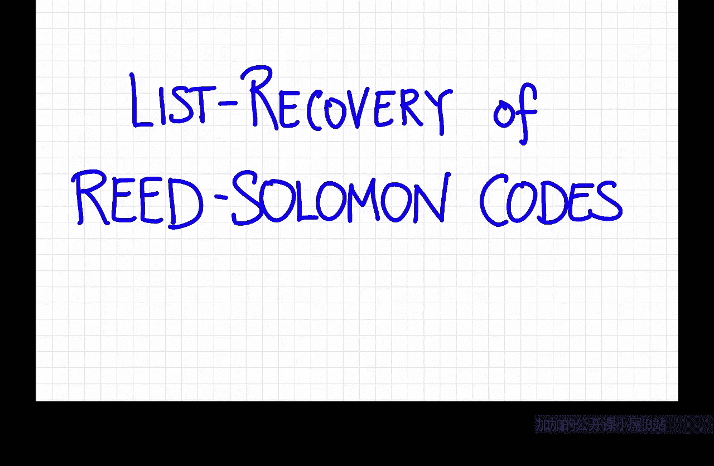

# 代数编码导论：2：RS码的列表恢复

在本节课程中，我们将探讨列表恢复问题在里德-所罗门码上的具体应用。我们将学习如何高效地找到所有满足大部分约束条件的低次多项式。

## 问题定义

上一节我们介绍了列表恢复的一般概念，本节中我们来看看如何将其具体应用于里德-所罗门码。

设有一组互不相同的求值点 **α₁, α₂, …, αₙ ∈ 𝔽_q**。同时，我们被给予一组列表 **S₁, S₂, …, Sₙ**，每个列表 **Sᵢ** 都是 **𝔽_q** 的子集，且大小至多为 **ℓ**。

那么，针对里德-所罗门码的列表恢复问题，其目标是找到所有满足以下条件的多项式 **f(x) ∈ 𝔽_q[x]**：
*   多项式的次数 **deg(f) ≤ k - 1**。
*   对于至少 **(1 - ρ)n** 个索引 **i**，有 **f(αᵢ) ∈ Sᵢ**。

如果存在这样的多项式，并且其数量 **L** 是可管理的，我们就称该里德-所罗门码是 **(ρ, ℓ, L)-列表可恢复**的。我们的目标是以**多项式时间**（关于 **n**）高效地找到所有这些多项式。

## 问题可视化

我们可以将这个问题可视化如下。想象一个坐标平面，横轴和纵轴都代表域 **𝔽_q**。我们在横轴上标出求值点 **α₁, α₂, …**。对于每个求值点 **αᵢ**，我们在纵向上有一个允许值的集合 **Sᵢ**（大小至多为 **ℓ**）。我们的目标是找到所有那些图像点 **(αᵢ, f(αᵢ))** 大部分都落在对应竖条 **Sᵢ** 内的低次多项式 **f**。

## 解决方案：Guruswami-Sudan算法

那么，我们如何高效地解决这个问题呢？实际上，我们已经掌握了答案。

回想一下我们在之前视频中学到的**Guruswami-Sudan算法**。该算法解决了以下问题：

**定理**：给定 **M** 个点 **(αᵢ, yᵢ)** 和一个参数 **r ≥ 1**，存在一个高效算法（Guruswami-Sudan算法），可以找到所有满足以下条件的多项式 **f(x) ∈ 𝔽_q[x]**：
*   **deg(f) ≤ k - 1**
*   **f(αᵢ) = yᵢ** 对于至少 **√(Mk(1 + 1/r))** 个索引 **i** 成立。

并且，这样的多项式数量至多为 **r√(M/k)**。

请注意，此定理中的点 **(αᵢ, yᵢ)** 的 **αᵢ** 不需要互不相同，且点的总数 **M** 可以大于码长 **n**。

## 从列表解码到列表恢复

这个定理如何帮助我们解决列表恢复问题呢？它直接导出了以下推论：

**推论**：一个长度为 **n**、维度为 **k**、码率为 **R = k/n** 的里德-所罗门码，是高效 **(ρ, ℓ, L)-列表可恢复**的，其中：
*   **ρ < 1 - √(Rℓ(1 + ε))**，对于任意 **ε > 0**。
*   列表大小 **L = O( (1/ε) √(ℓ / R) )**。

让我们分析一下这个半径 **ρ**。如果忽略 **ε**，它表明 **ρ** 可以达到 **1 - √(Rℓ)**。这很像列表解码的**约翰逊界**（Johnson Bound），后者给出的半径是 **1 - √(R)**。这里的区别在于平方根下多了一个 **ℓ**，这正是列表恢复版本的约翰逊界。

关于列表大小 **L**，由于要使 **ρ** 非负，需要 **R ≤ 1/ℓ**，因此 **√(ℓ / R) ≥ √(ℓ²) = ℓ**。这意味着 **L** 确实与 **ℓ** 成线性关系，符合预期。

## 推论证明简述

以下是该推论的简要证明思路：

1.  **构造点集**：给定输入列表 **Sᵢ = {yᵢ₁, yᵢ₂, …, yᵢ_ℓ}**，我们构造一个包含 **M = ℓn** 个点的集合。具体方法是，对于每个求值点 **αᵢ**，我们生成 **ℓ** 个点：**(αᵢ, yᵢ₁), (αᵢ, yᵢ₂), …, (αᵢ, yᵢ_ℓ)**。
2.  **应用定理**：对这个包含 **M** 个点的集合应用Guruswami-Sudan定理，并取参数 **r = 1/ε**。
3.  **建立联系**：我们需要满足定理中的“大量一致”条件。计算表明，当错误比例 **1 - ρ** 小于 **√(Rℓ(1 + ε))** 时，条件成立。移项后即得到 **ρ < 1 - √(Rℓ(1 + ε))**。
4.  **确定列表大小**：定理保证输出的多项式数量（即列表大小 **L**）至多为 **r√(M/k) = (1/ε) √( (ℓn) / (Rn) ) = O( (1/ε) √(ℓ / R) )**。

## 为何重要？🎯

你可能会问，我们为什么关心列表恢复？事实证明，列表恢复有**大量应用**。

在接下来的几节视频中，我们将看到列表恢复在**流算法**中的一个具体应用，展示其强大的实用性。

## 本节总结

本节课中，我们一起学习了：
1.  将列表恢复问题具体定义到里德-所罗门码上。
2.  认识到**Guruswami-Sudan算法**可以直接用于解决列表恢复问题。
3.  推导出了里德-所罗门码的列表恢复能力**约翰逊界**：**ρ < 1 - √(Rℓ)**，并能以多项式时间输出大小可控的候选列表。
4.  了解到列表恢复是后续重要应用（如流算法）的基础工具。