# 斯坦福大学【中英⚡代数编码导论｜Introduction to Algebraic Coding Theory】 p42 p41 12, Video 3： Heavy Hitters -BV16sRYYTEwg_p42-

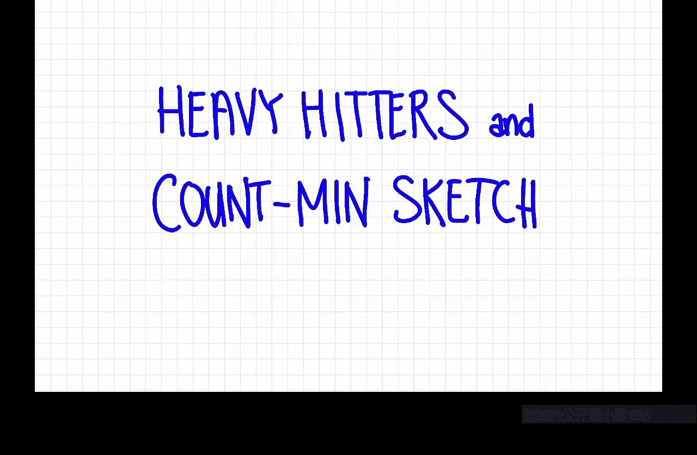

This video has nothing to do with algebraic coding theory。

 but we will soon see some applications of list recovery to the heavy hitters problem。

 which is a problem that shows up in streaming algorithms。

 So we need to introduce that problem first。We'll also introduce the countmin sketch。

 which is a solution to that streaming problem。 And completely independently of algebraic coding theory。

 countman sketch is just a really cool data structure。😊，So here is the heavy hitters's problem。

We get as input a stream of items， X 1， x 2， dotta， dot up to X M that live in some universe U。

And think that curly U is really big。 It has size capital N， which is very large。

And we see little M items of this stream。So when I say stream。

 I mean that this data is kind of streaming past us。 So x1 flies by， and then it's gone。

 and then x2 flies by and then it's gone and so on。 In particular。

 if we want to access X1 or X2 again， we need to write it down before it goes away forever。Okay。

 so that's our input。 Our output is supposed to be a list that contains all of the items X in the universe。

That appear a lot of times in the stream。Where a lot of times means greater than or equal to epsilon times m for some parameter epsilon between 0 and 1。

Notice that there are M items that we're going to see ever。 So this is saying that， like。

 I want all the items that appear at least some constant fraction of the time。

 Notice that there can be at most one over epsilon such items。

The heavy hitters problem comes up all over the place。 So， for example。

 imagine you're a router or something and you're seeing traffic fly by。

 You want to know what's the most common thing that you're seeing， something like that。Okay。

 so this is the problem。Why don't you think for a minute and figure out an answer。

 There's an easy one。Okay， great， there are a couple of easy answers。For example。

 you could just store all of the Xs and figure it out later。

Or you could store a histogram of all of the Xs and update that histogram each time you see one of the items。

Both of those answers are perfectly correct。But the downside of them is that they're going to take a lot of space。

If I want to store all of the X Is， I'm going to have to store M things。

 Let's think that little M is really big。And if I'm storing a histogram。

 I have to store histogram with size of universe possible spaces in it。 So that's capital N。 things。

 Capital N is also really big。 If we have limited space， this easy answer is not O。

So the catch is that you have limited space， and let's say that that limited space can be。

 say polylogarithmic in M and capital N。And there'll also be some dependence on epsilon。

 It's okay if that's polynomial。 Okay， now， how are you going to do this。

 Pause the video and think about it for a minute。Okay， that was mean of me。 Actually。

 this problem is impossible。In particular， it's known that you need at least big omega of capital N space for this problem。

If we assume that little M is on the order of n or larger， let's say。Okay， so that's too bad。

 but wait。When a problem is impossible， we can just define a new problem。

So here's another problem called approximate probable heavy hitters。 Once again。

 we have an input stream X 1 through X M of elements of our universe curly U。

 where the size of curly U is capital N， which is really big。 But now。

 instead of trying to output exactly the set of heavy hitters deterministically。

 we're going to allow ourselves a little bit of fudge factor。 First。

 we're going to allow for a small probability of failure。 And also。

 we're going to allow ourselves to return a list that is slightly too large。

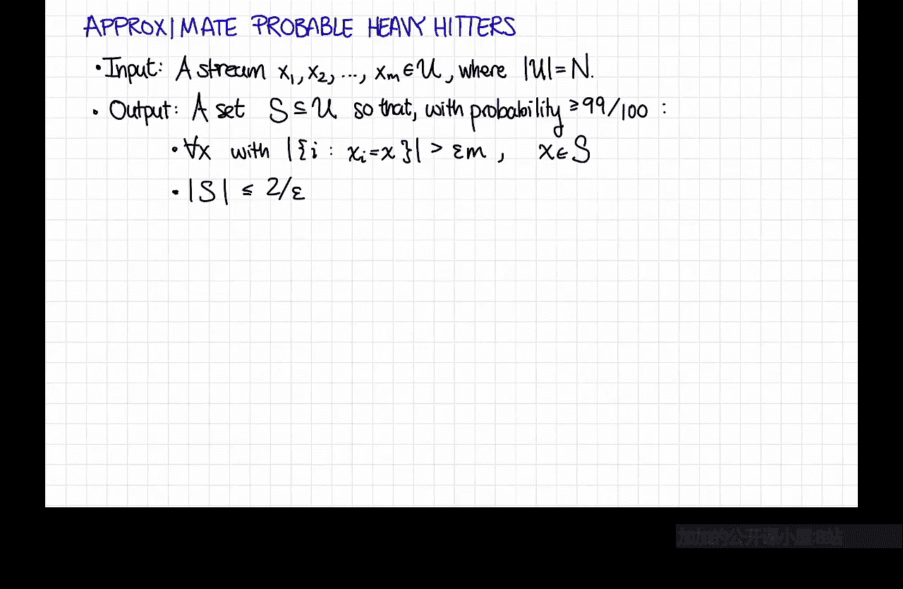

But that's guaranteed to contain all of the heavy hitters。In particular， we want to output a set S。

 which is a subset of the universe so that with high probability， say higher than probability 。99。

 the following holds。First， for all X that appear at least epsilon M times in the stream。

I want to guarantee that X should definitely be in my returned set S。Second。

 I want that return set to not be too large。 It should be no larger than two divided by epsilon。

Notice that S might be as large as1 over epsilon anyway。

 So this is saying no more than a factor of2 bigger than that。Just a side note。

 there are a couple different ways of defining the heavy hitters problem。

 this is how I'm going to do it for these lectures。If we define it this way。

 it turns out that it is possible with sublinear space。In particular。

 with space big O of log n times log N divided by Epsilon。

The solution is something called count min sketch。So here's the count Minke data structure。

Let T be some parameter。 Then I'm going to describe a data structure that is， what do we store。

An update function。 that is what happens when you see an item fly past you in the stream and also a query function。

 which is， how do you return your list of heavy hitters。

 That is the list of items that appeared a lot。Let's start with the data structure。

We're going to store T arrays A1 through At。Each of length， roughly four over epsilon。

 where epsilon is the same epsilon from the definition of the problem。

And let us just imagine for convenience that that is an integer。

Maybe the T arrays looks something like this。Alright， so here are our T arrays。

 They each have length for over epsilon。I'm drawing them kind of like this because I want to think of each cell in the array as being a bucket。

And that leads us to the next part of our data structure。

 which is that we are going to come up with capital T hash functions that hash the universe。

Into these buckets。So I think of H1 as hashing an item in the universe into one of the buckets in a1。

H2 hashees that item into a different bucket in A2 dotta dot。

 H T hases that item into yet a different bucket in A T。So that's the whole data structure。

What do we do with it？So here's how we do the update function。

So let's suppose that we see a stream that looks like this。We have an item X。

And then we have a couple of items， why。And then maybe we have another X。And then I don't know a Z。

A couple more whys。And so on。The point is that this stream is meant to have the item Y as a heavy hitter。

 Now， what happens when we see each of these items in the stream in turn？

 So when we see an item X in the universe， what we're going to do is we're going to。

 for each I between one and T。We're going to look at the I table， AI。

We're going to look at the bucket in that table that the item X hashees to H sub of x。

 and we're just going to increment a counter in that bucket。

So I should say that all of these arrays were initialized to zero。

 and then we're going to keep counters in them and increment those counters。So for example。

 maybe the first item that we see is X。And maybe X lands， I don't know。

 here in the first array and here in the second one。 and here in the teeth1。

 I'm drawing a little X here just to note that that was where X landed。

 But we're not actually going to store x there。 We're going to just make that plus 1。

 So at this point， after we've updated for x。 We have 0，0，0，0， dot do dot 0，1，0，0。Then we see a y。

 we're going to do the same thing。 Maybe y hashees here in this one。

 maybe in this one it hashees to the same bucket as x。Maybe don't here。 it hases there。

And then we see another Y。 They're the same hash functions each time。

 So the same thing is going to happen to the second y。Then we see another X。And Z。Bunch more wise。AW。

And so on。The thing you're supposed to be noticing here。

 Sorry that this is basically illegible is that where the heavy hitters land。

 that is why these buckets are getting really full。All the other buckets， not so much。

That observation informs how we're going to do the query estimate。

 so we want to return all of the items or a list that contains all of the items that appear a lot。😡。

The way we're going to do it is we're going to first try to estimate the number of times an item has appeared。

😡，So let's say we wanted to estimate the number of times that item Y has appeared in this list。

The way we're going to do it is we're going to look at all of the buckets that Y hashed to。

That's these。 And then we are going to read off the counter。

 which is the number of things that landed in that bucket。

So this is always going to be an underestimate for the number of y's that showed up。

 But we're going to hope that at least in one of these possible buckets。

 not too many other things landed there。 For example。

 we got really lucky here and nothing showed up except for why。In that case。

 the counter for this bucket would be exactly the right answer。

 or if not too many other things collided with that bucket。

 it would be pretty close to the right answer。So to that end。

 we're going to estimate the number of times an item has appeared as just the minimum of all of the counters of that item's bucket in all of the different arrays。

Then what we're going to do is we're going to go through all of the items and return the two over epsilon things with the largest estimates。

So hopefully， this makes intuitive sense。However， I'm going to skip the details and the analysis because they're not especially relevant for coding theory。

But it's a fun exercise to try to work it out。 I claim that if you choose the parameters like this。

 So T is log N， and the number of buckets in each array is 4 over epsilon。

Then doing this will succeed with high probability。Okay。

 so that was the countman sketchketch algorithm。 Prety cool。

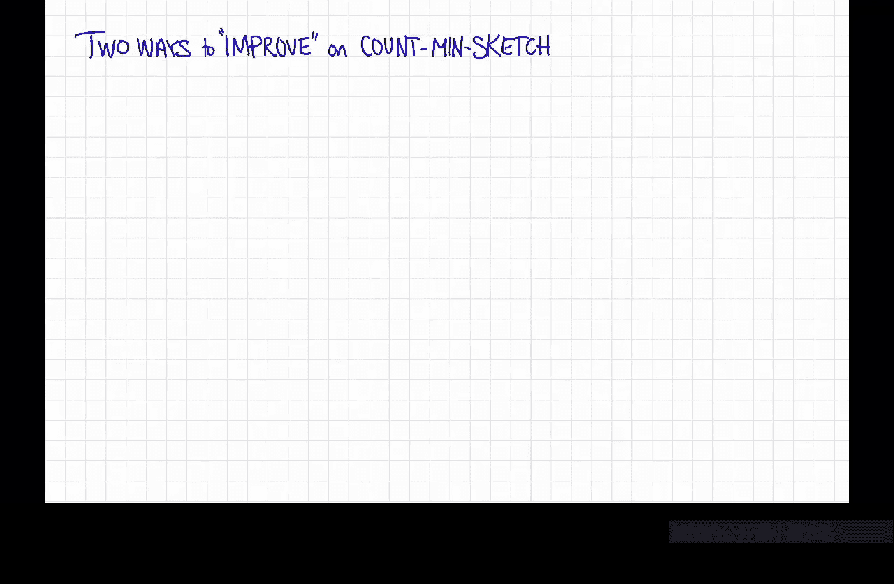

However， there are a few ways we might want to improve on it。

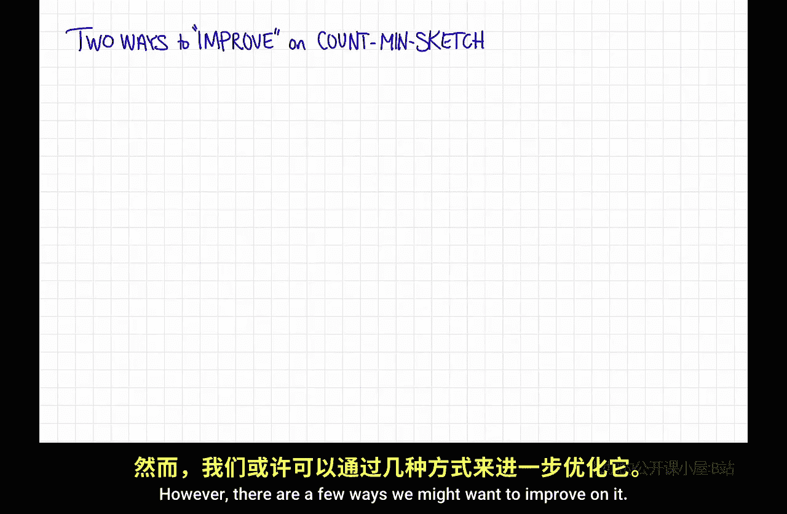

Okay， as an aside， I think that basically this is the nicest data structure ever。

 So it's really hard to improve on。 But if we're looking for things that could be better。

 here are a couple。

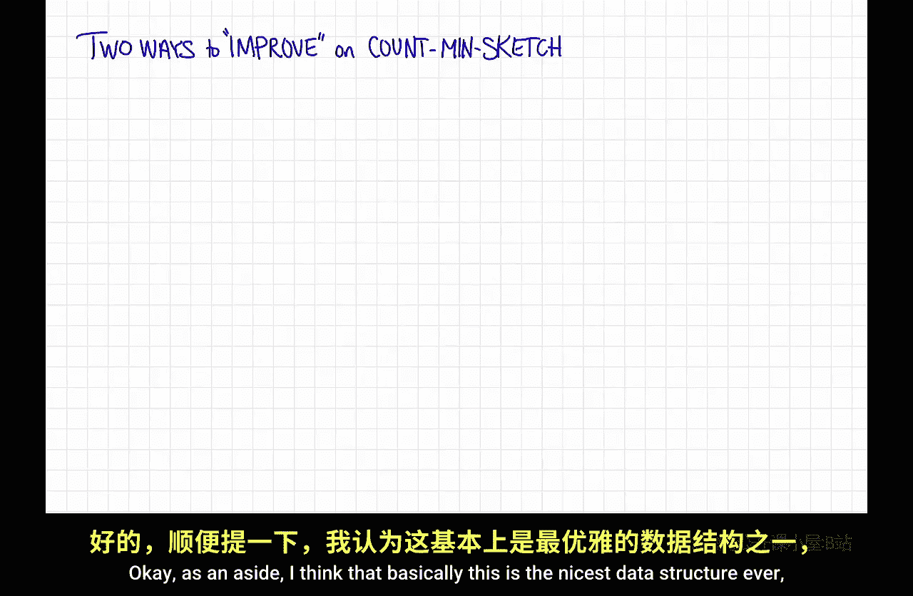

One thing we might hope for is to make it deterministic。

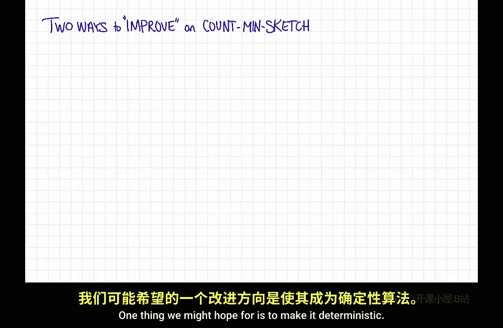

That is， the data structure that I defined on the previous slide was randomized。

 randomized over the choice of the random hash functions。

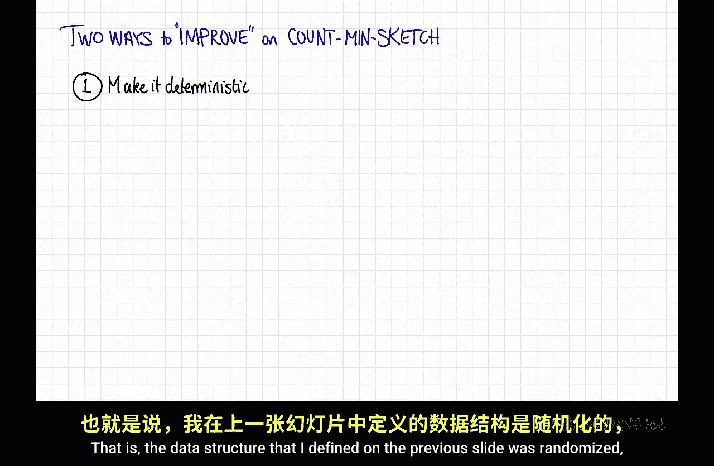

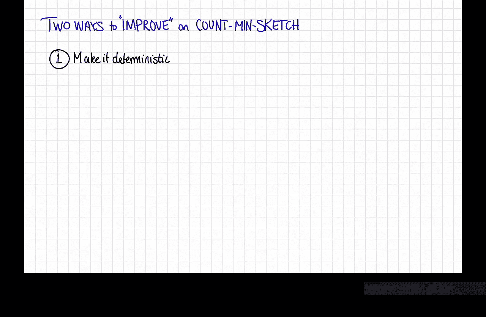

And it had some small fail probability。 We might hope to have a deterministic scheme that gets similar guarantees still with sublineinear space。

 but that is right，100 per of the time。

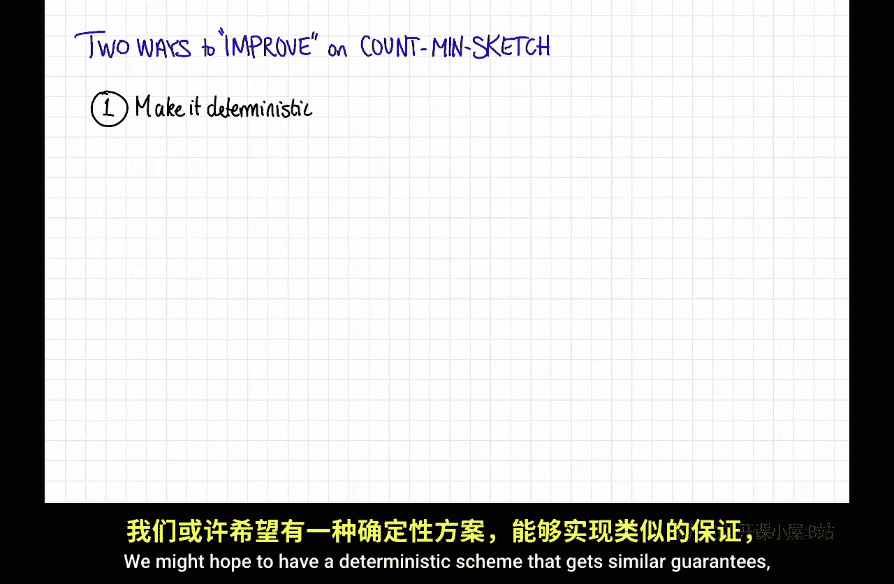

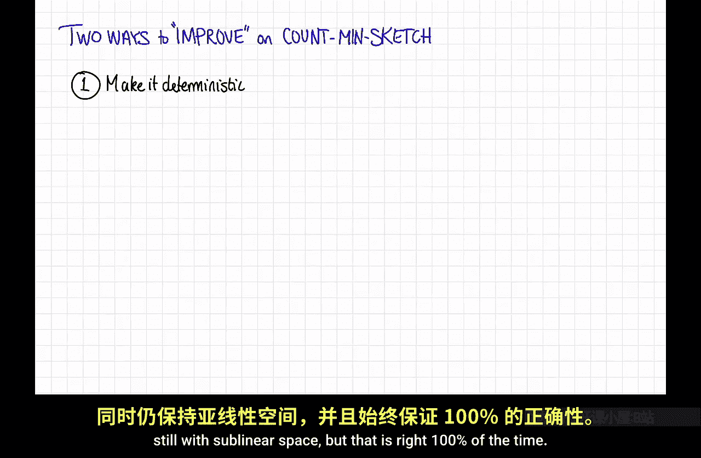

The second thing we might hope to improve is the query time。This algorithm takes really small space。

 but the algorithm that we had on the previous slide。

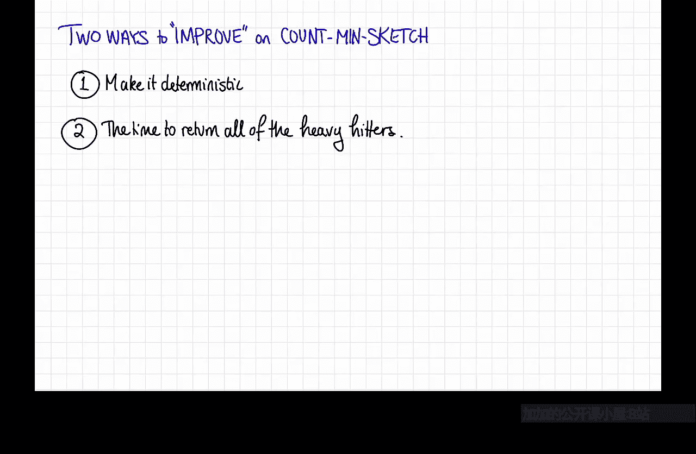

Down here。Well， it's not really an algorithm。 It just says。

 return the two over epsilon things with the largest testaments。How do we find those。Well， naively。

 we just loop through all of the items in the universe and be like， which ones are biggest。

 We could still do that with small space， but it's going to take a lot of time。

So we might hope to keep the small space， the sublinear space guarantee that we had before。

 but hope for also a sublinear time guarantee to return all the heavy hitters。

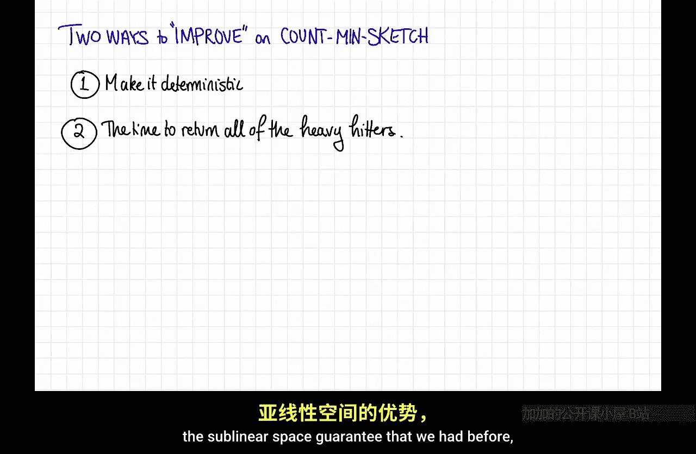

In the next video， we'll see a couple of cute ways to achieve these things using list recovery of Re Solomon codes。

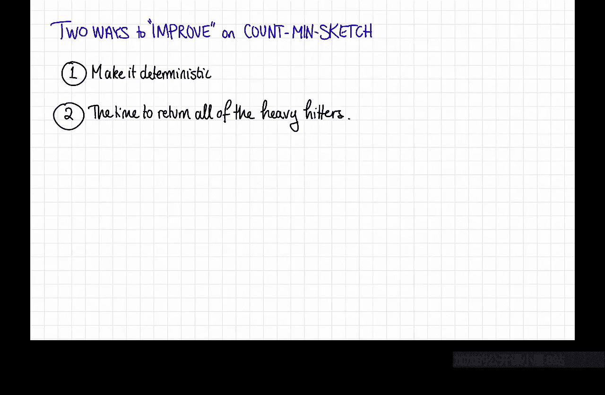