# 代数编码导论：3：大数据流中的频繁项检测 🎯

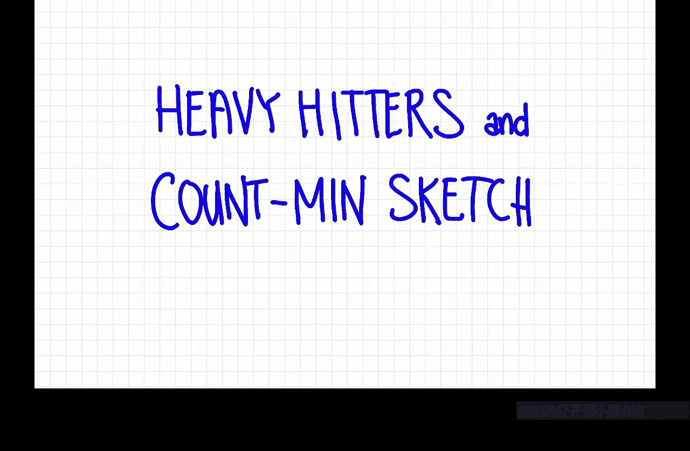

在本节课中，我们将要学习一个与代数编码理论看似无关，但后续会展示其联系的重要问题：大数据流中的频繁项检测问题。我们将介绍该问题的定义、一个经典的解决方案——Count-Min Sketch数据结构，并探讨其潜在的改进方向。

## 问题定义：什么是频繁项？ 📊

上一节我们介绍了课程背景，本节中我们来看看“频繁项”问题的具体定义。

我们有一个输入流，包含 `M` 个来自一个巨大宇宙 `U`（大小为 `N`）的元素：`x1, x2, ..., xM`。所谓“流”，意味着数据依次流过，一旦过去就无法再次访问，除非我们将其记录下来。

我们的目标是输出一个列表，其中包含所有在流中出现次数“很多”的元素。这里“很多”定义为出现次数大于等于 `ε * M`，其中 `ε` 是一个介于0和1之间的参数。由于总共只有 `M` 个元素，这样的“频繁项”最多只有 `1/ε` 个。

这个问题在现实中很常见，例如，网络路由器需要快速识别出最常出现的流量类型。

## 简单方案与空间挑战 💾

为什么我们不直接想一个简单的解决方案呢？以下是两种直观的方法：

*   **存储所有元素**：保存所有 `M` 个 `x`，最后再统计。这需要 `O(M)` 的空间。
*   **存储直方图**：为宇宙 `U` 中的每个可能元素维护一个计数器。这需要 `O(N)` 的空间。

这两种方案在 `M` 或 `N` 非常大时，空间开销都过于巨大。我们的挑战在于，希望使用远小于 `N` 和 `M` 的空间（例如 `polylog(N, M)` 级别）来解决这个问题。

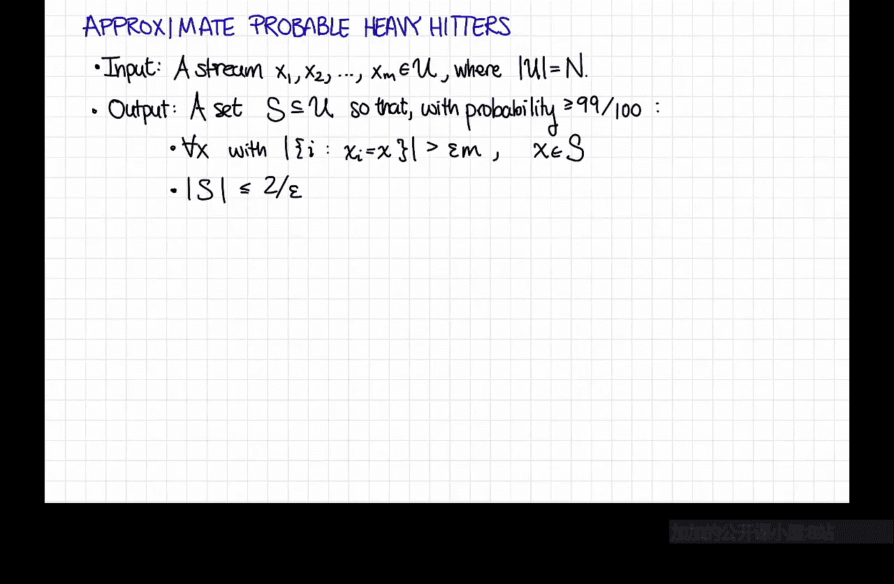

然而，研究表明，如果要求**精确地、确定性地**找出所有频繁项，至少需要 `Ω(N)` 的空间。这意味着在严格定义下，该问题在亚线性空间内是**不可能**解决的。

## 近似频繁项检测问题 ✅

当一个问题不可能解决时，我们可以重新定义一个可行的新问题。

于是我们引入了**近似频繁项检测**问题。输入流不变，但我们对输出放宽了要求：
1.  允许算法有微小的失败概率。
2.  允许返回的列表略大于真实的频繁项集合。

具体而言，我们希望输出一个集合 `S`，使得以高概率（如 >99%）满足以下两点：
*   **包含性**：所有出现次数 ≥ `εM` 的元素 `x` 都一定在 `S` 中。
*   **紧凑性**：集合 `S` 的大小不超过 `2/ε`（最多比真实频繁项集合大一倍）。

以这种方式定义后，该问题可以在亚线性空间内解决。所需的空间复杂度为 `O(log(M) * log(N) / ε)`。其解决方案就是 **Count-Min Sketch** 数据结构。

## Count-Min Sketch 数据结构 🏗️

上一节我们定义了可解的问题，本节中我们来看看其经典解决方案——Count-Min Sketch。这是一个非常巧妙的数据结构。

首先设定一个参数 `T`。该数据结构包含以下部分：

**数据结构存储**
我们存储 `T` 个数组 `A1, A2, ..., AT`。每个数组的长度约为 `4/ε`。你可以将每个数组位置想象成一个“桶”。

同时，我们准备 `T` 个哈希函数 `h1, h2, ..., hT`。每个哈希函数 `hi` 负责将宇宙 `U` 中的元素映射到数组 `Ai` 的某个桶中。

**更新操作**
当流中出现一个元素 `x` 时，我们进行以下操作：
对于每个 `i` 从 1 到 `T`：
1.  计算 `hi(x)`，得到它在数组 `Ai` 中的目标桶索引。
2.  将该桶内的计数器加 1。

所有数组的计数器初始值均为 0。

**查询与估计**
为了找出频繁项，我们首先需要估计每个元素出现的频率。
对于宇宙中的任意元素 `y`，我们按以下方式估计其出现次数 `count(y)`：
1.  查看 `y` 在 `T` 个数组中分别被哈希到的桶：`A1[h1(y)]`, `A2[h2(y)]`, ..., `AT[hT(y)]`。
2.  读取这些桶中的计数器值。
3.  取这些计数器中的**最小值**作为 `count(y)` 的估计值。公式表示为：
    `估计值(y) = min{ A1[h1(y)], A2[h2(y)], ..., AT[hT(y)] }`

**原理直观解释**
为什么取最小值？因为桶计数器可能被其他哈希到同一桶的元素“污染”而偏高。最小值是所有估计中最不可能被高估的（尽管可能被低估）。如果一个元素是频繁项，我们希望至少有一个哈希函数能将其映射到一个相对“干净”（碰撞少）的桶，从而获得一个接近真实值的估计。

最后，我们扫描所有元素，返回估计值最大的那 `2/ε` 个元素作为候选频繁项集合 `S`。

**参数与性能**
可以证明，如果设置参数 `T = O(log N)`，每个数组长度 `L = 4/ε`，那么上述方案能以高概率成功解决近似频繁项检测问题。

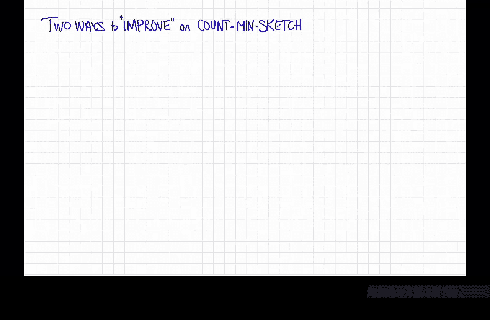

## Count-Min Sketch 的潜在改进方向 🔧

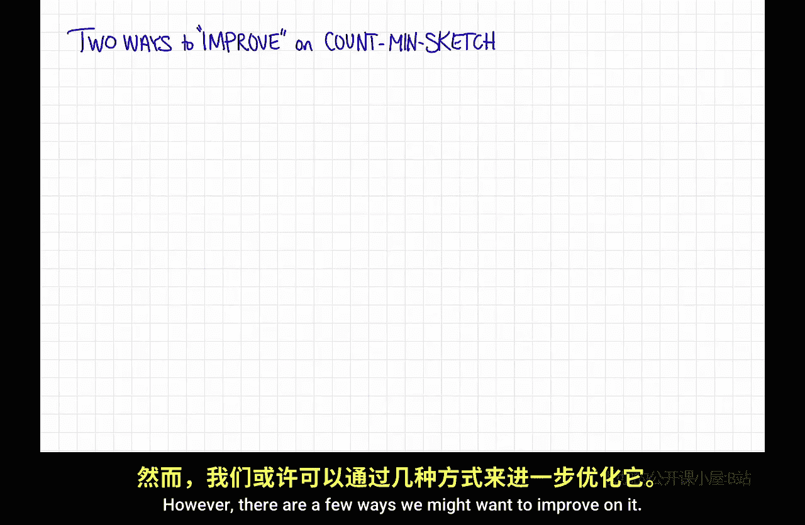

尽管 Count-Min Sketch 是一个非常优雅高效的数据结构，我们仍可以思考其改进空间。以下是两个可能的改进方向：

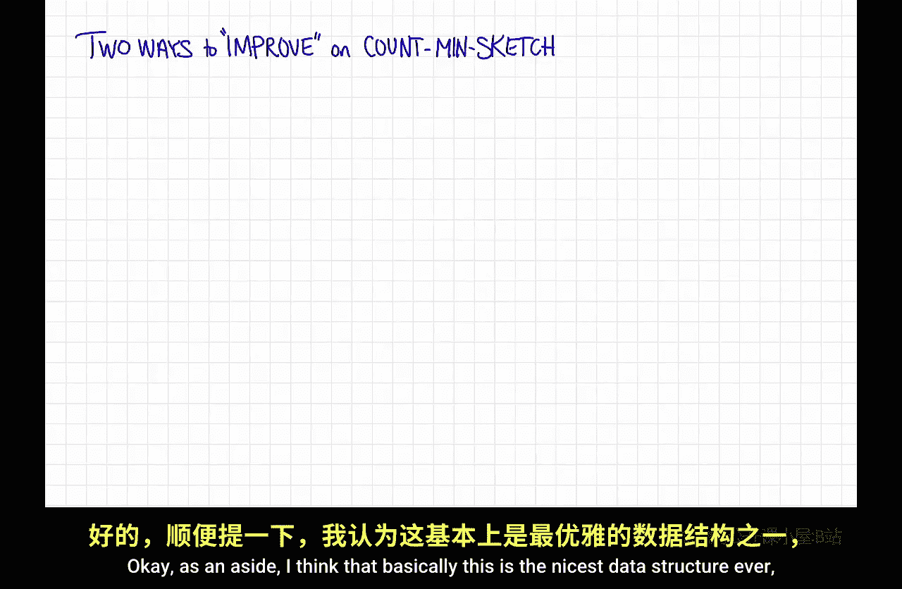

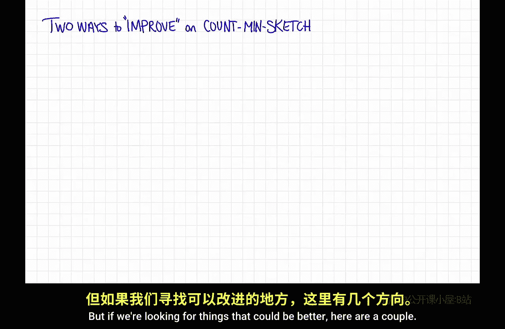

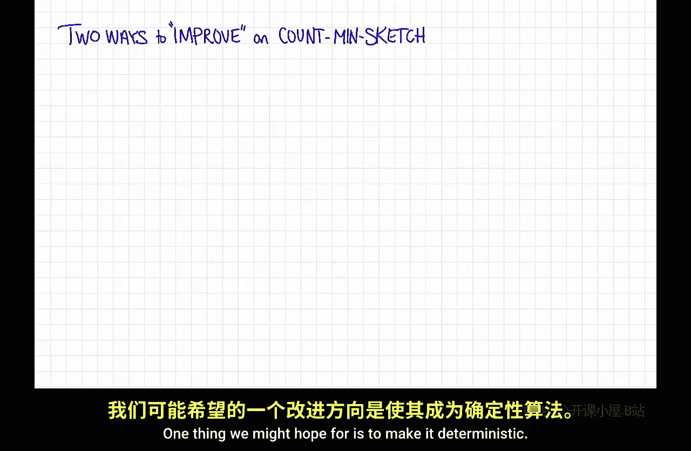

**1. 确定性方案**
当前的 Count-Min Sketch 是随机化的，其正确性依赖于随机选择的哈希函数，并有一个小的失败概率。我们可能希望找到一个**确定性**的方案，在保持亚线性空间的同时，获得类似的保证，并且100%正确。

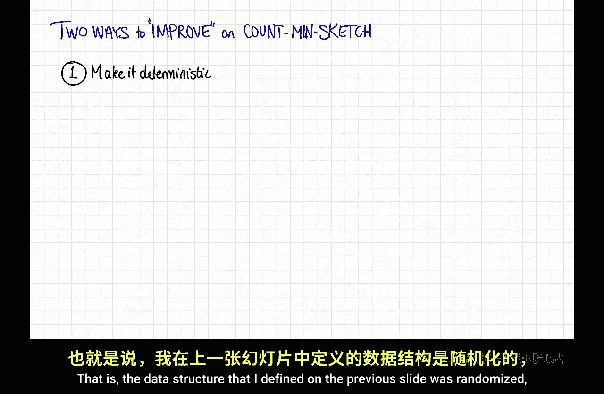

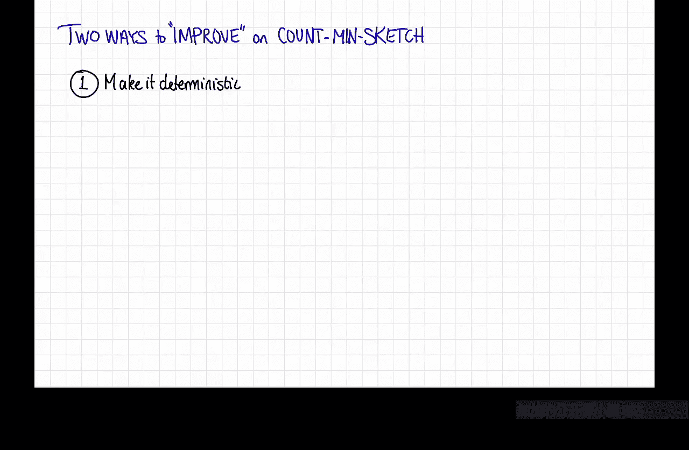

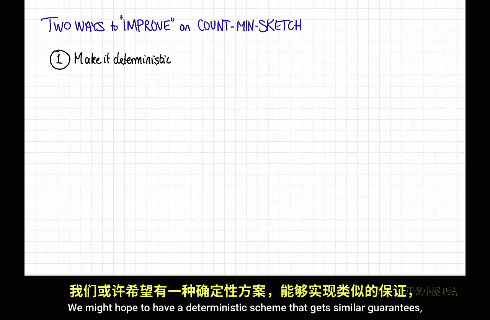

**2. 更快的查询时间**
当前方案在查询时需要遍历整个宇宙 `U` 中的所有元素来计算估计值并找出最大的那些。虽然空间是亚线性的，但查询时间是 `O(N)`，对于巨大的宇宙来说可能太慢。我们可能希望在保持亚线性空间的同时，也能实现亚线性的查询时间。

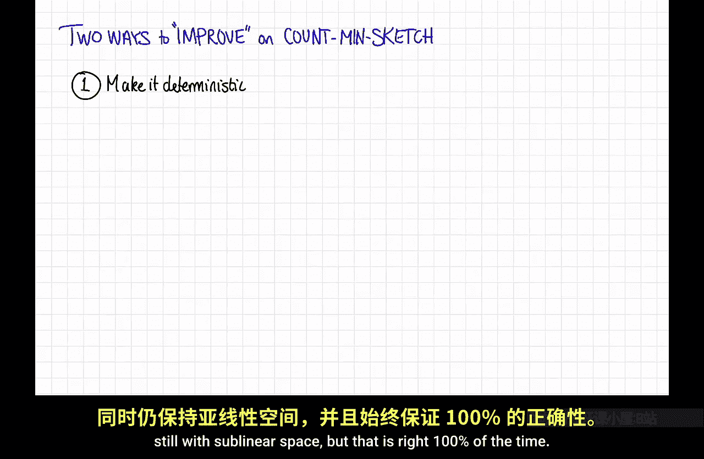

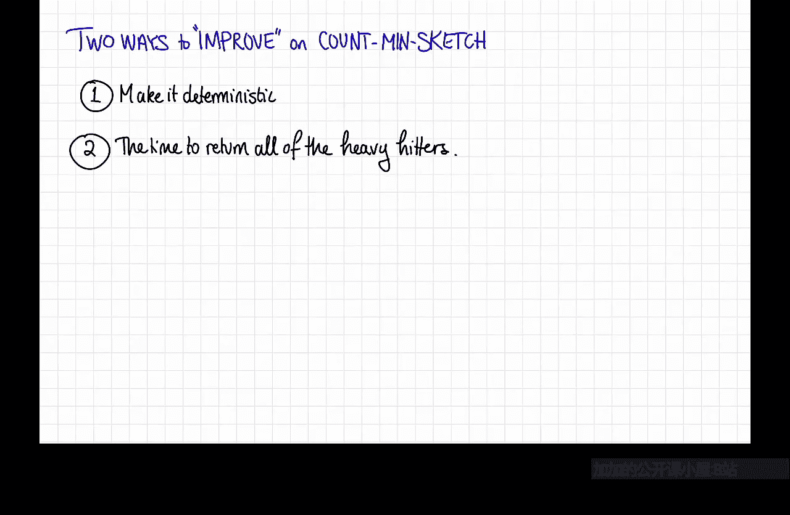

## 总结与下节预告 📚

本节课中我们一起学习了大数据流处理中的经典问题——频繁项检测。
*   我们首先了解了精确检测在亚线性空间下的不可能性。
*   接着，我们定义了可行的**近似频繁项检测**问题。
*   然后，详细介绍了解决该问题的 **Count-Min Sketch** 数据结构，包括其结构、更新和查询操作。
*   最后，我们探讨了该数据结构在**确定性**和**查询效率**方面可能的改进方向。

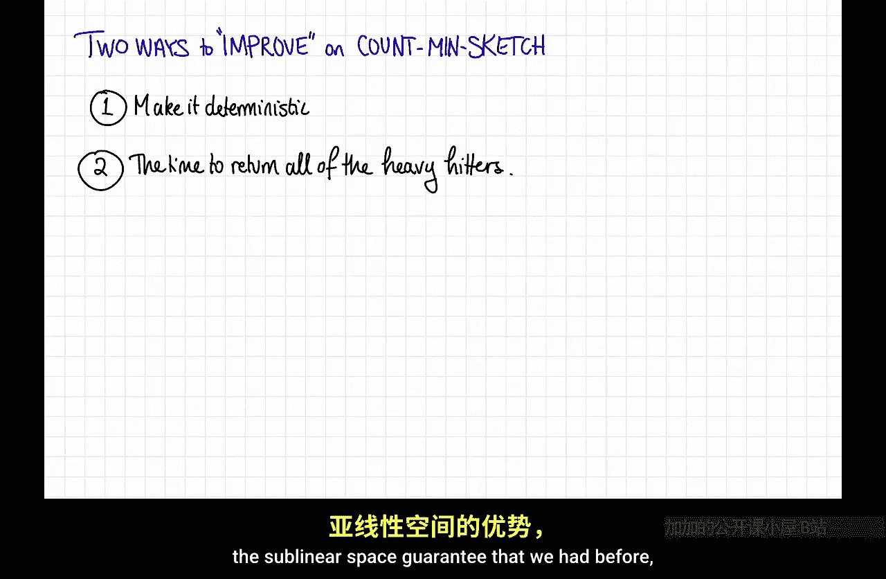

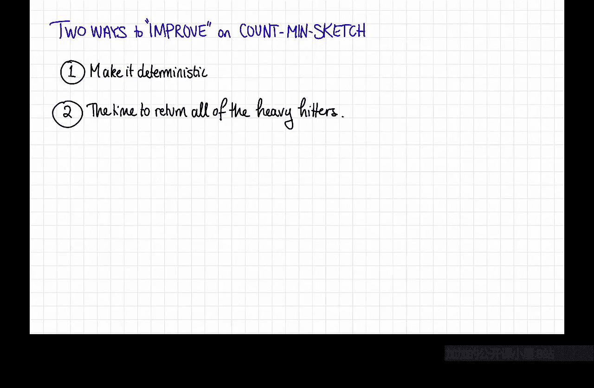

在下一节课中，我们将看到如何利用**里德-所罗门码的列表恢复**特性，以非常巧妙的方式来实现这些改进。