# 斯坦福大学【中英⚡代数编码导论｜Introduction to Algebraic Coding Theory】 p43 p42 12, Video 4： Applications of List Recovery -BV16sRYYTEwg_p43-

In this video， we'll mention several applications of list recovery。

 and we'll sketch the basic idea of an application to the heavy hitters problem。

 which we described in a previous video。One of the reasons that it's useful to think about list recovery as a generalization of list decoding is that list recovery has tons of different applications。

 not just in codingding theory， but in lots of places within codingding theory。

 though One big application is list decoding itself。

This is actually one of the reasons that list recovery was first defined。

It turns out that you can use list recoverable codes and you can use list recovery algorithms in order to design better list decodable codes。

 That is， you take your list recoverable code and you manipulate it in some way。

 And this allows us to get better list decodable codes than we knew how to get earlier。

 So if you're just interested in coding theory， list recovery very， very useful。 However。

 even beyond coding theory， list recovery has tons of uses。

It's connected to a lot of different ideas in pseudoranomness。

 like extractors and expanders and condensers and stuff like that。

 If you know what those buzzword are。It shows up in for lots of different applications in cryptography。

And also it shows up in algorithm design， for example。

 in algorithms for group testing and compressed sensing。

 which we've both seen in earlier videos and heavy hitters。

 which is the application that we will talk about a little more in this video。Today。

 we're just going to talk about the heavy hitters application。

 If you' are interested in some pointers to the rest of these， check out the lecture notes。

A quick disclaimer on this video。This is going to be pretty sketchy。

That is the point of this video is to just give you a flavor of how list recovery can be useful outside of coding theory。

 so I'm not going to go into any of the nitty gritty details and I'm not going to work out all the parameters or anything like that。

You're welcome to do that for fun if you want to， but I'm not going to do it in this video。

So this video will be pretty sketchy， both in that I will just sort of sketch these applications。

 And also， we're gonna to talk about sketching algorithms。

So let's quickly recall the countminke data structure that we saw in the previous video。

We have these T arrays。 And when we see an input stream like。X， X， Y， X， Y， Z， X， Y， Y。

 or something like that。 will process each one of these items in turn by hashing them to the appropriate bucket and incrementing a counter。

So for example， if x hashes here。In these different arrays。

 than after we see this whole string will have seen。F possible x's， so these counters would be four。

Notice that we're not storing X itself。 I'm destroying it that way to keep track of where the different counters are coming from。

 We'll have seen four Ys， maybe those hash like here。And a Z。

And if I wanted to estimate how many times， say， why appeared。

I would look at all the buckets where Y landed。 and I would take the minimum count over all those buckets。

 which in this case would be this one， and that would be 4， which in this case was the right answer。

 Hooray， Then if I want to return all of the heavy hitters。

 I'm going to loop over all the items in the universe and just find the top ones。

 One problem which we mentioned at the end of the previous video I that this algorithm is pretty slow。

We have to iterate over all of the items in the universe。 And as the name suggests。

 the universe is kind of large For the rest of this video。

 We'll see two different ways that list recovery can be used to ameliorate this problem。

And the first way will actually result also in a deterministic construction， which is pretty neat。

 So here's the first way。We're going to use exactly the same data structure as countman sketch。

 except we're going to replace the random hash functions with a read Solomon code。 More precisely。

 let's fix some distinct evaluation points。 Al 1 through alpha n in FQ。

Now let's consider a read Solomon code of rate， say epsilon over 10。

 where epsilon is the same epsilon from the definition of the heavy hitters' problem。

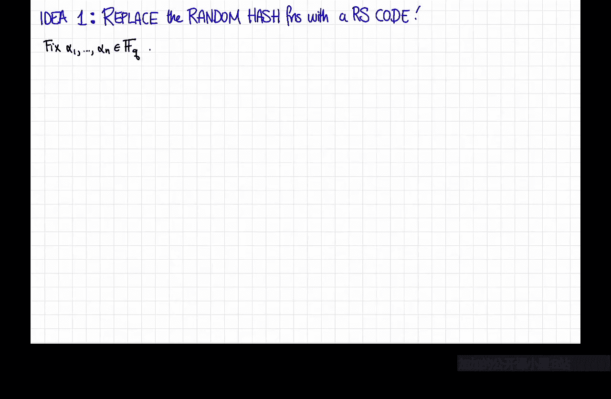

Let's also choose n to be equal to Q。 So this is just a full length read Solomon code。

So if you go back and look at the theorem that we proved about list recovery of read Solomon codes。

 you'll find that this read Solomon code is efficiently list recoverable with parameters P equal to 0 L equal to1 over Epsilon。

 little L equal to1 over Epsilon and big L on the order of1 over Epsilon。

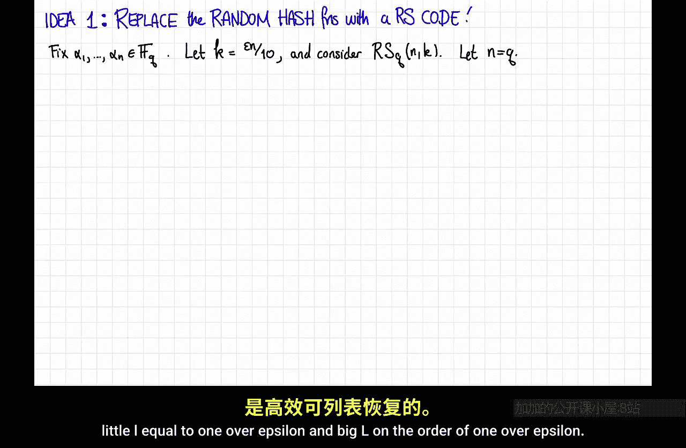

Indeed， let's check this real quick。So here I have a corollary。That we proved in a previous video。

 and I claim that if you plug in L equal to one over epsilon and gamma equal to1。

 you get that claim that I just made。If you don't believe me。

 you can pause the video now and verify that that is true。

Note that this constant 10 here isn't doing anything in particular。

 It's just some fudge factor to make sure that I don't mess up with the plus minus ones or floors and ceilings or something like that。

Okay， so we've got our list recoverable read Solomon code。 Now。

 what we're going to do is we're going to implement the countman sketch algorithm。

 But using this read Solomon code instead of the hash functions。 Here's what I mean by that。

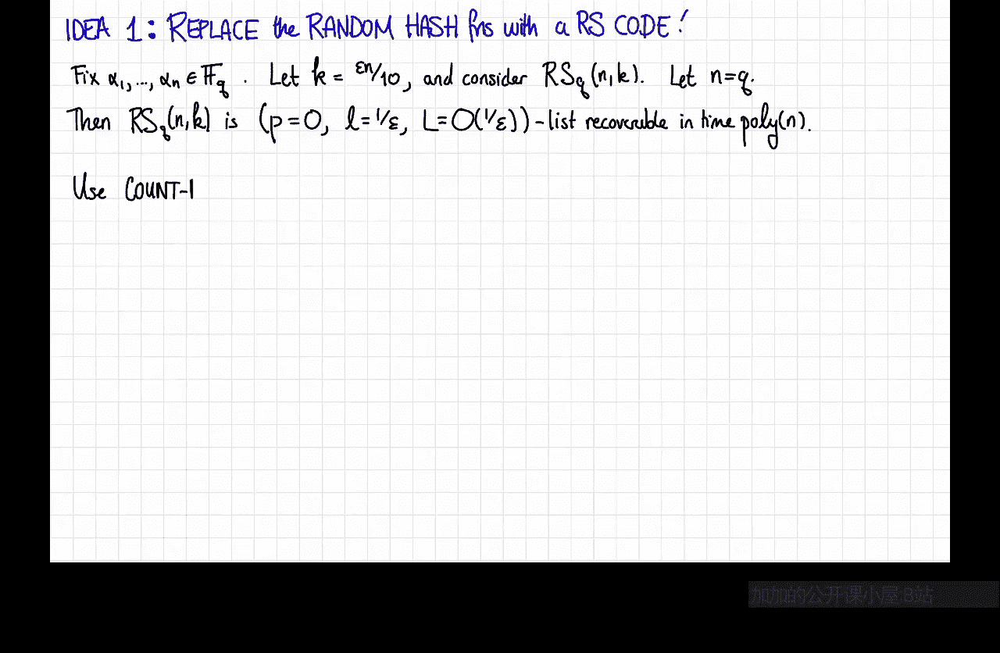

First， we're going to associate the universe with all of the polynomials of degree less than or equal to k -1。

Notice that this implies that the size of U is Q to the K。

Which is equal to Q to the Epsilon n over 10 or something like that。And this means that， N。

Is it most log size of the universe。Divided by epsilon。In particular， if we're doing stuff in time。

 polynomial and N， that's going to be poly logarithmic in the size of the universe。

 and that will be good for us。Okay， so we're identifying every object in our universe with a polynomial。

Now， instead of the random hash functions that we used in the countman sketch。

We're going to use evaluating polynomials at particular evaluation points。 In particular。

 let's select the hash function H JF。 So this is hashing a polynomial F。

 which is an item in our universe。I'm going to define this as F of alpha J。

So I'll just evaluate that polynomial on the J evaluation point， which we fixed earlier。

And we'll define this for all J from one to N。So let's see what this picture looks like in this context。

So we've got the same thing as before， except instead of these names， A1 through A T。

I'm going to think about these as each being an evaluation point。

 So this is the array that corresponds to alpha 1。 This is alpha 2。This is Alpha T。

Capital T is equal to n here。 And then each of these buckets。

Is going to be associated with a value that that polynomial could take on。Let's say beta 1。

 beta 2 up to beta  Q。 These are all of the values in Fq。Now。

 when we see a sequence of items in our universe， say we see a polynomial F a couple of times。

And then some polynomial G。And then F again。Some H。A bunch of Gs and so on。

What we're going to do is we're going to first， when we're processing this F。

 we'll evaluate it on all of these points。Let's say that f of alpha 1 happened to be equal to B2。

If that were the case， we'd put F there。And then f of alpha 2 is going to be equal to something else。

 Maybe it's this beta。So he'd put F there。And so on。And once again。

 we do this for all of our items in our stream。And now we have these counters。

For all of our different bins。Okay， so now what are we going to do？

This is the  query algorithm we had before。 Let's get rid of that。 We're not going to do that。

 That was slow。Instead， what we're going to do is run a list recovery algorithm。In particular。

 we're going to let SI。Be equal to all of the values beta。Such that。AI。

The bucket corresponding to beta has a counter in it that is large， greater than epsilon times M。

So in this case， S1， which corresponds to this first array here。

 might contain beta 2 and whatever beta this beta is。

 because those are the two fullest buckets or something like that。

 So's just all the buckets that have enough stuff in them。

Notice that there are at most one over epsilon， such buckets。Because otherwise。

 there's going to be more than M items in the whole array。

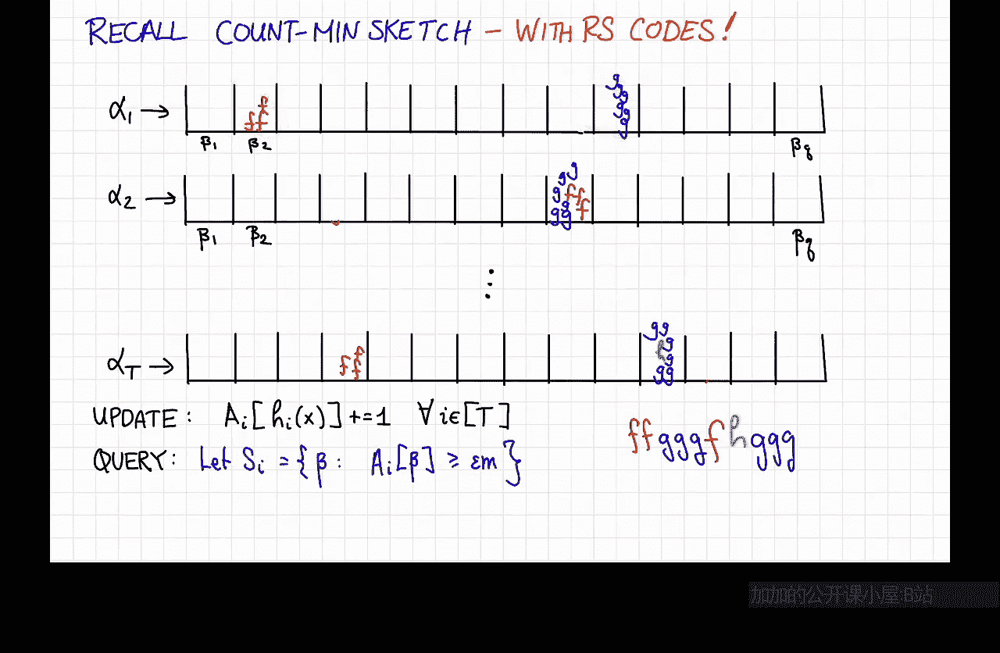

So the size of S is at most one of Repson。Now， what we're going to do is list for cover。

Using these lists as sub。Why is that a good idea， Well， suppose that， as in this little example here。

 G was some heavy hitter。That is， G appears at least epsilon times M times in the entire stream。

That means that G's bucket in every single array。Has at least epsilon M things in it。In other words。

 G of alpha I is going to appear in S I for all I。And this is precisely what a list recovery algorithm for read Solomon codes does。

 It takes these input lists S I， and it returns all of the polynomials G of low enough degree。

So that G of alpha I is an S for all of the Is。Therefore。

 we will return G and any other heavy hitter two。So returning to this slide， let's just write。

 Up is the same as before。And queryery is just run the list recovery algorithm。

Notice that since the size of S I is no more than one over epsilon。

 and we conveniently chose little L to be equal to one over epsilon， This works out。

 and we're guaranteed to get a list of size no larger than big O of1 over epsilon。Okay。

 I guess I'm remembering now that when I defined the heavy hitters problem。

 I said I wanted this to be two over Epsilon。 and maybe this will be a little bit larger。

 But now let let's call it good enough。It's a good exercise to work out the precise parameters here。

But the most important thing is that everythings in sight is going to be polynomial in N。

And N was log size of the universe divided by epsilon。 So that means that everything in sight。

 the storage， the running time， et cetera， is going to be polynomial in log of the size of the universe and whatever epsilon。

And for the purposes of this video， we will call that a win。If you do work it out。

 you'll find that the parameters for this are a little bit worse than the parameters for the original countman sketch。

 but we've gained two things。 First， it's a deterministic scheme instead of randomized。

 that's pretty cool。And second， we have an efficient。

 meaning polynomial in this time algorithm to do the querying that is to find all the heavy hitters。

Okay， so that's the first idea。Let's move on to the second idea。

 So this is another idea that uses list recovery of read Solomon codes to speed up the query time for countman sketch。

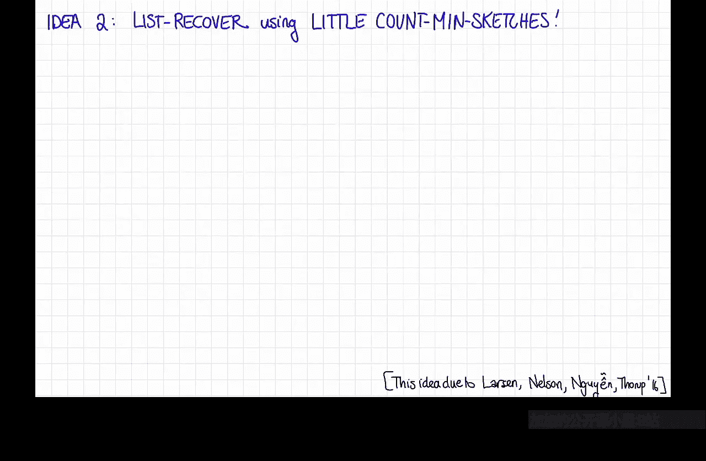

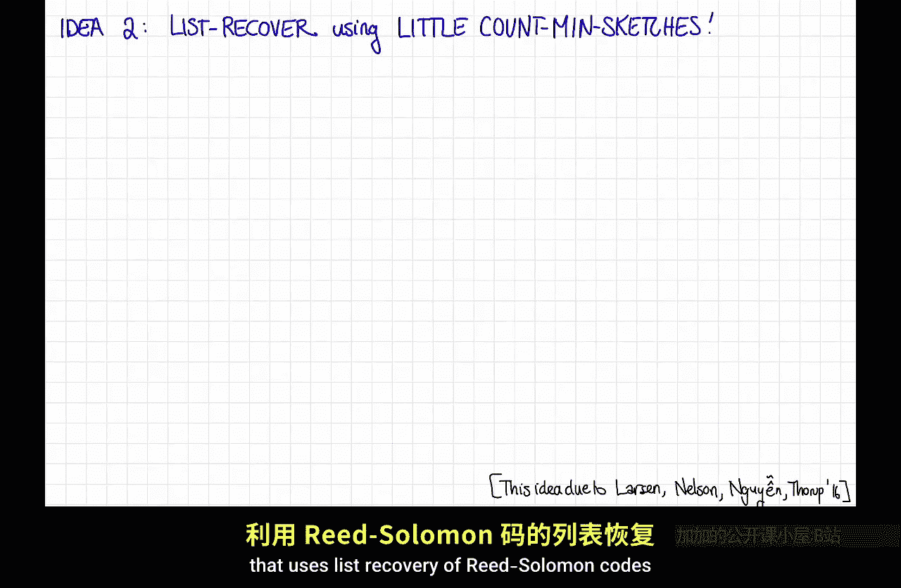

But it's a different idea。 So forget everything you just saw from I 1， we're going start again。Okay。

 don't forget quite everything from I 1。I'm going to copy and paste the setup that we had for idea1 here because we're' going to use the same setup。

We're going to pick a read Solomon code。That is list recoverable with little L equal 1 over epsilon。

 Big L is big O of1 over epsilon， and P equals 0。Actually， hang on。

 I don't want little L to be one over Epsilon。 I'm gonna want it to be two over Epsilon。

 That's important。So I guess we should change this 10 to a 20 just to be safe。Okay。

 so we have our read Solomon code exactly the same as we had before。 Maro this factor of 2。

 And as before， we're going to associate the universe with the set of all polynomials of degree at most K -1。

 Now， we're going to use a different data structure。 It's not the countmin sketch data structure。

 It's going to be a bunch of little countmin sketches。That is。

 I'm going to initialize N little countman sketches。And when I say little， I mean。

 that they're going to be for a littleer universe。 They're going to be for the universe， F sub Q。

Let's recall that as before， we're going to set Q， which is equal to n。

And that's going to be big O of log of capital N divided by epsilon。

 where capital N is the size of the universe。That's because the parameter setting is basically exactly the same as it was before。

 and this is what we got before。So that means that the universe for each of these little countmen sketches is basically logarithmic in the size of the actual universe。

 In particular， it means that because they are so small。

 we can do slow algorithms like the algorithm that just brute force searches over the whole universe reasonably quickly in time。

 polynomial in log N。So if that's our definition of fast。

 all of these things have fast query algorithms。What we're going to do next is use list recovery to bootstrap these little things with their fast algorithms to a big thing。

Here's how we're going to do that。So suppose we start with some item F。

 and we want to run an update on this item。 So we see this item。

 and we want to update our data structure。The first thing we're going to do is we are going to encode this with a read Solomon code。

 that is we're going to evaluate F at all of our evaluation points。

Ending up with F of alphapha 1 through F of alphapha N。

 The next thing we're going to do is we're going to update each of our little countmen sketches with these items。

So update the first one with F of alpha 1， the second one with F of alpha 2 and so on。

So our update algorithm is this to update on an item F in the big universe。

 We're going to update the I little countman sketch with F of alpha I。

 which lives in our little universe F Q。Then when it comes time to query。

 we're going to ask each one of these little countman sketches to run their query algorithm。Again。

 because they are so small， they can do this in time。 polynomial in little N。

 which is logarithmic in bigen。So we're going to do that。

 And we're going to get lists output by each of them。

 which I am suggestively going to name S1 through S N。Hopefully at this point。

 you see where this is going。Our query algorithm is then going to be。Run list recovery on these Ss。

Let's try to intuitively understand why this works。 Suppose that F is some heavy hitter。

 So it shows up a lot。 That means that F of alpha 1 is going to show up a lot for the first coordinate。

It might also show up because some other polynomial G happens to agree with F on the evaluation point alpha 1。

 but certainly this F of alpha1 is going to show up a lot。Therefore， hopefully。

 this little count minket is going to pick up on that。

 And that F of alphapha 1 is going to show up in S1。

 So then what we're left with is a bunch of lists。So that if F is a happy hitter。

 F of alpha I appears in a bunch of these lists。And once again。

 that is precisely the list recovery problem。That we solve up here。Each of these lists。

 by our guarantee on countman sketch， has size no more than two over epsilon。

 which is conveniently how we set little L here。And everything works out。

I just realized that actually maybe we shouldn't have set p equal to zero because there's some small probability that these things will fail。

So I guess to make this precise， actually， you should go back and set P to be some small constant and figure out how that needs to adjust the other small constants。

 But the big picture is not going to change。 Q and N are still going to be logarithmic and n。

 and everything in sight is going to be polynomial in that。But modular the details。

 This idea does work， and it does give us a fast query algorithm。 Once again。

 I'm not going to work out the parameters。 It's a fine exercise to do so， if you feel like it。

But it turns out that we do take， again， a little bit of a hit compared to the original countman sketch。

 This is going to take a little bit more space。 The update time is going to be a little bit longer。

 However， the query time is a lot faster。The reason is that all we need to do is run the query times for each of these little things。

 That's fast because they're so little。 And then we need to run the list recovery algorithm that takes time。

 polynomial and little N， which is polylogarithmic in big N。So at the end of the day。

 we have sublinear space and a sublinear time query algorithm。

Note that this algorithm is still randomized because we're using our little randomized countman sketches as in earth thingss。

Okay， so those are the two ideas that I wanted to tell you about using list recovery to speed up algorithms for heavy hitters。

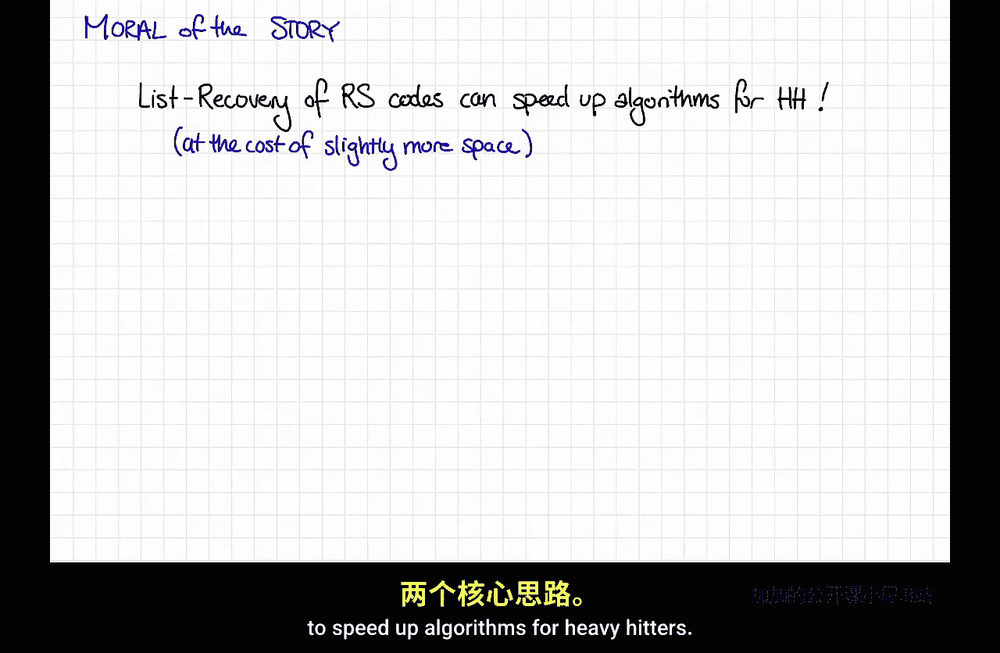

The moral of the story is that list recovery can be pretty useful。

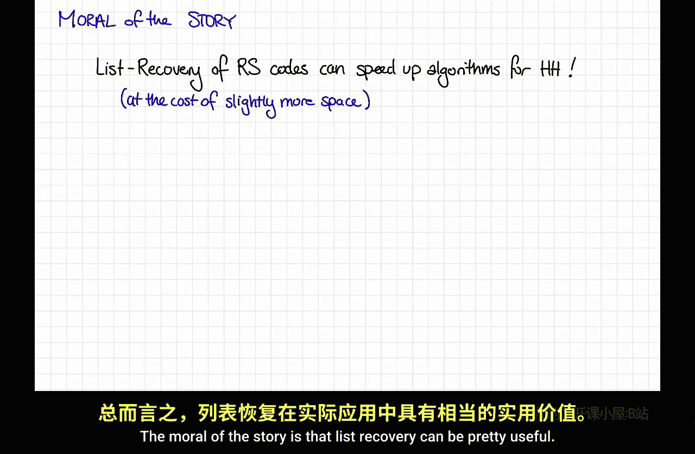

In this particular context， it allows us to speed up the query algorithms of count Minsket at the cost of adding slightly more space and a slightly slower update algorithm。

I didn't work out any of the parameters here， since that's not really the point of this video。

 But as I mentioned earlier， it turns out that there is a little bit of overhead in the space in the update time necessary to use these ideas。

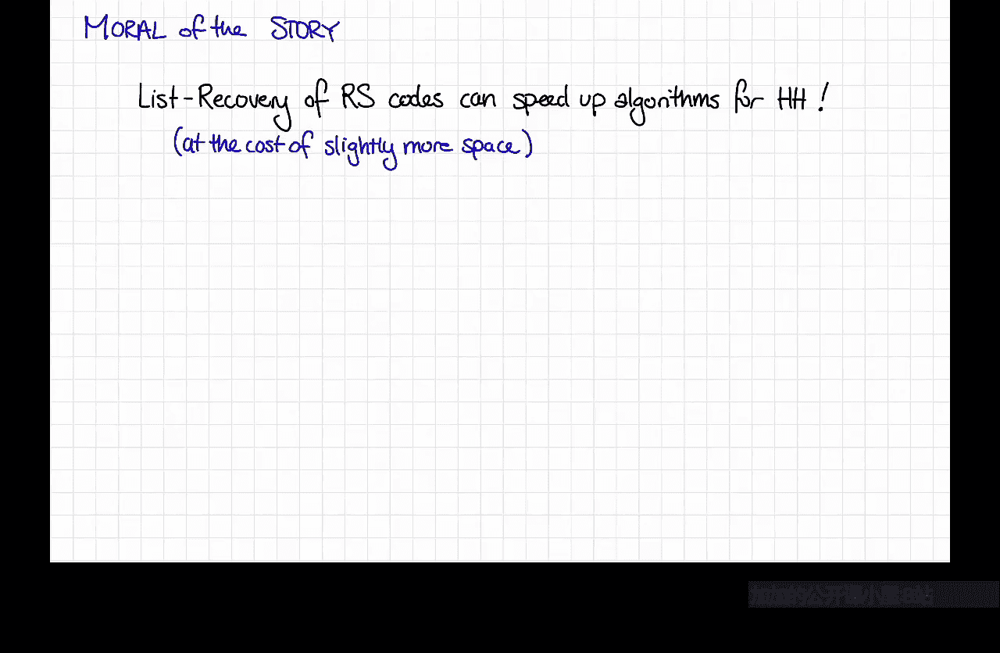

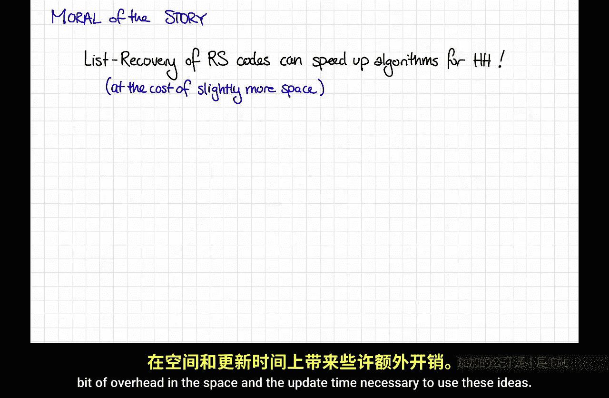

There's actually some really cool work on heavy hitters that does better than this without list recovery。

 So these results that I just showed you are not the state of the art for heavy hitters。 However。

 I think they are really cute， and also I think they do a good job of showcasing how list recovery can be a powerful tool in algorithm design。

😊。

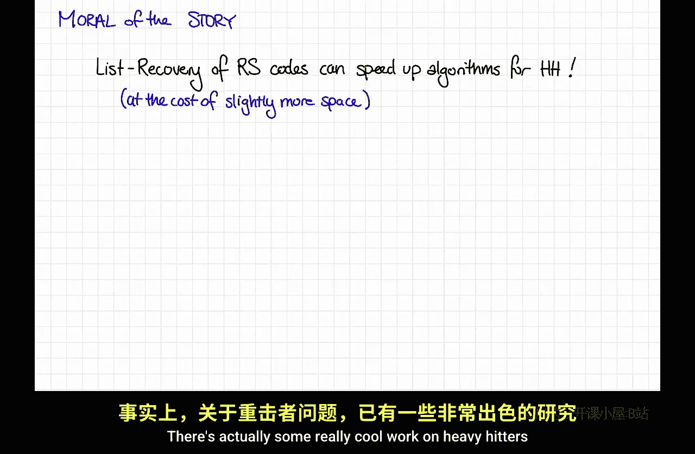

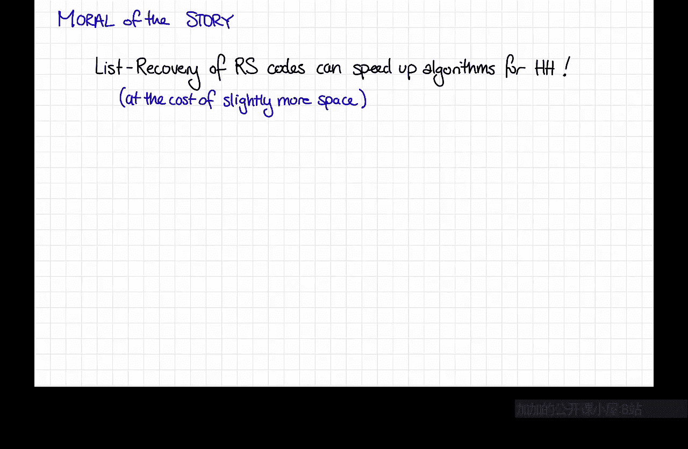