# 代数编码导论：4：列表恢复的应用

在本节课中，我们将探讨列表恢复的几种应用，并重点概述其在“频繁项问题”中的一个应用思路。列表恢复作为列表解码的推广，其应用范围远超编码理论本身，在伪随机性、密码学和算法设计等领域均有重要价值。

## 列表恢复的应用概述

上一节我们介绍了列表恢复的基本概念。本节中我们来看看列表恢复的广泛应用。

列表恢复之所以有用，是因为它不仅是列表解码的推广，还在编码理论内外有大量应用。在编码理论内部，列表恢复本身就是一个重要工具。列表恢复最初被定义的原因之一，就是可以利用列表可恢复码及其算法来设计更好的列表可解码码。通过操作列表可恢复码，我们可以获得比早期方法更优的列表可解码码。

然而，列表恢复的应用远不止于编码理论。它与伪随机性中的许多概念相关，例如提取器、扩展器和浓缩器等。列表恢复也出现在密码学的多种应用中。此外，在算法设计领域，例如在分组测试、压缩感知以及我们将在本节重点讨论的频繁项问题中，列表恢复也扮演着关键角色。

今天，我们主要讨论频繁项问题的应用。关于其他应用的指引，请查阅课程讲义。

需要说明的是，本节内容将较为概略，旨在让大家体会列表恢复在编码理论之外的用途，因此不会深入细节或计算具体参数。有兴趣的观众可以自行深入研究。

## 应用一：使用RS码替代哈希函数

首先，我们快速回顾上一节介绍的Count-Min Sketch数据结构。我们有T个数组。当处理输入流（例如 X, X, Y, X, Y, Z, X, Y, Y）时，每个项会被哈希到相应数组的桶中，并增加对应计数器的值。

例如，如果X被哈希到这些位置，在处理完整个流后，我们看到了4个X，那么这些计数器会显示为4。注意，我们并不存储X本身。我们可能看到4个Y和一个Z。如果想估计Y出现的次数，我们会查看Y被哈希到的所有桶，并取这些桶中计数的最小值，在这个例子中结果是4，即正确答案。

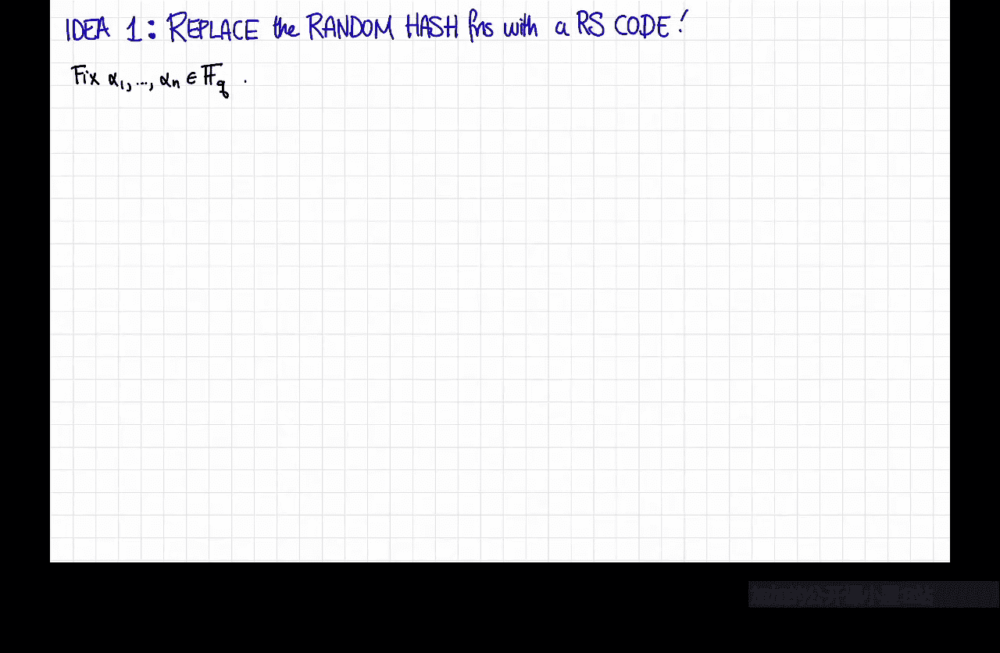

为了返回所有频繁项，算法需要遍历全集中的所有项并找出计数最高的项。然而，正如上一节末尾提到的，这个方法速度很慢，因为需要遍历整个可能很大的全集。

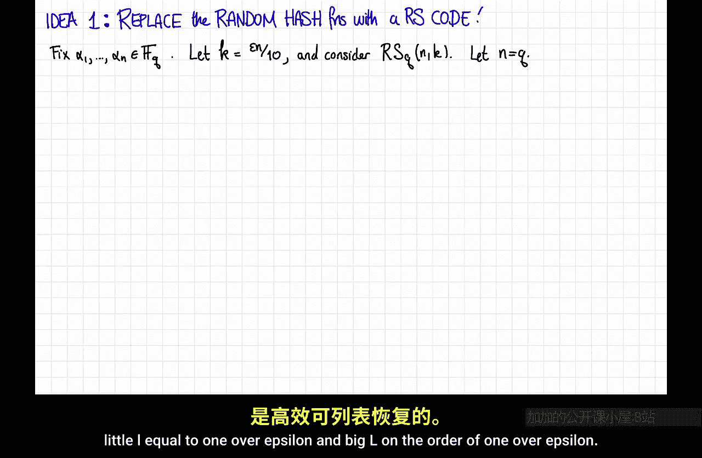

接下来，我们将看到两种利用列表恢复来改善这个问题的方法。第一种方法还会得到一个确定性的构造，这非常巧妙。

以下是第一种方法。我们将使用与Count-Min Sketch完全相同的数据结构，但用里德-所罗门码替代随机哈希函数。更精确地说，我们在域F_q中固定一些不同的评估点α_1到α_n。

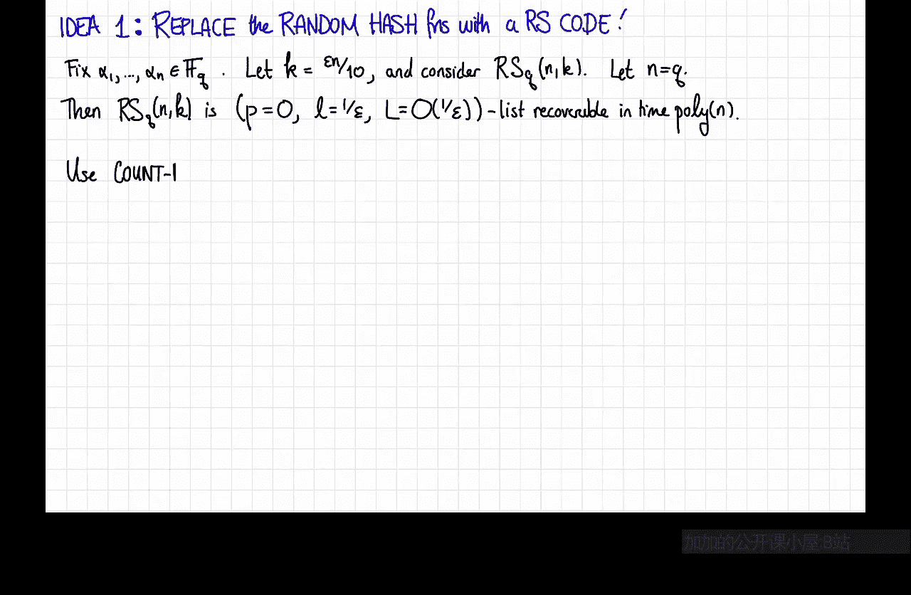

现在考虑一个码率约为ε/10的里德-所罗门码，其中ε是频繁项问题定义中的参数。同时，我们设n等于q，这样就得到了一个全长的里德-所罗门码。

回顾之前证明的关于里德-所罗门码列表恢复的定理，我们可以发现这个里德-所罗门码是高效列表可恢复的，其参数为：p=0，l=1/ε，L的数量级为O(1/ε)。具体来说，我们有以下推论：

**推论**：对于一个码率为R的RS码，若满足 l ≤ 1/(1-R-γ)，则该码是 (ζ, l, L)-列表可恢复的，其中 L = O(l/γ)。将 l 设为 1/ε，γ 设为 1，即可得到上述结论。

这里的常数10并非特定值，只是一个调整因子，用于确保计算中的取整等操作不会出错。

这样，我们就得到了列表可恢复的里德-所罗门码。现在，我们将实施Count-Min Sketch算法，但使用这个RS码代替哈希函数。具体做法如下：

首先，我们将全集U中的每个对象与一个次数小于等于k-1的多项式相关联。这意味着U的大小是 q^k，即大约 q^(εn/10)。因此，n最多是 log(|U|) / ε。特别地，如果我们的操作时间是n的多项式，那也就是|U|的多项式对数时间，这对我们是有利的。

接下来，我们用多项式在特定评估点的取值来替代Count-Min Sketch中的随机哈希函数。具体地，我们定义哈希函数 h_j(f) = f(α_j)，其中f是代表全集某项的多项式，j从1到n。

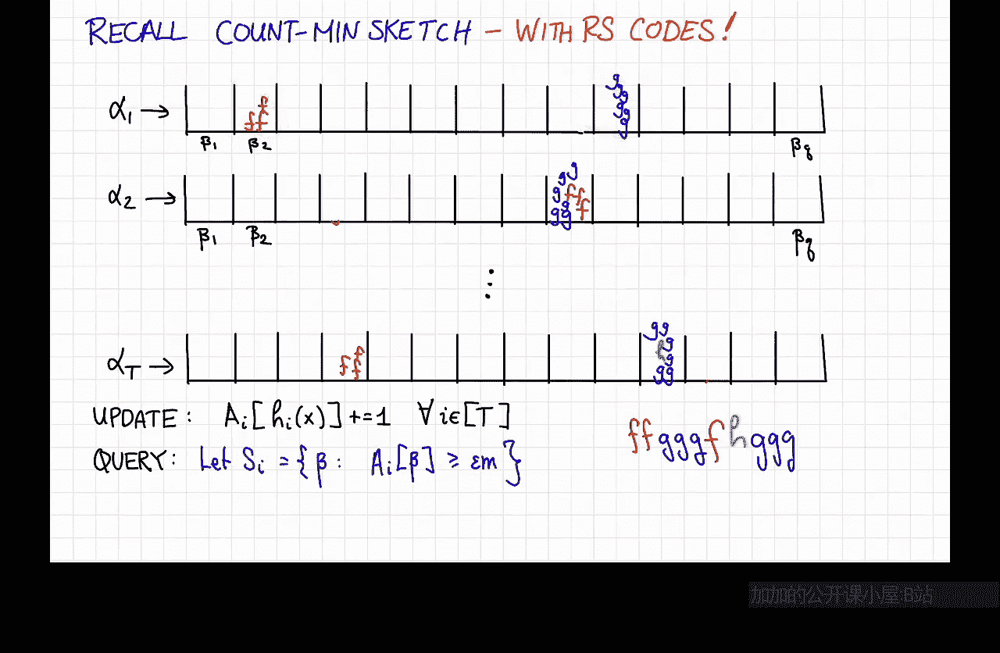

于是，数据结构变成了：有n个数组（T=n），每个数组对应一个评估点α_j。每个数组有q个桶，对应域F_q中的值β_1到β_q。

当处理输入流中的一系列项（例如多项式f出现多次，然后是多项式g，再是f，接着是h，一堆g等等）时，对于每个项（如f），我们计算它在所有评估点的值。假设 f(α_1) = β_2，我们就在第一个数组的β_2桶中为f增加计数。f(α_2)可能是另一个β值，我们就在对应数组的对应桶中增加计数。我们对流中的所有项都如此处理，最终得到所有桶的计数器。

现在，我们不使用原来缓慢的查询算法。取而代之的是，我们将运行一个列表恢复算法。具体来说，对于第i个数组，我们定义集合S_i，包含所有满足以下条件的β值：对应桶的计数器值大于εm（m是流的总长度）。这样，S_i最多包含1/ε个元素，因为否则整个数组中的总项数就会超过m。

**关键观察**：如果某个多项式g是频繁项（即在流中出现至少εm次），那么在每个数组中，g(α_i)对应的桶的计数至少为εm。这意味着对于所有i，g(α_i)都会出现在集合S_i中。而这正是里德-所罗门码列表恢复算法要解决的问题：给定输入列表S_i，算法返回所有满足“对于所有i，g(α_i) ∈ S_i”的低次数多项式g。因此，算法将返回g以及任何其他频繁项。

总结这个应用：
*   **更新操作**：与之前相同。
*   **查询操作**：运行列表恢复算法。
由于S_i的大小不超过1/ε，而我们恰好设置了参数l=1/ε，因此算法可行，并保证返回的列表大小不超过O(1/ε)。虽然最初定义频繁项问题时要求返回最多2/ε个项，但这里的数量级是相近的。精确计算参数是一个很好的练习。

最重要的是，所有操作（存储、运行时间等）都是n的多项式，而n是log(|U|)/ε，因此也就是|U|的多项式对数时间。在这个意义上，我们取得了成功。如果仔细计算参数，会发现这个方案比原始Count-Min Sketch的参数稍差一些，但我们获得了两个好处：第一，这是一个确定性方案而非随机化方案；第二，我们有一个高效的（即多项式时间）查询算法来找出所有频繁项。

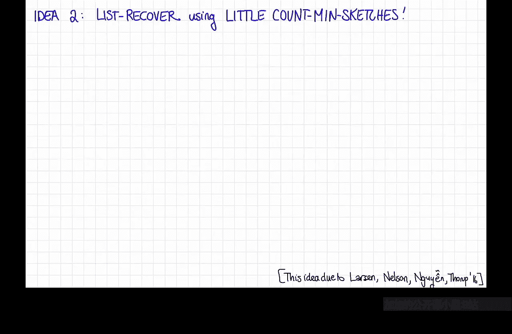

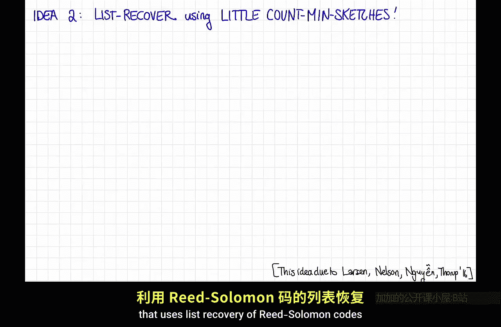

## 应用二：使用多个小型Count-Min Sketch

接下来是第二个想法，它同样利用里德-所罗门码的列表恢复来加速Count-Min Sketch的查询时间，但思路不同。

我们重新开始。首先，我们选择一个列表可恢复的里德-所罗门码，其参数为：l=2/ε，L=O(1/ε)，p=0（实际上，为了严谨，p应设为一个小的常数，但大体思路不变）。和之前一样，我们将全集与所有次数≤k-1的多项式集合相关联。

现在，我们将使用一个不同的数据结构：不是单个Count-Min Sketch，而是一组小型的Count-Min Sketch。我们将初始化n个小型的Count-Min Sketch。这里说“小型”，是指它们用于一个更小的全集，即域F_q。

和之前一样，我们设q等于n，而n是O(log(N)/ε)，其中N是原始全集的大小。这意味着每个小型Count-Min Sketch的全集大小仅为原始全集大小的对数级别。因此，即使使用像暴力遍历整个小全集这样的“慢”算法，也能在log(N)的多项式时间内快速完成查询。

接下来，我们将使用列表恢复来将这些具有快速查询能力的小型结构“组合”成一个处理大全集的结构。具体方法如下：

**更新操作**：假设我们有一个来自大全集的项f，需要更新我们的数据结构。
1.  首先，我们用里德-所罗门码对f进行编码，即计算f在所有评估点上的值：f(α_1), ..., f(α_n)。
2.  然后，我们用这些值去更新每一个小型的Count-Min Sketch：用f(α_1)更新第一个，用f(α_2)更新第二个，依此类推。

**查询操作**：
1.  我们让每个小型Count-Min Sketch运行它们自己的查询算法。因为它们很小，所以可以在多项式时间内完成。
2.  每个小型结构会输出一个列表，我们将其命名为S_1到S_n。
3.  最后，我们的查询算法就是：对这些列表S_i运行列表恢复算法。

**直观理解**：如果多项式f是一个频繁项，那么f(α_1)会在第一个坐标上频繁出现。虽然其他多项式g也可能在α_1处与f取值相同，但f(α_1)肯定会出现很多次。因此，我们希望第一个小型Count-Min Sketch能捕捉到这一点，使f(α_1)出现在S_1中。同理，对于其他评估点也是如此。最终，如果f是频繁项，那么对于所有i，f(α_i)都会出现在许多S_i列表中。而这正是列表恢复要解决的问题。

每个列表S_i的大小，根据Count-Min Sketch的保证，不超过2/ε，这恰好是我们之前设置参数l时的值。因此，一切都能配合工作。

同样，为了精确，需要考虑p不为0的情况，并调整其他小常数，但整体框架不变。q和n仍然是log(N)级别，所有操作都是其多项式时间。

这个想法确实可行，并提供了一个快速的查询算法。再次说明，本节不详细计算参数，有兴趣可以自行练习。结果表明，与原始Count-Min Sketch相比，我们确实需要付出一些代价：空间占用会稍多一些，更新时间也会稍长。然而，查询时间却快得多。原因在于，查询时只需要运行每个小型结构的查询算法（因为它们很小，所以很快），然后再运行列表恢复算法（该算法运行时间是n的多项式，即N的多项式对数时间）。最终，我们实现了亚线性的空间和亚线性的查询时间。

需要注意的是，这个算法仍然是随机化的，因为其基础构件（小型Count-Min Sketch）是随机化的。

## 总结与课程回顾

本节课中我们一起学习了列表恢复在频繁项问题上的两种应用。

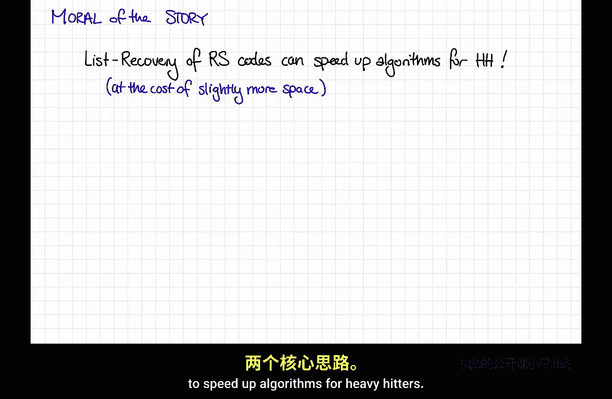

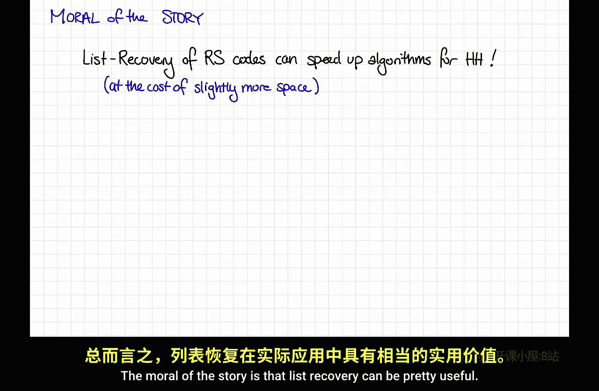

这两种利用列表恢复加速频繁项算法的方法，其核心思想是：列表恢复可以成为一个非常有用的工具。在这个具体情境中，它允许我们加速Count-Min Sketch的查询算法，代价是增加了少量空间和稍慢的更新操作。

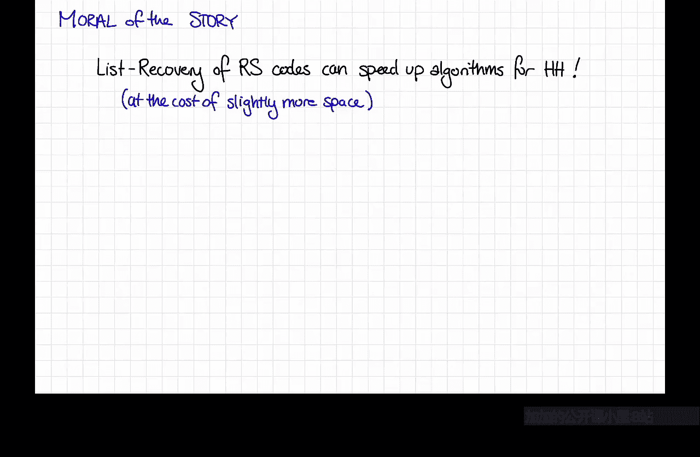

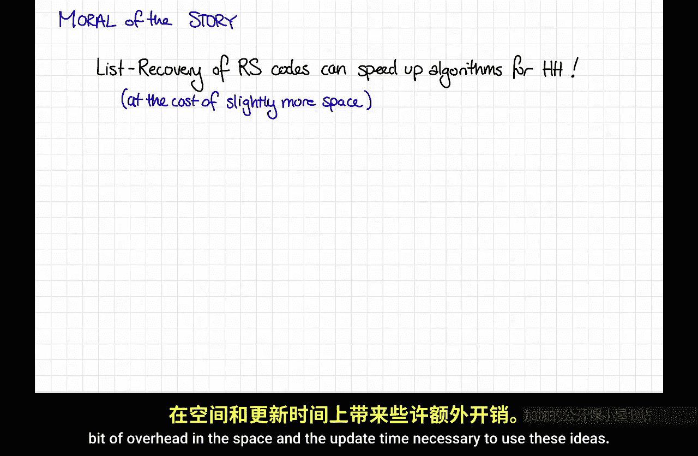

虽然本节没有详细计算具体参数，但需要指出，为了应用这些想法，在空间和更新时间上确实存在一些开销。实际上，在频繁项问题领域，存在一些比这些方法更优的前沿工作，并不依赖于列表恢复。然而，本节介绍的方法非常巧妙，并且很好地展示了列表恢复如何成为算法设计中的一个强大工具。

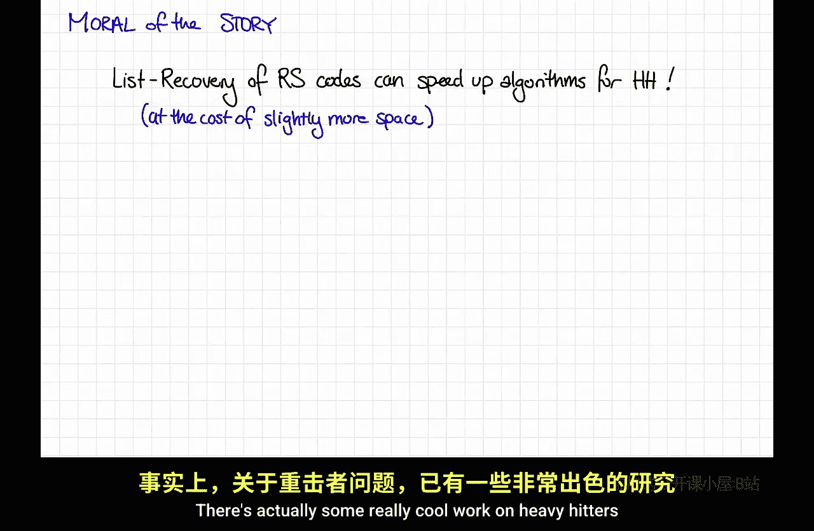

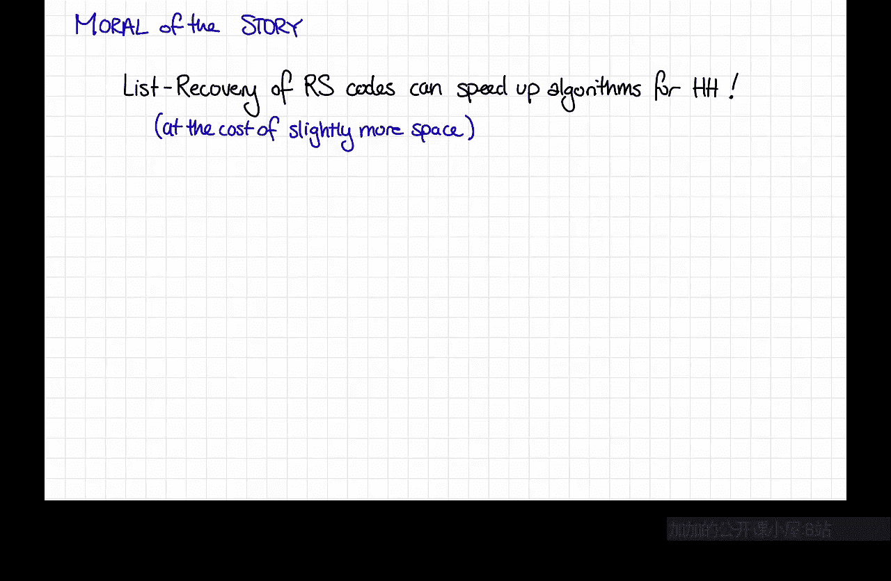

列表恢复的故事告诉我们，编码理论中的思想可以灵活地应用于计算机科学的其他领域，解决实际问题。