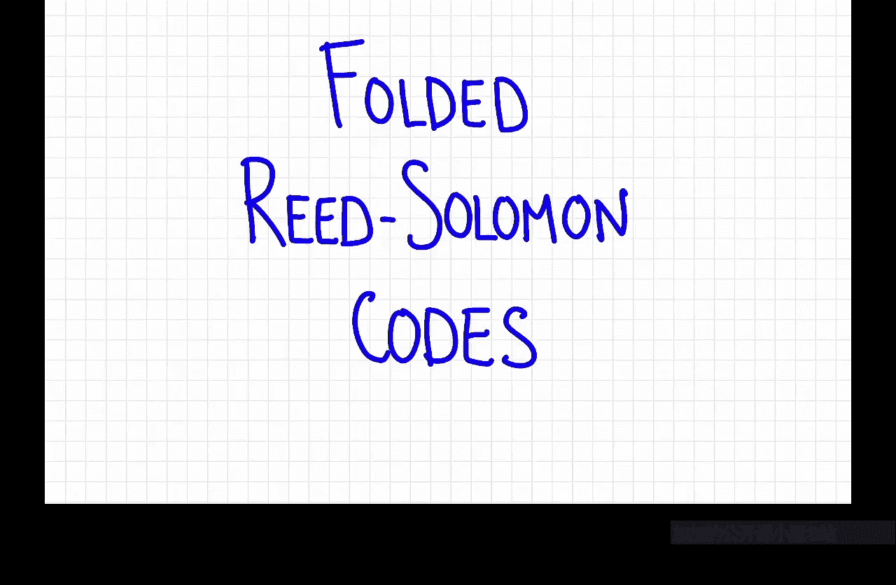
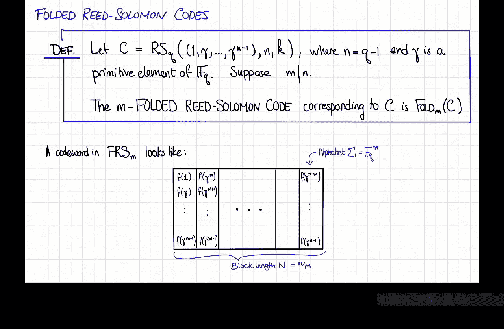
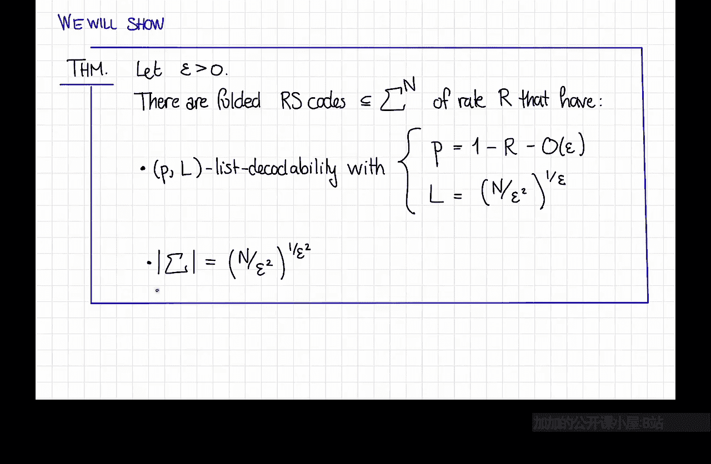
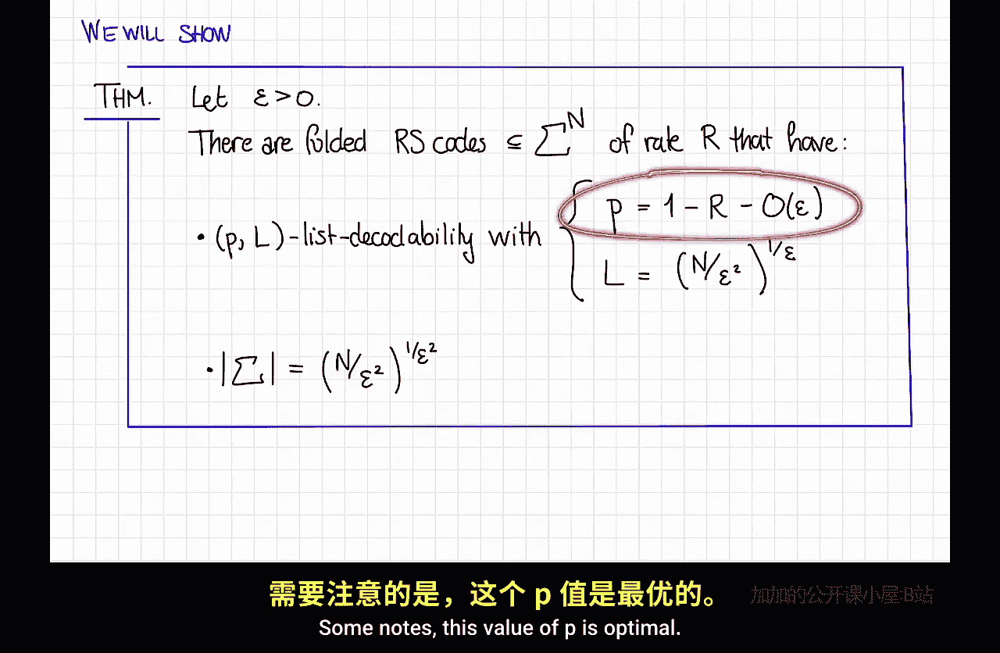
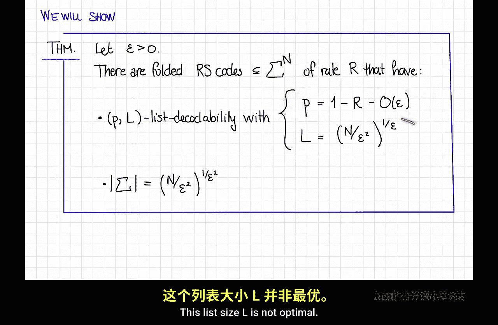
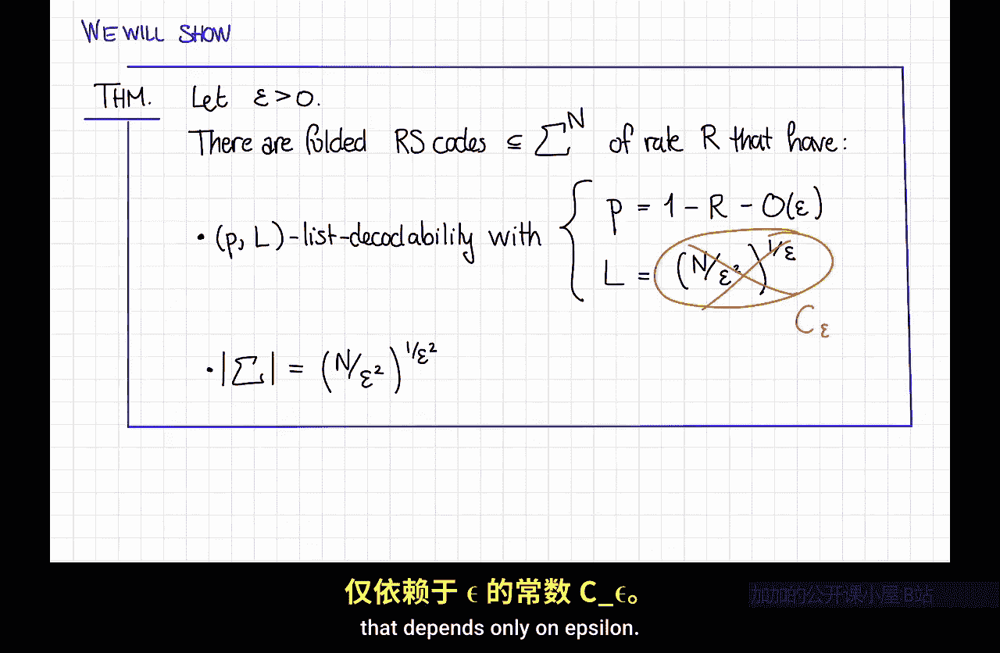
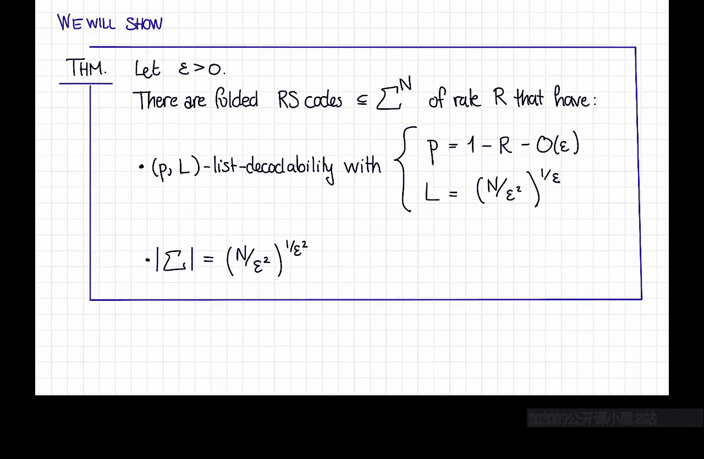

# 斯坦福大学【中英⚡代数编码导论｜Introduction to Algebraic Coding Theory】 p44 p43 13, Video 1： Folded Reed-Solomon Codes -BV16sRYYTEwg_p44-

In this video， we'll introduce folded Read Solomon codes。

 a variant on Read Solomon codes that will be able to efficiently list a code all the way up to list decoding capacity。

Let's recall the story so far， at least for list codingding。For codes of rate capital R。

 let's consider what fraction of errors P we can correct either with unique decoding or list decoding。

 So here's sort of a scale for P going all the way from 0 to 1。

We know that up to a1 minus r over two fraction of errors。

 we can uniquely decode read Solomon codes efficiently。For example。

 the Welds Sper camp algorithm did that。However， once we get beyond half the distance。

 unique decoding is impossible， and so we resort to list decoding。In a previous video。

 we saw that we can efficiently list a code， read Solomon codes using the Gar Sammi Sudan algorithm all the way up to the Johnson bound。

 So that's P equals 1 minus the square root of the rate。However。

 we saw that the list decoding capacity theorem said that in theory。

 there exist codes that can be list decod all the way up to P equal to1 minus R。However。

 that result was non constructive and it did not come with efficient algorithms。

Beyond P equals 1 minus R， the list decoding capacity theorem also said that there is no code that is listed decodable up to radius P unless we're going to have exponential list sizes。

Looking at this picture， the big gap seems to appear here。

We know that there are exist codes that are list decodable up to RaI P in this range。

 but we don't know explicit constructions of them and we don't know how to do it algorithmically。

 at least we don't so far in this class。What we're going to do in these videos is fill in that gap。

 So we'll figure out how to get explicit constructions of codes that can be list decodable for P in this range all the way up to list de codingding capacity of 1 minus R。

 And we're going to do it with efficient algorithms。

And these codes are going to be called folded read sallomon codes。In the rest of this video。

 we'll define Fedread Solomon codes， and in the subsequent videos。

 we will see how to list tocode them up to radius P up to 1 minus R efficiently。

In order to define folded read Solomon codes， we first need to define the folding operation。

So this is an operation that we can do to any code， and here's what it looks like。

So for some vector C in sigma to the N， define the M Y's fold of C。

 which I'm going to denote as fold sub M of C as follows。

So folds sub M of C is going to be a vector in sigma to the M to the n over M。

 Let's assume for now that M divides n。And the way we do it is we just sort of fold together the symbols in chunks of M。

 So if we start with a vector C that looks like this。 So it's C not， C 1， C2， do dot up to C n， -1。

 So a vector of length n。We're going to take the first M symbols and say， okay。

 that's a symbol now and we will group all of those together。And that'll be one big symbol。

 and the next symbol will be the next M symbols and so on。So after we fold。

 we're just going to rearrange the symbols in this vector to get a vector that looks like this。

Where the first entry is now a little vector of length M。

 The second entry is now a little vector of length M， and so on。

So we haven't really changed the coordinates of this vector。 We've just packaged them differently。

Now that we know how to fold a vector， we can define a folded code if we have a code C。

Subset of sigma to the N。 We can define the M Y's fold of C to just be the fold of every code word in C。

 So we take every single code word in C。 We fold it。 And that's what we get。

Let's make some observations。First， the alphabet of the M's fold of C is sigma to the M。

And the block length is n divided by M。I'm going to use capital N to denote the block length of a folded code so that we can reserve little n for the block length of the original code。

So when we pass from the original code to the folded code。

 we increase the alphabet size and decrease the block length。

Another observation is that folding does not change the rate of the code。Intuitively。

 the reason is that we haven't really changed how much information we're sending。

 We were just packaging it differently。If you want to see that formally。

 we can work out the rate from the definition。The rate of the folded code is the log base size of the alphabet。

 That's Q to the M。Of the size of C。Divided by the block length， which is n divided by M。

And when you write out what it means to have the log base something and move all the logs around。

 you get that this is equal。To log base Q of the size of C divided by n。And this， by definition。

 is just the rate of the original code C。Okay， so that's how we define a folded code。Unsurprisingly。

 a folded read Solomon code is what happens when we do this operation to a read Solomon code。

Formerly， here's the definition。 So let's C be a read Solomon code with evaluation points，1 gamma。

 gamma square dotta dot up to gamma to the n -1， where gamma is a primitive element of F Q and n is equal to  Q -1。

So C has block length n and dimension K。And let's suppose that M divides n。

Then the M folded read Solomon code corresponding to this original read Solomon code C is just the M's fold of C。

In other words， a code word in the M folded read Solomon code。

 which I'm going to abbreviate as F R S for folded Read Solomon looks like this。

So the block length is capital N， which is little N divided by M。And the alphabet is F Q to the M。

 The first symbol is just going to be the little vector。 F of 1 F of gamma， F of gamma squared。

 dotta dot up through F of gamma to the M -1。 The second symbol is the little vector F of gamma to the M。

 F of gamma to the M plus1， dotta dot up to F of gamma to the two M -1 and so on。

And then the last symbol contains the last M evaluation points。As we observed earlier。

 the rate of this code is just going to be k divided by n because that was the rate of the original read salmon code。

Okay， so that's a folded read Solomon code。 It doesn't seem that different than a read Solomon code。

 but as we'll see， we'll actually be able to get efficient list decoding algorithms all the way up to capacity。

Intuitively， by making the alphabet size larger， we're making the list decoding problem a little bit easier。

More formally， we're going to show the following theorem。Let epsilon be some constant。

 greater than 0。Then there are folded read Solomon codes in an alphabet sigma。

 so that is sigma equals Fq to the M for some  Q and some M and block length capital N。

So capital n is equal to little n divided by little M。

So that these codes have rate R and so that they are first P comma L list decodable with P very close to capacity。

 that as p is equal to1 minus the rate minus sum o of epsilon term。And with list size capital L。

 polynomial in n， assuming that epsilon is a constant。Moreover。

 we don't have to take the folding parameter to be too too large， if we made it really， really large。

 then the alphabet size would be ginormous。But we're able to take it so that the alphabet size is well still pretty big。

 but again， still polynomial in the block length capital N。

Assuming that epsilon is a constant。Some notes。This value of P。Is optimal。

 It approaches the list decoding capacity theorem that says that P cannot be larger than 1 minus R if we're going to hope for non trivial list decoding。

This list size L is not optimal， ideally， we'd hope for it to be a constant that depends only on epsilon。

 and really ideally maybe we'd hope for it to be like one of Epsilon。

 which is what we got for a completely random code。

And instead， it's polynomial in N。It turns out that folded read Solomon codes do have a list size that does not depend on N。

 That is， we can replace this expression here。With some constant c of epsilon。

 that depends only on epsilon。

But I'm not gonna to talk about that in these videos。So what we're going to show in these videos。

Is that result there？This alphabet size is also not optimal。 Idely， we'd like it to be some constant。

 depending only on epsilon， but it's good enough for us to establish this nice story that fills in this gap here and allows us to list a code folded read Solomon codes all the way up to radius P efficiently。

In the next few videos， we will prove this theorem。

