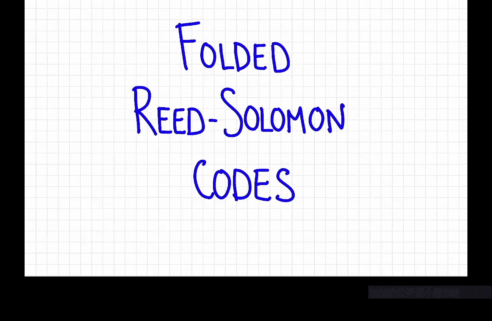
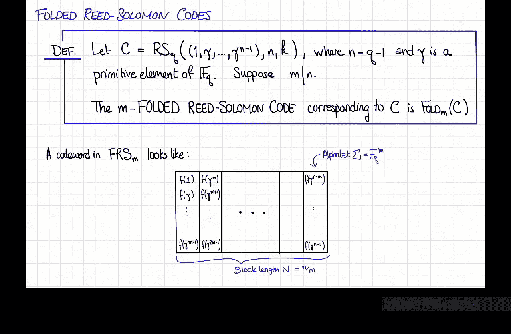
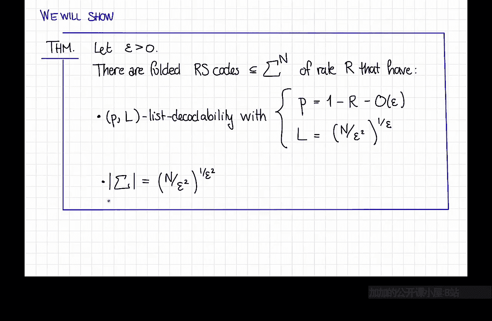
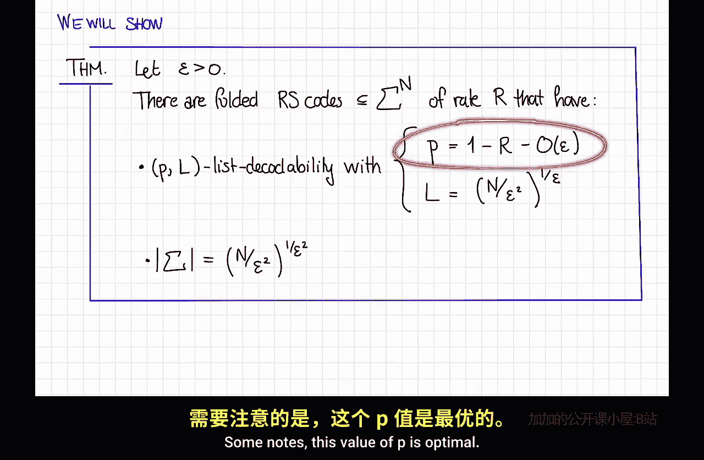
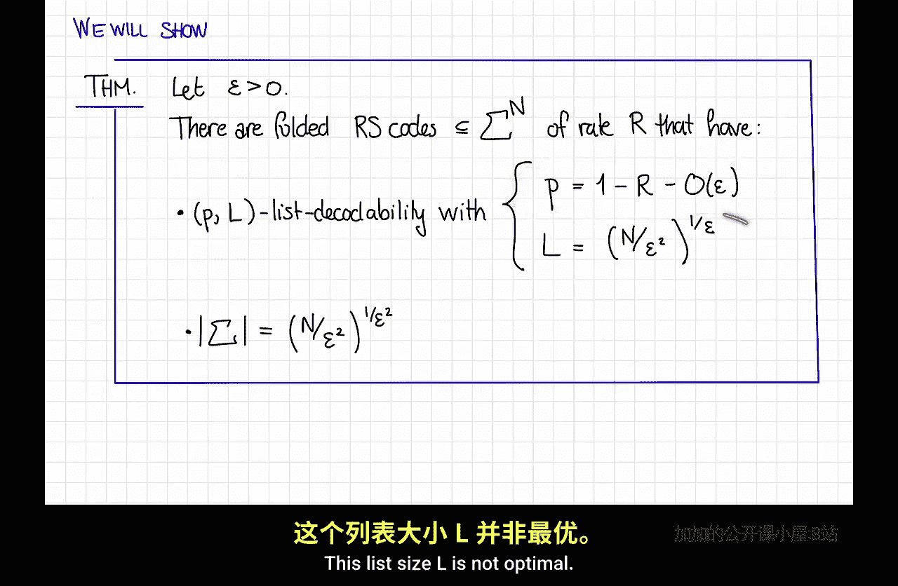
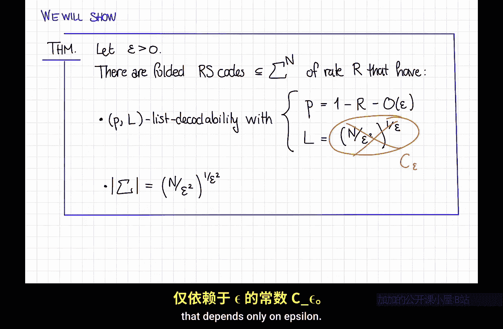
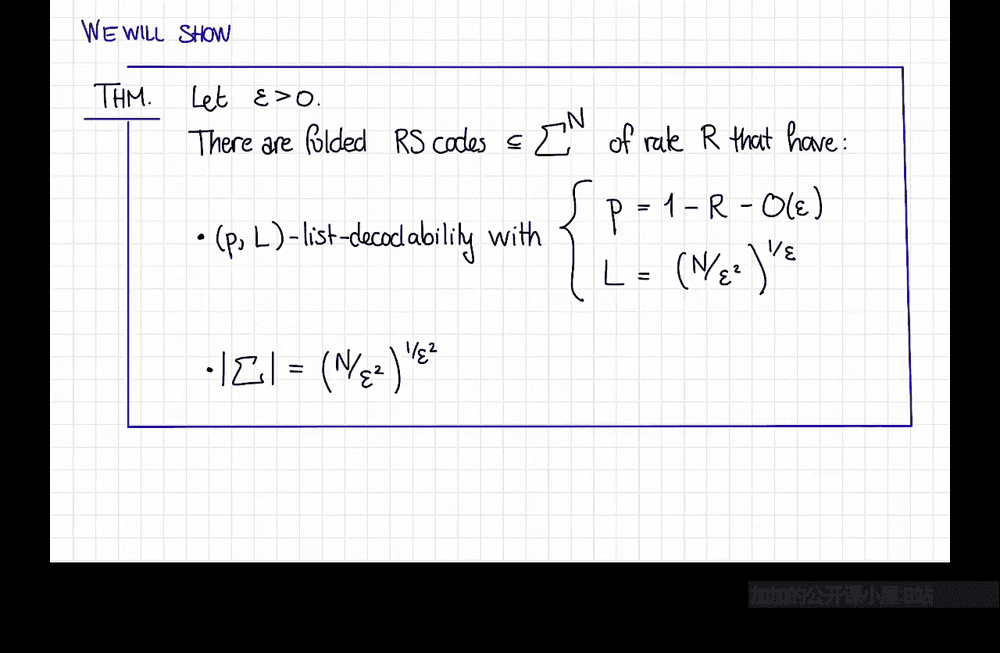

# 代数编码导论：13：折叠里德-所罗门码




在本节课中，我们将介绍折叠里德-所罗门码。这是一种里德-所罗门码的变体，能够高效地进行列表译码，直至达到列表译码容量。

## 概述

首先，让我们回顾一下列表译码的背景。对于一个码率为 **R** 的码，我们考虑在唯一译码和列表译码下，分别能纠正多大的错误比例 **P**。

**P** 的取值范围是从 0 到 1。我们知道，对于错误比例 **P ≤ (1 - R)/2**，可以高效地对里德-所罗门码进行唯一译码。然而，一旦超过这个界限，唯一译码就变得不可能，我们必须转向列表译码。

在之前的课程中，我们了解到可以使用 Guruswami-Sudan 算法高效地对里德-所罗门码进行列表译码，直至达到约翰逊界，即 **P = 1 - √R**。然而，列表译码容量定理指出，理论上存在可以列表译码至 **P = 1 - R** 的码。这个结果是存在性的，并未提供高效的构造算法。

在 **P = 1 - √R** 到 **P = 1 - R** 这个区间内，存在一个理论可行但缺乏显式构造和高效算法的空白。本课程的目标就是填补这个空白。我们将展示如何显式构造一种码，并给出高效算法，使其能够列表译码至接近容量 **1 - R** 的错误比例 **P**。这种码就是折叠里德-所罗门码。

在本节视频中，我们将定义折叠里德-所罗门码。在后续课程中，我们将学习如何高效地对其进行列表译码。

## 折叠操作

为了定义折叠里德-所罗门码，我们首先需要定义折叠操作。这是一个可以应用于任何码的操作。

对于一个向量 **c ∈ Σ^n**，我们定义其 **M** 次折叠，记作 **fold_M(c)**，如下所示：

**fold_M(c)** 将是一个属于 **(Σ^M)^(n/M)** 的向量（这里假设 **M** 整除 **n**）。操作方式是将符号按 **M** 个一组进行“折叠”打包。

具体来说，如果原始向量 **c** 是：
```
c = (c₀, c₁, c₂, ..., c_{n-1})
```
那么经过 **M** 次折叠后，我们得到的新向量是：
```
fold_M(c) = ( (c₀, c₁, ..., c_{M-1}), (c_M, c_{M+1}, ..., c_{2M-1}), ..., (c_{n-M}, ..., c_{n-1}) )
```
我们没有改变向量的坐标内容，只是改变了它们的打包方式。

## 折叠码的定义

现在，对于一个码 **C ⊆ Σ^n**，我们可以定义其 **M** 次折叠码，即 **C** 中所有码字的折叠结果的集合：
```
fold_M(C) = { fold_M(c) | c ∈ C }
```

以下是关于折叠码的一些观察：
*   折叠码的字母表是 **Σ^M**。
*   折叠码的码长是 **N = n / M**（我们用大写 **N** 表示折叠码的码长，保留小写 **n** 给原始码）。
*   折叠操作不改变码率。直观上，这是因为我们没有改变传输的信息量，只是改变了打包方式。形式上可以证明：
    ```
    Rate(fold_M(C)) = (log_{|Σ^M|} |C|) / (n/M) = (log_{|Σ|} |C|) / n = Rate(C)
    ```

## 折叠里德-所罗门码的定义

顾名思义，折叠里德-所罗门码就是将折叠操作应用于里德-所罗门码的结果。

正式定义如下：设 **C** 是一个里德-所罗门码，其定义在有限域 **F_q** 上，码长为 **n = q-1**，维度为 **k**，其估值点为 **1, γ, γ², ..., γ^{n-1}**，其中 **γ** 是 **F_q** 的一个本原元。假设 **M** 整除 **n**。

那么，对应于原始里德-所罗门码 **C** 的 **M** 次折叠里德-所罗门码（缩写为 **FRS**）就是 **C** 的 **M** 次折叠：
```
FRS = fold_M(C)
```

换句话说，一个折叠里德-所罗门码的码字（对应一个次数小于 **k** 的多项式 **f**）如下所示：
*   码长：**N = n / M**
*   字母表：**F_q^M**
*   第 **i** 个符号（**i = 0, ..., N-1**）是一个长度为 **M** 的向量：
    ```
    ( f(γ^{iM}), f(γ^{iM+1}), ..., f(γ^{iM+M-1}) )
    ```

如前所述，这个码的码率仍然是 **R = k / n**。折叠里德-所罗门码看起来与标准里德-所罗门码区别不大，但正如我们将要看到的，我们将能够为其设计出高效、直至达到容量的列表译码算法。直观上，通过增大字母表，我们使得列表译码问题变得稍微容易了一些。

## 主要定理

更正式地，我们将证明以下定理：




设 **ε** 为某个大于 0 的常数。那么存在折叠里德-所罗门码，其字母表 **Σ = F_q^M**（对于某个 **q** 和 **M**），码长 **N**，码率 **R**，使得该码是 **(P, L)** 列表可译码的，其中：
*   **P = 1 - R - O(ε)**，非常接近列表译码容量。
*   列表大小 **L** 是 **n** 的多项式（假设 **ε** 是常数）。

此外，我们不需要将折叠参数 **M** 取得非常大（否则字母表会过于巨大）。我们可以选择 **M**，使得字母表大小仍然是码长 **N** 的多项式（假设 **ε** 是常数）。






关于此定理的一些说明：
1.  **P** 的值是最优的。它趋近于列表译码容量定理指出的上限 **1 - R**。
    
2.  列表大小 **L** 并非最优。理想情况下，我们希望它只是一个依赖于 **ε** 的常数。实际上，折叠里德-所罗门码确实可以达到不依赖于 **N** 的常数列表大小，即 **L = C(ε)**，但这超出了本系列视频的讨论范围。
    
    
3.  字母表大小也非最优。理想情况下，我们希望它也是仅依赖于 **ε** 的常数。但当前的结果已经足够好，它填补了我们之前提到的理论空白，使我们能够高效地将折叠里德-所罗门码列表译码至接近容量 **1 - R** 的错误比例 **P**。


在接下来的几节课中，我们将证明这个定理。




## 总结


本节课我们一起学习了折叠里德-所罗门码。我们首先定义了通用的折叠操作以及折叠码，然后将其应用于里德-所罗门码，得到了折叠里德-所罗门码。最后，我们陈述了关于折叠里德-所罗门码可以达到列表译码容量的主要定理。在后续课程中，我们将深入探讨如何实现这一高效译码算法。